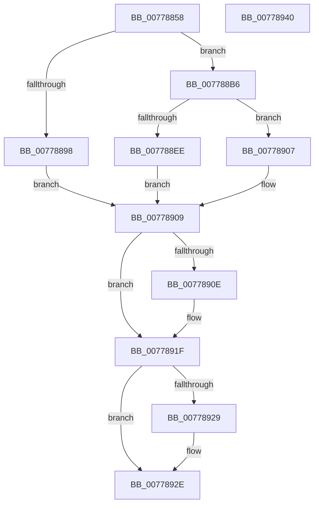

# TtmpDispatchCreateTerminal

- RVA: `0x00778858`–`0x00778941` (길이 `233` bytes)
- VA: `0x0000000140778858`
- 실행 섹션: `PAGE`
- PDB 이름 있음: `예`; PDB Function 태그: `아니요`
- unwind 정보 RVA: `0x000CDCDC`
- 디코드: `62`개 명령, `233/233` bytes 표시
- 미해석 바이트: `0` (있으면 어셈블리에 `.byte`로 보존)

> 이 문서는 커널 이미지의 기계어와 PDB 기호를 분석해 생성했습니다. 4번과 5번은 함수 원형과 자료형을 바이너리 사용 방식에서 추정한 C 해석이며 원본 소스 복구 결과는 아닙니다.

## 1. Dependencies

- 직접 호출 지점: **7**; 고유 호출 대상: **6**
- 직접 호출자로 확인된 함수: **1**
- RIP 상대 이미지 참조: **2**

### Outgoing calls
- `0x0077888D` → [TtmpAcquireSessionFromTerminalHandle](TtmpAcquireSessionFromTerminalHandle_function_00778544.md) (function, `0x00778544`)
- `0x007788AA` → [TtmiLogError](../98/TtmiLogError_function_0098B39C.md) (function, `0x0098B39C`)
- `0x007788E3` → [TtmiCreateTerminal](TtmiCreateTerminal_function_0077C748.md) (function, `0x0077C748`)
- `0x00778900` → [TtmiLogError](../98/TtmiLogError_function_0098B39C.md) (function, `0x0098B39C`)
- `0x00778915` → [ExReleaseResourceLite](../../text/25/ExReleaseResourceLite_function_0025FA10.md) (function, `0x0025FA10`)
- `0x0077891A` → [KeLeaveCriticalRegion](../../text/25/KeLeaveCriticalRegion_function_0025D8B0.md) (function, `0x0025D8B0`)
- `0x00778929` → [ObfDereferenceObject](../../text/2F/ObfDereferenceObject_function_002F9350.md) (function, `0x002F9350`)

### Direct callers
- [TtmDispatchApi](../98/TtmDispatchApi_function_0098AD08.md) at `0x0098AEAC`

### Static image references
- `0x0077889B` → RVA `0x00B04560` (` ?? ::NNGAKEGL::`string'`; read)
- `0x0077890E` → RVA `0x00F06940` (`.data`; read)

## 2. Other-region calls and transfers

- 다른 실행 섹션으로 향하는 call: **3**
  - `0x00778915` → [ExReleaseResourceLite](../../text/25/ExReleaseResourceLite_function_0025FA10.md) (`PAGE` → `.text`)
  - `0x0077891A` → [KeLeaveCriticalRegion](../../text/25/KeLeaveCriticalRegion_function_0025D8B0.md) (`PAGE` → `.text`)
  - `0x00778929` → [ObfDereferenceObject](../../text/2F/ObfDereferenceObject_function_002F9350.md) (`PAGE` → `.text`)
- 별도 외부 분기/꼬리 이동을 확인하지 못했습니다.

## 3. Assembly (complete function range)

```asm
00778858  4C 8B DC                        mov r11, rsp
0077885B  49 89 5B 10                     mov qword ptr [r11 + 0x10], rbx
0077885F  49 89 73 20                     mov qword ptr [r11 + 0x20], rsi
00778863  57                              push rdi
00778864  48 83 EC 30                     sub rsp, 0x30
00778868  49 83 63 08 00                  and qword ptr [r11 + 8], 0
0077886D  49 8D 43 18                     lea rax, [r11 + 0x18]
00778871  49 83 63 18 00                  and qword ptr [r11 + 0x18], 0
00778876  4D 8D 4B 08                     lea r9, [r11 + 8]
0077887A  48 8B F2                        mov rsi, rdx
0077887D  49 89 43 E8                     mov qword ptr [r11 - 0x18], rax
00778881  48 8B F9                        mov rdi, rcx
00778884  B2 01                           mov dl, 1
00778886  48 8B 49 10                     mov rcx, qword ptr [rcx + 0x10]
0077888A  45 33 C0                        xor r8d, r8d
0077888D  E8 B2 FC FF FF                  call 0x140778544
00778892  8B D8                           mov ebx, eax
00778894  85 C0                           test eax, eax
00778896  79 1E                           jns 0x1407788b6
00778898  44 8B C8                        mov r9d, eax
0077889B  48 8D 0D BE BC 38 00            lea rcx, [rip + 0x38bcbe]
007788A2  44 8B C0                        mov r8d, eax
007788A5  BA E3 00 00 00                  mov edx, 0xe3
007788AA  E8 ED 2A 21 00                  call 0x14098b39c
007788AF  48 8B 7C 24 40                  mov rdi, qword ptr [rsp + 0x40]
007788B4  EB 53                           jmp 0x140778909
007788B6  65 48 8B 04 25 88 01 00 00      mov rax, qword ptr gs:[0x188]
007788BF  4C 8B CE                        mov r9, rsi
007788C2  8B 57 08                        mov edx, dword ptr [rdi + 8]
007788C5  48 8B 7C 24 40                  mov rdi, qword ptr [rsp + 0x40]
007788CA  48 83 64 24 28 00               and qword ptr [rsp + 0x28], 0
007788D0  48 8B CF                        mov rcx, rdi
007788D3  44 8A 80 32 02 00 00            mov r8b, byte ptr [rax + 0x232]
007788DA  48 8D 46 08                     lea rax, [rsi + 8]
007788DE  48 89 44 24 20                  mov qword ptr [rsp + 0x20], rax
007788E3  E8 60 3E 00 00                  call 0x14077c748
007788E8  8B D8                           mov ebx, eax
007788EA  85 C0                           test eax, eax
007788EC  79 19                           jns 0x140778907
007788EE  44 8B C8                        mov r9d, eax
007788F1  48 8D 0D 68 BC 38 00            lea rcx, [rip + 0x38bc68]
007788F8  44 8B C0                        mov r8d, eax
007788FB  BA EF 00 00 00                  mov edx, 0xef
00778900  E8 97 2A 21 00                  call 0x14098b39c
00778905  EB 02                           jmp 0x140778909
00778907  33 DB                           xor ebx, ebx
00778909  48 85 FF                        test rdi, rdi
0077890C  74 11                           je 0x14077891f
0077890E  48 8D 0D 2B E0 78 00            lea rcx, [rip + 0x78e02b]
00778915  E8 F6 70 AE FF                  call 0x14025fa10
0077891A  E8 91 4F AE FF                  call 0x14025d8b0
0077891F  48 8B 4C 24 50                  mov rcx, qword ptr [rsp + 0x50]
00778924  48 85 C9                        test rcx, rcx
00778927  74 05                           je 0x14077892e
00778929  E8 22 0A B8 FF                  call 0x1402f9350
0077892E  48 8B 74 24 58                  mov rsi, qword ptr [rsp + 0x58]
00778933  8B C3                           mov eax, ebx
00778935  48 8B 5C 24 48                  mov rbx, qword ptr [rsp + 0x48]
0077893A  48 83 C4 30                     add rsp, 0x30
0077893E  5F                              pop rdi
0077893F  C3                              ret
00778940  CC                              int3
```

## 4. C-style interpretation (structured pseudocode)

```c
__int64 __fastcall TtmpDispatchCreateTerminal(__int64 a1, __int64 a2, int a3)
{
    __int64 result;
    __int64 v_rbx;
    __int64 v_rsp;
    unsigned __int64 v_stack_m10;
    unsigned __int64 v_stack_m18;
    unsigned __int64 v_stack_p10;
    unsigned __int64 v_stack_p18;
    unsigned __int64 v_stack_p20;
    unsigned __int64 v_stack_p8;

    *(unsigned __int64 *)(v_rsp + 16) = v_rbx;
    *(unsigned __int64 *)(v_rsp + 32) = v_rsi;
    v_rsp = (v_rsp) - (48);
    *(unsigned __int64 *)(v_rsp - 24) = v_rsp + 24;
    a3 = 0;
    result = TtmpAcquireSessionFromTerminalHandle(*(unsigned __int64 *)(a1 + 16), 1, a3, v_rsp + 8);
    if (!sign_flag) goto loc_007788B6;
    result = TtmiLogError(v_rip + 3718334, 227, (unsigned int)((unsigned int)(result)), (unsigned int)((unsigned int)(result)));
    goto loc_00778909;
loc_007788B6:
    v_stack_m18 = a2 + 8;
    result = TtmiCreateTerminal(v_stack_p8, (unsigned int)(*(unsigned int *)(v_stack_p8 + 8)), *(unsigned __int8 *)(*(unsigned __int64 *)(gs_base + (0 + 392)) + 562), a2);
    if (!sign_flag) goto loc_00778907;
    result = TtmiLogError(v_rip + 3718248, 239, (unsigned int)((unsigned int)(result)), (unsigned int)((unsigned int)(result)));
    goto loc_00778909;
loc_00778907:
    v_rbx = 0;
loc_00778909:
    if (v_stack_p8 != 0) {
        a1 = v_rip + 7921707;
        result = ExReleaseResourceLite(a1, 239, (unsigned int)((unsigned int)(result)), (unsigned int)((unsigned int)(result)));
        result = KeLeaveCriticalRegion(a1, 239, (unsigned int)((unsigned int)(result)), (unsigned int)((unsigned int)(result)));
    }
    if (v_stack_p18 != 0) {
        result = ObfDereferenceObject(v_stack_p18, 239, (unsigned int)((unsigned int)(result)), (unsigned int)((unsigned int)(result)));
    }
    v_rsp = (v_rsp) + (48);
    return 0;
}
```

## 5. (Beta) C Style

```c
int64_t TtmpDispatchCreateTerminal(void *Arg1, void *Arg2, int32_t Arg3)
{
    uint8_t *arg1 = (uint8_t *)Arg1;
    uint8_t *arg2 = (uint8_t *)Arg2;

    int64_t result;
    int64_t local_rbx;
    int64_t local_rsp;
    uint64_t v_stack_m10;
    uint64_t v_stack_m18;
    uint64_t v_stack_p10;
    uint64_t v_stack_p18;
    uint64_t v_stack_p20;
    uint64_t v_stack_p8;

    *(uint64_t *)(local_rsp + 0x10) = local_rbx;
    *(uint64_t *)(local_rsp + 0x20) = local_rsi;
    local_rsp = (local_rsp) - (48);
    *(uint64_t *)(local_rsp - 0x18) = local_rsp + 24;
    Arg3 = 0;
    result = TtmpAcquireSessionFromTerminalHandle(*(uint64_t *)(arg1 + 0x10), 1, Arg3, local_rsp + 8);
    if (!sign_flag) goto loc_007788B6;
    result = TtmiLogError(v_rip + 3718334, 227, (uint32_t)((uint32_t)(result)), (uint32_t)((uint32_t)(result)));
    goto loc_00778909;
loc_007788B6:
    v_stack_m18 = Arg2 + 8;
    result = TtmiCreateTerminal(v_stack_p8, (uint32_t)(*(uint32_t *)(v_stack_p8 + 0x8)), *(uint8_t *)(*(uint64_t *)(gs_base + (0 + 0x188)) + 0x232), Arg2);
    if (!sign_flag) goto loc_00778907;
    result = TtmiLogError(v_rip + 3718248, 239, (uint32_t)((uint32_t)(result)), (uint32_t)((uint32_t)(result)));
    goto loc_00778909;
loc_00778907:
    local_rbx = 0;
loc_00778909:
    if (v_stack_p8 != 0) {
        Arg1 = v_rip + 7921707;
        result = ExReleaseResourceLite(Arg1, 239, (uint32_t)((uint32_t)(result)), (uint32_t)((uint32_t)(result)));
        result = KeLeaveCriticalRegion(Arg1, 239, (uint32_t)((uint32_t)(result)), (uint32_t)((uint32_t)(result)));
    }
    if (v_stack_p18 != 0) {
        result = ObfDereferenceObject(v_stack_p18, 239, (uint32_t)((uint32_t)(result)), (uint32_t)((uint32_t)(result)));
    }
    local_rsp = (local_rsp) + (48);
    return 0;
}
```

### 관측된 메모리 오프셋

구조체 형식이 확인되지 않은 접근은 인자 기준의 오프셋으로만 기록했습니다.

| 기준 인자 | 오프셋 표현 | 폭 (bit) | 접근 |
|---|---:|---:|---|
| `Arg1` | `+ 0x8` | `32` | `R` |
| `Arg1` | `+ 0x10` | `64` | `R` |
| `Arg2` | `+ 0x8` | `64` | `R` |

## 6. Execution-region graph

[열기: 2D/3D 그래프와 함수 탐색 컨트롤 패널](../../../control-panel.html?section=page&rva=0x00778858&view=graph)

- 2D 그래프는 위에서 아래로 흐르고, 3D 그래프는 빈 공간을 드래그해 회전합니다. Shift+드래그는 이동, 휠은 확대·축소, 함수 노드 선택은 대상 보고서 이동입니다.

### Static fallback


