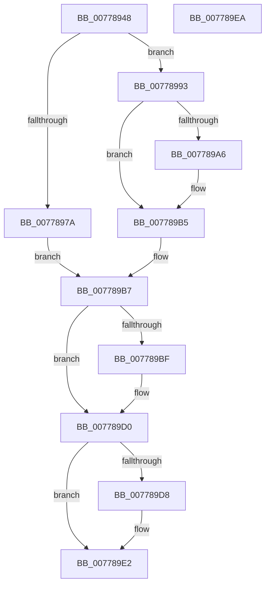

# TtmpDispatchEvacuateDevices

- RVA: `0x00778948`–`0x007789EB` (길이 `163` bytes)
- VA: `0x0000000140778948`
- 실행 섹션: `PAGE`
- PDB 이름 있음: `예`; PDB Function 태그: `아니요`
- unwind 정보 RVA: `0x000AA39C`
- 디코드: `44`개 명령, `163/163` bytes 표시
- 미해석 바이트: `0` (있으면 어셈블리에 `.byte`로 보존)

> 이 문서는 커널 이미지의 기계어와 PDB 기호를 분석해 생성했습니다. 4번과 5번은 함수 원형과 자료형을 바이너리 사용 방식에서 추정한 C 해석이며 원본 소스 복구 결과는 아닙니다.

## 1. Dependencies

- 직접 호출 지점: **7**; 고유 호출 대상: **7**
- 직접 호출자로 확인된 함수: **1**
- RIP 상대 이미지 참조: **2**

### Outgoing calls
- `0x0077896F` → [TtmpAcquireSessionFromTerminalHandle](TtmpAcquireSessionFromTerminalHandle_function_00778544.md) (function, `0x00778544`)
- `0x0077898C` → [TtmiLogError](../98/TtmiLogError_function_0098B39C.md) (function, `0x0098B39C`)
- `0x0077899D` → [TtmiEvacuateDevices](TtmiEvacuateDevices_function_00775BA4.md) (function, `0x00775BA4`)
- `0x007789B0` → [TtmiScheduleSessionWorker](TtmiScheduleSessionWorker_function_00777184.md) (function, `0x00777184`)
- `0x007789C6` → [ExReleaseResourceLite](../../text/25/ExReleaseResourceLite_function_0025FA10.md) (function, `0x0025FA10`)
- `0x007789CB` → [KeLeaveCriticalRegion](../../text/25/KeLeaveCriticalRegion_function_0025D8B0.md) (function, `0x0025D8B0`)
- `0x007789DD` → [ObfDereferenceObject](../../text/2F/ObfDereferenceObject_function_002F9350.md) (function, `0x002F9350`)

### Direct callers
- [TtmDispatchApi](../98/TtmDispatchApi_function_0098AD08.md) at `0x0098AE9C`

### Static image references
- `0x0077897D` → RVA `0x00B04610` (` ?? ::NNGAKEGL::`string'`; read)
- `0x007789BF` → RVA `0x00F06940` (`.data`; read)

## 2. Other-region calls and transfers

- 다른 실행 섹션으로 향하는 call: **3**
  - `0x007789C6` → [ExReleaseResourceLite](../../text/25/ExReleaseResourceLite_function_0025FA10.md) (`PAGE` → `.text`)
  - `0x007789CB` → [KeLeaveCriticalRegion](../../text/25/KeLeaveCriticalRegion_function_0025D8B0.md) (`PAGE` → `.text`)
  - `0x007789DD` → [ObfDereferenceObject](../../text/2F/ObfDereferenceObject_function_002F9350.md) (`PAGE` → `.text`)
- 별도 외부 분기/꼬리 이동을 확인하지 못했습니다.

## 3. Assembly (complete function range)

```asm
00778948  4C 8B DC                        mov r11, rsp
0077894B  53                              push rbx
0077894C  48 83 EC 30                     sub rsp, 0x30
00778950  48 8B 49 08                     mov rcx, qword ptr [rcx + 8]
00778954  49 8D 43 10                     lea rax, [r11 + 0x10]
00778958  49 83 63 08 00                  and qword ptr [r11 + 8], 0
0077895D  4D 8D 4B 08                     lea r9, [r11 + 8]
00778961  49 83 63 10 00                  and qword ptr [r11 + 0x10], 0
00778966  41 B0 01                        mov r8b, 1
00778969  33 D2                           xor edx, edx
0077896B  49 89 43 E8                     mov qword ptr [r11 - 0x18], rax
0077896F  E8 D0 FB FF FF                  call 0x140778544
00778974  8B D8                           mov ebx, eax
00778976  85 C0                           test eax, eax
00778978  79 19                           jns 0x140778993
0077897A  44 8B C8                        mov r9d, eax
0077897D  48 8D 0D 8C BC 38 00            lea rcx, [rip + 0x38bc8c]
00778984  44 8B C0                        mov r8d, eax
00778987  BA 62 02 00 00                  mov edx, 0x262
0077898C  E8 0B 2A 21 00                  call 0x14098b39c
00778991  EB 24                           jmp 0x1407789b7
00778993  48 8B 54 24 48                  mov rdx, qword ptr [rsp + 0x48]
00778998  48 8B 4C 24 40                  mov rcx, qword ptr [rsp + 0x40]
0077899D  E8 02 D2 FF FF                  call 0x140775ba4
007789A2  84 C0                           test al, al
007789A4  74 0F                           je 0x1407789b5
007789A6  48 8B 4C 24 40                  mov rcx, qword ptr [rsp + 0x40]
007789AB  BA 01 00 00 00                  mov edx, 1
007789B0  E8 CF E7 FF FF                  call 0x140777184
007789B5  33 DB                           xor ebx, ebx
007789B7  48 83 7C 24 40 00               cmp qword ptr [rsp + 0x40], 0
007789BD  74 11                           je 0x1407789d0
007789BF  48 8D 0D 7A DF 78 00            lea rcx, [rip + 0x78df7a]
007789C6  E8 45 70 AE FF                  call 0x14025fa10
007789CB  E8 E0 4E AE FF                  call 0x14025d8b0
007789D0  48 83 7C 24 48 00               cmp qword ptr [rsp + 0x48], 0
007789D6  74 0A                           je 0x1407789e2
007789D8  48 8B 4C 24 48                  mov rcx, qword ptr [rsp + 0x48]
007789DD  E8 6E 09 B8 FF                  call 0x1402f9350
007789E2  8B C3                           mov eax, ebx
007789E4  48 83 C4 30                     add rsp, 0x30
007789E8  5B                              pop rbx
007789E9  C3                              ret
007789EA  CC                              int3
```

## 4. C-style interpretation (structured pseudocode)

```c
__int64 __fastcall TtmpDispatchEvacuateDevices(__int64 a1, int a2)
{
    __int64 result;
    __int64 v_rbx;
    __int64 v_rsp;
    unsigned __int64 v_stack_p10;
    unsigned __int64 v_stack_p8;

    v_rsp = (v_rsp) - (48);
    a2 = 0;
    *(unsigned __int64 *)(v_rsp - 24) = v_rsp + 16;
    result = TtmpAcquireSessionFromTerminalHandle(*(unsigned __int64 *)(a1 + 8), a2, 1, v_rsp + 8);
    if (!sign_flag) goto loc_00778993;
    result = TtmiLogError(v_rip + 3718284, 610, (unsigned int)((unsigned int)(result)), (unsigned int)((unsigned int)(result)));
    goto loc_007789B7;
loc_00778993:
    result = TtmiEvacuateDevices(v_stack_p8, v_stack_p10, (unsigned int)((unsigned int)(result)), (unsigned int)((unsigned int)(result)));
    if ((unsigned __int8)(result) != 0) {
        a1 = v_stack_p8;
        a2 = 1;
        result = TtmiScheduleSessionWorker(a1, a2, (unsigned int)((unsigned int)(result)), (unsigned int)((unsigned int)(result)));
    }
    v_rbx = 0;
loc_007789B7:
    if (v_stack_p8 != 0) {
        a1 = v_rip + 7921530;
        result = ExReleaseResourceLite(a1, a2, (unsigned int)((unsigned int)(result)), (unsigned int)((unsigned int)(result)));
        result = KeLeaveCriticalRegion(a1, a2, (unsigned int)((unsigned int)(result)), (unsigned int)((unsigned int)(result)));
    }
    if (v_stack_p10 != 0) {
        a1 = v_stack_p10;
        result = ObfDereferenceObject(a1, a2, (unsigned int)((unsigned int)(result)), (unsigned int)((unsigned int)(result)));
    }
    v_rsp = (v_rsp) + (48);
    return 0;
}
```

## 5. (Beta) C Style

```c
int64_t TtmpDispatchEvacuateDevices(void *Arg1, int32_t Arg2)
{
    uint8_t *arg1 = (uint8_t *)Arg1;

    int64_t result;
    int64_t local_rbx;
    int64_t local_rsp;
    uint64_t v_stack_p10;
    uint64_t v_stack_p8;

    local_rsp = (local_rsp) - (48);
    Arg2 = 0;
    *(uint64_t *)(local_rsp - 0x18) = local_rsp + 16;
    result = TtmpAcquireSessionFromTerminalHandle(*(uint64_t *)(arg1 + 0x8), Arg2, 1, local_rsp + 8);
    if (!sign_flag) goto loc_00778993;
    result = TtmiLogError(v_rip + 3718284, 610, (uint32_t)((uint32_t)(result)), (uint32_t)((uint32_t)(result)));
    goto loc_007789B7;
loc_00778993:
    result = TtmiEvacuateDevices(v_stack_p8, v_stack_p10, (uint32_t)((uint32_t)(result)), (uint32_t)((uint32_t)(result)));
    if ((uint8_t)(result) != 0) {
        Arg1 = v_stack_p8;
        Arg2 = 1;
        result = TtmiScheduleSessionWorker(Arg1, Arg2, (uint32_t)((uint32_t)(result)), (uint32_t)((uint32_t)(result)));
    }
    local_rbx = 0;
loc_007789B7:
    if (v_stack_p8 != 0) {
        Arg1 = v_rip + 7921530;
        result = ExReleaseResourceLite(Arg1, Arg2, (uint32_t)((uint32_t)(result)), (uint32_t)((uint32_t)(result)));
        result = KeLeaveCriticalRegion(Arg1, Arg2, (uint32_t)((uint32_t)(result)), (uint32_t)((uint32_t)(result)));
    }
    if (v_stack_p10 != 0) {
        Arg1 = v_stack_p10;
        result = ObfDereferenceObject(Arg1, Arg2, (uint32_t)((uint32_t)(result)), (uint32_t)((uint32_t)(result)));
    }
    local_rsp = (local_rsp) + (48);
    return 0;
}
```

### 관측된 메모리 오프셋

구조체 형식이 확인되지 않은 접근은 인자 기준의 오프셋으로만 기록했습니다.

| 기준 인자 | 오프셋 표현 | 폭 (bit) | 접근 |
|---|---:|---:|---|
| `Arg1` | `+ 0x8` | `64` | `R` |

## 6. Execution-region graph

[열기: 2D/3D 그래프와 함수 탐색 컨트롤 패널](../../../control-panel.html?section=page&rva=0x00778948&view=graph)

- 2D 그래프는 위에서 아래로 흐르고, 3D 그래프는 빈 공간을 드래그해 회전합니다. Shift+드래그는 이동, 휠은 확대·축소, 함수 노드 선택은 대상 보고서 이동입니다.

### Static fallback


