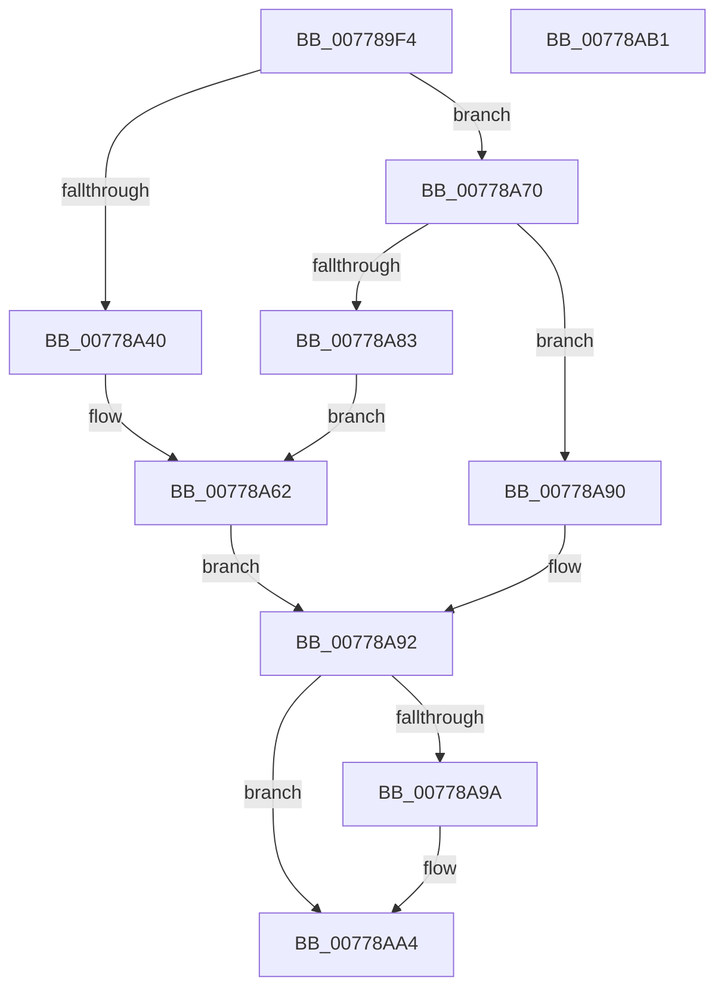

# TtmpDispatchGetTerminalEvent

- RVA: `0x007789F4`–`0x00778AB2` (길이 `190` bytes)
- VA: `0x00000001407789F4`
- 실행 섹션: `PAGE`
- PDB 이름 있음: `예`; PDB Function 태그: `아니요`
- unwind 정보 RVA: `0x000CDCB8`
- 디코드: `50`개 명령, `190/190` bytes 표시
- 미해석 바이트: `0` (있으면 어셈블리에 `.byte`로 보존)

> 이 문서는 커널 이미지의 기계어와 PDB 기호를 분석해 생성했습니다. 4번과 5번은 함수 원형과 자료형을 바이너리 사용 방식에서 추정한 C 해석이며 원본 소스 복구 결과는 아닙니다.

## 1. Dependencies

- 직접 호출 지점: **5**; 고유 호출 대상: **4**
- 직접 호출자로 확인된 함수: **1**
- RIP 상대 이미지 참조: **3**

### Outgoing calls
- `0x00778A35` → [ObReferenceObjectByHandle](../86/ObReferenceObjectByHandle_function_00868DB0.md) (function, `0x00868DB0`)
- `0x00778A52` → [TtmiLogError](../98/TtmiLogError_function_0098B39C.md) (function, `0x0098B39C`)
- `0x00778A69` → [TtmiLogError](../98/TtmiLogError_function_0098B39C.md) (function, `0x0098B39C`)
- `0x00778A78` → [TtmiRetrieveEventFromQueue](TtmiRetrieveEventFromQueue_function_0077DCB8.md) (function, `0x0077DCB8`)
- `0x00778A9F` → [ObfDereferenceObject](../../text/2F/ObfDereferenceObject_function_002F9350.md) (function, `0x002F9350`)

### Direct callers
- [TtmDispatchApi](../98/TtmDispatchApi_function_0098AD08.md) at `0x0098AE7F`

### Static image references
- `0x00778A1A` → RVA `0x00FD9E98` (`PAGEDATA`; read)
- `0x00778A43` → RVA `0x00B04740` (` ?? ::NNGAKEGL::`string'`; read)
- `0x00778A62` → RVA `0x00B04520` (` ?? ::NNGAKEGL::`string'`; read)

## 2. Other-region calls and transfers

- 다른 실행 섹션으로 향하는 call: **1**
  - `0x00778A9F` → [ObfDereferenceObject](../../text/2F/ObfDereferenceObject_function_002F9350.md) (`PAGE` → `.text`)
- 별도 외부 분기/꼬리 이동을 확인하지 못했습니다.

## 3. Assembly (complete function range)

```asm
007789F4  4C 8B DC                        mov r11, rsp
007789F7  49 89 5B 10                     mov qword ptr [r11 + 0x10], rbx
007789FB  56                              push rsi
007789FC  48 83 EC 30                     sub rsp, 0x30
00778A00  65 48 8B 04 25 88 01 00 00      mov rax, qword ptr gs:[0x188]
00778A09  48 8B F2                        mov rsi, rdx
00778A0C  49 83 63 F0 00                  and qword ptr [r11 - 0x10], 0
00778A11  BA 00 00 0F 00                  mov edx, 0xf0000
00778A16  48 8B 49 08                     mov rcx, qword ptr [rcx + 8]
00778A1A  4C 8B 05 77 14 86 00            mov r8, qword ptr [rip + 0x861477]
00778A21  44 8A 88 32 02 00 00            mov r9b, byte ptr [rax + 0x232]
00778A28  49 8D 43 08                     lea rax, [r11 + 8]
00778A2C  49 83 63 08 00                  and qword ptr [r11 + 8], 0
00778A31  49 89 43 E8                     mov qword ptr [r11 - 0x18], rax
00778A35  E8 76 03 0F 00                  call 0x140868db0
00778A3A  8B D8                           mov ebx, eax
00778A3C  85 C0                           test eax, eax
00778A3E  79 30                           jns 0x140778a70
00778A40  44 8B C8                        mov r9d, eax
00778A43  48 8D 0D F6 BC 38 00            lea rcx, [rip + 0x38bcf6]
00778A4A  44 8B C0                        mov r8d, eax
00778A4D  BA 36 01 00 00                  mov edx, 0x136
00778A52  E8 45 29 21 00                  call 0x14098b39c
00778A57  44 8B CB                        mov r9d, ebx
00778A5A  44 8B C3                        mov r8d, ebx
00778A5D  BA 95 01 00 00                  mov edx, 0x195
00778A62  48 8D 0D B7 BA 38 00            lea rcx, [rip + 0x38bab7]
00778A69  E8 2E 29 21 00                  call 0x14098b39c
00778A6E  EB 22                           jmp 0x140778a92
00778A70  48 8B 4C 24 40                  mov rcx, qword ptr [rsp + 0x40]
00778A75  48 8B D6                        mov rdx, rsi
00778A78  E8 3B 52 00 00                  call 0x14077dcb8
00778A7D  8B D8                           mov ebx, eax
00778A7F  85 C0                           test eax, eax
00778A81  79 0D                           jns 0x140778a90
00778A83  44 8B C8                        mov r9d, eax
00778A86  44 8B C0                        mov r8d, eax
00778A89  BA 9D 01 00 00                  mov edx, 0x19d
00778A8E  EB D2                           jmp 0x140778a62
00778A90  33 DB                           xor ebx, ebx
00778A92  48 83 7C 24 40 00               cmp qword ptr [rsp + 0x40], 0
00778A98  74 0A                           je 0x140778aa4
00778A9A  48 8B 4C 24 40                  mov rcx, qword ptr [rsp + 0x40]
00778A9F  E8 AC 08 B8 FF                  call 0x1402f9350
00778AA4  8B C3                           mov eax, ebx
00778AA6  48 8B 5C 24 48                  mov rbx, qword ptr [rsp + 0x48]
00778AAB  48 83 C4 30                     add rsp, 0x30
00778AAF  5E                              pop rsi
00778AB0  C3                              ret
00778AB1  CC                              int3
```

## 4. C-style interpretation (structured pseudocode)

```c
__int64 __fastcall TtmpDispatchGetTerminalEvent(__int64 a1, __int64 a2)
{
    __int64 result;
    __int64 v_rbx;
    __int64 v_rsp;
    unsigned __int64 v_stack_p10;
    unsigned __int64 v_stack_p8;

    *(unsigned __int64 *)(v_rsp + 16) = v_rbx;
    v_rsp = (v_rsp) - (48);
    *(unsigned __int64 *)(v_rsp - 24) = v_rsp + 8;
    result = ObReferenceObjectByHandle(*(unsigned __int64 *)(a1 + 8), (unsigned int)(0xF0000ULL), *(unsigned __int64 *)(v_rip + 8787063), *(unsigned __int8 *)(*(unsigned __int64 *)(gs_base + (0 + 392)) + 562));
    if (!sign_flag) goto loc_00778A70;
    result = TtmiLogError(v_rip + 3718390, 310, (unsigned int)((unsigned int)(result)), (unsigned int)((unsigned int)(result)));
loc_00778A62:
    result = TtmiLogError(v_rip + 3717815, 405, (unsigned int)((unsigned int)((unsigned int)((unsigned int)(result)))), (unsigned int)((unsigned int)((unsigned int)((unsigned int)(result)))));
    goto loc_00778A92;
loc_00778A70:
    result = TtmiRetrieveEventFromQueue(v_stack_p8, a2, (unsigned int)((unsigned int)((unsigned int)((unsigned int)(result)))), (unsigned int)((unsigned int)((unsigned int)((unsigned int)(result)))));
    if (!sign_flag) goto loc_00778A90;
    goto loc_00778A62;
loc_00778A90:
    v_rbx = 0;
loc_00778A92:
    if (v_stack_p8 != 0) {
        a1 = v_stack_p8;
        result = ObfDereferenceObject(a1, 413, (unsigned int)((unsigned int)(result)), (unsigned int)((unsigned int)(result)));
    }
    v_rsp = (v_rsp) + (48);
    return 0;
}
```

## 5. (Beta) C Style

```c
int64_t TtmpDispatchGetTerminalEvent(void *Arg1, int64_t Arg2)
{
    uint8_t *arg1 = (uint8_t *)Arg1;

    int64_t result;
    int64_t local_rbx;
    int64_t local_rsp;
    uint64_t v_stack_p10;
    uint64_t v_stack_p8;

    *(uint64_t *)(local_rsp + 0x10) = local_rbx;
    local_rsp = (local_rsp) - (48);
    *(uint64_t *)(local_rsp - 0x18) = local_rsp + 8;
    result = ObReferenceObjectByHandle(*(uint64_t *)(arg1 + 0x8), (uint32_t)(0xF0000ULL), *(uint64_t *)(v_rip + 0x861477), *(uint8_t *)(*(uint64_t *)(gs_base + (0 + 0x188)) + 0x232));
    if (!sign_flag) goto loc_00778A70;
    result = TtmiLogError(v_rip + 3718390, 310, (uint32_t)((uint32_t)(result)), (uint32_t)((uint32_t)(result)));
loc_00778A62:
    result = TtmiLogError(v_rip + 3717815, 405, (uint32_t)((uint32_t)((uint32_t)((uint32_t)(result)))), (uint32_t)((uint32_t)((uint32_t)((uint32_t)(result)))));
    goto loc_00778A92;
loc_00778A70:
    result = TtmiRetrieveEventFromQueue(v_stack_p8, Arg2, (uint32_t)((uint32_t)((uint32_t)((uint32_t)(result)))), (uint32_t)((uint32_t)((uint32_t)((uint32_t)(result)))));
    if (!sign_flag) goto loc_00778A90;
    goto loc_00778A62;
loc_00778A90:
    local_rbx = 0;
loc_00778A92:
    if (v_stack_p8 != 0) {
        Arg1 = v_stack_p8;
        result = ObfDereferenceObject(Arg1, 413, (uint32_t)((uint32_t)(result)), (uint32_t)((uint32_t)(result)));
    }
    local_rsp = (local_rsp) + (48);
    return 0;
}
```

### 관측된 메모리 오프셋

구조체 형식이 확인되지 않은 접근은 인자 기준의 오프셋으로만 기록했습니다.

| 기준 인자 | 오프셋 표현 | 폭 (bit) | 접근 |
|---|---:|---:|---|
| `Arg1` | `+ 0x8` | `64` | `R` |

## 6. Execution-region graph

[열기: 2D/3D 그래프와 함수 탐색 컨트롤 패널](../../../control-panel.html?section=page&rva=0x007789F4&view=graph)

- 2D 그래프는 위에서 아래로 흐르고, 3D 그래프는 빈 공간을 드래그해 회전합니다. Shift+드래그는 이동, 휠은 확대·축소, 함수 노드 선택은 대상 보고서 이동입니다.

### Static fallback


