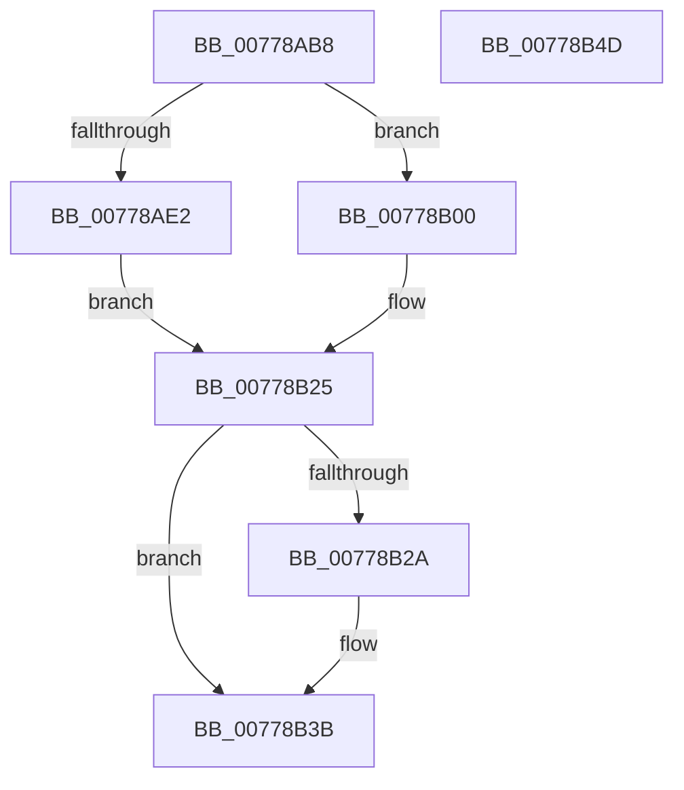

# TtmpDispatchOpenTerminal

- RVA: `0x00778AB8`–`0x00778B4E` (길이 `150` bytes)
- VA: `0x0000000140778AB8`
- 실행 섹션: `PAGE`
- PDB 이름 있음: `예`; PDB Function 태그: `아니요`
- unwind 정보 RVA: `0x000BC3A0`
- 디코드: `40`개 명령, `150/150` bytes 표시
- 미해석 바이트: `0` (있으면 어셈블리에 `.byte`로 보존)

> 이 문서는 커널 이미지의 기계어와 PDB 기호를 분석해 생성했습니다. 4번과 5번은 함수 원형과 자료형을 바이너리 사용 방식에서 추정한 C 해석이며 원본 소스 복구 결과는 아닙니다.

## 1. Dependencies

- 직접 호출 지점: **5**; 고유 호출 대상: **5**
- 직접 호출자로 확인된 함수: **1**
- RIP 상대 이미지 참조: **2**

### Outgoing calls
- `0x00778AD7` → [TtmiAcquireCurrentSession](TtmiAcquireCurrentSession_function_00777010.md) (function, `0x00777010`)
- `0x00778AF4` → [TtmiLogError](../98/TtmiLogError_function_0098B39C.md) (function, `0x0098B39C`)
- `0x00778B1E` → [TtmiOpenDefaultTerminal](TtmiOpenDefaultTerminal_function_0077CC20.md) (function, `0x0077CC20`)
- `0x00778B31` → [ExReleaseResourceLite](../../text/25/ExReleaseResourceLite_function_0025FA10.md) (function, `0x0025FA10`)
- `0x00778B36` → [KeLeaveCriticalRegion](../../text/25/KeLeaveCriticalRegion_function_0025D8B0.md) (function, `0x0025D8B0`)

### Direct callers
- [TtmDispatchApi](../98/TtmDispatchApi_function_0098AD08.md) at `0x0098AEBC`

### Static image references
- `0x00778AE5` → RVA `0x00B04490` (` ?? ::NNGAKEGL::`string'`; read)
- `0x00778B2A` → RVA `0x00F06940` (`.data`; read)

## 2. Other-region calls and transfers

- 다른 실행 섹션으로 향하는 call: **2**
  - `0x00778B31` → [ExReleaseResourceLite](../../text/25/ExReleaseResourceLite_function_0025FA10.md) (`PAGE` → `.text`)
  - `0x00778B36` → [KeLeaveCriticalRegion](../../text/25/KeLeaveCriticalRegion_function_0025D8B0.md) (`PAGE` → `.text`)
- 별도 외부 분기/꼬리 이동을 확인하지 못했습니다.

## 3. Assembly (complete function range)

```asm
00778AB8  48 8B C4                        mov rax, rsp
00778ABB  48 89 58 08                     mov qword ptr [rax + 8], rbx
00778ABF  48 89 70 10                     mov qword ptr [rax + 0x10], rsi
00778AC3  57                              push rdi
00778AC4  48 83 EC 20                     sub rsp, 0x20
00778AC8  48 83 60 18 00                  and qword ptr [rax + 0x18], 0
00778ACD  48 8B F1                        mov rsi, rcx
00778AD0  48 8D 48 18                     lea rcx, [rax + 0x18]
00778AD4  48 8B FA                        mov rdi, rdx
00778AD7  E8 34 E5 FF FF                  call 0x140777010
00778ADC  8B D8                           mov ebx, eax
00778ADE  85 C0                           test eax, eax
00778AE0  79 1E                           jns 0x140778b00
00778AE2  44 8B C8                        mov r9d, eax
00778AE5  48 8D 0D A4 B9 38 00            lea rcx, [rip + 0x38b9a4]
00778AEC  44 8B C0                        mov r8d, eax
00778AEF  BA 9A 00 00 00                  mov edx, 0x9a
00778AF4  E8 A3 28 21 00                  call 0x14098b39c
00778AF9  48 8B 7C 24 40                  mov rdi, qword ptr [rsp + 0x40]
00778AFE  EB 25                           jmp 0x140778b25
00778B00  65 48 8B 04 25 88 01 00 00      mov rax, qword ptr gs:[0x188]
00778B09  4C 8B CF                        mov r9, rdi
00778B0C  48 8B 7C 24 40                  mov rdi, qword ptr [rsp + 0x40]
00778B11  8B 56 08                        mov edx, dword ptr [rsi + 8]
00778B14  48 8B CF                        mov rcx, rdi
00778B17  44 8A 80 32 02 00 00            mov r8b, byte ptr [rax + 0x232]
00778B1E  E8 FD 40 00 00                  call 0x14077cc20
00778B23  8B D8                           mov ebx, eax
00778B25  48 85 FF                        test rdi, rdi
00778B28  74 11                           je 0x140778b3b
00778B2A  48 8D 0D 0F DE 78 00            lea rcx, [rip + 0x78de0f]
00778B31  E8 DA 6E AE FF                  call 0x14025fa10
00778B36  E8 75 4D AE FF                  call 0x14025d8b0
00778B3B  48 8B 74 24 38                  mov rsi, qword ptr [rsp + 0x38]
00778B40  8B C3                           mov eax, ebx
00778B42  48 8B 5C 24 30                  mov rbx, qword ptr [rsp + 0x30]
00778B47  48 83 C4 20                     add rsp, 0x20
00778B4B  5F                              pop rdi
00778B4C  C3                              ret
00778B4D  CC                              int3
```

## 4. C-style interpretation (structured pseudocode)

```c
__int64 __fastcall TtmpDispatchOpenTerminal(__int64 a1, __int64 a2)
{
    __int64 result;
    __int64 v_rsp;
    unsigned __int64 v_stack_p10;
    unsigned __int64 v_stack_p18;
    unsigned __int64 v_stack_p8;

    *(unsigned __int64 *)(v_rsp + 8) = v_rbx;
    *(unsigned __int64 *)(v_rsp + 16) = v_rsi;
    v_rsp = (v_rsp) - (32);
    result = TtmiAcquireCurrentSession(v_rsp + 24, a2, a3, a4);
    if (!sign_flag) goto loc_00778B00;
    result = TtmiLogError(v_rip + 3717540, 154, (unsigned int)((unsigned int)(result)), (unsigned int)((unsigned int)(result)));
    goto loc_00778B25;
loc_00778B00:
    result = TtmiOpenDefaultTerminal(v_stack_p18, (unsigned int)(*(unsigned int *)(a1 + 8)), *(unsigned __int8 *)(*(unsigned __int64 *)(gs_base + (0 + 392)) + 562), v_stack_p18);
loc_00778B25:
    if (v_stack_p18 != 0) {
        a1 = v_rip + 7921167;
        result = ExReleaseResourceLite(a1, (unsigned int)(*(unsigned int *)(a1 + 8)), *(unsigned __int8 *)(*(unsigned __int64 *)(gs_base + (0 + 392)) + 562), v_stack_p18);
        result = KeLeaveCriticalRegion(a1, (unsigned int)(*(unsigned int *)(a1 + 8)), *(unsigned __int8 *)(*(unsigned __int64 *)(gs_base + (0 + 392)) + 562), v_stack_p18);
    }
    v_rsp = (v_rsp) + (32);
    return (unsigned int)((unsigned int)((unsigned int)((unsigned int)(result))));
}
```

## 5. (Beta) C Style

```c
int64_t TtmpDispatchOpenTerminal(void *Arg1, int64_t Arg2)
{
    uint8_t *arg1 = (uint8_t *)Arg1;

    int64_t result;
    int64_t local_rsp;
    uint64_t v_stack_p10;
    uint64_t v_stack_p18;
    uint64_t v_stack_p8;

    *(uint64_t *)(local_rsp + 0x8) = local_rbx;
    *(uint64_t *)(local_rsp + 0x10) = local_rsi;
    local_rsp = (local_rsp) - (32);
    result = TtmiAcquireCurrentSession(local_rsp + 24, Arg2, a3, a4);
    if (!sign_flag) goto loc_00778B00;
    result = TtmiLogError(v_rip + 3717540, 154, (uint32_t)((uint32_t)(result)), (uint32_t)((uint32_t)(result)));
    goto loc_00778B25;
loc_00778B00:
    result = TtmiOpenDefaultTerminal(v_stack_p18, (uint32_t)(*(uint32_t *)(arg1 + 0x8)), *(uint8_t *)(*(uint64_t *)(gs_base + (0 + 0x188)) + 0x232), v_stack_p18);
loc_00778B25:
    if (v_stack_p18 != 0) {
        Arg1 = v_rip + 7921167;
        result = ExReleaseResourceLite(Arg1, (uint32_t)(*(uint32_t *)(arg1 + 0x8)), *(uint8_t *)(*(uint64_t *)(gs_base + (0 + 0x188)) + 0x232), v_stack_p18);
        result = KeLeaveCriticalRegion(Arg1, (uint32_t)(*(uint32_t *)(arg1 + 0x8)), *(uint8_t *)(*(uint64_t *)(gs_base + (0 + 0x188)) + 0x232), v_stack_p18);
    }
    local_rsp = (local_rsp) + (32);
    return (uint32_t)((uint32_t)((uint32_t)((uint32_t)(result))));
}
```

### 관측된 메모리 오프셋

구조체 형식이 확인되지 않은 접근은 인자 기준의 오프셋으로만 기록했습니다.

| 기준 인자 | 오프셋 표현 | 폭 (bit) | 접근 |
|---|---:|---:|---|
| `Arg1` | `+ 0x8` | `32` | `R` |

## 6. Execution-region graph

[열기: 2D/3D 그래프와 함수 탐색 컨트롤 패널](../../../control-panel.html?section=page&rva=0x00778AB8&view=graph)

- 2D 그래프는 위에서 아래로 흐르고, 3D 그래프는 빈 공간을 드래그해 회전합니다. Shift+드래그는 이동, 휠은 확대·축소, 함수 노드 선택은 대상 보고서 이동입니다.

### Static fallback


