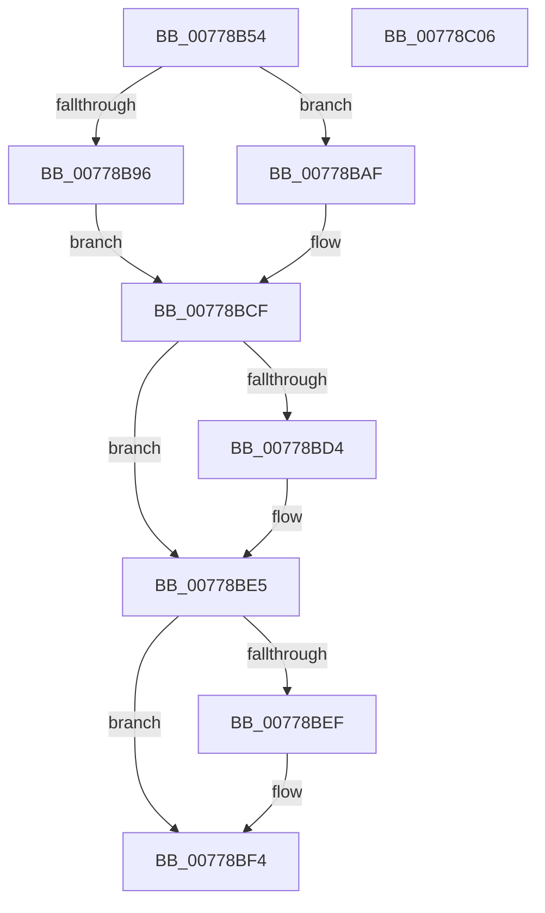

# TtmpDispatchSetDefaultDeviceAssignment

- RVA: `0x00778B54`–`0x00778C07` (길이 `179` bytes)
- VA: `0x0000000140778B54`
- 실행 섹션: `PAGE`
- PDB 이름 있음: `예`; PDB Function 태그: `아니요`
- unwind 정보 RVA: `0x00084CD4`
- 디코드: `51`개 명령, `179/179` bytes 표시
- 미해석 바이트: `0` (있으면 어셈블리에 `.byte`로 보존)

> 이 문서는 커널 이미지의 기계어와 PDB 기호를 분석해 생성했습니다. 4번과 5번은 함수 원형과 자료형을 바이너리 사용 방식에서 추정한 C 해석이며 원본 소스 복구 결과는 아닙니다.

## 1. Dependencies

- 직접 호출 지점: **6**; 고유 호출 대상: **6**
- 직접 호출자로 확인된 함수: **1**
- RIP 상대 이미지 참조: **2**

### Outgoing calls
- `0x00778B86` → [TtmpAcquireSessionFromTerminalHandle](TtmpAcquireSessionFromTerminalHandle_function_00778544.md) (function, `0x00778544`)
- `0x00778BA8` → [TtmiLogError](../98/TtmiLogError_function_0098B39C.md) (function, `0x0098B39C`)
- `0x00778BC8` → [TtmiLogSessionDeviceAssignmentPolicySet](TtmiLogSessionDeviceAssignmentPolicySet_function_0077AF9C.md) (function, `0x0077AF9C`)
- `0x00778BDB` → [ExReleaseResourceLite](../../text/25/ExReleaseResourceLite_function_0025FA10.md) (function, `0x0025FA10`)
- `0x00778BE0` → [KeLeaveCriticalRegion](../../text/25/KeLeaveCriticalRegion_function_0025D8B0.md) (function, `0x0025D8B0`)
- `0x00778BEF` → [ObfDereferenceObject](../../text/2F/ObfDereferenceObject_function_002F9350.md) (function, `0x002F9350`)

### Direct callers
- [TtmDispatchApi](../98/TtmDispatchApi_function_0098AD08.md) at `0x0098AEC6`

### Static image references
- `0x00778B99` → RVA `0x00B045A0` (` ?? ::NNGAKEGL::`string'`; read)
- `0x00778BD4` → RVA `0x00F06940` (`.data`; read)

## 2. Other-region calls and transfers

- 다른 실행 섹션으로 향하는 call: **3**
  - `0x00778BDB` → [ExReleaseResourceLite](../../text/25/ExReleaseResourceLite_function_0025FA10.md) (`PAGE` → `.text`)
  - `0x00778BE0` → [KeLeaveCriticalRegion](../../text/25/KeLeaveCriticalRegion_function_0025D8B0.md) (`PAGE` → `.text`)
  - `0x00778BEF` → [ObfDereferenceObject](../../text/2F/ObfDereferenceObject_function_002F9350.md) (`PAGE` → `.text`)
- 별도 외부 분기/꼬리 이동을 확인하지 못했습니다.

## 3. Assembly (complete function range)

```asm
00778B54  4C 8B DC                        mov r11, rsp
00778B57  49 89 5B 18                     mov qword ptr [r11 + 0x18], rbx
00778B5B  49 89 73 20                     mov qword ptr [r11 + 0x20], rsi
00778B5F  57                              push rdi
00778B60  48 83 EC 30                     sub rsp, 0x30
00778B64  49 83 63 08 00                  and qword ptr [r11 + 8], 0
00778B69  49 8D 43 10                     lea rax, [r11 + 0x10]
00778B6D  49 83 63 10 00                  and qword ptr [r11 + 0x10], 0
00778B72  4D 8D 4B 08                     lea r9, [r11 + 8]
00778B76  48 8B F1                        mov rsi, rcx
00778B79  49 89 43 E8                     mov qword ptr [r11 - 0x18], rax
00778B7D  48 8B 49 08                     mov rcx, qword ptr [rcx + 8]
00778B81  45 33 C0                        xor r8d, r8d
00778B84  B2 01                           mov dl, 1
00778B86  E8 B9 F9 FF FF                  call 0x140778544
00778B8B  48 8B 7C 24 40                  mov rdi, qword ptr [rsp + 0x40]
00778B90  8B D8                           mov ebx, eax
00778B92  85 C0                           test eax, eax
00778B94  79 19                           jns 0x140778baf
00778B96  44 8B C8                        mov r9d, eax
00778B99  48 8D 0D 00 BA 38 00            lea rcx, [rip + 0x38ba00]
00778BA0  44 8B C0                        mov r8d, eax
00778BA3  BA BE 02 00 00                  mov edx, 0x2be
00778BA8  E8 EF 27 21 00                  call 0x14098b39c
00778BAD  EB 20                           jmp 0x140778bcf
00778BAF  80 7E 10 00                     cmp byte ptr [rsi + 0x10], 0
00778BB3  8B 47 04                        mov eax, dword ptr [rdi + 4]
00778BB6  0F 95 C1                        setne cl
00778BB9  0F BA F0 0B                     btr eax, 0xb
00778BBD  0F B6 D1                        movzx edx, cl
00778BC0  C1 E2 0B                        shl edx, 0xb
00778BC3  0B D0                           or edx, eax
00778BC5  89 57 04                        mov dword ptr [rdi + 4], edx
00778BC8  E8 CF 23 00 00                  call 0x14077af9c
00778BCD  33 DB                           xor ebx, ebx
00778BCF  48 85 FF                        test rdi, rdi
00778BD2  74 11                           je 0x140778be5
00778BD4  48 8D 0D 65 DD 78 00            lea rcx, [rip + 0x78dd65]
00778BDB  E8 30 6E AE FF                  call 0x14025fa10
00778BE0  E8 CB 4C AE FF                  call 0x14025d8b0
00778BE5  48 8B 4C 24 48                  mov rcx, qword ptr [rsp + 0x48]
00778BEA  48 85 C9                        test rcx, rcx
00778BED  74 05                           je 0x140778bf4
00778BEF  E8 5C 07 B8 FF                  call 0x1402f9350
00778BF4  48 8B 74 24 58                  mov rsi, qword ptr [rsp + 0x58]
00778BF9  8B C3                           mov eax, ebx
00778BFB  48 8B 5C 24 50                  mov rbx, qword ptr [rsp + 0x50]
00778C00  48 83 C4 30                     add rsp, 0x30
00778C04  5F                              pop rdi
00778C05  C3                              ret
00778C06  CC                              int3
```

## 4. C-style interpretation (structured pseudocode)

```c
__int64 __fastcall TtmpDispatchSetDefaultDeviceAssignment(__int64 a1, __int64 a2, int a3)
{
    __int64 result;
    __int64 v_rbx;
    __int64 v_rsp;
    unsigned __int64 v_stack_p10;
    unsigned __int64 v_stack_p18;
    unsigned __int64 v_stack_p20;
    unsigned __int64 v_stack_p8;

    *(unsigned __int64 *)(v_rsp + 24) = v_rbx;
    *(unsigned __int64 *)(v_rsp + 32) = v_rsi;
    v_rsp = (v_rsp) - (48);
    *(unsigned __int64 *)(v_rsp - 24) = v_rsp + 16;
    a3 = 0;
    result = TtmpAcquireSessionFromTerminalHandle(*(unsigned __int64 *)(a1 + 8), 1, a3, v_rsp + 8);
    if (!sign_flag) goto loc_00778BAF;
    result = TtmiLogError(v_rip + 3717632, 702, (unsigned int)((unsigned int)(result)), (unsigned int)((unsigned int)(result)));
    goto loc_00778BCF;
loc_00778BAF:
    a1 = ((*(unsigned __int8 *)(a1 + 16)) != 0) ? 1 : 0;
    a2 = (unsigned int)(((unsigned __int8)(a1)) << (11));
    a2 = (unsigned int)((a2) | ((unsigned int)((unsigned int)(*(unsigned int *)(v_stack_p8 + 4)))));
    *(unsigned int *)(v_stack_p8 + 4) = (unsigned int)(a2);
    result = TtmiLogSessionDeviceAssignmentPolicySet(a1, a2, (unsigned int)((unsigned int)(result)), (unsigned int)((unsigned int)(result)));
    v_rbx = 0;
loc_00778BCF:
    if (v_stack_p8 != 0) {
        a1 = v_rip + 7920997;
        result = ExReleaseResourceLite(a1, a2, (unsigned int)((unsigned int)(result)), (unsigned int)((unsigned int)(result)));
        result = KeLeaveCriticalRegion(a1, a2, (unsigned int)((unsigned int)(result)), (unsigned int)((unsigned int)(result)));
    }
    if (v_stack_p10 != 0) {
        result = ObfDereferenceObject(v_stack_p10, a2, (unsigned int)((unsigned int)(result)), (unsigned int)((unsigned int)(result)));
    }
    v_rsp = (v_rsp) + (48);
    return 0;
}
```

## 5. (Beta) C Style

```c
int64_t TtmpDispatchSetDefaultDeviceAssignment(void *Arg1, int64_t Arg2, int32_t Arg3)
{
    uint8_t *arg1 = (uint8_t *)Arg1;

    int64_t result;
    int64_t local_rbx;
    int64_t local_rsp;
    uint64_t v_stack_p10;
    uint64_t v_stack_p18;
    uint64_t v_stack_p20;
    uint64_t v_stack_p8;

    *(uint64_t *)(local_rsp + 0x18) = local_rbx;
    *(uint64_t *)(local_rsp + 0x20) = local_rsi;
    local_rsp = (local_rsp) - (48);
    *(uint64_t *)(local_rsp - 0x18) = local_rsp + 16;
    Arg3 = 0;
    result = TtmpAcquireSessionFromTerminalHandle(*(uint64_t *)(arg1 + 0x8), 1, Arg3, local_rsp + 8);
    if (!sign_flag) goto loc_00778BAF;
    result = TtmiLogError(v_rip + 3717632, 702, (uint32_t)((uint32_t)(result)), (uint32_t)((uint32_t)(result)));
    goto loc_00778BCF;
loc_00778BAF:
    Arg1 = ((*(uint8_t *)(arg1 + 0x10)) != 0) ? 1 : 0;
    Arg2 = (uint32_t)(((uint8_t)(Arg1)) << (11));
    Arg2 = (uint32_t)((Arg2) | ((uint32_t)((uint32_t)(*(uint32_t *)(v_stack_p8 + 0x4)))));
    *(uint32_t *)(v_stack_p8 + 0x4) = (uint32_t)(Arg2);
    result = TtmiLogSessionDeviceAssignmentPolicySet(Arg1, Arg2, (uint32_t)((uint32_t)(result)), (uint32_t)((uint32_t)(result)));
    local_rbx = 0;
loc_00778BCF:
    if (v_stack_p8 != 0) {
        Arg1 = v_rip + 7920997;
        result = ExReleaseResourceLite(Arg1, Arg2, (uint32_t)((uint32_t)(result)), (uint32_t)((uint32_t)(result)));
        result = KeLeaveCriticalRegion(Arg1, Arg2, (uint32_t)((uint32_t)(result)), (uint32_t)((uint32_t)(result)));
    }
    if (v_stack_p10 != 0) {
        result = ObfDereferenceObject(v_stack_p10, Arg2, (uint32_t)((uint32_t)(result)), (uint32_t)((uint32_t)(result)));
    }
    local_rsp = (local_rsp) + (48);
    return 0;
}
```

### 관측된 메모리 오프셋

구조체 형식이 확인되지 않은 접근은 인자 기준의 오프셋으로만 기록했습니다.

| 기준 인자 | 오프셋 표현 | 폭 (bit) | 접근 |
|---|---:|---:|---|
| `Arg1` | `+ 0x8` | `64` | `R` |
| `Arg1` | `+ 0x10` | `8` | `R` |

## 6. Execution-region graph

[열기: 2D/3D 그래프와 함수 탐색 컨트롤 패널](../../../control-panel.html?section=page&rva=0x00778B54&view=graph)

- 2D 그래프는 위에서 아래로 흐르고, 3D 그래프는 빈 공간을 드래그해 회전합니다. Shift+드래그는 이동, 휠은 확대·축소, 함수 노드 선택은 대상 보고서 이동입니다.

### Static fallback


