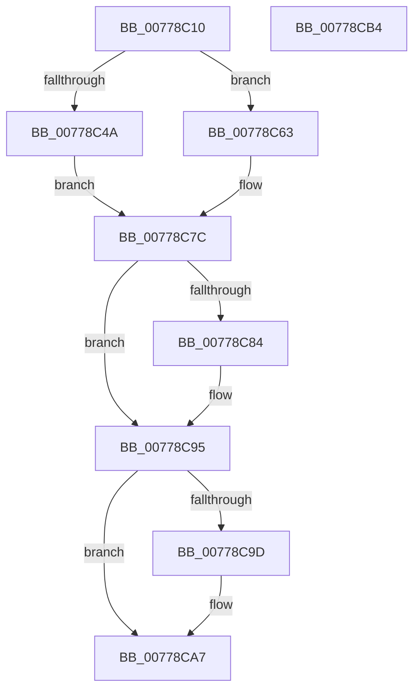

# TtmpDispatchSetDisplayPowerRequest

- RVA: `0x00778C10`–`0x00778CB5` (길이 `165` bytes)
- VA: `0x0000000140778C10`
- 실행 섹션: `PAGE`
- PDB 이름 있음: `예`; PDB Function 태그: `아니요`
- unwind 정보 RVA: `0x000CDC84`
- 디코드: `44`개 명령, `165/165` bytes 표시
- 미해석 바이트: `0` (있으면 어셈블리에 `.byte`로 보존)

> 이 문서는 커널 이미지의 기계어와 PDB 기호를 분석해 생성했습니다. 4번과 5번은 함수 원형과 자료형을 바이너리 사용 방식에서 추정한 C 해석이며 원본 소스 복구 결과는 아닙니다.

## 1. Dependencies

- 직접 호출 지점: **6**; 고유 호출 대상: **6**
- 직접 호출자로 확인된 함수: **1**
- RIP 상대 이미지 참조: **2**

### Outgoing calls
- `0x00778C3F` → [TtmpAcquireSessionFromTerminalHandle](TtmpAcquireSessionFromTerminalHandle_function_00778544.md) (function, `0x00778544`)
- `0x00778C5C` → [TtmiLogError](../98/TtmiLogError_function_0098B39C.md) (function, `0x0098B39C`)
- `0x00778C75` → [TtmiSetDisplayPowerRequest](TtmiSetDisplayPowerRequest_function_0077727C.md) (function, `0x0077727C`)
- `0x00778C8B` → [ExReleaseResourceLite](../../text/25/ExReleaseResourceLite_function_0025FA10.md) (function, `0x0025FA10`)
- `0x00778C90` → [KeLeaveCriticalRegion](../../text/25/KeLeaveCriticalRegion_function_0025D8B0.md) (function, `0x0025D8B0`)
- `0x00778CA2` → [ObfDereferenceObject](../../text/2F/ObfDereferenceObject_function_002F9350.md) (function, `0x002F9350`)

### Direct callers
- [TtmDispatchApi](../98/TtmDispatchApi_function_0098AD08.md) at `0x0098AF17`

### Static image references
- `0x00778C4D` → RVA `0x00B044C0` (` ?? ::NNGAKEGL::`string'`; read)
- `0x00778C84` → RVA `0x00F06940` (`.data`; read)

## 2. Other-region calls and transfers

- 다른 실행 섹션으로 향하는 call: **3**
  - `0x00778C8B` → [ExReleaseResourceLite](../../text/25/ExReleaseResourceLite_function_0025FA10.md) (`PAGE` → `.text`)
  - `0x00778C90` → [KeLeaveCriticalRegion](../../text/25/KeLeaveCriticalRegion_function_0025D8B0.md) (`PAGE` → `.text`)
  - `0x00778CA2` → [ObfDereferenceObject](../../text/2F/ObfDereferenceObject_function_002F9350.md) (`PAGE` → `.text`)
- 별도 외부 분기/꼬리 이동을 확인하지 못했습니다.

## 3. Assembly (complete function range)

```asm
00778C10  4C 8B DC                        mov r11, rsp
00778C13  49 89 5B 18                     mov qword ptr [r11 + 0x18], rbx
00778C17  55                              push rbp
00778C18  48 83 EC 30                     sub rsp, 0x30
00778C1C  49 83 63 10 00                  and qword ptr [r11 + 0x10], 0
00778C21  49 8D 43 08                     lea rax, [r11 + 8]
00778C25  49 83 63 08 00                  and qword ptr [r11 + 8], 0
00778C2A  4D 8D 4B 10                     lea r9, [r11 + 0x10]
00778C2E  41 B0 01                        mov r8b, 1
00778C31  49 89 43 E8                     mov qword ptr [r11 - 0x18], rax
00778C35  48 8B E9                        mov rbp, rcx
00778C38  41 8A D0                        mov dl, r8b
00778C3B  48 8B 49 08                     mov rcx, qword ptr [rcx + 8]
00778C3F  E8 00 F9 FF FF                  call 0x140778544
00778C44  8B D8                           mov ebx, eax
00778C46  85 C0                           test eax, eax
00778C48  79 19                           jns 0x140778c63
00778C4A  44 8B C8                        mov r9d, eax
00778C4D  48 8D 0D 6C B8 38 00            lea rcx, [rip + 0x38b86c]
00778C54  44 8B C0                        mov r8d, eax
00778C57  BA 57 03 00 00                  mov edx, 0x357
00778C5C  E8 3B 27 21 00                  call 0x14098b39c
00778C61  EB 19                           jmp 0x140778c7c
00778C63  44 8B 4D 14                     mov r9d, dword ptr [rbp + 0x14]
00778C67  44 8B 45 10                     mov r8d, dword ptr [rbp + 0x10]
00778C6B  48 8B 54 24 40                  mov rdx, qword ptr [rsp + 0x40]
00778C70  48 8B 4C 24 48                  mov rcx, qword ptr [rsp + 0x48]
00778C75  E8 02 E6 FF FF                  call 0x14077727c
00778C7A  8B D8                           mov ebx, eax
00778C7C  48 83 7C 24 48 00               cmp qword ptr [rsp + 0x48], 0
00778C82  74 11                           je 0x140778c95
00778C84  48 8D 0D B5 DC 78 00            lea rcx, [rip + 0x78dcb5]
00778C8B  E8 80 6D AE FF                  call 0x14025fa10
00778C90  E8 1B 4C AE FF                  call 0x14025d8b0
00778C95  48 83 7C 24 40 00               cmp qword ptr [rsp + 0x40], 0
00778C9B  74 0A                           je 0x140778ca7
00778C9D  48 8B 4C 24 40                  mov rcx, qword ptr [rsp + 0x40]
00778CA2  E8 A9 06 B8 FF                  call 0x1402f9350
00778CA7  8B C3                           mov eax, ebx
00778CA9  48 8B 5C 24 50                  mov rbx, qword ptr [rsp + 0x50]
00778CAE  48 83 C4 30                     add rsp, 0x30
00778CB2  5D                              pop rbp
00778CB3  C3                              ret
00778CB4  CC                              int3
```

## 4. C-style interpretation (structured pseudocode)

```c
__int64 __fastcall TtmpDispatchSetDisplayPowerRequest(__int64 a1)
{
    __int64 result;
    __int64 v_rsp;
    unsigned __int64 v_stack_p10;
    unsigned __int64 v_stack_p18;
    unsigned __int64 v_stack_p8;

    *(unsigned __int64 *)(v_rsp + 24) = v_rbx;
    v_rsp = (v_rsp) - (48);
    *(unsigned __int64 *)(v_rsp - 24) = v_rsp + 8;
    result = TtmpAcquireSessionFromTerminalHandle(*(unsigned __int64 *)(a1 + 8), 1, 1, v_rsp + 16);
    if (!sign_flag) goto loc_00778C63;
    result = TtmiLogError(v_rip + 3717228, 855, (unsigned int)((unsigned int)(result)), (unsigned int)((unsigned int)(result)));
    goto loc_00778C7C;
loc_00778C63:
    result = TtmiSetDisplayPowerRequest(v_stack_p10, v_stack_p8, (unsigned int)(*(unsigned int *)(a1 + 16)), (unsigned int)(*(unsigned int *)(a1 + 20)));
loc_00778C7C:
    if (v_stack_p10 != 0) {
        a1 = v_rip + 7920821;
        result = ExReleaseResourceLite(a1, v_stack_p8, (unsigned int)(*(unsigned int *)(a1 + 16)), (unsigned int)(*(unsigned int *)(a1 + 20)));
        result = KeLeaveCriticalRegion(a1, v_stack_p8, (unsigned int)(*(unsigned int *)(a1 + 16)), (unsigned int)(*(unsigned int *)(a1 + 20)));
    }
    if (v_stack_p8 != 0) {
        a1 = v_stack_p8;
        result = ObfDereferenceObject(a1, v_stack_p8, (unsigned int)(*(unsigned int *)(a1 + 16)), (unsigned int)(*(unsigned int *)(a1 + 20)));
    }
    v_rsp = (v_rsp) + (48);
    return (unsigned int)((unsigned int)((unsigned int)((unsigned int)(result))));
}
```

## 5. (Beta) C Style

```c
int64_t TtmpDispatchSetDisplayPowerRequest(void *Arg1)
{
    uint8_t *arg1 = (uint8_t *)Arg1;

    int64_t result;
    int64_t local_rsp;
    uint64_t v_stack_p10;
    uint64_t v_stack_p18;
    uint64_t v_stack_p8;

    *(uint64_t *)(local_rsp + 0x18) = local_rbx;
    local_rsp = (local_rsp) - (48);
    *(uint64_t *)(local_rsp - 0x18) = local_rsp + 8;
    result = TtmpAcquireSessionFromTerminalHandle(*(uint64_t *)(arg1 + 0x8), 1, 1, local_rsp + 16);
    if (!sign_flag) goto loc_00778C63;
    result = TtmiLogError(v_rip + 3717228, 855, (uint32_t)((uint32_t)(result)), (uint32_t)((uint32_t)(result)));
    goto loc_00778C7C;
loc_00778C63:
    result = TtmiSetDisplayPowerRequest(v_stack_p10, v_stack_p8, (uint32_t)(*(uint32_t *)(arg1 + 0x10)), (uint32_t)(*(uint32_t *)(arg1 + 0x14)));
loc_00778C7C:
    if (v_stack_p10 != 0) {
        Arg1 = v_rip + 7920821;
        result = ExReleaseResourceLite(Arg1, v_stack_p8, (uint32_t)(*(uint32_t *)(arg1 + 0x10)), (uint32_t)(*(uint32_t *)(arg1 + 0x14)));
        result = KeLeaveCriticalRegion(Arg1, v_stack_p8, (uint32_t)(*(uint32_t *)(arg1 + 0x10)), (uint32_t)(*(uint32_t *)(arg1 + 0x14)));
    }
    if (v_stack_p8 != 0) {
        Arg1 = v_stack_p8;
        result = ObfDereferenceObject(Arg1, v_stack_p8, (uint32_t)(*(uint32_t *)(arg1 + 0x10)), (uint32_t)(*(uint32_t *)(arg1 + 0x14)));
    }
    local_rsp = (local_rsp) + (48);
    return (uint32_t)((uint32_t)((uint32_t)((uint32_t)(result))));
}
```

### 관측된 메모리 오프셋

구조체 형식이 확인되지 않은 접근은 인자 기준의 오프셋으로만 기록했습니다.

| 기준 인자 | 오프셋 표현 | 폭 (bit) | 접근 |
|---|---:|---:|---|
| `Arg1` | `+ 0x8` | `64` | `R` |
| `Arg1` | `+ 0x10` | `32` | `R` |
| `Arg1` | `+ 0x14` | `32` | `R` |

## 6. Execution-region graph

[열기: 2D/3D 그래프와 함수 탐색 컨트롤 패널](../../../control-panel.html?section=page&rva=0x00778C10&view=graph)

- 2D 그래프는 위에서 아래로 흐르고, 3D 그래프는 빈 공간을 드래그해 회전합니다. Shift+드래그는 이동, 휠은 확대·축소, 함수 노드 선택은 대상 보고서 이동입니다.

### Static fallback


