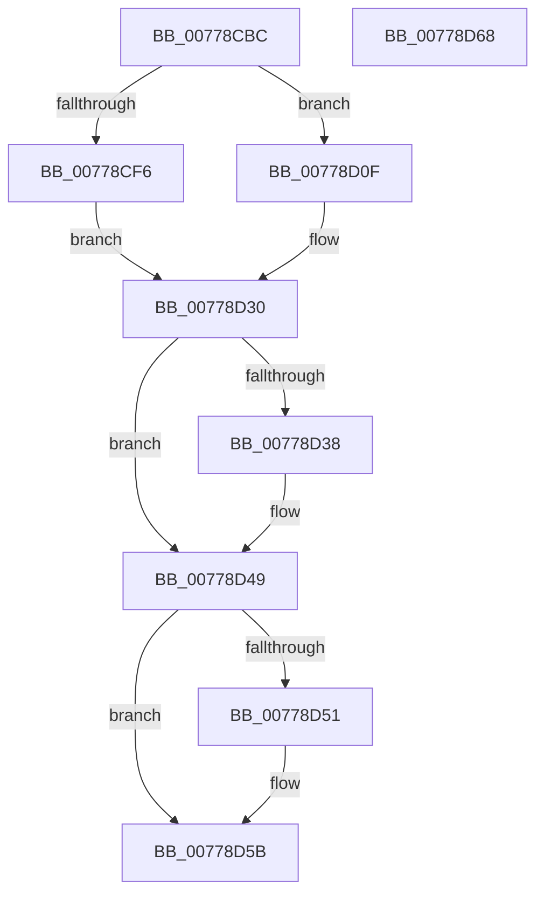

# TtmpDispatchSetDisplayState

- RVA: `0x00778CBC`–`0x00778D69` (길이 `173` bytes)
- VA: `0x0000000140778CBC`
- 실행 섹션: `PAGE`
- PDB 이름 있음: `예`; PDB Function 태그: `아니요`
- unwind 정보 RVA: `0x000CDCA8`
- 디코드: `45`개 명령, `173/173` bytes 표시
- 미해석 바이트: `0` (있으면 어셈블리에 `.byte`로 보존)

> 이 문서는 커널 이미지의 기계어와 PDB 기호를 분석해 생성했습니다. 4번과 5번은 함수 원형과 자료형을 바이너리 사용 방식에서 추정한 C 해석이며 원본 소스 복구 결과는 아닙니다.

## 1. Dependencies

- 직접 호출 지점: **6**; 고유 호출 대상: **6**
- 직접 호출자로 확인된 함수: **1**
- RIP 상대 이미지 참조: **2**

### Outgoing calls
- `0x00778CEB` → [TtmpAcquireSessionFromTerminalHandle](TtmpAcquireSessionFromTerminalHandle_function_00778544.md) (function, `0x00778544`)
- `0x00778D08` → [TtmiLogError](../98/TtmiLogError_function_0098B39C.md) (function, `0x0098B39C`)
- `0x00778D29` → [TtmiSetPendingOnOffRequest](TtmiSetPendingOnOffRequest_function_0077D074.md) (function, `0x0077D074`)
- `0x00778D3F` → [ExReleaseResourceLite](../../text/25/ExReleaseResourceLite_function_0025FA10.md) (function, `0x0025FA10`)
- `0x00778D44` → [KeLeaveCriticalRegion](../../text/25/KeLeaveCriticalRegion_function_0025D8B0.md) (function, `0x0025D8B0`)
- `0x00778D56` → [ObfDereferenceObject](../../text/2F/ObfDereferenceObject_function_002F9350.md) (function, `0x002F9350`)

### Direct callers
- [TtmDispatchApi](../98/TtmDispatchApi_function_0098AD08.md) at `0x0098AF2B`

### Static image references
- `0x00778CF9` → RVA `0x00B04540` (` ?? ::NNGAKEGL::`string'`; read)
- `0x00778D38` → RVA `0x00F06940` (`.data`; read)

## 2. Other-region calls and transfers

- 다른 실행 섹션으로 향하는 call: **3**
  - `0x00778D3F` → [ExReleaseResourceLite](../../text/25/ExReleaseResourceLite_function_0025FA10.md) (`PAGE` → `.text`)
  - `0x00778D44` → [KeLeaveCriticalRegion](../../text/25/KeLeaveCriticalRegion_function_0025D8B0.md) (`PAGE` → `.text`)
  - `0x00778D56` → [ObfDereferenceObject](../../text/2F/ObfDereferenceObject_function_002F9350.md) (`PAGE` → `.text`)
- 별도 외부 분기/꼬리 이동을 확인하지 못했습니다.

## 3. Assembly (complete function range)

```asm
00778CBC  4C 8B DC                        mov r11, rsp
00778CBF  49 89 5B 18                     mov qword ptr [r11 + 0x18], rbx
00778CC3  56                              push rsi
00778CC4  48 83 EC 30                     sub rsp, 0x30
00778CC8  49 83 63 10 00                  and qword ptr [r11 + 0x10], 0
00778CCD  49 8D 43 08                     lea rax, [r11 + 8]
00778CD1  49 83 63 08 00                  and qword ptr [r11 + 8], 0
00778CD6  4D 8D 4B 10                     lea r9, [r11 + 0x10]
00778CDA  41 B0 01                        mov r8b, 1
00778CDD  49 89 43 E8                     mov qword ptr [r11 - 0x18], rax
00778CE1  48 8B F1                        mov rsi, rcx
00778CE4  41 8A D0                        mov dl, r8b
00778CE7  48 8B 49 08                     mov rcx, qword ptr [rcx + 8]
00778CEB  E8 54 F8 FF FF                  call 0x140778544
00778CF0  8B D8                           mov ebx, eax
00778CF2  85 C0                           test eax, eax
00778CF4  79 19                           jns 0x140778d0f
00778CF6  44 8B C8                        mov r9d, eax
00778CF9  48 8D 0D 40 B8 38 00            lea rcx, [rip + 0x38b840]
00778D00  44 8B C0                        mov r8d, eax
00778D03  BA D6 01 00 00                  mov edx, 0x1d6
00778D08  E8 8F 26 21 00                  call 0x14098b39c
00778D0D  EB 21                           jmp 0x140778d30
00778D0F  44 8B 4E 14                     mov r9d, dword ptr [rsi + 0x14]
00778D13  44 8A 46 10                     mov r8b, byte ptr [rsi + 0x10]
00778D17  48 8B 54 24 40                  mov rdx, qword ptr [rsp + 0x40]
00778D1C  48 8B 4C 24 48                  mov rcx, qword ptr [rsp + 0x48]
00778D21  C7 44 24 20 54 53 44 53         mov dword ptr [rsp + 0x20], 0x53445354
00778D29  E8 46 43 00 00                  call 0x14077d074
00778D2E  33 DB                           xor ebx, ebx
00778D30  48 83 7C 24 48 00               cmp qword ptr [rsp + 0x48], 0
00778D36  74 11                           je 0x140778d49
00778D38  48 8D 0D 01 DC 78 00            lea rcx, [rip + 0x78dc01]
00778D3F  E8 CC 6C AE FF                  call 0x14025fa10
00778D44  E8 67 4B AE FF                  call 0x14025d8b0
00778D49  48 83 7C 24 40 00               cmp qword ptr [rsp + 0x40], 0
00778D4F  74 0A                           je 0x140778d5b
00778D51  48 8B 4C 24 40                  mov rcx, qword ptr [rsp + 0x40]
00778D56  E8 F5 05 B8 FF                  call 0x1402f9350
00778D5B  8B C3                           mov eax, ebx
00778D5D  48 8B 5C 24 50                  mov rbx, qword ptr [rsp + 0x50]
00778D62  48 83 C4 30                     add rsp, 0x30
00778D66  5E                              pop rsi
00778D67  C3                              ret
00778D68  CC                              int3
```

## 4. C-style interpretation (structured pseudocode)

```c
__int64 __fastcall TtmpDispatchSetDisplayState(__int64 a1)
{
    __int64 result;
    __int64 v_rbx;
    __int64 v_rsp;
    unsigned int v_stack_m18;
    unsigned __int64 v_stack_p10;
    unsigned __int64 v_stack_p18;
    unsigned __int64 v_stack_p8;

    *(unsigned __int64 *)(v_rsp + 24) = v_rbx;
    v_rsp = (v_rsp) - (48);
    *(unsigned __int64 *)(v_rsp - 24) = v_rsp + 8;
    result = TtmpAcquireSessionFromTerminalHandle(*(unsigned __int64 *)(a1 + 8), 1, 1, v_rsp + 16);
    if (!sign_flag) goto loc_00778D0F;
    result = TtmiLogError(v_rip + 3717184, 470, (unsigned int)((unsigned int)(result)), (unsigned int)((unsigned int)(result)));
    goto loc_00778D30;
loc_00778D0F:
    v_stack_m18 = 0x53445354ULL;
    result = TtmiSetPendingOnOffRequest(v_stack_p10, v_stack_p8, *(unsigned __int8 *)(a1 + 16), (unsigned int)(*(unsigned int *)(a1 + 20)));
    v_rbx = 0;
loc_00778D30:
    if (v_stack_p10 != 0) {
        a1 = v_rip + 7920641;
        result = ExReleaseResourceLite(a1, v_stack_p8, *(unsigned __int8 *)(a1 + 16), (unsigned int)(*(unsigned int *)(a1 + 20)));
        result = KeLeaveCriticalRegion(a1, v_stack_p8, *(unsigned __int8 *)(a1 + 16), (unsigned int)(*(unsigned int *)(a1 + 20)));
    }
    if (v_stack_p8 != 0) {
        a1 = v_stack_p8;
        result = ObfDereferenceObject(a1, v_stack_p8, *(unsigned __int8 *)(a1 + 16), (unsigned int)(*(unsigned int *)(a1 + 20)));
    }
    v_rsp = (v_rsp) + (48);
    return 0;
}
```

## 5. (Beta) C Style

```c
int64_t TtmpDispatchSetDisplayState(void *Arg1)
{
    uint8_t *arg1 = (uint8_t *)Arg1;

    int64_t result;
    int64_t local_rbx;
    int64_t local_rsp;
    uint32_t v_stack_m18;
    uint64_t v_stack_p10;
    uint64_t v_stack_p18;
    uint64_t v_stack_p8;

    *(uint64_t *)(local_rsp + 0x18) = local_rbx;
    local_rsp = (local_rsp) - (48);
    *(uint64_t *)(local_rsp - 0x18) = local_rsp + 8;
    result = TtmpAcquireSessionFromTerminalHandle(*(uint64_t *)(arg1 + 0x8), 1, 1, local_rsp + 16);
    if (!sign_flag) goto loc_00778D0F;
    result = TtmiLogError(v_rip + 3717184, 470, (uint32_t)((uint32_t)(result)), (uint32_t)((uint32_t)(result)));
    goto loc_00778D30;
loc_00778D0F:
    v_stack_m18 = 0x53445354ULL;
    result = TtmiSetPendingOnOffRequest(v_stack_p10, v_stack_p8, *(uint8_t *)(arg1 + 0x10), (uint32_t)(*(uint32_t *)(arg1 + 0x14)));
    local_rbx = 0;
loc_00778D30:
    if (v_stack_p10 != 0) {
        Arg1 = v_rip + 7920641;
        result = ExReleaseResourceLite(Arg1, v_stack_p8, *(uint8_t *)(arg1 + 0x10), (uint32_t)(*(uint32_t *)(arg1 + 0x14)));
        result = KeLeaveCriticalRegion(Arg1, v_stack_p8, *(uint8_t *)(arg1 + 0x10), (uint32_t)(*(uint32_t *)(arg1 + 0x14)));
    }
    if (v_stack_p8 != 0) {
        Arg1 = v_stack_p8;
        result = ObfDereferenceObject(Arg1, v_stack_p8, *(uint8_t *)(arg1 + 0x10), (uint32_t)(*(uint32_t *)(arg1 + 0x14)));
    }
    local_rsp = (local_rsp) + (48);
    return 0;
}
```

### 관측된 메모리 오프셋

구조체 형식이 확인되지 않은 접근은 인자 기준의 오프셋으로만 기록했습니다.

| 기준 인자 | 오프셋 표현 | 폭 (bit) | 접근 |
|---|---:|---:|---|
| `Arg1` | `+ 0x8` | `64` | `R` |
| `Arg1` | `+ 0x10` | `8` | `R` |
| `Arg1` | `+ 0x14` | `32` | `R` |

## 6. Execution-region graph

[열기: 2D/3D 그래프와 함수 탐색 컨트롤 패널](../../../control-panel.html?section=page&rva=0x00778CBC&view=graph)

- 2D 그래프는 위에서 아래로 흐르고, 3D 그래프는 빈 공간을 드래그해 회전합니다. Shift+드래그는 이동, 휠은 확대·축소, 함수 노드 선택은 대상 보고서 이동입니다.

### Static fallback


