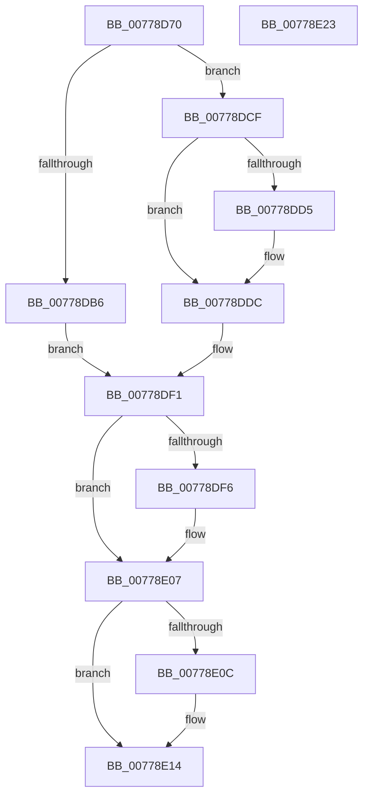

# TtmpDispatchSetDisplayTimeouts

- RVA: `0x00778D70`–`0x00778E24` (길이 `180` bytes)
- VA: `0x0000000140778D70`
- 실행 섹션: `PAGE`
- PDB 이름 있음: `예`; PDB Function 태그: `아니요`
- unwind 정보 RVA: `0x000CDC94`
- 디코드: `53`개 명령, `180/180` bytes 표시
- 미해석 바이트: `0` (있으면 어셈블리에 `.byte`로 보존)

> 이 문서는 커널 이미지의 기계어와 PDB 기호를 분석해 생성했습니다. 4번과 5번은 함수 원형과 자료형을 바이너리 사용 방식에서 추정한 C 해석이며 원본 소스 복구 결과는 아닙니다.

## 1. Dependencies

- 직접 호출 지점: **6**; 고유 호출 대상: **6**
- 직접 호출자로 확인된 함수: **1**
- RIP 상대 이미지 참조: **2**

### Outgoing calls
- `0x00778DA1` → [TtmpAcquireSessionFromTerminalHandle](TtmpAcquireSessionFromTerminalHandle_function_00778544.md) (function, `0x00778544`)
- `0x00778DC8` → [TtmiLogError](../98/TtmiLogError_function_0098B39C.md) (function, `0x0098B39C`)
- `0x00778DEA` → [TtmiTerminalSetDisplayTimeouts](TtmiTerminalSetDisplayTimeouts_function_0077D204.md) (function, `0x0077D204`)
- `0x00778DFD` → [ExReleaseResourceLite](../../text/25/ExReleaseResourceLite_function_0025FA10.md) (function, `0x0025FA10`)
- `0x00778E02` → [KeLeaveCriticalRegion](../../text/25/KeLeaveCriticalRegion_function_0025D8B0.md) (function, `0x0025D8B0`)
- `0x00778E0F` → [ObfDereferenceObject](../../text/2F/ObfDereferenceObject_function_002F9350.md) (function, `0x002F9350`)

### Direct callers
- [TtmDispatchApi](../98/TtmDispatchApi_function_0098AD08.md) at `0x0098AF21`

### Static image references
- `0x00778DB9` → RVA `0x00B045F0` (` ?? ::NNGAKEGL::`string'`; read)
- `0x00778DF6` → RVA `0x00F06940` (`.data`; read)

## 2. Other-region calls and transfers

- 다른 실행 섹션으로 향하는 call: **3**
  - `0x00778DFD` → [ExReleaseResourceLite](../../text/25/ExReleaseResourceLite_function_0025FA10.md) (`PAGE` → `.text`)
  - `0x00778E02` → [KeLeaveCriticalRegion](../../text/25/KeLeaveCriticalRegion_function_0025D8B0.md) (`PAGE` → `.text`)
  - `0x00778E0F` → [ObfDereferenceObject](../../text/2F/ObfDereferenceObject_function_002F9350.md) (`PAGE` → `.text`)
- 별도 외부 분기/꼬리 이동을 확인하지 못했습니다.

## 3. Assembly (complete function range)

```asm
00778D70  4C 8B DC                        mov r11, rsp
00778D73  49 89 5B 18                     mov qword ptr [r11 + 0x18], rbx
00778D77  55                              push rbp
00778D78  56                              push rsi
00778D79  57                              push rdi
00778D7A  48 83 EC 30                     sub rsp, 0x30
00778D7E  49 83 63 08 00                  and qword ptr [r11 + 8], 0
00778D83  49 8D 43 10                     lea rax, [r11 + 0x10]
00778D87  49 83 63 10 00                  and qword ptr [r11 + 0x10], 0
00778D8C  4D 8D 4B 08                     lea r9, [r11 + 8]
00778D90  41 B0 01                        mov r8b, 1
00778D93  49 89 43 D8                     mov qword ptr [r11 - 0x28], rax
00778D97  48 8B E9                        mov rbp, rcx
00778D9A  41 8A D0                        mov dl, r8b
00778D9D  48 8B 49 08                     mov rcx, qword ptr [rcx + 8]
00778DA1  E8 9E F7 FF FF                  call 0x140778544
00778DA6  48 8B 74 24 50                  mov rsi, qword ptr [rsp + 0x50]
00778DAB  8B F8                           mov edi, eax
00778DAD  48 8B 5C 24 58                  mov rbx, qword ptr [rsp + 0x58]
00778DB2  85 C0                           test eax, eax
00778DB4  79 19                           jns 0x140778dcf
00778DB6  44 8B C8                        mov r9d, eax
00778DB9  48 8D 0D 30 B8 38 00            lea rcx, [rip + 0x38b830]
00778DC0  44 8B C0                        mov r8d, eax
00778DC3  BA 1A 02 00 00                  mov edx, 0x21a
00778DC8  E8 CF 25 21 00                  call 0x14098b39c
00778DCD  EB 22                           jmp 0x140778df1
00778DCF  83 7B 1C 00                     cmp dword ptr [rbx + 0x1c], 0
00778DD3  75 07                           jne 0x140778ddc
00778DD5  C6 86 F0 00 00 00 00            mov byte ptr [rsi + 0xf0], 0
00778DDC  44 8B 4D 14                     mov r9d, dword ptr [rbp + 0x14]
00778DE0  48 8B D3                        mov rdx, rbx
00778DE3  44 8B 45 10                     mov r8d, dword ptr [rbp + 0x10]
00778DE7  48 8B CE                        mov rcx, rsi
00778DEA  E8 15 44 00 00                  call 0x14077d204
00778DEF  33 FF                           xor edi, edi
00778DF1  48 85 F6                        test rsi, rsi
00778DF4  74 11                           je 0x140778e07
00778DF6  48 8D 0D 43 DB 78 00            lea rcx, [rip + 0x78db43]
00778DFD  E8 0E 6C AE FF                  call 0x14025fa10
00778E02  E8 A9 4A AE FF                  call 0x14025d8b0
00778E07  48 85 DB                        test rbx, rbx
00778E0A  74 08                           je 0x140778e14
00778E0C  48 8B CB                        mov rcx, rbx
00778E0F  E8 3C 05 B8 FF                  call 0x1402f9350
00778E14  48 8B 5C 24 60                  mov rbx, qword ptr [rsp + 0x60]
00778E19  8B C7                           mov eax, edi
00778E1B  48 83 C4 30                     add rsp, 0x30
00778E1F  5F                              pop rdi
00778E20  5E                              pop rsi
00778E21  5D                              pop rbp
00778E22  C3                              ret
00778E23  CC                              int3
```

## 4. C-style interpretation (structured pseudocode)

```c
__int64 __fastcall TtmpDispatchSetDisplayTimeouts(__int64 a1)
{
    __int64 result;
    __int64 v_rdi;
    __int64 v_rsp;
    unsigned __int64 v_stack_p10;
    unsigned __int64 v_stack_p18;
    unsigned __int64 v_stack_p8;

    *(unsigned __int64 *)(v_rsp + 24) = v_rbx;
    v_rsp = (v_rsp) - (48);
    *(unsigned __int64 *)(v_rsp - 40) = v_rsp + 16;
    result = TtmpAcquireSessionFromTerminalHandle(*(unsigned __int64 *)(a1 + 8), 1, 1, v_rsp + 8);
    if (!sign_flag) goto loc_00778DCF;
    result = TtmiLogError(v_rip + 3717168, 538, (unsigned int)((unsigned int)(result)), (unsigned int)((unsigned int)(result)));
    goto loc_00778DF1;
loc_00778DCF:
    if ((*(unsigned int *)(v_stack_p10 + 28)) == 0) {
        *(unsigned __int8 *)(v_stack_p8 + 240) = 0;
    }
    result = TtmiTerminalSetDisplayTimeouts(v_stack_p8, v_stack_p10, (unsigned int)(*(unsigned int *)(a1 + 16)), (unsigned int)(*(unsigned int *)(a1 + 20)));
    v_rdi = 0;
loc_00778DF1:
    if (v_stack_p8 != 0) {
        a1 = v_rip + 7920451;
        result = ExReleaseResourceLite(a1, v_stack_p10, (unsigned int)(*(unsigned int *)(a1 + 16)), (unsigned int)(*(unsigned int *)(a1 + 20)));
        result = KeLeaveCriticalRegion(a1, v_stack_p10, (unsigned int)(*(unsigned int *)(a1 + 16)), (unsigned int)(*(unsigned int *)(a1 + 20)));
    }
    if (v_stack_p10 != 0) {
        a1 = v_stack_p10;
        result = ObfDereferenceObject(a1, v_stack_p10, (unsigned int)(*(unsigned int *)(a1 + 16)), (unsigned int)(*(unsigned int *)(a1 + 20)));
    }
    v_rsp = (v_rsp) + (48);
    return 0;
}
```

## 5. (Beta) C Style

```c
int64_t TtmpDispatchSetDisplayTimeouts(void *Arg1)
{
    uint8_t *arg1 = (uint8_t *)Arg1;

    int64_t result;
    int64_t local_rdi;
    int64_t local_rsp;
    uint64_t v_stack_p10;
    uint64_t v_stack_p18;
    uint64_t v_stack_p8;

    *(uint64_t *)(local_rsp + 0x18) = local_rbx;
    local_rsp = (local_rsp) - (48);
    *(uint64_t *)(local_rsp - 0x28) = local_rsp + 16;
    result = TtmpAcquireSessionFromTerminalHandle(*(uint64_t *)(arg1 + 0x8), 1, 1, local_rsp + 8);
    if (!sign_flag) goto loc_00778DCF;
    result = TtmiLogError(v_rip + 3717168, 538, (uint32_t)((uint32_t)(result)), (uint32_t)((uint32_t)(result)));
    goto loc_00778DF1;
loc_00778DCF:
    if ((*(uint32_t *)(v_stack_p10 + 0x1C)) == 0) {
        *(uint8_t *)(v_stack_p8 + 0xF0) = 0;
    }
    result = TtmiTerminalSetDisplayTimeouts(v_stack_p8, v_stack_p10, (uint32_t)(*(uint32_t *)(arg1 + 0x10)), (uint32_t)(*(uint32_t *)(arg1 + 0x14)));
    local_rdi = 0;
loc_00778DF1:
    if (v_stack_p8 != 0) {
        Arg1 = v_rip + 7920451;
        result = ExReleaseResourceLite(Arg1, v_stack_p10, (uint32_t)(*(uint32_t *)(arg1 + 0x10)), (uint32_t)(*(uint32_t *)(arg1 + 0x14)));
        result = KeLeaveCriticalRegion(Arg1, v_stack_p10, (uint32_t)(*(uint32_t *)(arg1 + 0x10)), (uint32_t)(*(uint32_t *)(arg1 + 0x14)));
    }
    if (v_stack_p10 != 0) {
        Arg1 = v_stack_p10;
        result = ObfDereferenceObject(Arg1, v_stack_p10, (uint32_t)(*(uint32_t *)(arg1 + 0x10)), (uint32_t)(*(uint32_t *)(arg1 + 0x14)));
    }
    local_rsp = (local_rsp) + (48);
    return 0;
}
```

### 관측된 메모리 오프셋

구조체 형식이 확인되지 않은 접근은 인자 기준의 오프셋으로만 기록했습니다.

| 기준 인자 | 오프셋 표현 | 폭 (bit) | 접근 |
|---|---:|---:|---|
| `Arg1` | `+ 0x8` | `64` | `R` |
| `Arg1` | `+ 0x10` | `32` | `R` |
| `Arg1` | `+ 0x14` | `32` | `R` |

## 6. Execution-region graph

[열기: 2D/3D 그래프와 함수 탐색 컨트롤 패널](../../../control-panel.html?section=page&rva=0x00778D70&view=graph)

- 2D 그래프는 위에서 아래로 흐르고, 3D 그래프는 빈 공간을 드래그해 회전합니다. Shift+드래그는 이동, 휠은 확대·축소, 함수 노드 선택은 대상 보고서 이동입니다.

### Static fallback


