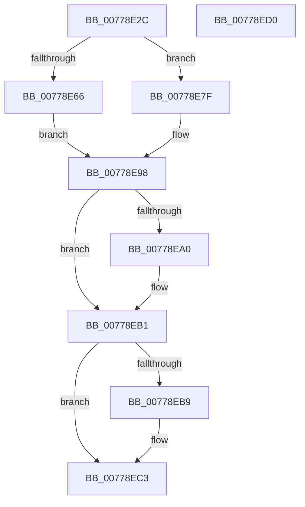

# TtmpDispatchSetInputWakeCapability

- RVA: `0x00778E2C`–`0x00778ED1` (길이 `165` bytes)
- VA: `0x0000000140778E2C`
- 실행 섹션: `PAGE`
- PDB 이름 있음: `예`; PDB Function 태그: `아니요`
- unwind 정보 RVA: `0x000CDC84`
- 디코드: `44`개 명령, `165/165` bytes 표시
- 미해석 바이트: `0` (있으면 어셈블리에 `.byte`로 보존)

> 이 문서는 커널 이미지의 기계어와 PDB 기호를 분석해 생성했습니다. 4번과 5번은 함수 원형과 자료형을 바이너리 사용 방식에서 추정한 C 해석이며 원본 소스 복구 결과는 아닙니다.

## 1. Dependencies

- 직접 호출 지점: **6**; 고유 호출 대상: **6**
- 직접 호출자로 확인된 함수: **1**
- RIP 상대 이미지 참조: **2**

### Outgoing calls
- `0x00778E5B` → [TtmpAcquireSessionFromTerminalHandle](TtmpAcquireSessionFromTerminalHandle_function_00778544.md) (function, `0x00778544`)
- `0x00778E78` → [TtmiLogError](../98/TtmiLogError_function_0098B39C.md) (function, `0x0098B39C`)
- `0x00778E91` → [TtmiSetInputWakeCapability](TtmiSetInputWakeCapability_function_00775E84.md) (function, `0x00775E84`)
- `0x00778EA7` → [ExReleaseResourceLite](../../text/25/ExReleaseResourceLite_function_0025FA10.md) (function, `0x0025FA10`)
- `0x00778EAC` → [KeLeaveCriticalRegion](../../text/25/KeLeaveCriticalRegion_function_0025D8B0.md) (function, `0x0025D8B0`)
- `0x00778EBE` → [ObfDereferenceObject](../../text/2F/ObfDereferenceObject_function_002F9350.md) (function, `0x002F9350`)

### Direct callers
- [TtmDispatchApi](../98/TtmDispatchApi_function_0098AD08.md) at `0x0098AF0D`

### Static image references
- `0x00778E69` → RVA `0x00B044F0` (` ?? ::NNGAKEGL::`string'`; read)
- `0x00778EA0` → RVA `0x00F06940` (`.data`; read)

## 2. Other-region calls and transfers

- 다른 실행 섹션으로 향하는 call: **3**
  - `0x00778EA7` → [ExReleaseResourceLite](../../text/25/ExReleaseResourceLite_function_0025FA10.md) (`PAGE` → `.text`)
  - `0x00778EAC` → [KeLeaveCriticalRegion](../../text/25/KeLeaveCriticalRegion_function_0025D8B0.md) (`PAGE` → `.text`)
  - `0x00778EBE` → [ObfDereferenceObject](../../text/2F/ObfDereferenceObject_function_002F9350.md) (`PAGE` → `.text`)
- 별도 외부 분기/꼬리 이동을 확인하지 못했습니다.

## 3. Assembly (complete function range)

```asm
00778E2C  4C 8B DC                        mov r11, rsp
00778E2F  49 89 5B 18                     mov qword ptr [r11 + 0x18], rbx
00778E33  55                              push rbp
00778E34  48 83 EC 30                     sub rsp, 0x30
00778E38  49 83 63 10 00                  and qword ptr [r11 + 0x10], 0
00778E3D  49 8D 43 08                     lea rax, [r11 + 8]
00778E41  49 83 63 08 00                  and qword ptr [r11 + 8], 0
00778E46  4D 8D 4B 10                     lea r9, [r11 + 0x10]
00778E4A  41 B0 01                        mov r8b, 1
00778E4D  49 89 43 E8                     mov qword ptr [r11 - 0x18], rax
00778E51  48 8B E9                        mov rbp, rcx
00778E54  41 8A D0                        mov dl, r8b
00778E57  48 8B 49 08                     mov rcx, qword ptr [rcx + 8]
00778E5B  E8 E4 F6 FF FF                  call 0x140778544
00778E60  8B D8                           mov ebx, eax
00778E62  85 C0                           test eax, eax
00778E64  79 19                           jns 0x140778e7f
00778E66  44 8B C8                        mov r9d, eax
00778E69  48 8D 0D 80 B6 38 00            lea rcx, [rip + 0x38b680]
00778E70  44 8B C0                        mov r8d, eax
00778E73  BA A5 03 00 00                  mov edx, 0x3a5
00778E78  E8 1F 25 21 00                  call 0x14098b39c
00778E7D  EB 19                           jmp 0x140778e98
00778E7F  44 8B 4D 14                     mov r9d, dword ptr [rbp + 0x14]
00778E83  44 8B 45 10                     mov r8d, dword ptr [rbp + 0x10]
00778E87  48 8B 54 24 40                  mov rdx, qword ptr [rsp + 0x40]
00778E8C  48 8B 4C 24 48                  mov rcx, qword ptr [rsp + 0x48]
00778E91  E8 EE CF FF FF                  call 0x140775e84
00778E96  8B D8                           mov ebx, eax
00778E98  48 83 7C 24 48 00               cmp qword ptr [rsp + 0x48], 0
00778E9E  74 11                           je 0x140778eb1
00778EA0  48 8D 0D 99 DA 78 00            lea rcx, [rip + 0x78da99]
00778EA7  E8 64 6B AE FF                  call 0x14025fa10
00778EAC  E8 FF 49 AE FF                  call 0x14025d8b0
00778EB1  48 83 7C 24 40 00               cmp qword ptr [rsp + 0x40], 0
00778EB7  74 0A                           je 0x140778ec3
00778EB9  48 8B 4C 24 40                  mov rcx, qword ptr [rsp + 0x40]
00778EBE  E8 8D 04 B8 FF                  call 0x1402f9350
00778EC3  8B C3                           mov eax, ebx
00778EC5  48 8B 5C 24 50                  mov rbx, qword ptr [rsp + 0x50]
00778ECA  48 83 C4 30                     add rsp, 0x30
00778ECE  5D                              pop rbp
00778ECF  C3                              ret
00778ED0  CC                              int3
```

## 4. C-style interpretation (structured pseudocode)

```c
__int64 __fastcall TtmpDispatchSetInputWakeCapability(__int64 a1)
{
    __int64 result;
    __int64 v_rsp;
    unsigned __int64 v_stack_p10;
    unsigned __int64 v_stack_p18;
    unsigned __int64 v_stack_p8;

    *(unsigned __int64 *)(v_rsp + 24) = v_rbx;
    v_rsp = (v_rsp) - (48);
    *(unsigned __int64 *)(v_rsp - 24) = v_rsp + 8;
    result = TtmpAcquireSessionFromTerminalHandle(*(unsigned __int64 *)(a1 + 8), 1, 1, v_rsp + 16);
    if (!sign_flag) goto loc_00778E7F;
    result = TtmiLogError(v_rip + 3716736, 933, (unsigned int)((unsigned int)(result)), (unsigned int)((unsigned int)(result)));
    goto loc_00778E98;
loc_00778E7F:
    result = TtmiSetInputWakeCapability(v_stack_p10, v_stack_p8, (unsigned int)(*(unsigned int *)(a1 + 16)), (unsigned int)(*(unsigned int *)(a1 + 20)));
loc_00778E98:
    if (v_stack_p10 != 0) {
        a1 = v_rip + 7920281;
        result = ExReleaseResourceLite(a1, v_stack_p8, (unsigned int)(*(unsigned int *)(a1 + 16)), (unsigned int)(*(unsigned int *)(a1 + 20)));
        result = KeLeaveCriticalRegion(a1, v_stack_p8, (unsigned int)(*(unsigned int *)(a1 + 16)), (unsigned int)(*(unsigned int *)(a1 + 20)));
    }
    if (v_stack_p8 != 0) {
        a1 = v_stack_p8;
        result = ObfDereferenceObject(a1, v_stack_p8, (unsigned int)(*(unsigned int *)(a1 + 16)), (unsigned int)(*(unsigned int *)(a1 + 20)));
    }
    v_rsp = (v_rsp) + (48);
    return (unsigned int)((unsigned int)((unsigned int)((unsigned int)(result))));
}
```

## 5. (Beta) C Style

```c
int64_t TtmpDispatchSetInputWakeCapability(void *Arg1)
{
    uint8_t *arg1 = (uint8_t *)Arg1;

    int64_t result;
    int64_t local_rsp;
    uint64_t v_stack_p10;
    uint64_t v_stack_p18;
    uint64_t v_stack_p8;

    *(uint64_t *)(local_rsp + 0x18) = local_rbx;
    local_rsp = (local_rsp) - (48);
    *(uint64_t *)(local_rsp - 0x18) = local_rsp + 8;
    result = TtmpAcquireSessionFromTerminalHandle(*(uint64_t *)(arg1 + 0x8), 1, 1, local_rsp + 16);
    if (!sign_flag) goto loc_00778E7F;
    result = TtmiLogError(v_rip + 3716736, 933, (uint32_t)((uint32_t)(result)), (uint32_t)((uint32_t)(result)));
    goto loc_00778E98;
loc_00778E7F:
    result = TtmiSetInputWakeCapability(v_stack_p10, v_stack_p8, (uint32_t)(*(uint32_t *)(arg1 + 0x10)), (uint32_t)(*(uint32_t *)(arg1 + 0x14)));
loc_00778E98:
    if (v_stack_p10 != 0) {
        Arg1 = v_rip + 7920281;
        result = ExReleaseResourceLite(Arg1, v_stack_p8, (uint32_t)(*(uint32_t *)(arg1 + 0x10)), (uint32_t)(*(uint32_t *)(arg1 + 0x14)));
        result = KeLeaveCriticalRegion(Arg1, v_stack_p8, (uint32_t)(*(uint32_t *)(arg1 + 0x10)), (uint32_t)(*(uint32_t *)(arg1 + 0x14)));
    }
    if (v_stack_p8 != 0) {
        Arg1 = v_stack_p8;
        result = ObfDereferenceObject(Arg1, v_stack_p8, (uint32_t)(*(uint32_t *)(arg1 + 0x10)), (uint32_t)(*(uint32_t *)(arg1 + 0x14)));
    }
    local_rsp = (local_rsp) + (48);
    return (uint32_t)((uint32_t)((uint32_t)((uint32_t)(result))));
}
```

### 관측된 메모리 오프셋

구조체 형식이 확인되지 않은 접근은 인자 기준의 오프셋으로만 기록했습니다.

| 기준 인자 | 오프셋 표현 | 폭 (bit) | 접근 |
|---|---:|---:|---|
| `Arg1` | `+ 0x8` | `64` | `R` |
| `Arg1` | `+ 0x10` | `32` | `R` |
| `Arg1` | `+ 0x14` | `32` | `R` |

## 6. Execution-region graph

[열기: 2D/3D 그래프와 함수 탐색 컨트롤 패널](../../../control-panel.html?section=page&rva=0x00778E2C&view=graph)

- 2D 그래프는 위에서 아래로 흐르고, 3D 그래프는 빈 공간을 드래그해 회전합니다. Shift+드래그는 이동, 휠은 확대·축소, 함수 노드 선택은 대상 보고서 이동입니다.

### Static fallback


