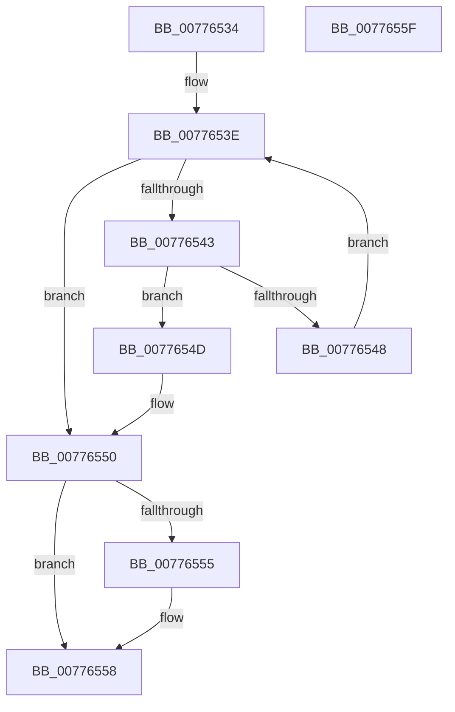

# TtmpFindDeviceByDeviceId

- RVA: `0x00776534`–`0x00776560` (길이 `44` bytes)
- VA: `0x0000000140776534`
- 실행 섹션: `PAGE`
- PDB 이름 있음: `예`; PDB Function 태그: `아니요`
- unwind 정보 RVA: `0x000DB714`
- 디코드: `17`개 명령, `44/44` bytes 표시
- 미해석 바이트: `0` (있으면 어셈블리에 `.byte`로 보존)

> 이 문서는 커널 이미지의 기계어와 PDB 기호를 분석해 생성했습니다. 4번과 5번은 함수 원형과 자료형을 바이너리 사용 방식에서 추정한 C 해석이며 원본 소스 복구 결과는 아닙니다.

## 1. Dependencies

- 직접 호출 지점: **0**; 고유 호출 대상: **0**
- 직접 호출자로 확인된 함수: **3**
- RIP 상대 이미지 참조: **0**

### Outgoing calls
- 직접 디코드된 call 명령이 없습니다.

### Direct callers
- [TtmiAssignDevice](TtmiAssignDevice_function_00775A3C.md) at `0x00775A65`
- [TtmiSetInputWakeCapability](TtmiSetInputWakeCapability_function_00775E84.md) at `0x00775EB1`
- [TtmpCommitTerminalDisplayStateUpdateWorker](TtmpCommitTerminalDisplayStateUpdateWorker_function_00776390.md) at `0x00776414`

### Static image references
- 디코드된 RIP-relative 메모리 참조가 없습니다.

## 2. Other-region calls and transfers

- 다른 실행 섹션으로 향하는 call: **0**
- 별도 외부 분기/꼬리 이동을 확인하지 못했습니다.

## 3. Assembly (complete function range)

```asm
00776534  45 33 C9                        xor r9d, r9d
00776537  48 83 C1 60                     add rcx, 0x60
0077653B  48 8B 01                        mov rax, qword ptr [rcx]
0077653E  48 3B C1                        cmp rax, rcx
00776541  74 0D                           je 0x140776550
00776543  39 50 20                        cmp dword ptr [rax + 0x20], edx
00776546  74 05                           je 0x14077654d
00776548  48 8B 00                        mov rax, qword ptr [rax]
0077654B  EB F1                           jmp 0x14077653e
0077654D  4C 8B C8                        mov r9, rax
00776550  4D 85 C0                        test r8, r8
00776553  74 03                           je 0x140776558
00776555  4D 89 08                        mov qword ptr [r8], r9
00776558  4D 85 C9                        test r9, r9
0077655B  0F 95 C0                        setne al
0077655E  C3                              ret
0077655F  CC                              int3
```

## 4. C-style interpretation (structured pseudocode)

```c
__int64 __fastcall TtmpFindDeviceByDeviceId(__int64 a1, int a2, __int64 a3, int a4)
{
    __int64 result;

    a4 = 0;
    a1 = (a1) + (96);
loc_0077653E:
    if ((*(unsigned __int64 *)(a1)) == a1) goto loc_00776550;
    if ((*(unsigned int *)(*(unsigned __int64 *)(a1) + 32)) == a2) goto loc_0077654D;
    goto loc_0077653E;
loc_0077654D:
loc_00776550:
    if (a3 != 0) {
        *(unsigned __int64 *)(a3) = *(unsigned __int64 *)(*(unsigned __int64 *)(a1));
    }
    result = (*(unsigned __int64 *)(*(unsigned __int64 *)(a1)) != 0) ? 1 : 0;
    return result;
}
```

## 5. (Beta) C Style

```c
int64_t TtmpFindDeviceByDeviceId(void *Arg1, int32_t Arg2, int64_t Arg3, int32_t Arg4)
{
    uint8_t *arg1 = (uint8_t *)Arg1;

    int64_t result;

    Arg4 = 0;
    Arg1 = (Arg1) + (96);
loc_0077653E:
    if ((*(uint64_t *)(arg1)) == Arg1) goto loc_00776550;
    if ((*(uint32_t *)(*(uint64_t *)(arg1) + 0x20)) == Arg2) goto loc_0077654D;
    goto loc_0077653E;
loc_0077654D:
loc_00776550:
    if (Arg3 != 0) {
        *(uint64_t *)(Arg3) = *(uint64_t *)(*(uint64_t *)(arg1));
    }
    result = (*(uint64_t *)(*(uint64_t *)(arg1)) != 0) ? 1 : 0;
    return result;
}
```

### 관측된 메모리 오프셋

구조체 형식이 확인되지 않은 접근은 인자 기준의 오프셋으로만 기록했습니다.

| 기준 인자 | 오프셋 표현 | 폭 (bit) | 접근 |
|---|---:|---:|---|
| `Arg1` | `+ 0x0` | `64` | `R` |

## 6. Execution-region graph

[열기: 2D/3D 그래프와 함수 탐색 컨트롤 패널](../../../control-panel.html?section=page&rva=0x00776534&view=graph)

- 2D 그래프는 위에서 아래로 흐르고, 3D 그래프는 빈 공간을 드래그해 회전합니다. Shift+드래그는 이동, 휠은 확대·축소, 함수 노드 선택은 대상 보고서 이동입니다.

### Static fallback


