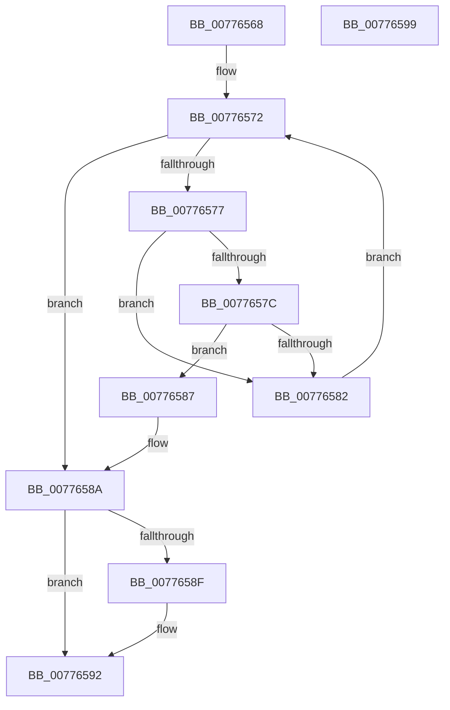

# TtmpFindDeviceByToken

- RVA: `0x00776568`–`0x0077659A` (길이 `50` bytes)
- VA: `0x0000000140776568`
- 실행 섹션: `PAGE`
- PDB 이름 있음: `예`; PDB Function 태그: `아니요`
- unwind 정보 RVA: `0x000DB714`
- 디코드: `19`개 명령, `50/50` bytes 표시
- 미해석 바이트: `0` (있으면 어셈블리에 `.byte`로 보존)

> 이 문서는 커널 이미지의 기계어와 PDB 기호를 분석해 생성했습니다. 4번과 5번은 함수 원형과 자료형을 바이너리 사용 방식에서 추정한 C 해석이며 원본 소스 복구 결과는 아닙니다.

## 1. Dependencies

- 직접 호출 지점: **0**; 고유 호출 대상: **0**
- 직접 호출자로 확인된 함수: **3**
- RIP 상대 이미지 참조: **0**

### Outgoing calls
- 직접 디코드된 call 명령이 없습니다.

### Direct callers
- [TtmNotifyDeviceArrival](TtmNotifyDeviceArrival_function_007754F0.md) at `0x007755EE`
- [TtmNotifyDeviceDeparture](TtmNotifyDeviceDeparture_function_007757F0.md) at `0x00775846`
- [TtmNotifyDeviceInput](TtmNotifyDeviceInput_function_007758B0.md) at `0x0077599D`

### Static image references
- 디코드된 RIP-relative 메모리 참조가 없습니다.

## 2. Other-region calls and transfers

- 다른 실행 섹션으로 향하는 call: **0**
- 별도 외부 분기/꼬리 이동을 확인하지 못했습니다.

## 3. Assembly (complete function range)

```asm
00776568  45 33 D2                        xor r10d, r10d
0077656B  48 83 C1 60                     add rcx, 0x60
0077656F  48 8B 01                        mov rax, qword ptr [rcx]
00776572  48 3B C1                        cmp rax, rcx
00776575  74 13                           je 0x14077658a
00776577  39 50 10                        cmp dword ptr [rax + 0x10], edx
0077657A  75 06                           jne 0x140776582
0077657C  4C 39 40 18                     cmp qword ptr [rax + 0x18], r8
00776580  74 05                           je 0x140776587
00776582  48 8B 00                        mov rax, qword ptr [rax]
00776585  EB EB                           jmp 0x140776572
00776587  4C 8B D0                        mov r10, rax
0077658A  4D 85 C9                        test r9, r9
0077658D  74 03                           je 0x140776592
0077658F  4D 89 11                        mov qword ptr [r9], r10
00776592  4D 85 D2                        test r10, r10
00776595  0F 95 C0                        setne al
00776598  C3                              ret
00776599  CC                              int3
```

## 4. C-style interpretation (structured pseudocode)

```c
__int64 __fastcall TtmpFindDeviceByToken(__int64 a1, int a2, __int64 a3, __int64 a4)
{
    __int64 result;
    __int64 v_r10;

    v_r10 = 0;
    a1 = (a1) + (96);
loc_00776572:
    if ((*(unsigned __int64 *)(a1)) == a1) goto loc_0077658A;
    if ((*(unsigned int *)(*(unsigned __int64 *)(a1) + 16)) != a2) goto loc_00776582;
    if ((*(unsigned __int64 *)(*(unsigned __int64 *)(a1) + 24)) == a3) goto loc_00776587;
loc_00776582:
    goto loc_00776572;
loc_00776587:
loc_0077658A:
    if (a4 != 0) {
        *(unsigned __int64 *)(a4) = *(unsigned __int64 *)(*(unsigned __int64 *)(a1));
    }
    result = (*(unsigned __int64 *)(*(unsigned __int64 *)(a1)) != 0) ? 1 : 0;
    return result;
}
```

## 5. (Beta) C Style

```c
int64_t TtmpFindDeviceByToken(void *Arg1, int32_t Arg2, int64_t Arg3, int64_t Arg4)
{
    uint8_t *arg1 = (uint8_t *)Arg1;

    int64_t result;
    int64_t local_r10;

    local_r10 = 0;
    Arg1 = (Arg1) + (96);
loc_00776572:
    if ((*(uint64_t *)(arg1)) == Arg1) goto loc_0077658A;
    if ((*(uint32_t *)(*(uint64_t *)(arg1) + 0x10)) != Arg2) goto loc_00776582;
    if ((*(uint64_t *)(*(uint64_t *)(arg1) + 0x18)) == Arg3) goto loc_00776587;
loc_00776582:
    goto loc_00776572;
loc_00776587:
loc_0077658A:
    if (Arg4 != 0) {
        *(uint64_t *)(Arg4) = *(uint64_t *)(*(uint64_t *)(arg1));
    }
    result = (*(uint64_t *)(*(uint64_t *)(arg1)) != 0) ? 1 : 0;
    return result;
}
```

### 관측된 메모리 오프셋

구조체 형식이 확인되지 않은 접근은 인자 기준의 오프셋으로만 기록했습니다.

| 기준 인자 | 오프셋 표현 | 폭 (bit) | 접근 |
|---|---:|---:|---|
| `Arg1` | `+ 0x0` | `64` | `R` |

## 6. Execution-region graph

[열기: 2D/3D 그래프와 함수 탐색 컨트롤 패널](../../../control-panel.html?section=page&rva=0x00776568&view=graph)

- 2D 그래프는 위에서 아래로 흐르고, 3D 그래프는 빈 공간을 드래그해 회전합니다. Shift+드래그는 이동, 휠은 확대·축소, 함수 노드 선택은 대상 보고서 이동입니다.

### Static fallback


