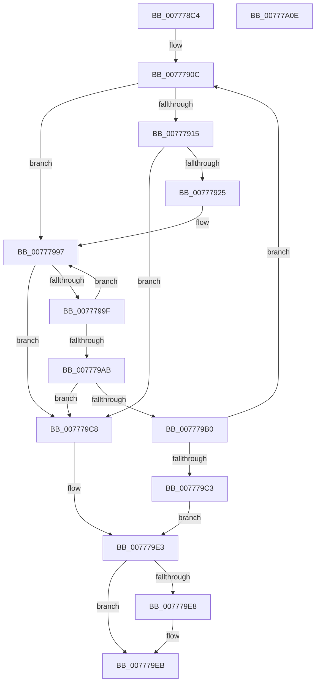

# TtmpFindPowerRequestEntryById

- RVA: `0x007778C4`–`0x00777A0F` (길이 `331` bytes)
- VA: `0x00000001407778C4`
- 실행 섹션: `PAGE`
- PDB 이름 있음: `예`; PDB Function 태그: `아니요`
- unwind 정보 RVA: `0x0005D79C`
- 디코드: `93`개 명령, `331/331` bytes 표시
- 미해석 바이트: `0` (있으면 어셈블리에 `.byte`로 보존)

> 이 문서는 커널 이미지의 기계어와 PDB 기호를 분석해 생성했습니다. 4번과 5번은 함수 원형과 자료형을 바이너리 사용 방식에서 추정한 C 해석이며 원본 소스 복구 결과는 아닙니다.

## 1. Dependencies

- 직접 호출 지점: **2**; 고유 호출 대상: **2**
- 직접 호출자로 확인된 함수: **4**
- RIP 상대 이미지 참조: **1**

### Outgoing calls
- `0x007779B6` → [TtmpPowerRequestEntryComparator](TtmpPowerRequestEntryComparator_function_00777DC4.md) (function, `0x00777DC4`)
- `0x007779DE` → [TtmiLogError](../98/TtmiLogError_function_0098B39C.md) (function, `0x0098B39C`)

### Direct callers
- [TtmiSetDisplayPowerRequest](TtmiSetDisplayPowerRequest_function_0077727C.md) at `0x007772BF`
- [TtmiSetDisplayPowerRequest](TtmiSetDisplayPowerRequest_function_0077727C.md) at `0x007773C3`
- [TtmpSetDisplayRequestEnded](TtmpSetDisplayRequestEnded_function_00778124.md) at `0x00778147`
- [TtmpUpdateDisplayRequiredPowerRequest](TtmpUpdateDisplayRequiredPowerRequest_function_00778304.md) at `0x0077832A`
- [TtmpUpdatePowerRequestAttribute](TtmpUpdatePowerRequestAttribute_function_007783D4.md) at `0x00778434`

### Static image references
- `0x007779CC` → RVA `0x00B04290` (` ?? ::NNGAKEGL::`string'`; read)

## 2. Other-region calls and transfers

- 다른 실행 섹션으로 향하는 call: **0**
- 별도 외부 분기/꼬리 이동을 확인하지 못했습니다.

## 3. Assembly (complete function range)

```asm
007778C4  48 89 5C 24 10                  mov qword ptr [rsp + 0x10], rbx
007778C9  48 89 6C 24 18                  mov qword ptr [rsp + 0x18], rbp
007778CE  48 89 74 24 20                  mov qword ptr [rsp + 0x20], rsi
007778D3  57                              push rdi
007778D4  41 54                           push r12
007778D6  41 55                           push r13
007778D8  41 56                           push r14
007778DA  41 57                           push r15
007778DC  48 83 EC 20                     sub rsp, 0x20
007778E0  44 8B B9 14 01 00 00            mov r15d, dword ptr [rcx + 0x114]
007778E7  4C 8B E9                        mov r13, rcx
007778EA  48 83 CD FF                     or rbp, 0xffffffffffffffff
007778EE  4C 63 E2                        movsxd r12, edx
007778F1  41 8B CF                        mov ecx, r15d
007778F4  33 FF                           xor edi, edi
007778F6  83 E1 1F                        and ecx, 0x1f
007778F9  33 DB                           xor ebx, ebx
007778FB  48 D3 E5                        shl rbp, cl
007778FE  49 8B F4                        mov rsi, r12
00777901  48 23 F5                        and rsi, rbp
00777904  4D 8B F0                        mov r14, r8
00777907  48 89 74 24 50                  mov qword ptr [rsp + 0x50], rsi
0077790C  48 85 DB                        test rbx, rbx
0077790F  0F 85 82 00 00 00               jne 0x140777997
00777915  45 8B CF                        mov r9d, r15d
00777918  41 C1 E9 05                     shr r9d, 5
0077791C  45 85 C9                        test r9d, r9d
0077791F  0F 84 A3 00 00 00               je 0x1407779c8
00777925  40 0F B6 C6                     movzx eax, sil
00777929  48 05 CB 5D B1 00               add rax, 0xb15dcb
0077792F  48 6B C8 25                     imul rcx, rax, 0x25
00777933  0F B6 44 24 51                  movzx eax, byte ptr [rsp + 0x51]
00777938  48 03 C8                        add rcx, rax
0077793B  0F B6 44 24 52                  movzx eax, byte ptr [rsp + 0x52]
00777940  48 6B D1 25                     imul rdx, rcx, 0x25
00777944  48 03 D0                        add rdx, rax
00777947  0F B6 44 24 53                  movzx eax, byte ptr [rsp + 0x53]
0077794C  48 6B CA 25                     imul rcx, rdx, 0x25
00777950  48 03 C8                        add rcx, rax
00777953  0F B6 44 24 54                  movzx eax, byte ptr [rsp + 0x54]
00777958  48 6B D1 25                     imul rdx, rcx, 0x25
0077795C  48 03 D0                        add rdx, rax
0077795F  0F B6 44 24 55                  movzx eax, byte ptr [rsp + 0x55]
00777964  48 6B CA 25                     imul rcx, rdx, 0x25
00777968  48 03 C8                        add rcx, rax
0077796B  0F B6 44 24 56                  movzx eax, byte ptr [rsp + 0x56]
00777970  48 6B D1 25                     imul rdx, rcx, 0x25
00777974  41 8D 49 FF                     lea ecx, [r9 - 1]
00777978  48 03 D0                        add rdx, rax
0077797B  0F B6 44 24 57                  movzx eax, byte ptr [rsp + 0x57]
00777980  4C 6B C2 25                     imul r8, rdx, 0x25
00777984  49 03 C0                        add rax, r8
00777987  8B C0                           mov eax, eax
00777989  48 23 C8                        and rcx, rax
0077798C  49 8B 85 18 01 00 00            mov rax, qword ptr [r13 + 0x118]
00777993  48 8D 1C C8                     lea rbx, [rax + rcx*8]
00777997  48 8B 1B                        mov rbx, qword ptr [rbx]
0077799A  F6 C3 01                        test bl, 1
0077799D  75 29                           jne 0x1407779c8
0077799F  48 8B 43 08                     mov rax, qword ptr [rbx + 8]
007779A3  48 23 C5                        and rax, rbp
007779A6  48 3B F0                        cmp rsi, rax
007779A9  75 EC                           jne 0x140777997
007779AB  48 85 DB                        test rbx, rbx
007779AE  74 18                           je 0x1407779c8
007779B0  49 8B D4                        mov rdx, r12
007779B3  48 8B CB                        mov rcx, rbx
007779B6  E8 09 04 00 00                  call 0x140777dc4
007779BB  85 C0                           test eax, eax
007779BD  0F 84 49 FF FF FF               je 0x14077790c
007779C3  48 8B FB                        mov rdi, rbx
007779C6  EB 1B                           jmp 0x1407779e3
007779C8  41 83 C9 FF                     or r9d, 0xffffffff
007779CC  48 8D 0D BD C8 38 00            lea rcx, [rip + 0x38c8bd]
007779D3  BA 92 01 00 00                  mov edx, 0x192
007779D8  41 B8 25 02 00 C0               mov r8d, 0xc0000225
007779DE  E8 B9 39 21 00                  call 0x14098b39c
007779E3  4D 85 F6                        test r14, r14
007779E6  74 03                           je 0x1407779eb
007779E8  49 89 3E                        mov qword ptr [r14], rdi
007779EB  48 8B 5C 24 58                  mov rbx, qword ptr [rsp + 0x58]
007779F0  48 85 FF                        test rdi, rdi
007779F3  48 8B 6C 24 60                  mov rbp, qword ptr [rsp + 0x60]
007779F8  48 8B 74 24 68                  mov rsi, qword ptr [rsp + 0x68]
007779FD  0F 95 C0                        setne al
00777A00  48 83 C4 20                     add rsp, 0x20
00777A04  41 5F                           pop r15
00777A06  41 5E                           pop r14
00777A08  41 5D                           pop r13
00777A0A  41 5C                           pop r12
00777A0C  5F                              pop rdi
00777A0D  C3                              ret
00777A0E  CC                              int3
```

## 4. C-style interpretation (structured pseudocode)

```c
__int64 __fastcall TtmpFindPowerRequestEntryById(__int64 a1, int a2, __int64 a3)
{
    __int64 result;
    __int64 v_rbp;
    __int64 v_rbx;
    __int64 v_rdi;
    __int64 v_rsi;
    __int64 v_rsp;
    unsigned __int64 v_stack_p10;
    unsigned __int64 v_stack_p18;
    unsigned __int64 v_stack_p20;
    unsigned __int64 v_stack_p8;
    unsigned __int8 v_stack_p9;
    unsigned __int8 v_stack_pA;
    unsigned __int8 v_stack_pB;
    unsigned __int8 v_stack_pC;
    unsigned __int8 v_stack_pD;
    unsigned __int8 v_stack_pE;
    unsigned __int8 v_stack_pF;

    v_stack_p10 = v_rbx;
    v_stack_p18 = v_rbp;
    v_stack_p20 = v_rsi;
    v_rsp = (v_rsp) - (32);
    v_rbp = (v_rbp) | (-1);
    v_rdi = 0;
    a1 = (unsigned int)(((unsigned int)((unsigned int)((unsigned int)(*(unsigned int *)(a1 + 276))))) & (31));
    v_rbx = 0;
    v_rbp = (v_rbp) << ((unsigned __int8)(a1));
    v_rsi = ((int)(a2)) & (v_rbp);
    v_stack_p8 = v_rsi;
loc_0077790C:
    if (0 != 0) goto loc_00777997;
    a4 = (unsigned int)(((unsigned int)((unsigned int)((unsigned int)(*(unsigned int *)(a1 + 276))))) >> (5));
    if ((unsigned int)(a4) == 0) goto loc_007779C8;
    result = ((unsigned __int8)(v_rsi)) + (0xB15DCBULL);
    a1 = (a1) * (result);
    a1 = (a1) + (v_stack_p9);
    a2 = (a2) * (a1);
    a2 = (a2) + (v_stack_pA);
    a1 = (a1) * (a2);
    a1 = (a1) + (v_stack_pB);
    a2 = (a2) * (a1);
    a2 = (a2) + (v_stack_pC);
    a1 = (a1) * (a2);
    a1 = (a1) + (v_stack_pD);
    a2 = (a2) * (a1);
    a2 = (a2) + (v_stack_pE);
    a3 = (a3) * (a2);
    result = (v_stack_pF) + (a3);
    a1 = (a4 - 1) & ((unsigned int)((unsigned int)(result)));
loc_00777997:
    if ((((unsigned __int8)(*(unsigned __int64 *)(*(unsigned __int64 *)(a1 + 280) + a1 * 8))) & (1)) != 0) goto loc_007779C8;
    result = (*(unsigned __int64 *)(*(unsigned __int64 *)(*(unsigned __int64 *)(a1 + 280) + a1 * 8) + 8)) & (v_rbp);
    if (v_rsi != result) goto loc_00777997;
    if (*(unsigned __int64 *)(*(unsigned __int64 *)(a1 + 280) + a1 * 8) == 0) goto loc_007779C8;
    result = TtmpPowerRequestEntryComparator(*(unsigned __int64 *)(*(unsigned __int64 *)(a1 + 280) + a1 * 8), (int)(a2), a3, a4);
    if ((unsigned int)(result) == 0) goto loc_0077790C;
    goto loc_007779E3;
loc_007779C8:
    a4 = (unsigned int)((a4) | (0xFFFFFFFFULL));
    result = TtmiLogError(v_rip + 3721405, 402, (unsigned int)(0xC0000225ULL), a4);
loc_007779E3:
    if (a3 != 0) {
        *(unsigned __int64 *)(a3) = *(unsigned __int64 *)(*(unsigned __int64 *)(a1 + 280) + a1 * 8);
    }
    result = (*(unsigned __int64 *)(*(unsigned __int64 *)(a1 + 280) + a1 * 8) != 0) ? 1 : 0;
    v_rsp = (v_rsp) + (32);
    return result;
}
```

## 5. (Beta) C Style

```c
int64_t TtmpFindPowerRequestEntryById(void *Arg1, int32_t Arg2, int64_t Arg3)
{
    uint8_t *arg1 = (uint8_t *)Arg1;

    int64_t result;
    int64_t local_rbp;
    int64_t local_rbx;
    int64_t local_rdi;
    int64_t local_rsi;
    int64_t local_rsp;
    uint64_t v_stack_p10;
    uint64_t v_stack_p18;
    uint64_t v_stack_p20;
    uint64_t v_stack_p8;
    uint8_t v_stack_p9;
    uint8_t v_stack_pA;
    uint8_t v_stack_pB;
    uint8_t v_stack_pC;
    uint8_t v_stack_pD;
    uint8_t v_stack_pE;
    uint8_t v_stack_pF;

    v_stack_p10 = local_rbx;
    v_stack_p18 = local_rbp;
    v_stack_p20 = local_rsi;
    local_rsp = (local_rsp) - (32);
    local_rbp = (local_rbp) | (-1);
    local_rdi = 0;
    Arg1 = (uint32_t)(((uint32_t)((uint32_t)((uint32_t)(*(uint32_t *)(arg1 + 0x114))))) & (31));
    local_rbx = 0;
    local_rbp = (local_rbp) << ((uint8_t)(Arg1));
    local_rsi = ((int32_t)(Arg2)) & (local_rbp);
    v_stack_p8 = local_rsi;
loc_0077790C:
    if (0 != 0) goto loc_00777997;
    a4 = (uint32_t)(((uint32_t)((uint32_t)((uint32_t)(*(uint32_t *)(arg1 + 0x114))))) >> (5));
    if ((uint32_t)(a4) == 0) goto loc_007779C8;
    result = ((uint8_t)(local_rsi)) + (0xB15DCBULL);
    Arg1 = (Arg1) * (result);
    Arg1 = (Arg1) + (v_stack_p9);
    Arg2 = (Arg2) * (Arg1);
    Arg2 = (Arg2) + (v_stack_pA);
    Arg1 = (Arg1) * (Arg2);
    Arg1 = (Arg1) + (v_stack_pB);
    Arg2 = (Arg2) * (Arg1);
    Arg2 = (Arg2) + (v_stack_pC);
    Arg1 = (Arg1) * (Arg2);
    Arg1 = (Arg1) + (v_stack_pD);
    Arg2 = (Arg2) * (Arg1);
    Arg2 = (Arg2) + (v_stack_pE);
    Arg3 = (Arg3) * (Arg2);
    result = (v_stack_pF) + (Arg3);
    Arg1 = (a4 - 1) & ((uint32_t)((uint32_t)(result)));
loc_00777997:
    if ((((uint8_t)(*(uint64_t *)(*(uint64_t *)(arg1 + 0x118) + arg1 * 8))) & (1)) != 0) goto loc_007779C8;
    result = (*(uint64_t *)(*(uint64_t *)(*(uint64_t *)(arg1 + 0x118) + arg1 * 8) + 0x8)) & (local_rbp);
    if (local_rsi != result) goto loc_00777997;
    if (*(uint64_t *)(*(uint64_t *)(arg1 + 0x118) + arg1 * 8) == 0) goto loc_007779C8;
    result = TtmpPowerRequestEntryComparator(*(uint64_t *)(*(uint64_t *)(arg1 + 0x118) + arg1 * 8), (int32_t)(Arg2), Arg3, a4);
    if ((uint32_t)(result) == 0) goto loc_0077790C;
    goto loc_007779E3;
loc_007779C8:
    a4 = (uint32_t)((a4) | (0xFFFFFFFFULL));
    result = TtmiLogError(v_rip + 3721405, 402, (uint32_t)(0xC0000225ULL), a4);
loc_007779E3:
    if (Arg3 != 0) {
        *(uint64_t *)(Arg3) = *(uint64_t *)(*(uint64_t *)(arg1 + 0x118) + arg1 * 8);
    }
    result = (*(uint64_t *)(*(uint64_t *)(arg1 + 0x118) + arg1 * 8) != 0) ? 1 : 0;
    local_rsp = (local_rsp) + (32);
    return result;
}
```

### 관측된 메모리 오프셋

구조체 형식이 확인되지 않은 접근은 인자 기준의 오프셋으로만 기록했습니다.

| 기준 인자 | 오프셋 표현 | 폭 (bit) | 접근 |
|---|---:|---:|---|
| `Arg1` | `+ 0x114` | `32` | `R` |
| `Arg1` | `+ 0x118` | `64` | `R` |

## 6. Execution-region graph

[열기: 2D/3D 그래프와 함수 탐색 컨트롤 패널](../../../control-panel.html?section=page&rva=0x007778C4&view=graph)

- 2D 그래프는 위에서 아래로 흐르고, 3D 그래프는 빈 공간을 드래그해 회전합니다. Shift+드래그는 이동, 휠은 확대·축소, 함수 노드 선택은 대상 보고서 이동입니다.

### Static fallback


