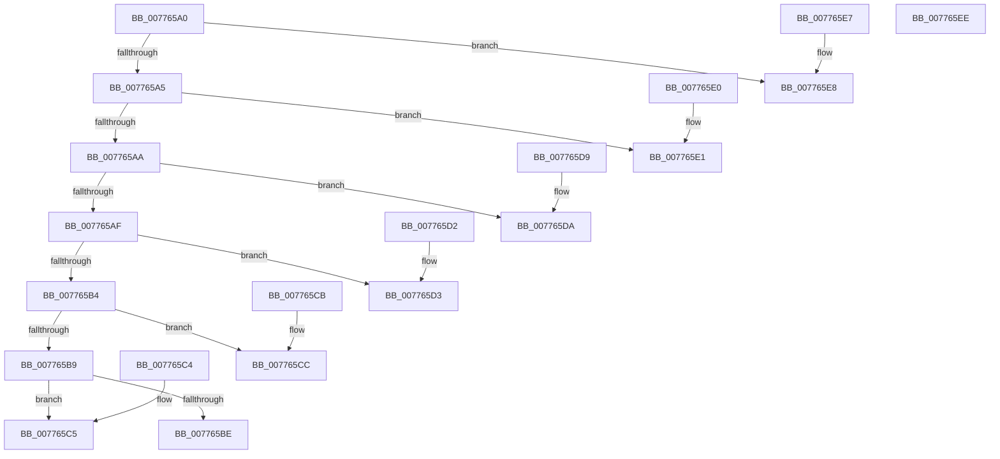

# TtmpGetCalloutTagFromCalloutType

- RVA: `0x007765A0`–`0x007765EF` (길이 `79` bytes)
- VA: `0x00000001407765A0`
- 실행 섹션: `PAGE`
- PDB 이름 있음: `예`; PDB Function 태그: `아니요`
- unwind 정보 RVA: `0x000DB714`
- 디코드: `33`개 명령, `79/79` bytes 표시
- 미해석 바이트: `0` (있으면 어셈블리에 `.byte`로 보존)

> 이 문서는 커널 이미지의 기계어와 PDB 기호를 분석해 생성했습니다. 4번과 5번은 함수 원형과 자료형을 바이너리 사용 방식에서 추정한 C 해석이며 원본 소스 복구 결과는 아닙니다.

## 1. Dependencies

- 직접 호출 지점: **0**; 고유 호출 대상: **0**
- 직접 호출자로 확인된 함수: **2**
- RIP 상대 이미지 참조: **0**

### Outgoing calls
- 직접 디코드된 call 명령이 없습니다.

### Direct callers
- [TtmpStartCallout](TtmpStartCallout_function_00776AA4.md) at `0x00776BD8`
- [TtmpStopCallout](TtmpStopCallout_function_00776C24.md) at `0x00776CA4`

### Static image references
- 디코드된 RIP-relative 메모리 참조가 없습니다.

## 2. Other-region calls and transfers

- 다른 실행 섹션으로 향하는 call: **0**
- 별도 외부 분기/꼬리 이동을 확인하지 못했습니다.

## 3. Assembly (complete function range)

```asm
007765A0  83 E9 01                        sub ecx, 1
007765A3  74 43                           je 0x1407765e8
007765A5  83 E9 01                        sub ecx, 1
007765A8  74 37                           je 0x1407765e1
007765AA  83 E9 01                        sub ecx, 1
007765AD  74 2B                           je 0x1407765da
007765AF  83 E9 01                        sub ecx, 1
007765B2  74 1F                           je 0x1407765d3
007765B4  83 E9 01                        sub ecx, 1
007765B7  74 13                           je 0x1407765cc
007765B9  83 F9 01                        cmp ecx, 1
007765BC  74 07                           je 0x1407765c5
007765BE  B8 43 45 72 72                  mov eax, 0x72724543
007765C3  C3                              ret
007765C4  CC                              int3
007765C5  B8 53 50 44 57                  mov eax, 0x57445053
007765CA  C3                              ret
007765CB  CC                              int3
007765CC  B8 53 42 50 53                  mov eax, 0x53504253
007765D1  C3                              ret
007765D2  CC                              int3
007765D3  B8 44 69 73 53                  mov eax, 0x53736944
007765D8  C3                              ret
007765D9  CC                              int3
007765DA  B8 49 6E 70 4D                  mov eax, 0x4d706e49
007765DF  C3                              ret
007765E0  CC                              int3
007765E1  B8 43 6C 6F 73                  mov eax, 0x736f6c43
007765E6  C3                              ret
007765E7  CC                              int3
007765E8  B8 54 65 72 6D                  mov eax, 0x6d726554
007765ED  C3                              ret
007765EE  CC                              int3
```

## 4. C-style interpretation (structured pseudocode)

```c
__int64 __fastcall TtmpGetCalloutTagFromCalloutType(int a1)
{
    a1 = (unsigned int)((a1) - (1));
    if (condition_is_equal) goto loc_007765E8;
    a1 = (unsigned int)((a1) - (1));
    if (condition_is_equal) goto loc_007765E1;
    a1 = (unsigned int)((a1) - (1));
    if (condition_is_equal) goto loc_007765DA;
    a1 = (unsigned int)((a1) - (1));
    if (condition_is_equal) goto loc_007765D3;
    a1 = (unsigned int)((a1) - (1));
    if (condition_is_equal) goto loc_007765CC;
    if (a1 == 1) goto loc_007765C5;
    return (unsigned int)(0x72724543ULL);
loc_007765C5:
    return (unsigned int)(0x57445053ULL);
loc_007765CC:
    return (unsigned int)(0x53504253ULL);
loc_007765D3:
    return (unsigned int)(0x53736944ULL);
loc_007765DA:
    return (unsigned int)(0x4D706E49ULL);
loc_007765E1:
    return (unsigned int)(0x736F6C43ULL);
loc_007765E8:
    return (unsigned int)(0x6D726554ULL);
}
```

## 5. (Beta) C Style

```c
int64_t TtmpGetCalloutTagFromCalloutType(int32_t Arg1)
{
    Arg1 = (uint32_t)((Arg1) - (1));
    if (condition_is_equal) goto loc_007765E8;
    Arg1 = (uint32_t)((Arg1) - (1));
    if (condition_is_equal) goto loc_007765E1;
    Arg1 = (uint32_t)((Arg1) - (1));
    if (condition_is_equal) goto loc_007765DA;
    Arg1 = (uint32_t)((Arg1) - (1));
    if (condition_is_equal) goto loc_007765D3;
    Arg1 = (uint32_t)((Arg1) - (1));
    if (condition_is_equal) goto loc_007765CC;
    if (Arg1 == 1) goto loc_007765C5;
    return (uint32_t)(0x72724543ULL);
loc_007765C5:
    return (uint32_t)(0x57445053ULL);
loc_007765CC:
    return (uint32_t)(0x53504253ULL);
loc_007765D3:
    return (uint32_t)(0x53736944ULL);
loc_007765DA:
    return (uint32_t)(0x4D706E49ULL);
loc_007765E1:
    return (uint32_t)(0x736F6C43ULL);
loc_007765E8:
    return (uint32_t)(0x6D726554ULL);
}
```

## 6. Execution-region graph

[열기: 2D/3D 그래프와 함수 탐색 컨트롤 패널](../../../control-panel.html?section=page&rva=0x007765A0&view=graph)

- 2D 그래프는 위에서 아래로 흐르고, 3D 그래프는 빈 공간을 드래그해 회전합니다. Shift+드래그는 이동, 휠은 확대·축소, 함수 노드 선택은 대상 보고서 이동입니다.

### Static fallback


