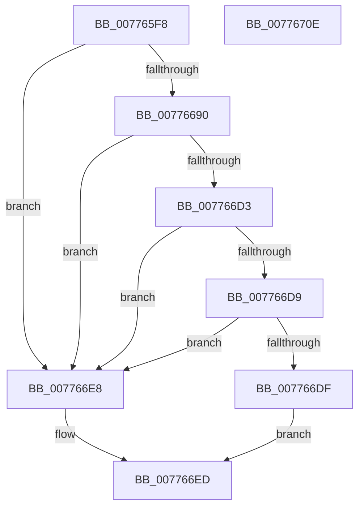

# TtmpGetConfigOverride

- RVA: `0x007765F8`–`0x0077670F` (길이 `279` bytes)
- VA: `0x00000001407765F8`
- 실행 섹션: `PAGE`
- PDB 이름 있음: `예`; PDB Function 태그: `아니요`
- unwind 정보 RVA: `0x000CDBD8`
- 디코드: `73`개 명령, `279/279` bytes 표시
- 미해석 바이트: `0` (있으면 어셈블리에 `.byte`로 보존)

> 이 문서는 커널 이미지의 기계어와 PDB 기호를 분석해 생성했습니다. 4번과 5번은 함수 원형과 자료형을 바이너리 사용 방식에서 추정한 C 해석이며 원본 소스 복구 결과는 아닙니다.

## 1. Dependencies

- 직접 호출 지점: **6**; 고유 호출 대상: **5**
- 직접 호출자로 확인된 함수: **1**
- RIP 상대 이미지 참조: **2**

### Outgoing calls
- `0x00776652` → [RtlInitUnicodeString](../../text/42/RtlInitUnicodeString_function_0042A780.md) (function, `0x0042A780`)
- `0x00776687` → [ZwOpenKey](../../text/6A/ZwOpenKey_function_006AD310.md) (function, `0x006AD310`)
- `0x00776697` → [RtlInitUnicodeString](../../text/42/RtlInitUnicodeString_function_0042A780.md) (function, `0x0042A780`)
- `0x007766BF` → [ZwQueryValueKey](../../text/6A/ZwQueryValueKey_function_006AD3B0.md) (function, `0x006AD3B0`)
- `0x007766CA` → [ZwClose](../../text/6A/ZwClose_function_006AD2B0.md) (function, `0x006AD2B0`)
- `0x007766F4` → [_security_check_cookie](../../text/6A/_security_check_cookie_function_006AC640.md) (function, `0x006AC640`)

### Direct callers
- [TtmpStartCallout](TtmpStartCallout_function_00776AA4.md) at `0x00776AEE`
- [TtmpStartCallout](TtmpStartCallout_function_00776AA4.md) at `0x00776B19`

### Static image references
- `0x0077660F` → RVA `0x00E0A740` (`.data`; read)
- `0x00776633` → RVA `0x0002B450` (`.rdata`; read)

## 2. Other-region calls and transfers

- 다른 실행 섹션으로 향하는 call: **6**
  - `0x00776652` → [RtlInitUnicodeString](../../text/42/RtlInitUnicodeString_function_0042A780.md) (`PAGE` → `.text`)
  - `0x00776687` → [ZwOpenKey](../../text/6A/ZwOpenKey_function_006AD310.md) (`PAGE` → `.text`)
  - `0x00776697` → [RtlInitUnicodeString](../../text/42/RtlInitUnicodeString_function_0042A780.md) (`PAGE` → `.text`)
  - `0x007766BF` → [ZwQueryValueKey](../../text/6A/ZwQueryValueKey_function_006AD3B0.md) (`PAGE` → `.text`)
  - `0x007766CA` → [ZwClose](../../text/6A/ZwClose_function_006AD2B0.md) (`PAGE` → `.text`)
  - `0x007766F4` → [_security_check_cookie](../../text/6A/_security_check_cookie_function_006AC640.md) (`PAGE` → `.text`)
- 별도 외부 분기/꼬리 이동을 확인하지 못했습니다.

## 3. Assembly (complete function range)

```asm
007765F8  48 89 5C 24 08                  mov qword ptr [rsp + 8], rbx
007765FD  48 89 7C 24 20                  mov qword ptr [rsp + 0x20], rdi
00776602  55                              push rbp
00776603  48 8D 6C 24 A9                  lea rbp, [rsp - 0x57]
00776608  48 81 EC B0 00 00 00            sub rsp, 0xb0
0077660F  48 8B 05 2A 41 69 00            mov rax, qword ptr [rip + 0x69412a]
00776616  48 33 C4                        xor rax, rsp
00776619  48 89 45 47                     mov qword ptr [rbp + 0x47], rax
0077661D  33 C0                           xor eax, eax
0077661F  48 8D 4D E7                     lea rcx, [rbp - 0x19]
00776623  21 45 23                        and dword ptr [rbp + 0x23], eax
00776626  0F 57 C0                        xorps xmm0, xmm0
00776629  48 21 45 DF                     and qword ptr [rbp - 0x21], rax
0077662D  48 8B DA                        mov rbx, rdx
00776630  21 45 D7                        and dword ptr [rbp - 0x29], eax
00776633  48 8D 15 16 4E 8B FF            lea rdx, [rip - 0x74b1ea]
0077663A  0F 57 C9                        xorps xmm1, xmm1
0077663D  89 45 0B                        mov dword ptr [rbp + 0xb], eax
00776640  21 45 0B                        and dword ptr [rbp + 0xb], eax
00776643  49 8B F8                        mov rdi, r8
00776646  0F 11 45 E7                     movups xmmword ptr [rbp - 0x19], xmm0
0077664A  0F 11 4D F7                     movups xmmword ptr [rbp - 9], xmm1
0077664E  0F 11 45 37                     movups xmmword ptr [rbp + 0x37], xmm0
00776652  E8 29 41 CB FF                  call 0x14042a780
00776657  48 83 65 0F 00                  and qword ptr [rbp + 0xf], 0
0077665C  48 8D 45 E7                     lea rax, [rbp - 0x19]
00776660  0F 57 C0                        xorps xmm0, xmm0
00776663  48 89 45 17                     mov qword ptr [rbp + 0x17], rax
00776667  4C 8D 45 07                     lea r8, [rbp + 7]
0077666B  C7 45 07 30 00 00 00            mov dword ptr [rbp + 7], 0x30
00776672  BA 19 00 02 00                  mov edx, 0x20019
00776677  C7 45 1F 40 02 00 00            mov dword ptr [rbp + 0x1f], 0x240
0077667E  48 8D 4D DF                     lea rcx, [rbp - 0x21]
00776682  F3 0F 7F 45 27                  movdqu xmmword ptr [rbp + 0x27], xmm0
00776687  E8 84 6C F3 FF                  call 0x1406ad310
0077668C  85 C0                           test eax, eax
0077668E  78 58                           js 0x1407766e8
00776690  48 8B D3                        mov rdx, rbx
00776693  48 8D 4D F7                     lea rcx, [rbp - 9]
00776697  E8 E4 40 CB FF                  call 0x14042a780
0077669C  48 8B 4D DF                     mov rcx, qword ptr [rbp - 0x21]
007766A0  48 8D 45 D7                     lea rax, [rbp - 0x29]
007766A4  48 89 44 24 28                  mov qword ptr [rsp + 0x28], rax
007766A9  4C 8D 4D 37                     lea r9, [rbp + 0x37]
007766AD  41 B8 02 00 00 00               mov r8d, 2
007766B3  C7 44 24 20 10 00 00 00         mov dword ptr [rsp + 0x20], 0x10
007766BB  48 8D 55 F7                     lea rdx, [rbp - 9]
007766BF  E8 EC 6C F3 FF                  call 0x1406ad3b0
007766C4  48 8B 4D DF                     mov rcx, qword ptr [rbp - 0x21]
007766C8  8B D8                           mov ebx, eax
007766CA  E8 E1 6B F3 FF                  call 0x1406ad2b0
007766CF  85 DB                           test ebx, ebx
007766D1  78 15                           js 0x1407766e8
007766D3  83 7D 3B 04                     cmp dword ptr [rbp + 0x3b], 4
007766D7  75 0F                           jne 0x1407766e8
007766D9  83 7D 3F 04                     cmp dword ptr [rbp + 0x3f], 4
007766DD  75 09                           jne 0x1407766e8
007766DF  8B 45 43                        mov eax, dword ptr [rbp + 0x43]
007766E2  89 07                           mov dword ptr [rdi], eax
007766E4  B0 01                           mov al, 1
007766E6  EB 05                           jmp 0x1407766ed
007766E8  83 27 00                        and dword ptr [rdi], 0
007766EB  32 C0                           xor al, al
007766ED  48 8B 4D 47                     mov rcx, qword ptr [rbp + 0x47]
007766F1  48 33 CC                        xor rcx, rsp
007766F4  E8 47 5F F3 FF                  call 0x1406ac640
007766F9  4C 8D 9C 24 B0 00 00 00         lea r11, [rsp + 0xb0]
00776701  49 8B 5B 10                     mov rbx, qword ptr [r11 + 0x10]
00776705  49 8B 7B 28                     mov rdi, qword ptr [r11 + 0x28]
00776709  49 8B E3                        mov rsp, r11
0077670C  5D                              pop rbp
0077670D  C3                              ret
0077670E  CC                              int3
```

## 4. C-style interpretation (structured pseudocode)

```c
__int64 __fastcall TtmpGetConfigOverride(__int64 a1, __int64 a2, __int64 a3)
{
    __int64 result;
    __int64 v_rsp;
    unsigned __int64 v_stack_m18;
    unsigned int v_stack_m1C;
    unsigned int v_stack_m20;
    unsigned int v_stack_m24;
    unsigned __int64 v_stack_m28;
    unsigned __int64 v_stack_m38;
    unsigned int v_stack_m3C;
    unsigned int v_stack_m40;
    unsigned __int64 v_stack_m48;
    unsigned __int64 v_stack_m50;
    unsigned int v_stack_m54;
    unsigned __int64 v_stack_m58;
    unsigned __int64 v_stack_m5F;
    unsigned __int64 v_stack_m68;
    unsigned __int64 v_stack_m78;
    unsigned __int64 v_stack_m8;
    unsigned __int64 v_stack_m80;
    unsigned int v_stack_m88;
    unsigned __int64 v_stack_m90;
    unsigned int v_stack_m98;
    unsigned __int64 v_stack_p20;
    unsigned __int64 v_stack_p8;

    v_stack_p8 = v_rbx;
    v_stack_p20 = v_rdi;
    v_rsp = (v_rsp) - (176);
    result = (*(unsigned __int64 *)(v_rip + 6897962)) ^ (v_rsp);
    v_stack_m18 = result;
    result = 0;
    v_stack_m54 = 0;
    v_stack_m78 = v_xmm0;
    v_stack_m68 = v_xmm1;
    v_stack_m28 = v_xmm0;
    result = RtlInitUnicodeString(v_stack_m78, v_rip - 7647722, a3, a4);
    v_stack_m48 = v_stack_m78;
    v_stack_m58 = 48;
    v_stack_m40 = 576;
    v_stack_m38 = v_xmm0;
    result = ZwOpenKey(v_stack_m80, (unsigned int)(0x20019ULL), v_stack_m58, a4);
    if (sign_flag) goto loc_007766E8;
    result = RtlInitUnicodeString(v_stack_m68, a2, v_stack_m58, a4);
    v_stack_m90 = v_stack_m88;
    v_stack_m98 = 16;
    result = ZwQueryValueKey(v_stack_m80, v_stack_m68, 2, v_stack_m28);
    result = ZwClose(v_stack_m80, v_stack_m68, 2, v_stack_m28);
    if (sign_flag) goto loc_007766E8;
    if (v_stack_m24 != 4) goto loc_007766E8;
    if (v_stack_m20 != 4) goto loc_007766E8;
    *(unsigned int *)(a3) = (unsigned int)((unsigned int)(v_stack_m1C));
    goto loc_007766ED;
loc_007766E8:
    result = 0;
loc_007766ED:
    a1 = (v_stack_m18) ^ (v_rsp);
    result = _security_check_cookie(a1, v_stack_m68, 2, v_stack_m28);
    return result;
}
```

## 5. (Beta) C Style

```c
int64_t TtmpGetConfigOverride(int64_t Arg1, int64_t Arg2, void *Arg3)
{
    uint8_t *arg3 = (uint8_t *)Arg3;

    int64_t result;
    int64_t local_rsp;
    uint64_t v_stack_m18;
    uint32_t v_stack_m1C;
    uint32_t v_stack_m20;
    uint32_t v_stack_m24;
    uint64_t v_stack_m28;
    uint64_t v_stack_m38;
    uint32_t v_stack_m3C;
    uint32_t v_stack_m40;
    uint64_t v_stack_m48;
    uint64_t v_stack_m50;
    uint32_t v_stack_m54;
    uint64_t v_stack_m58;
    uint64_t v_stack_m5F;
    uint64_t v_stack_m68;
    uint64_t v_stack_m78;
    uint64_t v_stack_m8;
    uint64_t v_stack_m80;
    uint32_t v_stack_m88;
    uint64_t v_stack_m90;
    uint32_t v_stack_m98;
    uint64_t v_stack_p20;
    uint64_t v_stack_p8;

    v_stack_p8 = local_rbx;
    v_stack_p20 = local_rdi;
    local_rsp = (local_rsp) - (176);
    result = (*(uint64_t *)(v_rip + 0x69412A)) ^ (local_rsp);
    v_stack_m18 = result;
    result = 0;
    v_stack_m54 = 0;
    v_stack_m78 = v_xmm0;
    v_stack_m68 = v_xmm1;
    v_stack_m28 = v_xmm0;
    result = RtlInitUnicodeString(v_stack_m78, v_rip - 7647722, Arg3, a4);
    v_stack_m48 = v_stack_m78;
    v_stack_m58 = 48;
    v_stack_m40 = 576;
    v_stack_m38 = v_xmm0;
    result = ZwOpenKey(v_stack_m80, (uint32_t)(0x20019ULL), v_stack_m58, a4);
    if (sign_flag) goto loc_007766E8;
    result = RtlInitUnicodeString(v_stack_m68, Arg2, v_stack_m58, a4);
    v_stack_m90 = v_stack_m88;
    v_stack_m98 = 16;
    result = ZwQueryValueKey(v_stack_m80, v_stack_m68, 2, v_stack_m28);
    result = ZwClose(v_stack_m80, v_stack_m68, 2, v_stack_m28);
    if (sign_flag) goto loc_007766E8;
    if (v_stack_m24 != 4) goto loc_007766E8;
    if (v_stack_m20 != 4) goto loc_007766E8;
    *(uint32_t *)(arg3) = (uint32_t)((uint32_t)(v_stack_m1C));
    goto loc_007766ED;
loc_007766E8:
    result = 0;
loc_007766ED:
    Arg1 = (v_stack_m18) ^ (local_rsp);
    result = _security_check_cookie(Arg1, v_stack_m68, 2, v_stack_m28);
    return result;
}
```

### 관측된 메모리 오프셋

구조체 형식이 확인되지 않은 접근은 인자 기준의 오프셋으로만 기록했습니다.

| 기준 인자 | 오프셋 표현 | 폭 (bit) | 접근 |
|---|---:|---:|---|
| `Arg3` | `+ 0x0` | `32` | `R/W` |
| `Arg3` | `+ 0x0` | `32` | `W` |

## 6. Execution-region graph

[열기: 2D/3D 그래프와 함수 탐색 컨트롤 패널](../../../control-panel.html?section=page&rva=0x007765F8&view=graph)

- 2D 그래프는 위에서 아래로 흐르고, 3D 그래프는 빈 공간을 드래그해 회전합니다. Shift+드래그는 이동, 휠은 확대·축소, 함수 노드 선택은 대상 보고서 이동입니다.

### Static fallback


