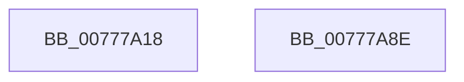

# TtmpInitiateModernStandbyTransition

- RVA: `0x00777A18`–`0x00777A8F` (길이 `119` bytes)
- VA: `0x0000000140777A18`
- 실행 섹션: `PAGE`
- PDB 이름 있음: `예`; PDB Function 태그: `아니요`
- unwind 정보 RVA: `0x00060BC4`
- 디코드: `30`개 명령, `119/119` bytes 표시
- 미해석 바이트: `0` (있으면 어셈블리에 `.byte`로 보존)

> 이 문서는 커널 이미지의 기계어와 PDB 기호를 분석해 생성했습니다. 4번과 5번은 함수 원형과 자료형을 바이너리 사용 방식에서 추정한 C 해석이며 원본 소스 복구 결과는 아닙니다.

## 1. Dependencies

- 직접 호출 지점: **6**; 고유 호출 대상: **6**
- 직접 호출자로 확인된 함수: **2**
- RIP 상대 이미지 참조: **1**

### Outgoing calls
- `0x00777A36` → [TtmiLogInitiateModernStandbyTransitionStart](TtmiLogInitiateModernStandbyTransitionStart_function_0077A50C.md) (function, `0x0077A50C`)
- `0x00777A4A` → [ExReleaseResourceLite](../../text/25/ExReleaseResourceLite_function_0025FA10.md) (function, `0x0025FA10`)
- `0x00777A4F` → [KeLeaveCriticalRegion](../../text/25/KeLeaveCriticalRegion_function_0025D8B0.md) (function, `0x0025D8B0`)
- `0x00777A59` → [PoTtmInitiatePowerStateTransition](../76/PoTtmInitiatePowerStateTransition_function_007695E8.md) (function, `0x007695E8`)
- `0x00777A60` → [TtmpAcquireSessionLock](../70/TtmpAcquireSessionLock_function_00700408.md) (function, `0x00700408`)
- `0x00777A77` → [TtmiLogInitiateModernStandbyTransitionStop](TtmiLogInitiateModernStandbyTransitionStop_function_0077A600.md) (function, `0x0077A600`)

### Direct callers
- [TtmpActivateSessionWorker](TtmpActivateSessionWorker_function_0077768C.md) at `0x007776D8`
- [TtmpSessionWorker](TtmpSessionWorker_function_00777F60.md) at `0x00778108`

### Static image references
- `0x00777A43` → RVA `0x00F06940` (`.data`; read)

## 2. Other-region calls and transfers

- 다른 실행 섹션으로 향하는 call: **2**
  - `0x00777A4A` → [ExReleaseResourceLite](../../text/25/ExReleaseResourceLite_function_0025FA10.md) (`PAGE` → `.text`)
  - `0x00777A4F` → [KeLeaveCriticalRegion](../../text/25/KeLeaveCriticalRegion_function_0025D8B0.md) (`PAGE` → `.text`)
- 별도 외부 분기/꼬리 이동을 확인하지 못했습니다.

## 3. Assembly (complete function range)

```asm
00777A18  48 89 5C 24 08                  mov qword ptr [rsp + 8], rbx
00777A1D  48 89 74 24 10                  mov qword ptr [rsp + 0x10], rsi
00777A22  57                              push rdi
00777A23  48 83 EC 20                     sub rsp, 0x20
00777A27  40 8A FA                        mov dil, dl
00777A2A  48 8B F1                        mov rsi, rcx
00777A2D  40 8A CF                        mov cl, dil
00777A30  41 8B D0                        mov edx, r8d
00777A33  41 8B D8                        mov ebx, r8d
00777A36  E8 D1 2A 00 00                  call 0x14077a50c
00777A3B  48 83 A6 E8 00 00 00 00         and qword ptr [rsi + 0xe8], 0
00777A43  48 8D 0D F6 EE 78 00            lea rcx, [rip + 0x78eef6]
00777A4A  E8 C1 7F AE FF                  call 0x14025fa10
00777A4F  E8 5C 5E AE FF                  call 0x14025d8b0
00777A54  8B D3                           mov edx, ebx
00777A56  40 8A CF                        mov cl, dil
00777A59  E8 8A 1B FF FF                  call 0x1407695e8
00777A5E  8B D8                           mov ebx, eax
00777A60  E8 A3 89 F8 FF                  call 0x140700408
00777A65  65 48 8B 0C 25 88 01 00 00      mov rcx, qword ptr gs:[0x188]
00777A6E  48 89 8E E8 00 00 00            mov qword ptr [rsi + 0xe8], rcx
00777A75  8B CB                           mov ecx, ebx
00777A77  E8 84 2B 00 00                  call 0x14077a600
00777A7C  48 8B 74 24 38                  mov rsi, qword ptr [rsp + 0x38]
00777A81  8B C3                           mov eax, ebx
00777A83  48 8B 5C 24 30                  mov rbx, qword ptr [rsp + 0x30]
00777A88  48 83 C4 20                     add rsp, 0x20
00777A8C  5F                              pop rdi
00777A8D  C3                              ret
00777A8E  CC                              int3
```

## 4. C-style interpretation (structured pseudocode)

```c
__int64 __fastcall TtmpInitiateModernStandbyTransition(__int64 a1, unsigned __int8 a2, int a3)
{
    __int64 result;
    __int64 v_rsp;
    unsigned __int64 v_stack_p10;
    unsigned __int64 v_stack_p8;

    v_stack_p8 = v_rbx;
    v_stack_p10 = v_rsi;
    v_rsp = (v_rsp) - (32);
    result = TtmiLogInitiateModernStandbyTransitionStart(a2, (unsigned int)(a3), a3, a4);
    result = ExReleaseResourceLite(v_rip + 7925494, (unsigned int)(a3), a3, a4);
    result = KeLeaveCriticalRegion(v_rip + 7925494, (unsigned int)(a3), a3, a4);
    result = PoTtmInitiatePowerStateTransition(a2, (unsigned int)((unsigned int)((unsigned int)(a3))), a3, a4);
    result = TtmpAcquireSessionLock(a2, (unsigned int)((unsigned int)((unsigned int)(a3))), a3, a4);
    *(unsigned __int64 *)(a1 + 232) = *(unsigned __int64 *)(gs_base + (0 + 392));
    result = TtmiLogInitiateModernStandbyTransitionStop((unsigned int)((unsigned int)((unsigned int)((unsigned int)(result)))), (unsigned int)((unsigned int)((unsigned int)(a3))), a3, a4);
    v_rsp = (v_rsp) + (32);
    return (unsigned int)((unsigned int)((unsigned int)((unsigned int)(result))));
}
```

## 5. (Beta) C Style

```c
int64_t TtmpInitiateModernStandbyTransition(void *Arg1, uint8_t Arg2, int32_t Arg3)
{
    uint8_t *arg1 = (uint8_t *)Arg1;

    int64_t result;
    int64_t local_rsp;
    uint64_t v_stack_p10;
    uint64_t v_stack_p8;

    v_stack_p8 = local_rbx;
    v_stack_p10 = local_rsi;
    local_rsp = (local_rsp) - (32);
    result = TtmiLogInitiateModernStandbyTransitionStart(Arg2, (uint32_t)(Arg3), Arg3, a4);
    result = ExReleaseResourceLite(v_rip + 7925494, (uint32_t)(Arg3), Arg3, a4);
    result = KeLeaveCriticalRegion(v_rip + 7925494, (uint32_t)(Arg3), Arg3, a4);
    result = PoTtmInitiatePowerStateTransition(Arg2, (uint32_t)((uint32_t)((uint32_t)(Arg3))), Arg3, a4);
    result = TtmpAcquireSessionLock(Arg2, (uint32_t)((uint32_t)((uint32_t)(Arg3))), Arg3, a4);
    *(uint64_t *)(arg1 + 0xE8) = *(uint64_t *)(gs_base + (0 + 0x188));
    result = TtmiLogInitiateModernStandbyTransitionStop((uint32_t)((uint32_t)((uint32_t)((uint32_t)(result)))), (uint32_t)((uint32_t)((uint32_t)(Arg3))), Arg3, a4);
    local_rsp = (local_rsp) + (32);
    return (uint32_t)((uint32_t)((uint32_t)((uint32_t)(result))));
}
```

### 관측된 메모리 오프셋

구조체 형식이 확인되지 않은 접근은 인자 기준의 오프셋으로만 기록했습니다.

| 기준 인자 | 오프셋 표현 | 폭 (bit) | 접근 |
|---|---:|---:|---|
| `Arg1` | `+ 0xE8` | `64` | `R/W` |
| `Arg1` | `+ 0xE8` | `64` | `W` |

## 6. Execution-region graph

[열기: 2D/3D 그래프와 함수 탐색 컨트롤 패널](../../../control-panel.html?section=page&rva=0x00777A18&view=graph)

- 2D 그래프는 위에서 아래로 흐르고, 3D 그래프는 빈 공간을 드래그해 회전합니다. Shift+드래그는 이동, 휠은 확대·축소, 함수 노드 선택은 대상 보고서 이동입니다.

### Static fallback


