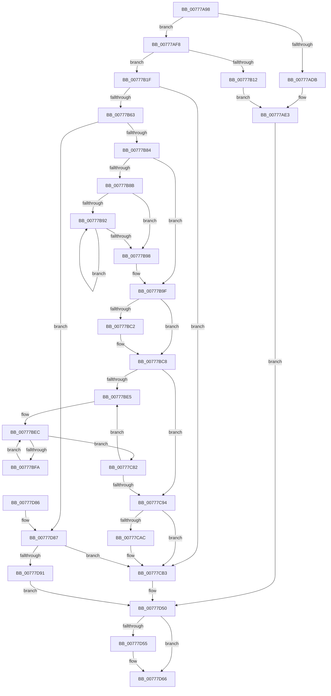

# TtmpInsertPowerRequestToSession

- RVA: `0x00777A98`–`0x00777DBB` (길이 `803` bytes)
- VA: `0x0000000140777A98`
- 실행 섹션: `PAGE`
- PDB 이름 있음: `예`; PDB Function 태그: `아니요`
- unwind 정보 RVA: `0x000790E4`
- 디코드: `220`개 명령, `803/803` bytes 표시
- 미해석 바이트: `0` (있으면 어셈블리에 `.byte`로 보존)

> 이 문서는 커널 이미지의 기계어와 PDB 기호를 분석해 생성했습니다. 4번과 5번은 함수 원형과 자료형을 바이너리 사용 방식에서 추정한 C 해석이며 원본 소스 복구 결과는 아닙니다.

## 1. Dependencies

- 직접 호출 지점: **9**; 고유 호출 대상: **8**
- 직접 호출자로 확인된 함수: **2**
- RIP 상대 이미지 참조: **2**

### Outgoing calls
- `0x00777ACD` → [TtmpAcquireSessionById](../98/TtmpAcquireSessionById_function_0098B4F4.md) (function, `0x0098B4F4`)
- `0x00777AEE` → [TtmiLogError](../98/TtmiLogError_function_0098B39C.md) (function, `0x0098B39C`)
- `0x00777B05` → [ExAllocatePool2](../../poolcode/B8/ExAllocatePool2_function_00B820F0.md) (function, `0x00B820F0`)
- `0x00777B73` → [TtmpPowerRequestHashAllocator](TtmpPowerRequestHashAllocator_function_00777DD4.md) (function, `0x00777DD4`)
- `0x00777CAE` → [TtmpPowerRequestHashDeallocator](TtmpPowerRequestHashDeallocator_function_00777DF8.md) (function, `0x00777DF8`)
- `0x00777D5C` → [ExReleaseResourceLite](../../text/25/ExReleaseResourceLite_function_0025FA10.md) (function, `0x0025FA10`)
- `0x00777D61` → [KeLeaveCriticalRegion](../../text/25/KeLeaveCriticalRegion_function_0025D8B0.md) (function, `0x0025D8B0`)
- `0x00777DA7` → [TtmiLogError](../98/TtmiLogError_function_0098B39C.md) (function, `0x0098B39C`)
- `0x00777DB4` → [ExFreePoolWithTag](../../poolcode/B8/ExFreePoolWithTag_function_00B82870.md) (function, `0x00B82870`)

### Direct callers
- [TtmNotifySessionPowerRequestCreated](TtmNotifySessionPowerRequestCreated_function_00776DD8.md) at `0x00776DEC`
- [TtmNotifySessionPowerRequestPresent](TtmNotifySessionPowerRequestPresent_function_00776F88.md) at `0x00776FC4`

### Static image references
- `0x00777AE7` → RVA `0x00B04370` (` ?? ::NNGAKEGL::`string'`; read)
- `0x00777D55` → RVA `0x00F06940` (`.data`; read)

## 2. Other-region calls and transfers

- 다른 실행 섹션으로 향하는 call: **4**
  - `0x00777B05` → [ExAllocatePool2](../../poolcode/B8/ExAllocatePool2_function_00B820F0.md) (`PAGE` → `POOLCODE`)
  - `0x00777D5C` → [ExReleaseResourceLite](../../text/25/ExReleaseResourceLite_function_0025FA10.md) (`PAGE` → `.text`)
  - `0x00777D61` → [KeLeaveCriticalRegion](../../text/25/KeLeaveCriticalRegion_function_0025D8B0.md) (`PAGE` → `.text`)
  - `0x00777DB4` → [ExFreePoolWithTag](../../poolcode/B8/ExFreePoolWithTag_function_00B82870.md) (`PAGE` → `POOLCODE`)
- 별도 외부 분기/꼬리 이동을 확인하지 못했습니다.

## 3. Assembly (complete function range)

```asm
00777A98  48 8B C4                        mov rax, rsp
00777A9B  48 89 58 08                     mov qword ptr [rax + 8], rbx
00777A9F  48 89 68 10                     mov qword ptr [rax + 0x10], rbp
00777AA3  48 89 70 18                     mov qword ptr [rax + 0x18], rsi
00777AA7  57                              push rdi
00777AA8  41 54                           push r12
00777AAA  41 55                           push r13
00777AAC  41 56                           push r14
00777AAE  41 57                           push r15
00777AB0  48 83 EC 30                     sub rsp, 0x30
00777AB4  48 63 FA                        movsxd rdi, edx
00777AB7  45 33 E4                        xor r12d, r12d
00777ABA  8B D1                           mov edx, ecx
00777ABC  4C 89 60 C8                     mov qword ptr [rax - 0x38], r12
00777AC0  48 8D 48 C8                     lea rcx, [rax - 0x38]
00777AC4  49 8B D9                        mov rbx, r9
00777AC7  41 8B F0                        mov esi, r8d
00777ACA  45 8A FC                        mov r15b, r12b
00777ACD  E8 22 3A 21 00                  call 0x14098b4f4
00777AD2  4C 8B 6C 24 20                  mov r13, qword ptr [rsp + 0x20]
00777AD7  85 C0                           test eax, eax
00777AD9  79 1D                           jns 0x140777af8
00777ADB  44 8B C0                        mov r8d, eax
00777ADE  BA 31 0D 00 00                  mov edx, 0xd31
00777AE3  49 83 C9 FF                     or r9, 0xffffffffffffffff
00777AE7  48 8D 0D 82 C8 38 00            lea rcx, [rip + 0x38c882]
00777AEE  E8 A9 38 21 00                  call 0x14098b39c
00777AF3  E9 58 02 00 00                  jmp 0x140777d50
00777AF8  B9 40 00 00 00                  mov ecx, 0x40
00777AFD  41 B8 54 74 50 52               mov r8d, 0x52507454
00777B03  8B D1                           mov edx, ecx
00777B05  E8 E6 A5 40 00                  call 0x140b820f0
00777B0A  4C 8B F0                        mov r14, rax
00777B0D  48 85 C0                        test rax, rax
00777B10  75 0D                           jne 0x140777b1f
00777B12  BA 3A 0D 00 00                  mov edx, 0xd3a
00777B17  41 B8 9A 00 00 C0               mov r8d, 0xc000009a
00777B1D  EB C4                           jmp 0x140777ae3
00777B1F  48 89 58 18                     mov qword ptr [rax + 0x18], rbx
00777B23  48 83 CD FF                     or rbp, 0xffffffffffffffff
00777B27  89 70 14                        mov dword ptr [rax + 0x14], esi
00777B2A  49 8D B5 10 01 00 00            lea rsi, [r13 + 0x110]
00777B31  48 89 78 08                     mov qword ptr [rax + 8], rdi
00777B35  89 78 10                        mov dword ptr [rax + 0x10], edi
00777B38  48 8B 84 24 80 00 00 00         mov rax, qword ptr [rsp + 0x80]
00777B40  49 89 46 20                     mov qword ptr [r14 + 0x20], rax
00777B44  49 8D 46 30                     lea rax, [r14 + 0x30]
00777B48  45 89 66 28                     mov dword ptr [r14 + 0x28], r12d
00777B4C  48 89 40 08                     mov qword ptr [rax + 8], rax
00777B50  48 89 00                        mov qword ptr [rax], rax
00777B53  8B 5E 04                        mov ebx, dword ptr [rsi + 4]
00777B56  C1 EB 05                        shr ebx, 5
00777B59  03 DB                           add ebx, ebx
00777B5B  39 1E                           cmp dword ptr [rsi], ebx
00777B5D  0F 82 50 01 00 00               jb 0x140777cb3
00777B63  8D 45 05                        lea eax, [rbp + 5]
00777B66  3B D8                           cmp ebx, eax
00777B68  0F 42 D8                        cmovb ebx, eax
00777B6B  33 D2                           xor edx, edx
00777B6D  8B CB                           mov ecx, ebx
00777B6F  48 C1 E1 03                     shl rcx, 3
00777B73  E8 5C 02 00 00                  call 0x140777dd4
00777B78  4C 8B C0                        mov r8, rax
00777B7B  48 85 C0                        test rax, rax
00777B7E  0F 84 03 02 00 00               je 0x140777d87
00777B84  8D 43 FF                        lea eax, [rbx - 1]
00777B87  85 C3                           test ebx, eax
00777B89  74 14                           je 0x140777b9f
00777B8B  83 C9 FF                        or ecx, 0xffffffff
00777B8E  85 DB                           test ebx, ebx
00777B90  74 06                           je 0x140777b98
00777B92  FF C1                           inc ecx
00777B94  D1 EB                           shr ebx, 1
00777B96  75 FA                           jne 0x140777b92
00777B98  BB 01 00 00 00                  mov ebx, 1
00777B9D  D3 E3                           shl ebx, cl
00777B9F  B8 00 00 00 04                  mov eax, 0x4000000
00777BA4  3B D8                           cmp ebx, eax
00777BA6  0F 47 D8                        cmova ebx, eax
00777BA9  48 8B C6                        mov rax, rsi
00777BAC  48 83 C8 01                     or rax, 1
00777BB0  8B CB                           mov ecx, ebx
00777BB2  49 8D 14 D8                     lea rdx, [r8 + rbx*8]
00777BB6  4C 3B C2                        cmp r8, rdx
00777BB9  49 0F 47 CC                     cmova rcx, r12
00777BBD  48 85 C9                        test rcx, rcx
00777BC0  74 06                           je 0x140777bc8
00777BC2  49 8B F8                        mov rdi, r8
00777BC5  F3 48 AB                        rep stosq qword ptr [rdi], rax
00777BC8  8B 56 04                        mov edx, dword ptr [rsi + 4]
00777BCB  4C 8B D5                        mov r10, rbp
00777BCE  8B CA                           mov ecx, edx
00777BD0  41 8B FC                        mov edi, r12d
00777BD3  83 E1 1F                        and ecx, 0x1f
00777BD6  49 D3 E2                        shl r10, cl
00777BD9  F7 C2 E0 FF FF FF               test edx, 0xffffffe0
00777BDF  0F 86 AF 00 00 00               jbe 0x140777c94
00777BE5  4C 8B 7E 08                     mov r15, qword ptr [rsi + 8]
00777BE9  44 8B DF                        mov r11d, edi
00777BEC  4F 8B 0C DF                     mov r9, qword ptr [r15 + r11*8]
00777BF0  41 F6 C1 01                     test r9b, 1
00777BF4  0F 85 88 00 00 00               jne 0x140777c82
00777BFA  49 8B 01                        mov rax, qword ptr [r9]
00777BFD  4B 89 04 DF                     mov qword ptr [r15 + r11*8], rax
00777C01  49 8B 41 08                     mov rax, qword ptr [r9 + 8]
00777C05  49 23 C2                        and rax, r10
00777C08  48 89 44 24 20                  mov qword ptr [rsp + 0x20], rax
00777C0D  0F B6 C0                        movzx eax, al
00777C10  48 05 CB 5D B1 00               add rax, 0xb15dcb
00777C16  48 6B C8 25                     imul rcx, rax, 0x25
00777C1A  0F B6 44 24 21                  movzx eax, byte ptr [rsp + 0x21]
00777C1F  48 03 C8                        add rcx, rax
00777C22  0F B6 44 24 22                  movzx eax, byte ptr [rsp + 0x22]
00777C27  48 6B D1 25                     imul rdx, rcx, 0x25
00777C2B  48 03 D0                        add rdx, rax
00777C2E  0F B6 44 24 23                  movzx eax, byte ptr [rsp + 0x23]
00777C33  48 6B CA 25                     imul rcx, rdx, 0x25
00777C37  48 03 C8                        add rcx, rax
00777C3A  0F B6 44 24 24                  movzx eax, byte ptr [rsp + 0x24]
00777C3F  48 6B D1 25                     imul rdx, rcx, 0x25
00777C43  48 03 D0                        add rdx, rax
00777C46  0F B6 44 24 25                  movzx eax, byte ptr [rsp + 0x25]
00777C4B  48 6B CA 25                     imul rcx, rdx, 0x25
00777C4F  48 03 C8                        add rcx, rax
00777C52  0F B6 44 24 26                  movzx eax, byte ptr [rsp + 0x26]
00777C57  48 6B D1 25                     imul rdx, rcx, 0x25
00777C5B  48 03 D0                        add rdx, rax
00777C5E  0F B6 44 24 27                  movzx eax, byte ptr [rsp + 0x27]
00777C63  48 6B CA 25                     imul rcx, rdx, 0x25
00777C67  8D 53 FF                        lea edx, [rbx - 1]
00777C6A  48 03 C1                        add rax, rcx
00777C6D  8B C0                           mov eax, eax
00777C6F  48 23 D0                        and rdx, rax
00777C72  49 8B 04 D0                     mov rax, qword ptr [r8 + rdx*8]
00777C76  49 89 01                        mov qword ptr [r9], rax
00777C79  4D 89 0C D0                     mov qword ptr [r8 + rdx*8], r9
00777C7D  E9 6A FF FF FF                  jmp 0x140777bec
00777C82  8B 56 04                        mov edx, dword ptr [rsi + 4]
00777C85  FF C7                           inc edi
00777C87  8B C2                           mov eax, edx
00777C89  C1 E8 05                        shr eax, 5
00777C8C  3B F8                           cmp edi, eax
00777C8E  0F 82 51 FF FF FF               jb 0x140777be5
00777C94  48 8B 4E 08                     mov rcx, qword ptr [rsi + 8]
00777C98  83 E2 1F                        and edx, 0x1f
00777C9B  C1 E3 05                        shl ebx, 5
00777C9E  0B D3                           or edx, ebx
00777CA0  4C 89 46 08                     mov qword ptr [rsi + 8], r8
00777CA4  89 56 04                        mov dword ptr [rsi + 4], edx
00777CA7  48 85 C9                        test rcx, rcx
00777CAA  74 07                           je 0x140777cb3
00777CAC  33 D2                           xor edx, edx
00777CAE  E8 45 01 00 00                  call 0x140777df8
00777CB3  41 8B 8D 14 01 00 00            mov ecx, dword ptr [r13 + 0x114]
00777CBA  41 B7 01                        mov r15b, 1
00777CBD  8B F9                           mov edi, ecx
00777CBF  83 E1 1F                        and ecx, 0x1f
00777CC2  48 D3 E5                        shl rbp, cl
00777CC5  49 23 6E 08                     and rbp, qword ptr [r14 + 8]
00777CC9  48 89 6C 24 20                  mov qword ptr [rsp + 0x20], rbp
00777CCE  40 0F B6 C5                     movzx eax, bpl
00777CD2  48 05 CB 5D B1 00               add rax, 0xb15dcb
00777CD8  C1 EF 05                        shr edi, 5
00777CDB  48 6B C8 25                     imul rcx, rax, 0x25
00777CDF  0F B6 44 24 21                  movzx eax, byte ptr [rsp + 0x21]
00777CE4  48 03 C8                        add rcx, rax
00777CE7  0F B6 44 24 22                  movzx eax, byte ptr [rsp + 0x22]
00777CEC  48 6B D1 25                     imul rdx, rcx, 0x25
00777CF0  48 03 D0                        add rdx, rax
00777CF3  0F B6 44 24 23                  movzx eax, byte ptr [rsp + 0x23]
00777CF8  48 6B CA 25                     imul rcx, rdx, 0x25
00777CFC  48 03 C8                        add rcx, rax
00777CFF  0F B6 44 24 24                  movzx eax, byte ptr [rsp + 0x24]
00777D04  48 6B D1 25                     imul rdx, rcx, 0x25
00777D08  48 03 D0                        add rdx, rax
00777D0B  0F B6 44 24 25                  movzx eax, byte ptr [rsp + 0x25]
00777D10  48 6B CA 25                     imul rcx, rdx, 0x25
00777D14  48 03 C8                        add rcx, rax
00777D17  0F B6 44 24 26                  movzx eax, byte ptr [rsp + 0x26]
00777D1C  48 6B D1 25                     imul rdx, rcx, 0x25
00777D20  48 03 D0                        add rdx, rax
00777D23  0F B6 44 24 27                  movzx eax, byte ptr [rsp + 0x27]
00777D28  48 6B CA 25                     imul rcx, rdx, 0x25
00777D2C  8D 57 FF                        lea edx, [rdi - 1]
00777D2F  48 03 C1                        add rax, rcx
00777D32  49 8B 8D 18 01 00 00            mov rcx, qword ptr [r13 + 0x118]
00777D39  8B C0                           mov eax, eax
00777D3B  48 23 D0                        and rdx, rax
00777D3E  48 8B 04 D1                     mov rax, qword ptr [rcx + rdx*8]
00777D42  49 89 06                        mov qword ptr [r14], rax
00777D45  4C 89 34 D1                     mov qword ptr [rcx + rdx*8], r14
00777D49  41 FF 85 10 01 00 00            inc dword ptr [r13 + 0x110]
00777D50  4D 85 ED                        test r13, r13
00777D53  74 11                           je 0x140777d66
00777D55  48 8D 0D E4 EB 78 00            lea rcx, [rip + 0x78ebe4]
00777D5C  E8 AF 7C AE FF                  call 0x14025fa10
00777D61  E8 4A 5B AE FF                  call 0x14025d8b0
00777D66  48 8B 5C 24 60                  mov rbx, qword ptr [rsp + 0x60]
00777D6B  41 8A C7                        mov al, r15b
00777D6E  48 8B 6C 24 68                  mov rbp, qword ptr [rsp + 0x68]
00777D73  48 8B 74 24 70                  mov rsi, qword ptr [rsp + 0x70]
00777D78  48 83 C4 30                     add rsp, 0x30
00777D7C  41 5F                           pop r15
00777D7E  41 5E                           pop r14
00777D80  41 5D                           pop r13
00777D82  41 5C                           pop r12
00777D84  5F                              pop rdi
00777D85  C3                              ret
00777D86  CC                              int3
00777D87  83 7E 04 20                     cmp dword ptr [rsi + 4], 0x20
00777D8B  0F 83 22 FF FF FF               jae 0x140777cb3
00777D91  49 83 C9 FF                     or r9, 0xffffffffffffffff
00777D95  48 8D 0D D4 C5 38 00            lea rcx, [rip + 0x38c5d4]
00777D9C  BA 51 0D 00 00                  mov edx, 0xd51
00777DA1  41 B8 9A 00 00 C0               mov r8d, 0xc000009a
00777DA7  E8 F0 35 21 00                  call 0x14098b39c
00777DAC  BA 54 74 50 52                  mov edx, 0x52507454
00777DB1  49 8B CE                        mov rcx, r14
00777DB4  E8 B7 AA 40 00                  call 0x140b82870
00777DB9  EB 95                           jmp 0x140777d50
```

## 4. C-style interpretation (structured pseudocode)

```c
__int64 __fastcall TtmpInsertPowerRequestToSession(int a1, int a2, int a3, __int64 a4, __int64 a5)
{
    __int64 result;
    __int64 v_r10;
    __int64 v_r12;
    __int64 v_rbp;
    __int64 v_rbx;
    __int64 v_rdi;
    __int64 v_rsp;
    unsigned __int8 v_stack_m31;
    unsigned __int8 v_stack_m32;
    unsigned __int8 v_stack_m33;
    unsigned __int8 v_stack_m34;
    unsigned __int8 v_stack_m35;
    unsigned __int8 v_stack_m36;
    unsigned __int8 v_stack_m37;
    unsigned __int64 v_stack_m38;
    unsigned __int64 v_stack_p10;
    unsigned __int64 v_stack_p18;
    unsigned __int64 v_stack_p8;

    *(unsigned __int64 *)(v_rsp + 8) = v_rbx;
    *(unsigned __int64 *)(v_rsp + 16) = v_rbp;
    *(unsigned __int64 *)(v_rsp + 24) = v_rsi;
    v_rsp = (v_rsp) - (48);
    v_r12 = 0;
    *(unsigned __int64 *)(v_rsp - 56) = 0;
    result = TtmpAcquireSessionById(v_rsp - 56, (unsigned int)(a1), a3, a4);
    if (!sign_flag) goto loc_00777AF8;
loc_00777AE3:
    a4 = (a4) | (-1);
    result = TtmiLogError(v_rip + 3721346, (unsigned int)(0xD31ULL), (unsigned int)((unsigned int)(result)), a4);
    goto loc_00777D50;
loc_00777AF8:
    result = ExAllocatePool2(64, 64, (unsigned int)(0x52507454ULL), a4);
    if (result != 0) goto loc_00777B1F;
    goto loc_00777AE3;
loc_00777B1F:
    *(unsigned __int64 *)(result + 24) = a4;
    v_rbp = (v_rbp) | (-1);
    *(unsigned int *)(result + 20) = (unsigned int)((unsigned int)(a3));
    *(unsigned __int64 *)(result + 8) = (int)(a2);
    *(unsigned int *)(result + 16) = (unsigned int)((int)(a2));
    *(unsigned __int64 *)(result + 32) = a5;
    *(unsigned int *)(result + 40) = 0;
    *(unsigned __int64 *)(result + 48 + 8) = result + 48;
    *(unsigned __int64 *)(result + 48) = result + 48;
    v_rbx = (unsigned int)(((unsigned int)(*(unsigned int *)(v_stack_m38 + 272 + 4))) >> (5));
    v_rbx = (unsigned int)((v_rbx) + ((unsigned int)(v_rbx)));
    if ((*(unsigned int *)(v_stack_m38 + 272)) < ((unsigned int)(v_rbx))) goto loc_00777CB3;
    if (((unsigned int)(v_rbx)) < ((unsigned int)(v_rbp + 5))) { v_rbx = (unsigned int)(v_rbp + 5); }
    a2 = 0;
    a1 = ((unsigned int)((unsigned int)(v_rbx))) << (3);
    result = TtmpPowerRequestHashAllocator(a1, a2, (unsigned int)(0xC000009AULL), a4);
    if (result == 0) goto loc_00777D87;
    if ((((unsigned int)(v_rbx)) & ((unsigned int)(v_rbx - 1))) == 0) goto loc_00777B9F;
    a1 = (unsigned int)((a1) | (0xFFFFFFFFULL));
    if ((unsigned int)(v_rbx) == 0) goto loc_00777B98;
loc_00777B92:
    a1 = (unsigned int)((a1) + 1);
    v_rbx = (unsigned int)((v_rbx) >> (1));
    if (condition_is_not_equal) goto loc_00777B92;
loc_00777B98:
    v_rbx = (unsigned int)((1) << ((unsigned __int8)(a1)));
loc_00777B9F:
    if (((unsigned int)(v_rbx)) > ((unsigned int)((unsigned int)(0x4000000ULL)))) { v_rbx = (unsigned int)((unsigned int)(0x4000000ULL)); }
    result = (v_stack_m38 + 272) | (1);
    a1 = (unsigned int)((unsigned int)(v_rbx));
    if (result > (result + v_rbx * 8)) { a1 = 0; }
    v_rdi = (int)(a2);
    if (a1 != 0) {
        v_rdi = result;
    }
    a1 = (unsigned int)(((unsigned int)((unsigned int)((unsigned int)(*(unsigned int *)(v_stack_m38 + 272 + 4))))) & (31));
    v_r10 = (v_rbp) << ((unsigned __int8)(a1));
    if (condition_is_below_or_equal) goto loc_00777C94;
loc_00777BE5:
loc_00777BEC:
    if ((((unsigned __int8)(*(unsigned __int64 *)(*(unsigned __int64 *)(v_stack_m38 + 272 + 8) + 0 * 8))) & (1)) != 0) goto loc_00777C82;
    *(unsigned __int64 *)(*(unsigned __int64 *)(v_stack_m38 + 272 + 8) + 0 * 8) = *(unsigned __int64 *)(*(unsigned __int64 *)(*(unsigned __int64 *)(v_stack_m38 + 272 + 8) + 0 * 8));
    result = (*(unsigned __int64 *)(*(unsigned __int64 *)(*(unsigned __int64 *)(v_stack_m38 + 272 + 8) + 0 * 8) + 8)) & (v_r10);
    v_stack_m38 = result;
    result = ((unsigned __int8)(result)) + (0xB15DCBULL);
    a1 = (a1) * (result);
    a1 = (a1) + (v_stack_m37);
    a2 = ((unsigned int)(*(unsigned int *)(v_stack_m38 + 272 + 4))) * (a1);
    a2 = (a2) + (v_stack_m36);
    a1 = (a1) * (a2);
    a1 = (a1) + (v_stack_m35);
    a2 = (a2) * (a1);
    a2 = (a2) + (v_stack_m34);
    a1 = (a1) * (a2);
    a1 = (a1) + (v_stack_m33);
    a2 = (a2) * (a1);
    a2 = (a2) + (v_stack_m32);
    a1 = (a1) * (a2);
    result = (v_stack_m31) + (a1);
    a2 = (v_rbx - 1) & ((unsigned int)((unsigned int)(result)));
    *(unsigned __int64 *)(*(unsigned __int64 *)(*(unsigned __int64 *)(v_stack_m38 + 272 + 8) + 0 * 8)) = *(unsigned __int64 *)(result + a2 * 8);
    *(unsigned __int64 *)(result + a2 * 8) = *(unsigned __int64 *)(*(unsigned __int64 *)(v_stack_m38 + 272 + 8) + 0 * 8);
    goto loc_00777BEC;
loc_00777C82:
    v_rdi = (unsigned int)((0) + 1);
    result = (unsigned int)(((unsigned int)((unsigned int)((unsigned int)(*(unsigned int *)(v_stack_m38 + 272 + 4))))) >> (5));
    if (((unsigned int)(v_rdi)) < ((unsigned int)(result))) goto loc_00777BE5;
loc_00777C94:
    a2 = (unsigned int)(((unsigned int)(*(unsigned int *)(v_stack_m38 + 272 + 4))) & (31));
    v_rbx = (unsigned int)((v_rbx) << (5));
    a2 = (unsigned int)((a2) | ((unsigned int)(v_rbx)));
    *(unsigned __int64 *)(v_stack_m38 + 272 + 8) = result;
    *(unsigned int *)(v_stack_m38 + 272 + 4) = a2;
    if (*(unsigned __int64 *)(v_stack_m38 + 272 + 8) != 0) {
        a2 = 0;
        result = TtmpPowerRequestHashDeallocator(*(unsigned __int64 *)(v_stack_m38 + 272 + 8), a2, result, *(unsigned __int64 *)(*(unsigned __int64 *)(v_stack_m38 + 272 + 8) + 0 * 8));
    }
    a1 = (unsigned int)(((unsigned int)(*(unsigned int *)(v_stack_m38 + 276))) & (31));
    v_rbp = (v_rbp) << ((unsigned __int8)(a1));
    v_rbp = (v_rbp) & (*(unsigned __int64 *)(result + 8));
    v_stack_m38 = v_rbp;
    result = ((unsigned __int8)(v_rbp)) + (0xB15DCBULL);
    v_rdi = (unsigned int)(((unsigned int)((unsigned int)((unsigned int)(*(unsigned int *)(v_stack_m38 + 276))))) >> (5));
    a1 = (a1) * (result);
    a1 = (a1) + (v_stack_m37);
    a2 = (a2) * (a1);
    a2 = (a2) + (v_stack_m36);
    a1 = (a1) * (a2);
    a1 = (a1) + (v_stack_m35);
    a2 = (a2) * (a1);
    a2 = (a2) + (v_stack_m34);
    a1 = (a1) * (a2);
    a1 = (a1) + (v_stack_m33);
    a2 = (a2) * (a1);
    a2 = (a2) + (v_stack_m32);
    a1 = (a1) * (a2);
    result = (v_stack_m31) + (a1);
    a2 = (v_rdi - 1) & ((unsigned int)((unsigned int)(result)));
    *(unsigned __int64 *)(result) = *(unsigned __int64 *)(*(unsigned __int64 *)(v_stack_m38 + 280) + a2 * 8);
    *(unsigned __int64 *)(*(unsigned __int64 *)(v_stack_m38 + 280) + a2 * 8) = result;
loc_00777D50:
    result = *(unsigned __int64 *)(*(unsigned __int64 *)(v_stack_m38 + 280) + a2 * 8);
    if (v_stack_m38 != 0) {
        a1 = v_rip + 7924708;
        result = ExReleaseResourceLite(a1, a2, result, *(unsigned __int64 *)(*(unsigned __int64 *)(v_stack_m38 + 272 + 8) + 0 * 8));
        result = KeLeaveCriticalRegion(a1, a2, result, *(unsigned __int64 *)(*(unsigned __int64 *)(v_stack_m38 + 272 + 8) + 0 * 8));
    }
    v_rsp = (v_rsp) + (48);
    return 1;
loc_00777D87:
    if ((*(unsigned int *)(v_stack_p18 + 4)) >= 32) goto loc_00777CB3;
    a4 = (*(unsigned __int64 *)(*(unsigned __int64 *)(v_stack_m38 + 272 + 8) + 0 * 8)) | (-1);
    result = TtmiLogError(v_rip + 3720660, (unsigned int)(0xD51ULL), (unsigned int)(0xC000009AULL), a4);
    result = ExFreePoolWithTag(result, (unsigned int)(0x52507454ULL), (unsigned int)(0xC000009AULL), a4);
    goto loc_00777D50;
}
```

## 5. (Beta) C Style

```c
int64_t TtmpInsertPowerRequestToSession(int32_t Arg1, int32_t Arg2, int32_t Arg3, int64_t Arg4, int64_t Arg5)
{
    int64_t result;
    int64_t local_r10;
    int64_t local_r12;
    int64_t local_rbp;
    int64_t local_rbx;
    int64_t local_rdi;
    int64_t local_rsp;
    uint8_t v_stack_m31;
    uint8_t v_stack_m32;
    uint8_t v_stack_m33;
    uint8_t v_stack_m34;
    uint8_t v_stack_m35;
    uint8_t v_stack_m36;
    uint8_t v_stack_m37;
    uint64_t v_stack_m38;
    uint64_t v_stack_p10;
    uint64_t v_stack_p18;
    uint64_t v_stack_p8;

    *(uint64_t *)(local_rsp + 0x8) = local_rbx;
    *(uint64_t *)(local_rsp + 0x10) = local_rbp;
    *(uint64_t *)(local_rsp + 0x18) = local_rsi;
    local_rsp = (local_rsp) - (48);
    local_r12 = 0;
    *(uint64_t *)(local_rsp - 0x38) = 0;
    result = TtmpAcquireSessionById(local_rsp - 56, (uint32_t)(Arg1), Arg3, Arg4);
    if (!sign_flag) goto loc_00777AF8;
loc_00777AE3:
    Arg4 = (Arg4) | (-1);
    result = TtmiLogError(v_rip + 3721346, (uint32_t)(0xD31ULL), (uint32_t)((uint32_t)(result)), Arg4);
    goto loc_00777D50;
loc_00777AF8:
    result = ExAllocatePool2(64, 64, (uint32_t)(0x52507454ULL), Arg4);
    if (result != 0) goto loc_00777B1F;
    goto loc_00777AE3;
loc_00777B1F:
    *(uint64_t *)(result + 0x18) = Arg4;
    local_rbp = (local_rbp) | (-1);
    *(uint32_t *)(result + 0x14) = (uint32_t)((uint32_t)(Arg3));
    *(uint64_t *)(result + 0x8) = (int32_t)(Arg2);
    *(uint32_t *)(result + 0x10) = (uint32_t)((int32_t)(Arg2));
    *(uint64_t *)(result + 0x20) = Arg5;
    *(uint32_t *)(result + 0x28) = 0;
    *(uint64_t *)(result + 0x30 + 0x8) = result + 48;
    *(uint64_t *)(result + 0x30) = result + 48;
    local_rbx = (uint32_t)(((uint32_t)(*(uint32_t *)(v_stack_m38 + 0x110 + 0x4))) >> (5));
    local_rbx = (uint32_t)((local_rbx) + ((uint32_t)(local_rbx)));
    if ((*(uint32_t *)(v_stack_m38 + 0x110)) < ((uint32_t)(local_rbx))) goto loc_00777CB3;
    if (((uint32_t)(local_rbx)) < ((uint32_t)(local_rbp + 5))) { local_rbx = (uint32_t)(local_rbp + 5); }
    Arg2 = 0;
    Arg1 = ((uint32_t)((uint32_t)(local_rbx))) << (3);
    result = TtmpPowerRequestHashAllocator(Arg1, Arg2, (uint32_t)(0xC000009AULL), Arg4);
    if (result == 0) goto loc_00777D87;
    if ((((uint32_t)(local_rbx)) & ((uint32_t)(local_rbx - 1))) == 0) goto loc_00777B9F;
    Arg1 = (uint32_t)((Arg1) | (0xFFFFFFFFULL));
    if ((uint32_t)(local_rbx) == 0) goto loc_00777B98;
loc_00777B92:
    Arg1 = (uint32_t)((Arg1) + 1);
    local_rbx = (uint32_t)((local_rbx) >> (1));
    if (condition_is_not_equal) goto loc_00777B92;
loc_00777B98:
    local_rbx = (uint32_t)((1) << ((uint8_t)(Arg1)));
loc_00777B9F:
    if (((uint32_t)(local_rbx)) > ((uint32_t)((uint32_t)(0x4000000ULL)))) { local_rbx = (uint32_t)((uint32_t)(0x4000000ULL)); }
    result = (v_stack_m38 + 272) | (1);
    Arg1 = (uint32_t)((uint32_t)(local_rbx));
    if (result > (result + local_rbx * 8)) { Arg1 = 0; }
    local_rdi = (int32_t)(Arg2);
    if (Arg1 != 0) {
        local_rdi = result;
    }
    Arg1 = (uint32_t)(((uint32_t)((uint32_t)((uint32_t)(*(uint32_t *)(v_stack_m38 + 0x110 + 0x4))))) & (31));
    local_r10 = (local_rbp) << ((uint8_t)(Arg1));
    if (condition_is_below_or_equal) goto loc_00777C94;
loc_00777BE5:
loc_00777BEC:
    if ((((uint8_t)(*(uint64_t *)(*(uint64_t *)(v_stack_m38 + 0x110 + 0x8) + 0x0 * 8))) & (1)) != 0) goto loc_00777C82;
    *(uint64_t *)(*(uint64_t *)(v_stack_m38 + 0x110 + 0x8) + 0x0 * 8) = *(uint64_t *)(*(uint64_t *)(*(uint64_t *)(v_stack_m38 + 0x110 + 0x8) + 0x0 * 8));
    result = (*(uint64_t *)(*(uint64_t *)(*(uint64_t *)(v_stack_m38 + 0x110 + 0x8) + 0x0 * 8) + 0x8)) & (local_r10);
    v_stack_m38 = result;
    result = ((uint8_t)(result)) + (0xB15DCBULL);
    Arg1 = (Arg1) * (result);
    Arg1 = (Arg1) + (v_stack_m37);
    Arg2 = ((uint32_t)(*(uint32_t *)(v_stack_m38 + 0x110 + 0x4))) * (Arg1);
    Arg2 = (Arg2) + (v_stack_m36);
    Arg1 = (Arg1) * (Arg2);
    Arg1 = (Arg1) + (v_stack_m35);
    Arg2 = (Arg2) * (Arg1);
    Arg2 = (Arg2) + (v_stack_m34);
    Arg1 = (Arg1) * (Arg2);
    Arg1 = (Arg1) + (v_stack_m33);
    Arg2 = (Arg2) * (Arg1);
    Arg2 = (Arg2) + (v_stack_m32);
    Arg1 = (Arg1) * (Arg2);
    result = (v_stack_m31) + (Arg1);
    Arg2 = (local_rbx - 1) & ((uint32_t)((uint32_t)(result)));
    *(uint64_t *)(*(uint64_t *)(*(uint64_t *)(v_stack_m38 + 0x110 + 0x8) + 0x0 * 8)) = *(uint64_t *)(result + Arg2 * 8);
    *(uint64_t *)(result + Arg2 * 8) = *(uint64_t *)(*(uint64_t *)(v_stack_m38 + 0x110 + 0x8) + 0x0 * 8);
    goto loc_00777BEC;
loc_00777C82:
    local_rdi = (uint32_t)((0) + 1);
    result = (uint32_t)(((uint32_t)((uint32_t)((uint32_t)(*(uint32_t *)(v_stack_m38 + 0x110 + 0x4))))) >> (5));
    if (((uint32_t)(local_rdi)) < ((uint32_t)(result))) goto loc_00777BE5;
loc_00777C94:
    Arg2 = (uint32_t)(((uint32_t)(*(uint32_t *)(v_stack_m38 + 0x110 + 0x4))) & (31));
    local_rbx = (uint32_t)((local_rbx) << (5));
    Arg2 = (uint32_t)((Arg2) | ((uint32_t)(local_rbx)));
    *(uint64_t *)(v_stack_m38 + 0x110 + 0x8) = result;
    *(uint32_t *)(v_stack_m38 + 0x110 + 0x4) = Arg2;
    if (*(uint64_t *)(v_stack_m38 + 0x110 + 0x8) != 0) {
        Arg2 = 0;
        result = TtmpPowerRequestHashDeallocator(*(uint64_t *)(v_stack_m38 + 0x110 + 0x8), Arg2, result, *(uint64_t *)(*(uint64_t *)(v_stack_m38 + 0x110 + 0x8) + 0x0 * 8));
    }
    Arg1 = (uint32_t)(((uint32_t)(*(uint32_t *)(v_stack_m38 + 0x114))) & (31));
    local_rbp = (local_rbp) << ((uint8_t)(Arg1));
    local_rbp = (local_rbp) & (*(uint64_t *)(result + 0x8));
    v_stack_m38 = local_rbp;
    result = ((uint8_t)(local_rbp)) + (0xB15DCBULL);
    local_rdi = (uint32_t)(((uint32_t)((uint32_t)((uint32_t)(*(uint32_t *)(v_stack_m38 + 0x114))))) >> (5));
    Arg1 = (Arg1) * (result);
    Arg1 = (Arg1) + (v_stack_m37);
    Arg2 = (Arg2) * (Arg1);
    Arg2 = (Arg2) + (v_stack_m36);
    Arg1 = (Arg1) * (Arg2);
    Arg1 = (Arg1) + (v_stack_m35);
    Arg2 = (Arg2) * (Arg1);
    Arg2 = (Arg2) + (v_stack_m34);
    Arg1 = (Arg1) * (Arg2);
    Arg1 = (Arg1) + (v_stack_m33);
    Arg2 = (Arg2) * (Arg1);
    Arg2 = (Arg2) + (v_stack_m32);
    Arg1 = (Arg1) * (Arg2);
    result = (v_stack_m31) + (Arg1);
    Arg2 = (local_rdi - 1) & ((uint32_t)((uint32_t)(result)));
    *(uint64_t *)(result) = *(uint64_t *)(*(uint64_t *)(v_stack_m38 + 0x118) + Arg2 * 8);
    *(uint64_t *)(*(uint64_t *)(v_stack_m38 + 0x118) + Arg2 * 8) = result;
loc_00777D50:
    result = *(uint64_t *)(*(uint64_t *)(v_stack_m38 + 0x118) + Arg2 * 8);
    if (v_stack_m38 != 0) {
        Arg1 = v_rip + 7924708;
        result = ExReleaseResourceLite(Arg1, Arg2, result, *(uint64_t *)(*(uint64_t *)(v_stack_m38 + 0x110 + 0x8) + 0x0 * 8));
        result = KeLeaveCriticalRegion(Arg1, Arg2, result, *(uint64_t *)(*(uint64_t *)(v_stack_m38 + 0x110 + 0x8) + 0x0 * 8));
    }
    local_rsp = (local_rsp) + (48);
    return 1;
loc_00777D87:
    if ((*(uint32_t *)(v_stack_p18 + 0x4)) >= 32) goto loc_00777CB3;
    Arg4 = (*(uint64_t *)(*(uint64_t *)(v_stack_m38 + 0x110 + 0x8) + 0x0 * 8)) | (-1);
    result = TtmiLogError(v_rip + 3720660, (uint32_t)(0xD51ULL), (uint32_t)(0xC000009AULL), Arg4);
    result = ExFreePoolWithTag(result, (uint32_t)(0x52507454ULL), (uint32_t)(0xC000009AULL), Arg4);
    goto loc_00777D50;
}
```

## 6. Execution-region graph

[열기: 2D/3D 그래프와 함수 탐색 컨트롤 패널](../../../control-panel.html?section=page&rva=0x00777A98&view=graph)

- 2D 그래프는 위에서 아래로 흐르고, 3D 그래프는 빈 공간을 드래그해 회전합니다. Shift+드래그는 이동, 휠은 확대·축소, 함수 노드 선택은 대상 보고서 이동입니다.

### Static fallback


