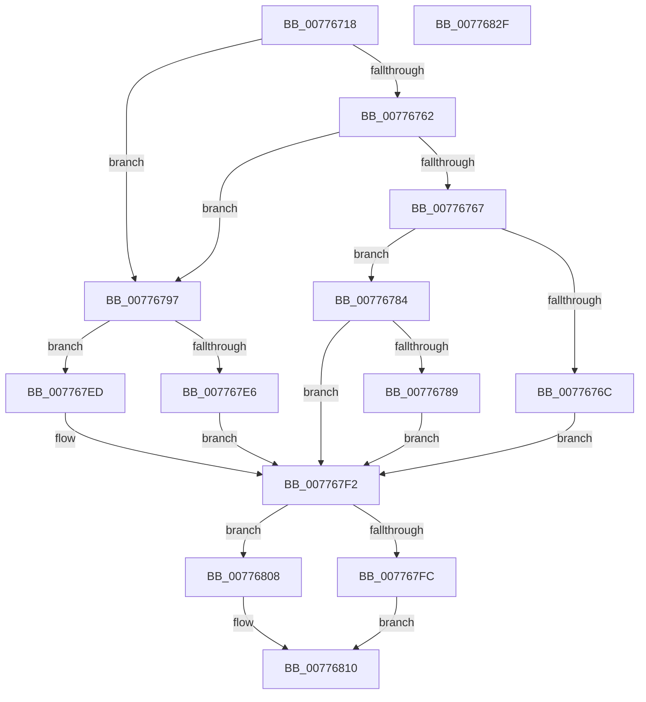

# TtmpPublishDeviceEvent

- RVA: `0x00776718`–`0x00776830` (길이 `280` bytes)
- VA: `0x0000000140776718`
- 실행 섹션: `PAGE`
- PDB 이름 있음: `예`; PDB Function 태그: `아니요`
- unwind 정보 RVA: `0x000CDBF8`
- 디코드: `80`개 명령, `280/280` bytes 표시
- 미해석 바이트: `0` (있으면 어셈블리에 `.byte`로 보존)

> 이 문서는 커널 이미지의 기계어와 PDB 기호를 분석해 생성했습니다. 4번과 5번은 함수 원형과 자료형을 바이너리 사용 방식에서 추정한 C 해석이며 원본 소스 복구 결과는 아닙니다.

## 1. Dependencies

- 직접 호출 지점: **8**; 고유 호출 대상: **8**
- 직접 호출자로 확인된 함수: **3**
- RIP 상대 이미지 참조: **0**

### Outgoing calls
- `0x00776753` → [memset](../../text/6C/memset_function_006C6C40.md) (function, `0x006C6C40`)
- `0x0077677D` → [TtmiLogDeviceAssignedTerminalEvent](TtmiLogDeviceAssignedTerminalEvent_function_00779648.md) (function, `0x00779648`)
- `0x00776790` → [TtmiLogDeviceDepartedTerminalEvent](TtmiLogDeviceDepartedTerminalEvent_function_00779738.md) (function, `0x00779738`)
- `0x007767C7` → [RtlStringCchCopyW](../../text/26/RtlStringCchCopyW_function_0026E9A4.md) (function, `0x0026E9A4`)
- `0x007767E6` → [TtmiLogDeviceEnumeratedTerminalEvent](TtmiLogDeviceEnumeratedTerminalEvent_function_00779920.md) (function, `0x00779920`)
- `0x007767ED` → [TtmiLogDeviceArrivedTerminalEvent](TtmiLogDeviceArrivedTerminalEvent_function_00779508.md) (function, `0x00779508`)
- `0x007767FF` → [TtmiWriteEventToSingleQueue](TtmiWriteEventToSingleQueue_function_0077DE04.md) (function, `0x0077DE04`)
- `0x0077680B` → [TtmiWriteEventToAllQueues](TtmiWriteEventToAllQueues_function_007775AC.md) (function, `0x007775AC`)

### Direct callers
- [TtmiAssignDevice](TtmiAssignDevice_function_00775A3C.md) at `0x00775AAA`
- [TtmiPublishDeviceEnumerationEvents](TtmiPublishDeviceEnumerationEvents_function_00775C0C.md) at `0x00775C4F`
- [TtmiSessionDeviceListWorker](TtmiSessionDeviceListWorker_function_00775CA0.md) at `0x00775D1B`
- [TtmiSessionDeviceListWorker](TtmiSessionDeviceListWorker_function_00775CA0.md) at `0x00775D99`

### Static image references
- 디코드된 RIP-relative 메모리 참조가 없습니다.

## 2. Other-region calls and transfers

- 다른 실행 섹션으로 향하는 call: **2**
  - `0x00776753` → [memset](../../text/6C/memset_function_006C6C40.md) (`PAGE` → `.text`)
  - `0x007767C7` → [RtlStringCchCopyW](../../text/26/RtlStringCchCopyW_function_0026E9A4.md) (`PAGE` → `.text`)
- 별도 외부 분기/꼬리 이동을 확인하지 못했습니다.

## 3. Assembly (complete function range)

```asm
00776718  48 8B C4                        mov rax, rsp
0077671B  48 89 58 08                     mov qword ptr [rax + 8], rbx
0077671F  48 89 70 10                     mov qword ptr [rax + 0x10], rsi
00776723  48 89 78 18                     mov qword ptr [rax + 0x18], rdi
00776727  55                              push rbp
00776728  41 56                           push r14
0077672A  41 57                           push r15
0077672C  48 8D A8 98 FE FF FF            lea rbp, [rax - 0x168]
00776733  48 81 EC 50 02 00 00            sub rsp, 0x250
0077673A  49 8B F8                        mov rdi, r8
0077673D  4C 8B F2                        mov r14, rdx
00776740  4C 8B F9                        mov r15, rcx
00776743  33 D2                           xor edx, edx
00776745  41 B8 1C 02 00 00               mov r8d, 0x21c
0077674B  48 8D 4C 24 34                  lea rcx, [rsp + 0x34]
00776750  41 8B D9                        mov ebx, r9d
00776753  E8 E8 04 F5 FF                  call 0x1406c6c40
00776758  33 F6                           xor esi, esi
0077675A  89 5C 24 30                     mov dword ptr [rsp + 0x30], ebx
0077675E  85 DB                           test ebx, ebx
00776760  74 35                           je 0x140776797
00776762  83 FB 03                        cmp ebx, 3
00776765  74 30                           je 0x140776797
00776767  83 FB 04                        cmp ebx, 4
0077676A  75 18                           jne 0x140776784
0077676C  8B 4F 20                        mov ecx, dword ptr [rdi + 0x20]
0077676F  8B 97 54 02 00 00               mov edx, dword ptr [rdi + 0x254]
00776775  89 4C 24 38                     mov dword ptr [rsp + 0x38], ecx
00776779  89 54 24 3C                     mov dword ptr [rsp + 0x3c], edx
0077677D  E8 C6 2E 00 00                  call 0x140779648
00776782  EB 6E                           jmp 0x1407767f2
00776784  83 FB 05                        cmp ebx, 5
00776787  75 69                           jne 0x1407767f2
00776789  8B 4F 20                        mov ecx, dword ptr [rdi + 0x20]
0077678C  89 4C 24 38                     mov dword ptr [rsp + 0x38], ecx
00776790  E8 A3 2F 00 00                  call 0x140779738
00776795  EB 5B                           jmp 0x1407767f2
00776797  8B 47 20                        mov eax, dword ptr [rdi + 0x20]
0077679A  4C 8D 5F 4C                     lea r11, [rdi + 0x4c]
0077679E  89 44 24 38                     mov dword ptr [rsp + 0x38], eax
007767A2  48 8D 4C 24 48                  lea rcx, [rsp + 0x48]
007767A7  8B 87 54 02 00 00               mov eax, dword ptr [rdi + 0x254]
007767AD  4D 8B C3                        mov r8, r11
007767B0  89 44 24 3C                     mov dword ptr [rsp + 0x3c], eax
007767B4  BA 04 01 00 00                  mov edx, 0x104
007767B9  8B 47 10                        mov eax, dword ptr [rdi + 0x10]
007767BC  89 44 24 40                     mov dword ptr [rsp + 0x40], eax
007767C0  8B 47 48                        mov eax, dword ptr [rdi + 0x48]
007767C3  89 44 24 44                     mov dword ptr [rsp + 0x44], eax
007767C7  E8 D8 81 AF FF                  call 0x14026e9a4
007767CC  44 8B 4F 48                     mov r9d, dword ptr [rdi + 0x48]
007767D0  44 8B 47 10                     mov r8d, dword ptr [rdi + 0x10]
007767D4  8B 97 54 02 00 00               mov edx, dword ptr [rdi + 0x254]
007767DA  8B 4F 20                        mov ecx, dword ptr [rdi + 0x20]
007767DD  4C 89 5C 24 20                  mov qword ptr [rsp + 0x20], r11
007767E2  85 DB                           test ebx, ebx
007767E4  75 07                           jne 0x1407767ed
007767E6  E8 35 31 00 00                  call 0x140779920
007767EB  EB 05                           jmp 0x1407767f2
007767ED  E8 16 2D 00 00                  call 0x140779508
007767F2  48 8D 54 24 30                  lea rdx, [rsp + 0x30]
007767F7  4D 85 F6                        test r14, r14
007767FA  74 0C                           je 0x140776808
007767FC  49 8B CE                        mov rcx, r14
007767FF  E8 00 76 00 00                  call 0x14077de04
00776804  8B F0                           mov esi, eax
00776806  EB 08                           jmp 0x140776810
00776808  49 8B CF                        mov rcx, r15
0077680B  E8 9C 0D 00 00                  call 0x1407775ac
00776810  4C 8D 9C 24 50 02 00 00         lea r11, [rsp + 0x250]
00776818  8B C6                           mov eax, esi
0077681A  49 8B 5B 20                     mov rbx, qword ptr [r11 + 0x20]
0077681E  49 8B 73 28                     mov rsi, qword ptr [r11 + 0x28]
00776822  49 8B 7B 30                     mov rdi, qword ptr [r11 + 0x30]
00776826  49 8B E3                        mov rsp, r11
00776829  41 5F                           pop r15
0077682B  41 5E                           pop r14
0077682D  5D                              pop rbp
0077682E  C3                              ret
0077682F  CC                              int3
```

## 4. C-style interpretation (structured pseudocode)

```c
__int64 __fastcall TtmpPublishDeviceEvent(__int64 a1, __int64 a2, __int64 a3, int a4)
{
    __int64 result;
    __int64 v_rsi;
    __int64 v_rsp;
    unsigned __int64 v_stack_m18;
    unsigned __int64 v_stack_m220;
    unsigned int v_stack_m224;
    unsigned int v_stack_m228;
    unsigned int v_stack_m22C;
    unsigned int v_stack_m230;
    unsigned __int64 v_stack_m234;
    unsigned int v_stack_m238;
    unsigned __int64 v_stack_m248;

    *(unsigned __int64 *)(v_rsp + 8) = v_rbx;
    *(unsigned __int64 *)(v_rsp + 16) = v_rsi;
    *(unsigned __int64 *)(v_rsp + 24) = v_rdi;
    v_rsp = (v_rsp) - (592);
    a2 = 0;
    result = memset(v_stack_m234, a2, 540, a4);
    v_rsi = 0;
    v_stack_m238 = (unsigned int)((unsigned int)(a4));
    if ((unsigned int)((unsigned int)(a4)) == 0) goto loc_00776797;
    if (((unsigned int)((unsigned int)(a4))) == 3) goto loc_00776797;
    if (((unsigned int)((unsigned int)(a4))) != 4) goto loc_00776784;
    v_stack_m230 = (unsigned int)((unsigned int)(*(unsigned int *)(a3 + 32)));
    v_stack_m22C = (unsigned int)((unsigned int)(*(unsigned int *)(a3 + 596)));
    result = TtmiLogDeviceAssignedTerminalEvent((unsigned int)(*(unsigned int *)(a3 + 32)), (unsigned int)(*(unsigned int *)(a3 + 596)), 540, a4);
    goto loc_007767F2;
loc_00776784:
    if (((unsigned int)((unsigned int)(a4))) != 5) goto loc_007767F2;
    v_stack_m230 = (unsigned int)((unsigned int)(*(unsigned int *)(a3 + 32)));
    result = TtmiLogDeviceDepartedTerminalEvent((unsigned int)(*(unsigned int *)(a3 + 32)), (unsigned int)(*(unsigned int *)(a3 + 596)), 540, a4);
    goto loc_007767F2;
loc_00776797:
    v_stack_m230 = (unsigned int)((unsigned int)(*(unsigned int *)(a3 + 32)));
    v_stack_m22C = (unsigned int)((unsigned int)(*(unsigned int *)(a3 + 596)));
    v_stack_m228 = (unsigned int)((unsigned int)(*(unsigned int *)(a3 + 16)));
    v_stack_m224 = (unsigned int)((unsigned int)(*(unsigned int *)(a3 + 72)));
    result = RtlStringCchCopyW(v_stack_m220, 260, a3 + 76, a4);
    v_stack_m248 = a3 + 76;
    if ((unsigned int)((unsigned int)(a4)) != 0) goto loc_007767ED;
    result = TtmiLogDeviceEnumeratedTerminalEvent((unsigned int)(*(unsigned int *)(a3 + 32)), (unsigned int)(*(unsigned int *)(a3 + 596)), (unsigned int)(*(unsigned int *)(a3 + 16)), (unsigned int)(*(unsigned int *)(a3 + 72)));
    goto loc_007767F2;
loc_007767ED:
    result = TtmiLogDeviceArrivedTerminalEvent((unsigned int)(*(unsigned int *)(a3 + 32)), (unsigned int)(*(unsigned int *)(a3 + 596)), (unsigned int)(*(unsigned int *)(a3 + 16)), (unsigned int)(*(unsigned int *)(a3 + 72)));
loc_007767F2:
    if (0 == 0) goto loc_00776808;
    result = TtmiWriteEventToSingleQueue(0, v_stack_m238, (unsigned int)(*(unsigned int *)(a3 + 16)), (unsigned int)(*(unsigned int *)(a3 + 72)));
    goto loc_00776810;
loc_00776808:
    result = TtmiWriteEventToAllQueues(a1, v_stack_m238, (unsigned int)(*(unsigned int *)(a3 + 16)), (unsigned int)(*(unsigned int *)(a3 + 72)));
loc_00776810:
    return (unsigned int)((unsigned int)((unsigned int)((unsigned int)(result))));
}
```

## 5. (Beta) C Style

```c
int64_t TtmpPublishDeviceEvent(int64_t Arg1, int64_t Arg2, void *Arg3, int32_t Arg4)
{
    uint8_t *arg3 = (uint8_t *)Arg3;

    int64_t result;
    int64_t local_rsi;
    int64_t local_rsp;
    uint64_t v_stack_m18;
    uint64_t v_stack_m220;
    uint32_t v_stack_m224;
    uint32_t v_stack_m228;
    uint32_t v_stack_m22C;
    uint32_t v_stack_m230;
    uint64_t v_stack_m234;
    uint32_t v_stack_m238;
    uint64_t v_stack_m248;

    *(uint64_t *)(local_rsp + 0x8) = local_rbx;
    *(uint64_t *)(local_rsp + 0x10) = local_rsi;
    *(uint64_t *)(local_rsp + 0x18) = local_rdi;
    local_rsp = (local_rsp) - (592);
    Arg2 = 0;
    result = memset(v_stack_m234, Arg2, 540, Arg4);
    local_rsi = 0;
    v_stack_m238 = (uint32_t)((uint32_t)(Arg4));
    if ((uint32_t)((uint32_t)(Arg4)) == 0) goto loc_00776797;
    if (((uint32_t)((uint32_t)(Arg4))) == 3) goto loc_00776797;
    if (((uint32_t)((uint32_t)(Arg4))) != 4) goto loc_00776784;
    v_stack_m230 = (uint32_t)((uint32_t)(*(uint32_t *)(arg3 + 0x20)));
    v_stack_m22C = (uint32_t)((uint32_t)(*(uint32_t *)(arg3 + 0x254)));
    result = TtmiLogDeviceAssignedTerminalEvent((uint32_t)(*(uint32_t *)(arg3 + 0x20)), (uint32_t)(*(uint32_t *)(arg3 + 0x254)), 540, Arg4);
    goto loc_007767F2;
loc_00776784:
    if (((uint32_t)((uint32_t)(Arg4))) != 5) goto loc_007767F2;
    v_stack_m230 = (uint32_t)((uint32_t)(*(uint32_t *)(arg3 + 0x20)));
    result = TtmiLogDeviceDepartedTerminalEvent((uint32_t)(*(uint32_t *)(arg3 + 0x20)), (uint32_t)(*(uint32_t *)(arg3 + 0x254)), 540, Arg4);
    goto loc_007767F2;
loc_00776797:
    v_stack_m230 = (uint32_t)((uint32_t)(*(uint32_t *)(arg3 + 0x20)));
    v_stack_m22C = (uint32_t)((uint32_t)(*(uint32_t *)(arg3 + 0x254)));
    v_stack_m228 = (uint32_t)((uint32_t)(*(uint32_t *)(arg3 + 0x10)));
    v_stack_m224 = (uint32_t)((uint32_t)(*(uint32_t *)(arg3 + 0x48)));
    result = RtlStringCchCopyW(v_stack_m220, 260, Arg3 + 76, Arg4);
    v_stack_m248 = Arg3 + 76;
    if ((uint32_t)((uint32_t)(Arg4)) != 0) goto loc_007767ED;
    result = TtmiLogDeviceEnumeratedTerminalEvent((uint32_t)(*(uint32_t *)(arg3 + 0x20)), (uint32_t)(*(uint32_t *)(arg3 + 0x254)), (uint32_t)(*(uint32_t *)(arg3 + 0x10)), (uint32_t)(*(uint32_t *)(arg3 + 0x48)));
    goto loc_007767F2;
loc_007767ED:
    result = TtmiLogDeviceArrivedTerminalEvent((uint32_t)(*(uint32_t *)(arg3 + 0x20)), (uint32_t)(*(uint32_t *)(arg3 + 0x254)), (uint32_t)(*(uint32_t *)(arg3 + 0x10)), (uint32_t)(*(uint32_t *)(arg3 + 0x48)));
loc_007767F2:
    if (0 == 0) goto loc_00776808;
    result = TtmiWriteEventToSingleQueue(0, v_stack_m238, (uint32_t)(*(uint32_t *)(arg3 + 0x10)), (uint32_t)(*(uint32_t *)(arg3 + 0x48)));
    goto loc_00776810;
loc_00776808:
    result = TtmiWriteEventToAllQueues(Arg1, v_stack_m238, (uint32_t)(*(uint32_t *)(arg3 + 0x10)), (uint32_t)(*(uint32_t *)(arg3 + 0x48)));
loc_00776810:
    return (uint32_t)((uint32_t)((uint32_t)((uint32_t)(result))));
}
```

### 관측된 메모리 오프셋

구조체 형식이 확인되지 않은 접근은 인자 기준의 오프셋으로만 기록했습니다.

| 기준 인자 | 오프셋 표현 | 폭 (bit) | 접근 |
|---|---:|---:|---|
| `Arg3` | `+ 0x10` | `32` | `R` |
| `Arg3` | `+ 0x20` | `32` | `R` |
| `Arg3` | `+ 0x48` | `32` | `R` |
| `Arg3` | `+ 0x4C` | `64` | `R` |
| `Arg3` | `+ 0x254` | `32` | `R` |

## 6. Execution-region graph

[열기: 2D/3D 그래프와 함수 탐색 컨트롤 패널](../../../control-panel.html?section=page&rva=0x00776718&view=graph)

- 2D 그래프는 위에서 아래로 흐르고, 3D 그래프는 빈 공간을 드래그해 회전합니다. Shift+드래그는 이동, 휠은 확대·축소, 함수 노드 선택은 대상 보고서 이동입니다.

### Static fallback


