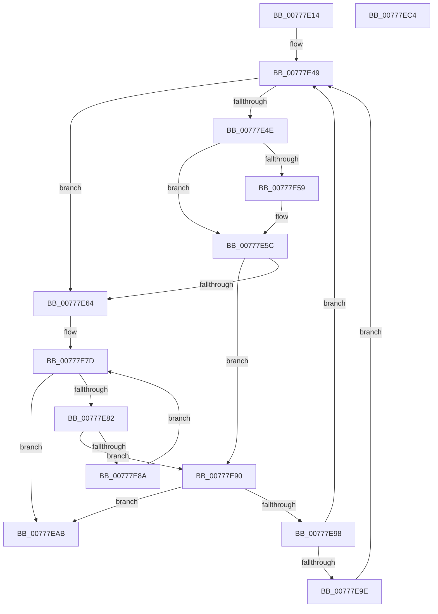

# TtmpPublishDisplayRequiredPowerRequestEvents

- RVA: `0x00777E14`–`0x00777EC5` (길이 `177` bytes)
- VA: `0x0000000140777E14`
- 실행 섹션: `PAGE`
- PDB 이름 있음: `예`; PDB Function 태그: `아니요`
- unwind 정보 RVA: `0x00060300`
- 디코드: `53`개 명령, `177/177` bytes 표시
- 미해석 바이트: `0` (있으면 어셈블리에 `.byte`로 보존)

> 이 문서는 커널 이미지의 기계어와 PDB 기호를 분석해 생성했습니다. 4번과 5번은 함수 원형과 자료형을 바이너리 사용 방식에서 추정한 C 해석이며 원본 소스 복구 결과는 아닙니다.

## 1. Dependencies

- 직접 호출 지점: **1**; 고유 호출 대상: **1**
- 직접 호출자로 확인된 함수: **1**
- RIP 상대 이미지 참조: **0**

### Outgoing calls
- `0x00777EA4` → [TtmpWriteDisplayRequiredPowerRequestUpdatedEvent](TtmpWriteDisplayRequiredPowerRequestUpdatedEvent_function_00778498.md) (function, `0x00778498`)

### Direct callers
- [TtmiWriteEnumerationEventsToQueue](TtmiWriteEnumerationEventsToQueue_function_00777510.md) at `0x00777554`

### Static image references
- 디코드된 RIP-relative 메모리 참조가 없습니다.

## 2. Other-region calls and transfers

- 다른 실행 섹션으로 향하는 call: **0**
- 별도 외부 분기/꼬리 이동을 확인하지 못했습니다.

## 3. Assembly (complete function range)

```asm
00777E14  48 89 5C 24 08                  mov qword ptr [rsp + 8], rbx
00777E19  48 89 6C 24 10                  mov qword ptr [rsp + 0x10], rbp
00777E1E  48 89 74 24 18                  mov qword ptr [rsp + 0x18], rsi
00777E23  57                              push rdi
00777E24  41 56                           push r14
00777E26  41 57                           push r15
00777E28  48 83 EC 20                     sub rsp, 0x20
00777E2C  48 8B B9 18 01 00 00            mov rdi, qword ptr [rcx + 0x118]
00777E33  48 8B EA                        mov rbp, rdx
00777E36  48 8B DF                        mov rbx, rdi
00777E39  48 8B F1                        mov rsi, rcx
00777E3C  45 33 F6                        xor r14d, r14d
00777E3F  49 BF 02 00 00 00 00 00 00 80   movabs r15, 0x8000000000000002
00777E49  48 85 DB                        test rbx, rbx
00777E4C  74 16                           je 0x140777e64
00777E4E  48 8B 03                        mov rax, qword ptr [rbx]
00777E51  49 23 C7                        and rax, r15
00777E54  49 3B C7                        cmp rax, r15
00777E57  75 03                           jne 0x140777e5c
00777E59  49 8B 06                        mov rax, qword ptr [r14]
00777E5C  48 8B 1B                        mov rbx, qword ptr [rbx]
00777E5F  F6 C3 01                        test bl, 1
00777E62  74 2C                           je 0x140777e90
00777E64  8B 8E 14 01 00 00               mov ecx, dword ptr [rsi + 0x114]
00777E6A  48 83 C7 08                     add rdi, 8
00777E6E  48 8B 86 18 01 00 00            mov rax, qword ptr [rsi + 0x118]
00777E75  48 C1 E9 05                     shr rcx, 5
00777E79  48 8D 14 C8                     lea rdx, [rax + rcx*8]
00777E7D  48 3B FA                        cmp rdi, rdx
00777E80  73 29                           jae 0x140777eab
00777E82  48 8B 1F                        mov rbx, qword ptr [rdi]
00777E85  F6 C3 01                        test bl, 1
00777E88  74 06                           je 0x140777e90
00777E8A  48 83 C7 08                     add rdi, 8
00777E8E  EB ED                           jmp 0x140777e7d
00777E90  4C 8B C3                        mov r8, rbx
00777E93  48 85 DB                        test rbx, rbx
00777E96  74 13                           je 0x140777eab
00777E98  44 39 73 28                     cmp dword ptr [rbx + 0x28], r14d
00777E9C  76 AB                           jbe 0x140777e49
00777E9E  48 8B D5                        mov rdx, rbp
00777EA1  48 8B CE                        mov rcx, rsi
00777EA4  E8 EF 05 00 00                  call 0x140778498
00777EA9  EB 9E                           jmp 0x140777e49
00777EAB  48 8B 5C 24 40                  mov rbx, qword ptr [rsp + 0x40]
00777EB0  48 8B 6C 24 48                  mov rbp, qword ptr [rsp + 0x48]
00777EB5  48 8B 74 24 50                  mov rsi, qword ptr [rsp + 0x50]
00777EBA  48 83 C4 20                     add rsp, 0x20
00777EBE  41 5F                           pop r15
00777EC0  41 5E                           pop r14
00777EC2  5F                              pop rdi
00777EC3  C3                              ret
00777EC4  CC                              int3
```

## 4. C-style interpretation (structured pseudocode)

```c
__int64 __fastcall TtmpPublishDisplayRequiredPowerRequestEvents(__int64 a1, __int64 a2)
{
    __int64 result;
    __int64 v_r14;
    __int64 v_rdi;
    __int64 v_rsp;
    unsigned __int64 v_stack_p10;
    unsigned __int64 v_stack_p18;
    unsigned __int64 v_stack_p8;

    v_stack_p8 = v_rbx;
    v_stack_p10 = v_rbp;
    v_stack_p18 = v_rsi;
    v_rsp = (v_rsp) - (32);
    v_r14 = 0;
loc_00777E49:
    if (*(unsigned __int64 *)(a1 + 280) == 0) goto loc_00777E64;
    result = (*(unsigned __int64 *)(*(unsigned __int64 *)(a1 + 280))) & (v_r15);
    if (result == v_r15) {
        result = *(unsigned __int64 *)(v_r14);
    }
    if ((((unsigned __int8)(*(unsigned __int64 *)(*(unsigned __int64 *)(a1 + 280)))) & (1)) == 0) goto loc_00777E90;
loc_00777E64:
    v_rdi = (*(unsigned __int64 *)(a1 + 280)) + (8);
    a1 = ((unsigned int)(*(unsigned int *)(a1 + 276))) >> (5);
loc_00777E7D:
    if (v_rdi >= (*(unsigned __int64 *)(a1 + 280) + a1 * 8)) goto loc_00777EAB;
    if ((((unsigned __int8)(*(unsigned __int64 *)(v_rdi))) & (1)) == 0) goto loc_00777E90;
    v_rdi = (v_rdi) + (8);
    goto loc_00777E7D;
loc_00777E90:
    if (*(unsigned __int64 *)(v_rdi) == 0) goto loc_00777EAB;
    if ((*(unsigned int *)(*(unsigned __int64 *)(v_rdi) + 40)) <= 0) goto loc_00777E49;
    result = TtmpWriteDisplayRequiredPowerRequestUpdatedEvent(a1, a2, *(unsigned __int64 *)(v_rdi), a4);
    goto loc_00777E49;
loc_00777EAB:
    v_rsp = (v_rsp) + (32);
    return result;
}
```

## 5. (Beta) C Style

```c
int64_t TtmpPublishDisplayRequiredPowerRequestEvents(void *Arg1, int64_t Arg2)
{
    uint8_t *arg1 = (uint8_t *)Arg1;

    int64_t result;
    int64_t local_r14;
    int64_t local_rdi;
    int64_t local_rsp;
    uint64_t v_stack_p10;
    uint64_t v_stack_p18;
    uint64_t v_stack_p8;

    v_stack_p8 = local_rbx;
    v_stack_p10 = local_rbp;
    v_stack_p18 = local_rsi;
    local_rsp = (local_rsp) - (32);
    local_r14 = 0;
loc_00777E49:
    if (*(uint64_t *)(arg1 + 0x118) == 0) goto loc_00777E64;
    result = (*(uint64_t *)(*(uint64_t *)(arg1 + 0x118))) & (local_r15);
    if (result == local_r15) {
        result = *(uint64_t *)(local_r14);
    }
    if ((((uint8_t)(*(uint64_t *)(*(uint64_t *)(arg1 + 0x118)))) & (1)) == 0) goto loc_00777E90;
loc_00777E64:
    local_rdi = (*(uint64_t *)(arg1 + 0x118)) + (8);
    Arg1 = ((uint32_t)(*(uint32_t *)(arg1 + 0x114))) >> (5);
loc_00777E7D:
    if (local_rdi >= (*(uint64_t *)(arg1 + 0x118) + Arg1 * 8)) goto loc_00777EAB;
    if ((((uint8_t)(*(uint64_t *)(local_rdi))) & (1)) == 0) goto loc_00777E90;
    local_rdi = (local_rdi) + (8);
    goto loc_00777E7D;
loc_00777E90:
    if (*(uint64_t *)(local_rdi) == 0) goto loc_00777EAB;
    if ((*(uint32_t *)(*(uint64_t *)(local_rdi) + 0x28)) <= 0) goto loc_00777E49;
    result = TtmpWriteDisplayRequiredPowerRequestUpdatedEvent(Arg1, Arg2, *(uint64_t *)(local_rdi), a4);
    goto loc_00777E49;
loc_00777EAB:
    local_rsp = (local_rsp) + (32);
    return result;
}
```

### 관측된 메모리 오프셋

구조체 형식이 확인되지 않은 접근은 인자 기준의 오프셋으로만 기록했습니다.

| 기준 인자 | 오프셋 표현 | 폭 (bit) | 접근 |
|---|---:|---:|---|
| `Arg1` | `+ 0x114` | `32` | `R` |
| `Arg1` | `+ 0x118` | `64` | `R` |

## 6. Execution-region graph

[열기: 2D/3D 그래프와 함수 탐색 컨트롤 패널](../../../control-panel.html?section=page&rva=0x00777E14&view=graph)

- 2D 그래프는 위에서 아래로 흐르고, 3D 그래프는 빈 공간을 드래그해 회전합니다. Shift+드래그는 이동, 휠은 확대·축소, 함수 노드 선택은 대상 보고서 이동입니다.

### Static fallback


