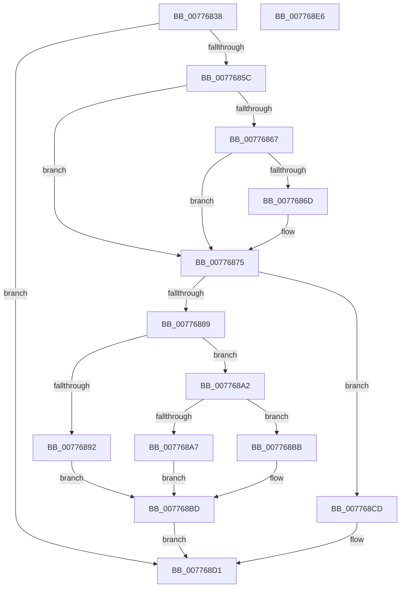

# TtmpPushTerminalDisplayStateOntoDevice

- RVA: `0x00776838`–`0x007768E7` (길이 `175` bytes)
- VA: `0x0000000140776838`
- 실행 섹션: `PAGE`
- PDB 이름 있음: `예`; PDB Function 태그: `아니요`
- unwind 정보 RVA: `0x0005C954`
- 디코드: `53`개 명령, `175/175` bytes 표시
- 미해석 바이트: `0` (있으면 어셈블리에 `.byte`로 보존)

> 이 문서는 커널 이미지의 기계어와 PDB 기호를 분석해 생성했습니다. 4번과 5번은 함수 원형과 자료형을 바이너리 사용 방식에서 추정한 C 해석이며 원본 소스 복구 결과는 아닙니다.

## 1. Dependencies

- 직접 호출 지점: **5**; 고유 호출 대상: **3**
- 직접 호출자로 확인된 함수: **1**
- RIP 상대 이미지 참조: **0**

### Outgoing calls
- `0x00776870` → [TtmpCallSetBuiltinPanelState](TtmpCallSetBuiltinPanelState_function_0077600C.md) (function, `0x0077600C`)
- `0x0077687E` → [TtmpCallSetDisplayState](TtmpCallSetDisplayState_function_0077608C.md) (function, `0x0077608C`)
- `0x0077689B` → [TtmpCallSetBuiltinPanelState](TtmpCallSetBuiltinPanelState_function_0077600C.md) (function, `0x0077600C`)
- `0x007768B1` → [TtmpCallSetBuiltinPanelState](TtmpCallSetBuiltinPanelState_function_0077600C.md) (function, `0x0077600C`)
- `0x007768C6` → [TtmpUpdatePrimaryDisplayWnf](TtmpUpdatePrimaryDisplayWnf_function_00776CEC.md) (function, `0x00776CEC`)

### Direct callers
- [TtmpCommitTerminalDisplayStateUpdateWorker](TtmpCommitTerminalDisplayStateUpdateWorker_function_00776390.md) at `0x00776489`
- [TtmpCommitTerminalDisplayStateUpdateWorker](TtmpCommitTerminalDisplayStateUpdateWorker_function_00776390.md) at `0x007764AE`
- [TtmpCommitTerminalDisplayStateUpdateWorker](TtmpCommitTerminalDisplayStateUpdateWorker_function_00776390.md) at `0x007764F5`

### Static image references
- 디코드된 RIP-relative 메모리 참조가 없습니다.

## 2. Other-region calls and transfers

- 다른 실행 섹션으로 향하는 call: **0**
- 별도 외부 분기/꼬리 이동을 확인하지 못했습니다.

## 3. Assembly (complete function range)

```asm
00776838  48 89 5C 24 08                  mov qword ptr [rsp + 8], rbx
0077683D  48 89 6C 24 10                  mov qword ptr [rsp + 0x10], rbp
00776842  48 89 74 24 18                  mov qword ptr [rsp + 0x18], rsi
00776847  57                              push rdi
00776848  48 83 EC 20                     sub rsp, 0x20
0077684C  48 83 7A 38 00                  cmp qword ptr [rdx + 0x38], 0
00776851  41 8B E8                        mov ebp, r8d
00776854  48 8B FA                        mov rdi, rdx
00776857  48 8B D9                        mov rbx, rcx
0077685A  74 75                           je 0x1407768d1
0077685C  BE FF FF FF FF                  mov esi, 0xffffffff
00776861  48 39 72 18                     cmp qword ptr [rdx + 0x18], rsi
00776865  74 0E                           je 0x140776875
00776867  41 83 F8 01                     cmp r8d, 1
0077686B  77 08                           ja 0x140776875
0077686D  45 33 C0                        xor r8d, r8d
00776870  E8 97 F7 FF FF                  call 0x14077600c
00776875  44 8B C5                        mov r8d, ebp
00776878  48 8B D7                        mov rdx, rdi
0077687B  48 8B CB                        mov rcx, rbx
0077687E  E8 09 F8 FF FF                  call 0x14077608c
00776883  48 39 77 18                     cmp qword ptr [rdi + 0x18], rsi
00776887  74 44                           je 0x1407768cd
00776889  BE 02 00 00 00                  mov esi, 2
0077688E  3B EE                           cmp ebp, esi
00776890  75 10                           jne 0x1407768a2
00776892  44 8B C6                        mov r8d, esi
00776895  48 8B D7                        mov rdx, rdi
00776898  48 8B CB                        mov rcx, rbx
0077689B  E8 6C F7 FF FF                  call 0x14077600c
007768A0  EB 1B                           jmp 0x1407768bd
007768A2  83 FD 03                        cmp ebp, 3
007768A5  75 14                           jne 0x1407768bb
007768A7  44 8D 45 FE                     lea r8d, [rbp - 2]
007768AB  48 8B D7                        mov rdx, rdi
007768AE  48 8B CB                        mov rcx, rbx
007768B1  E8 56 F7 FF FF                  call 0x14077600c
007768B6  8D 75 FE                        lea esi, [rbp - 2]
007768B9  EB 02                           jmp 0x1407768bd
007768BB  33 F6                           xor esi, esi
007768BD  44 8B C6                        mov r8d, esi
007768C0  48 8B D7                        mov rdx, rdi
007768C3  48 8B CB                        mov rcx, rbx
007768C6  E8 21 04 00 00                  call 0x140776cec
007768CB  EB 04                           jmp 0x1407768d1
007768CD  F0 FF 43 78                     lock inc dword ptr [rbx + 0x78]
007768D1  48 8B 5C 24 30                  mov rbx, qword ptr [rsp + 0x30]
007768D6  48 8B 6C 24 38                  mov rbp, qword ptr [rsp + 0x38]
007768DB  48 8B 74 24 40                  mov rsi, qword ptr [rsp + 0x40]
007768E0  48 83 C4 20                     add rsp, 0x20
007768E4  5F                              pop rdi
007768E5  C3                              ret
007768E6  CC                              int3
```

## 4. C-style interpretation (structured pseudocode)

```c
__int64 __fastcall TtmpPushTerminalDisplayStateOntoDevice(__int64 a1, __int64 a2, int a3)
{
    __int64 result;
    __int64 v_rsi;
    __int64 v_rsp;
    unsigned __int64 v_stack_p10;
    unsigned __int64 v_stack_p18;
    unsigned __int64 v_stack_p8;

    v_stack_p8 = v_rbx;
    v_stack_p10 = v_rbp;
    v_stack_p18 = v_rsi;
    v_rsp = (v_rsp) - (32);
    if ((*(unsigned __int64 *)(a2 + 56)) == 0) goto loc_007768D1;
    if ((*(unsigned __int64 *)(a2 + 24)) == ((unsigned int)(0xFFFFFFFFULL))) goto loc_00776875;
    if (a3 <= 1) {
        a3 = 0;
        result = TtmpCallSetBuiltinPanelState(a1, a2, a3, a4);
    }
    result = TtmpCallSetDisplayState(a1, a2, (unsigned int)((unsigned int)((unsigned int)(a3))), a4);
    if ((*(unsigned __int64 *)(a2 + 24)) == ((unsigned int)(0xFFFFFFFFULL))) goto loc_007768CD;
    if (((unsigned int)((unsigned int)(a3))) != 2) goto loc_007768A2;
    result = TtmpCallSetBuiltinPanelState(a1, a2, 2, a4);
    goto loc_007768BD;
loc_007768A2:
    if (((unsigned int)((unsigned int)(a3))) != 3) goto loc_007768BB;
    result = TtmpCallSetBuiltinPanelState(a1, a2, (unsigned int)(a3) - 2, a4);
    goto loc_007768BD;
loc_007768BB:
    v_rsi = 0;
loc_007768BD:
    result = TtmpUpdatePrimaryDisplayWnf(a1, a2, 0, a4);
    goto loc_007768D1;
loc_007768CD:
loc_007768D1:
    v_rsp = (v_rsp) + (32);
    return result;
}
```

## 5. (Beta) C Style

```c
int64_t TtmpPushTerminalDisplayStateOntoDevice(void *Arg1, void *Arg2, int32_t Arg3)
{
    uint8_t *arg1 = (uint8_t *)Arg1;
    uint8_t *arg2 = (uint8_t *)Arg2;

    int64_t result;
    int64_t local_rsi;
    int64_t local_rsp;
    uint64_t v_stack_p10;
    uint64_t v_stack_p18;
    uint64_t v_stack_p8;

    v_stack_p8 = local_rbx;
    v_stack_p10 = local_rbp;
    v_stack_p18 = local_rsi;
    local_rsp = (local_rsp) - (32);
    if ((*(uint64_t *)(arg2 + 0x38)) == 0) goto loc_007768D1;
    if ((*(uint64_t *)(arg2 + 0x18)) == ((uint32_t)(0xFFFFFFFFULL))) goto loc_00776875;
    if (Arg3 <= 1) {
        Arg3 = 0;
        result = TtmpCallSetBuiltinPanelState(Arg1, Arg2, Arg3, a4);
    }
    result = TtmpCallSetDisplayState(Arg1, Arg2, (uint32_t)((uint32_t)((uint32_t)(Arg3))), a4);
    if ((*(uint64_t *)(arg2 + 0x18)) == ((uint32_t)(0xFFFFFFFFULL))) goto loc_007768CD;
    if (((uint32_t)((uint32_t)(Arg3))) != 2) goto loc_007768A2;
    result = TtmpCallSetBuiltinPanelState(Arg1, Arg2, 2, a4);
    goto loc_007768BD;
loc_007768A2:
    if (((uint32_t)((uint32_t)(Arg3))) != 3) goto loc_007768BB;
    result = TtmpCallSetBuiltinPanelState(Arg1, Arg2, (uint32_t)(Arg3) - 2, a4);
    goto loc_007768BD;
loc_007768BB:
    local_rsi = 0;
loc_007768BD:
    result = TtmpUpdatePrimaryDisplayWnf(Arg1, Arg2, 0, a4);
    goto loc_007768D1;
loc_007768CD:
loc_007768D1:
    local_rsp = (local_rsp) + (32);
    return result;
}
```

### 관측된 메모리 오프셋

구조체 형식이 확인되지 않은 접근은 인자 기준의 오프셋으로만 기록했습니다.

| 기준 인자 | 오프셋 표현 | 폭 (bit) | 접근 |
|---|---:|---:|---|
| `Arg1` | `+ 0x78` | `32` | `R/W` |
| `Arg2` | `+ 0x18` | `64` | `R` |
| `Arg2` | `+ 0x38` | `64` | `R` |

## 6. Execution-region graph

[열기: 2D/3D 그래프와 함수 탐색 컨트롤 패널](../../../control-panel.html?section=page&rva=0x00776838&view=graph)

- 2D 그래프는 위에서 아래로 흐르고, 3D 그래프는 빈 공간을 드래그해 회전합니다. Shift+드래그는 이동, 휠은 확대·축소, 함수 노드 선택은 대상 보고서 이동입니다.

### Static fallback


