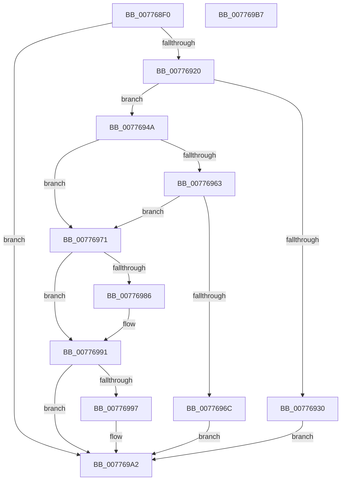

# TtmpPushTerminalState

- RVA: `0x007768F0`–`0x007769B8` (길이 `200` bytes)
- VA: `0x00000001407768F0`
- 실행 섹션: `PAGE`
- PDB 이름 있음: `예`; PDB Function 태그: `아니요`
- unwind 정보 RVA: `0x000BD000`
- 디코드: `58`개 명령, `200/200` bytes 표시
- 미해석 바이트: `0` (있으면 어셈블리에 `.byte`로 보존)

> 이 문서는 커널 이미지의 기계어와 PDB 기호를 분석해 생성했습니다. 4번과 5번은 함수 원형과 자료형을 바이너리 사용 방식에서 추정한 C 해석이며 원본 소스 복구 결과는 아닙니다.

## 1. Dependencies

- 직접 호출 지점: **4**; 고유 호출 대상: **4**
- 직접 호출자로 확인된 함수: **1**
- RIP 상대 이미지 참조: **1**

### Outgoing calls
- `0x00776927` → [TtmiGetTerminalById](TtmiGetTerminalById_function_0077CA04.md) (function, `0x0077CA04`)
- `0x00776943` → [TtmiLogError](../98/TtmiLogError_function_0098B39C.md) (function, `0x0098B39C`)
- `0x00776977` → [TtmpQueueTerminalDisplayStateOntoDevice](TtmpQueueTerminalDisplayStateOntoDevice_function_007769C0.md) (function, `0x007769C0`)
- `0x0077699D` → [TtmpCallSetInputMode](TtmpCallSetInputMode_function_0077613C.md) (function, `0x0077613C`)

### Direct callers
- [TtmiSessionDeviceListWorker](TtmiSessionDeviceListWorker_function_00775CA0.md) at `0x00775D5B`

### Static image references
- `0x00776934` → RVA `0x00B040C0` (` ?? ::NNGAKEGL::`string'`; read)

## 2. Other-region calls and transfers

- 다른 실행 섹션으로 향하는 call: **0**
- 별도 외부 분기/꼬리 이동을 확인하지 못했습니다.

## 3. Assembly (complete function range)

```asm
007768F0  48 8B C4                        mov rax, rsp
007768F3  48 89 58 08                     mov qword ptr [rax + 8], rbx
007768F7  48 89 68 18                     mov qword ptr [rax + 0x18], rbp
007768FB  56                              push rsi
007768FC  57                              push rdi
007768FD  41 56                           push r14
007768FF  48 83 EC 20                     sub rsp, 0x20
00776903  44 8B 82 54 02 00 00            mov r8d, dword ptr [rdx + 0x254]
0077690A  33 DB                           xor ebx, ebx
0077690C  48 89 58 10                     mov qword ptr [rax + 0x10], rbx
00776910  48 8B FA                        mov rdi, rdx
00776913  48 8B F1                        mov rsi, rcx
00776916  41 83 F8 FF                     cmp r8d, -1
0077691A  0F 84 82 00 00 00               je 0x1407769a2
00776920  48 8B D1                        mov rdx, rcx
00776923  48 8D 48 10                     lea rcx, [rax + 0x10]
00776927  E8 D8 60 00 00                  call 0x14077ca04
0077692C  85 C0                           test eax, eax
0077692E  79 1A                           jns 0x14077694a
00776930  41 83 C9 FF                     or r9d, 0xffffffff
00776934  48 8D 0D 85 D7 38 00            lea rcx, [rip + 0x38d785]
0077693B  44 8B C0                        mov r8d, eax
0077693E  BA 6B 0C 00 00                  mov edx, 0xc6b
00776943  E8 54 4A 21 00                  call 0x14098b39c
00776948  EB 58                           jmp 0x1407769a2
0077694A  48 8B 6C 24 48                  mov rbp, qword ptr [rsp + 0x48]
0077694F  41 BE 01 00 00 00               mov r14d, 1
00776955  8B 46 04                        mov eax, dword ptr [rsi + 4]
00776958  44 8B 85 14 01 00 00            mov r8d, dword ptr [rbp + 0x114]
0077695F  A8 08                           test al, 8
00776961  75 0E                           jne 0x140776971
00776963  41 8D 40 FE                     lea eax, [r8 - 2]
00776967  41 3B C6                        cmp eax, r14d
0077696A  77 05                           ja 0x140776971
0077696C  41 8A DE                        mov bl, r14b
0077696F  EB 31                           jmp 0x1407769a2
00776971  48 8B D7                        mov rdx, rdi
00776974  48 8B CE                        mov rcx, rsi
00776977  E8 44 00 00 00                  call 0x1407769c0
0077697C  44 8B 45 30                     mov r8d, dword ptr [rbp + 0x30]
00776980  41 83 F8 02                     cmp r8d, 2
00776984  75 0B                           jne 0x140776991
00776986  F6 87 58 02 00 00 80            test byte ptr [rdi + 0x258], 0x80
0077698D  45 0F 44 C6                     cmove r8d, r14d
00776991  48 39 5F 40                     cmp qword ptr [rdi + 0x40], rbx
00776995  74 0B                           je 0x1407769a2
00776997  48 8B D7                        mov rdx, rdi
0077699A  48 8B CE                        mov rcx, rsi
0077699D  E8 9A F7 FF FF                  call 0x14077613c
007769A2  48 8B 6C 24 50                  mov rbp, qword ptr [rsp + 0x50]
007769A7  8A C3                           mov al, bl
007769A9  48 8B 5C 24 40                  mov rbx, qword ptr [rsp + 0x40]
007769AE  48 83 C4 20                     add rsp, 0x20
007769B2  41 5E                           pop r14
007769B4  5F                              pop rdi
007769B5  5E                              pop rsi
007769B6  C3                              ret
007769B7  CC                              int3
```

## 4. C-style interpretation (structured pseudocode)

```c
__int64 __fastcall TtmpPushTerminalState(__int64 a1, __int64 a2, __int64 a3, int a4)
{
    __int64 result;
    __int64 v_rbx;
    __int64 v_rsp;
    unsigned __int64 v_stack_p10;
    unsigned __int64 v_stack_p18;
    unsigned __int64 v_stack_p8;

    *(unsigned __int64 *)(v_rsp + 8) = v_rbx;
    *(unsigned __int64 *)(v_rsp + 24) = v_rbp;
    v_rsp = (v_rsp) - (32);
    v_rbx = 0;
    *(unsigned __int64 *)(v_rsp + 16) = 0;
    if (((unsigned int)((unsigned int)(*(unsigned int *)(a2 + 596)))) == -1) goto loc_007769A2;
    result = TtmiGetTerminalById(v_rsp + 16, a1, (unsigned int)(*(unsigned int *)(a2 + 596)), a4);
    if (!sign_flag) goto loc_0077694A;
    a4 = (unsigned int)((a4) | (0xFFFFFFFFULL));
    result = TtmiLogError(v_rip + 3725189, (unsigned int)(0xC6BULL), (unsigned int)((unsigned int)(result)), a4);
    goto loc_007769A2;
loc_0077694A:
    if ((((unsigned __int8)((unsigned int)(*(unsigned int *)(a1 + 4)))) & (8)) != 0) goto loc_00776971;
    if (((unsigned int)((unsigned int)(*(unsigned int *)(v_stack_p10 + 276)) - 2)) > 1) goto loc_00776971;
    goto loc_007769A2;
loc_00776971:
    result = TtmpQueueTerminalDisplayStateOntoDevice(a1, a2, (unsigned int)(*(unsigned int *)(v_stack_p10 + 276)), a4);
    if (((unsigned int)((unsigned int)(*(unsigned int *)(v_stack_p10 + 48)))) == 2) {
        a3 = (unsigned int)(*(unsigned int *)(v_stack_p10 + 48));
        if (((*(unsigned __int8 *)(a2 + 600)) & (128)) == 0) { a3 = 1; }
    }
    if ((*(unsigned __int64 *)(a2 + 64)) != 1) {
        a2 = a2;
        a1 = a1;
        result = TtmpCallSetInputMode(a1, a2, a3, a4);
    }
    v_rsp = (v_rsp) + (32);
    return 1;
}
```

## 5. (Beta) C Style

```c
int64_t TtmpPushTerminalState(void *Arg1, void *Arg2, int64_t Arg3, int32_t Arg4)
{
    uint8_t *arg1 = (uint8_t *)Arg1;
    uint8_t *arg2 = (uint8_t *)Arg2;

    int64_t result;
    int64_t local_rbx;
    int64_t local_rsp;
    uint64_t v_stack_p10;
    uint64_t v_stack_p18;
    uint64_t v_stack_p8;

    *(uint64_t *)(local_rsp + 0x8) = local_rbx;
    *(uint64_t *)(local_rsp + 0x18) = local_rbp;
    local_rsp = (local_rsp) - (32);
    local_rbx = 0;
    *(uint64_t *)(local_rsp + 0x10) = 0;
    if (((uint32_t)((uint32_t)(*(uint32_t *)(arg2 + 0x254)))) == -1) goto loc_007769A2;
    result = TtmiGetTerminalById(local_rsp + 16, Arg1, (uint32_t)(*(uint32_t *)(arg2 + 0x254)), Arg4);
    if (!sign_flag) goto loc_0077694A;
    Arg4 = (uint32_t)((Arg4) | (0xFFFFFFFFULL));
    result = TtmiLogError(v_rip + 3725189, (uint32_t)(0xC6BULL), (uint32_t)((uint32_t)(result)), Arg4);
    goto loc_007769A2;
loc_0077694A:
    if ((((uint8_t)((uint32_t)(*(uint32_t *)(arg1 + 0x4)))) & (8)) != 0) goto loc_00776971;
    if (((uint32_t)((uint32_t)(*(uint32_t *)(v_stack_p10 + 0x114)) - 2)) > 1) goto loc_00776971;
    goto loc_007769A2;
loc_00776971:
    result = TtmpQueueTerminalDisplayStateOntoDevice(Arg1, Arg2, (uint32_t)(*(uint32_t *)(v_stack_p10 + 0x114)), Arg4);
    if (((uint32_t)((uint32_t)(*(uint32_t *)(v_stack_p10 + 0x30)))) == 2) {
        Arg3 = (uint32_t)(*(uint32_t *)(v_stack_p10 + 0x30));
        if (((*(uint8_t *)(arg2 + 0x258)) & (128)) == 0) { Arg3 = 1; }
    }
    if ((*(uint64_t *)(arg2 + 0x40)) != 1) {
        Arg2 = Arg2;
        Arg1 = Arg1;
        result = TtmpCallSetInputMode(Arg1, Arg2, Arg3, Arg4);
    }
    local_rsp = (local_rsp) + (32);
    return 1;
}
```

### 관측된 메모리 오프셋

구조체 형식이 확인되지 않은 접근은 인자 기준의 오프셋으로만 기록했습니다.

| 기준 인자 | 오프셋 표현 | 폭 (bit) | 접근 |
|---|---:|---:|---|
| `Arg1` | `+ 0x4` | `32` | `R` |
| `Arg2` | `+ 0x40` | `64` | `R` |
| `Arg2` | `+ 0x254` | `32` | `R` |
| `Arg2` | `+ 0x258` | `8` | `R` |

## 6. Execution-region graph

[열기: 2D/3D 그래프와 함수 탐색 컨트롤 패널](../../../control-panel.html?section=page&rva=0x007768F0&view=graph)

- 2D 그래프는 위에서 아래로 흐르고, 3D 그래프는 빈 공간을 드래그해 회전합니다. Shift+드래그는 이동, 휠은 확대·축소, 함수 노드 선택은 대상 보고서 이동입니다.

### Static fallback


