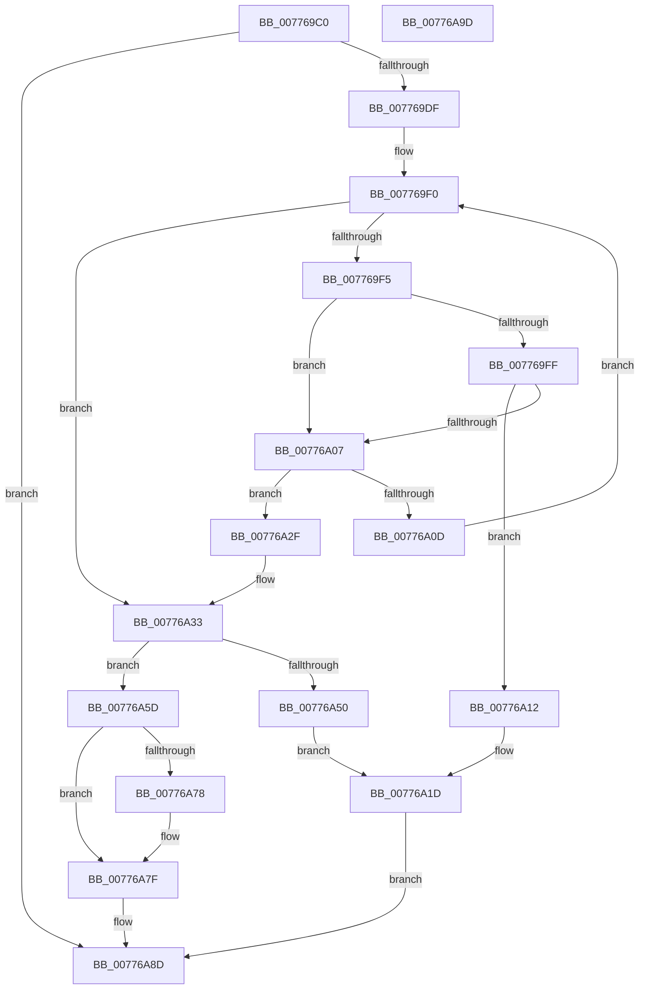

# TtmpQueueTerminalDisplayStateOntoDevice

- RVA: `0x007769C0`–`0x00776A9E` (길이 `222` bytes)
- VA: `0x00000001407769C0`
- 실행 섹션: `PAGE`
- PDB 이름 있음: `예`; PDB Function 태그: `아니요`
- unwind 정보 RVA: `0x00060BC4`
- 디코드: `62`개 명령, `222/222` bytes 표시
- 미해석 바이트: `0` (있으면 어셈블리에 `.byte`로 보존)

> 이 문서는 커널 이미지의 기계어와 PDB 기호를 분석해 생성했습니다. 4번과 5번은 함수 원형과 자료형을 바이너리 사용 방식에서 추정한 C 해석이며 원본 소스 복구 결과는 아닙니다.

## 1. Dependencies

- 직접 호출 지점: **2**; 고유 호출 대상: **2**
- 직접 호출자로 확인된 함수: **1**
- RIP 상대 이미지 참조: **1**

### Outgoing calls
- `0x00776A28` → [TtmiLogError](../98/TtmiLogError_function_0098B39C.md) (function, `0x0098B39C`)
- `0x00776A43` → [ExAllocatePool2](../../poolcode/B8/ExAllocatePool2_function_00B820F0.md) (function, `0x00B820F0`)

### Direct callers
- [TtmpPushTerminalState](TtmpPushTerminalState_function_007768F0.md) at `0x00776977`

### Static image references
- `0x00776A21` → RVA `0x00B04100` (` ?? ::NNGAKEGL::`string'`; read)

## 2. Other-region calls and transfers

- 다른 실행 섹션으로 향하는 call: **1**
  - `0x00776A43` → [ExAllocatePool2](../../poolcode/B8/ExAllocatePool2_function_00B820F0.md) (`PAGE` → `POOLCODE`)
- 별도 외부 분기/꼬리 이동을 확인하지 못했습니다.

## 3. Assembly (complete function range)

```asm
007769C0  48 89 5C 24 08                  mov qword ptr [rsp + 8], rbx
007769C5  48 89 74 24 10                  mov qword ptr [rsp + 0x10], rsi
007769CA  57                              push rdi
007769CB  48 83 EC 20                     sub rsp, 0x20
007769CF  48 8B 72 38                     mov rsi, qword ptr [rdx + 0x38]
007769D3  48 8B FA                        mov rdi, rdx
007769D6  48 85 F6                        test rsi, rsi
007769D9  0F 84 AE 00 00 00               je 0x140776a8d
007769DF  49 63 D0                        movsxd rdx, r8d
007769E2  48 83 C2 08                     add rdx, 8
007769E6  48 C1 E2 04                     shl rdx, 4
007769EA  48 03 D1                        add rdx, rcx
007769ED  48 8B 1A                        mov rbx, qword ptr [rdx]
007769F0  48 3B DA                        cmp rbx, rdx
007769F3  74 3E                           je 0x140776a33
007769F5  48 8B 47 18                     mov rax, qword ptr [rdi + 0x18]
007769F9  48 39 43 18                     cmp qword ptr [rbx + 0x18], rax
007769FD  75 08                           jne 0x140776a07
007769FF  8B 47 20                        mov eax, dword ptr [rdi + 0x20]
00776A02  39 43 20                        cmp dword ptr [rbx + 0x20], eax
00776A05  74 0B                           je 0x140776a12
00776A07  48 39 73 10                     cmp qword ptr [rbx + 0x10], rsi
00776A0B  73 22                           jae 0x140776a2f
00776A0D  48 8B 1B                        mov rbx, qword ptr [rbx]
00776A10  EB DE                           jmp 0x1407769f0
00776A12  BA 33 0B 00 00                  mov edx, 0xb33
00776A17  41 B8 2A 02 00 C0               mov r8d, 0xc000022a
00776A1D  41 83 C9 FF                     or r9d, 0xffffffff
00776A21  48 8D 0D D8 D6 38 00            lea rcx, [rip + 0x38d6d8]
00776A28  E8 6F 49 21 00                  call 0x14098b39c
00776A2D  EB 5E                           jmp 0x140776a8d
00776A2F  48 8B 5B 08                     mov rbx, qword ptr [rbx + 8]
00776A33  BA 28 00 00 00                  mov edx, 0x28
00776A38  B9 00 01 00 00                  mov ecx, 0x100
00776A3D  41 B8 54 74 6D 44               mov r8d, 0x446d7454
00776A43  E8 A8 B6 40 00                  call 0x140b820f0
00776A48  48 8B C8                        mov rcx, rax
00776A4B  48 85 C0                        test rax, rax
00776A4E  75 0D                           jne 0x140776a5d
00776A50  BA 56 0B 00 00                  mov edx, 0xb56
00776A55  41 B8 9A 00 00 C0               mov r8d, 0xc000009a
00776A5B  EB C0                           jmp 0x140776a1d
00776A5D  48 89 70 10                     mov qword ptr [rax + 0x10], rsi
00776A61  48 8B 47 18                     mov rax, qword ptr [rdi + 0x18]
00776A65  48 89 41 18                     mov qword ptr [rcx + 0x18], rax
00776A69  8B 47 20                        mov eax, dword ptr [rdi + 0x20]
00776A6C  89 41 20                        mov dword ptr [rcx + 0x20], eax
00776A6F  48 8B 03                        mov rax, qword ptr [rbx]
00776A72  48 39 58 08                     cmp qword ptr [rax + 8], rbx
00776A76  74 07                           je 0x140776a7f
00776A78  B9 03 00 00 00                  mov ecx, 3
00776A7D  CD 29                           int 0x29
00776A7F  48 89 01                        mov qword ptr [rcx], rax
00776A82  48 89 59 08                     mov qword ptr [rcx + 8], rbx
00776A86  48 89 48 08                     mov qword ptr [rax + 8], rcx
00776A8A  48 89 0B                        mov qword ptr [rbx], rcx
00776A8D  48 8B 5C 24 30                  mov rbx, qword ptr [rsp + 0x30]
00776A92  48 8B 74 24 38                  mov rsi, qword ptr [rsp + 0x38]
00776A97  48 83 C4 20                     add rsp, 0x20
00776A9B  5F                              pop rdi
00776A9C  C3                              ret
00776A9D  CC                              int3
```

## 4. C-style interpretation (structured pseudocode)

```c
__int64 __fastcall TtmpQueueTerminalDisplayStateOntoDevice(__int64 a1, __int64 a2, int a3, int a4)
{
    __int64 result;
    __int64 v_rsp;
    unsigned __int64 v_stack_p10;
    unsigned __int64 v_stack_p8;

    v_stack_p8 = v_rbx;
    v_stack_p10 = v_rsi;
    v_rsp = (v_rsp) - (32);
    if (*(unsigned __int64 *)(a2 + 56) == 0) goto loc_00776A8D;
    a2 = ((int)(a3)) + (8);
    a2 = (a2) << (4);
    a2 = (a2) + (a1);
loc_007769F0:
    if ((*(unsigned __int64 *)(a2)) == a2) goto loc_00776A33;
    if ((*(unsigned __int64 *)(*(unsigned __int64 *)(a2) + 24)) != (*(unsigned __int64 *)(a2 + 24))) goto loc_00776A07;
    if ((*(unsigned int *)(*(unsigned __int64 *)(a2) + 32)) == ((unsigned int)((unsigned int)(*(unsigned int *)(a2 + 32))))) goto loc_00776A12;
loc_00776A07:
    if ((*(unsigned __int64 *)(*(unsigned __int64 *)(a2) + 16)) >= (*(unsigned __int64 *)(a2 + 56))) goto loc_00776A2F;
    goto loc_007769F0;
loc_00776A12:
loc_00776A1D:
    a4 = (unsigned int)((a4) | (0xFFFFFFFFULL));
    result = TtmiLogError(v_rip + 3725016, (unsigned int)(0xB33ULL), (unsigned int)(0xC000022AULL), a4);
    goto loc_00776A8D;
loc_00776A2F:
loc_00776A33:
    result = ExAllocatePool2(256, 40, (unsigned int)(0x446D7454ULL), a4);
    if (result != 0) goto loc_00776A5D;
    goto loc_00776A1D;
loc_00776A5D:
    *(unsigned __int64 *)(result + 16) = *(unsigned __int64 *)(a2 + 56);
    *(unsigned __int64 *)(result + 24) = *(unsigned __int64 *)(a2 + 24);
    *(unsigned int *)(result + 32) = (unsigned int)((unsigned int)(*(unsigned int *)(a2 + 32)));
    if ((*(unsigned __int64 *)(*(unsigned __int64 *)(*(unsigned __int64 *)(*(unsigned __int64 *)(*(unsigned __int64 *)(a2)) + 8)) + 8)) != (*(unsigned __int64 *)(*(unsigned __int64 *)(*(unsigned __int64 *)(a2)) + 8))) {
        a1 = 3;
    }
    *(unsigned __int64 *)(a1) = *(unsigned __int64 *)(*(unsigned __int64 *)(*(unsigned __int64 *)(*(unsigned __int64 *)(a2)) + 8));
    *(unsigned __int64 *)(a1 + 8) = *(unsigned __int64 *)(*(unsigned __int64 *)(*(unsigned __int64 *)(a2)) + 8);
    *(unsigned __int64 *)(*(unsigned __int64 *)(*(unsigned __int64 *)(*(unsigned __int64 *)(*(unsigned __int64 *)(a2)) + 8)) + 8) = a1;
    *(unsigned __int64 *)(*(unsigned __int64 *)(*(unsigned __int64 *)(*(unsigned __int64 *)(a2)) + 8)) = a1;
loc_00776A8D:
    v_rsp = (v_rsp) + (32);
    return *(unsigned __int64 *)(*(unsigned __int64 *)(*(unsigned __int64 *)(*(unsigned __int64 *)(a2)) + 8));
}
```

## 5. (Beta) C Style

```c
int64_t TtmpQueueTerminalDisplayStateOntoDevice(int64_t Arg1, void *Arg2, int32_t Arg3, int32_t Arg4)
{
    uint8_t *arg2 = (uint8_t *)Arg2;

    int64_t result;
    int64_t local_rsp;
    uint64_t v_stack_p10;
    uint64_t v_stack_p8;

    v_stack_p8 = local_rbx;
    v_stack_p10 = local_rsi;
    local_rsp = (local_rsp) - (32);
    if (*(uint64_t *)(arg2 + 0x38) == 0) goto loc_00776A8D;
    Arg2 = ((int32_t)(Arg3)) + (8);
    Arg2 = (Arg2) << (4);
    Arg2 = (Arg2) + (Arg1);
loc_007769F0:
    if ((*(uint64_t *)(arg2)) == Arg2) goto loc_00776A33;
    if ((*(uint64_t *)(*(uint64_t *)(arg2) + 0x18)) != (*(uint64_t *)(arg2 + 0x18))) goto loc_00776A07;
    if ((*(uint32_t *)(*(uint64_t *)(arg2) + 0x20)) == ((uint32_t)((uint32_t)(*(uint32_t *)(arg2 + 0x20))))) goto loc_00776A12;
loc_00776A07:
    if ((*(uint64_t *)(*(uint64_t *)(arg2) + 0x10)) >= (*(uint64_t *)(arg2 + 0x38))) goto loc_00776A2F;
    goto loc_007769F0;
loc_00776A12:
loc_00776A1D:
    Arg4 = (uint32_t)((Arg4) | (0xFFFFFFFFULL));
    result = TtmiLogError(v_rip + 3725016, (uint32_t)(0xB33ULL), (uint32_t)(0xC000022AULL), Arg4);
    goto loc_00776A8D;
loc_00776A2F:
loc_00776A33:
    result = ExAllocatePool2(256, 40, (uint32_t)(0x446D7454ULL), Arg4);
    if (result != 0) goto loc_00776A5D;
    goto loc_00776A1D;
loc_00776A5D:
    *(uint64_t *)(result + 0x10) = *(uint64_t *)(arg2 + 0x38);
    *(uint64_t *)(result + 0x18) = *(uint64_t *)(arg2 + 0x18);
    *(uint32_t *)(result + 0x20) = (uint32_t)((uint32_t)(*(uint32_t *)(arg2 + 0x20)));
    if ((*(uint64_t *)(*(uint64_t *)(*(uint64_t *)(*(uint64_t *)(*(uint64_t *)(arg2)) + 0x8)) + 0x8)) != (*(uint64_t *)(*(uint64_t *)(*(uint64_t *)(arg2)) + 0x8))) {
        Arg1 = 3;
    }
    *(uint64_t *)(Arg1) = *(uint64_t *)(*(uint64_t *)(*(uint64_t *)(*(uint64_t *)(arg2)) + 0x8));
    *(uint64_t *)(Arg1 + 0x8) = *(uint64_t *)(*(uint64_t *)(*(uint64_t *)(arg2)) + 0x8);
    *(uint64_t *)(*(uint64_t *)(*(uint64_t *)(*(uint64_t *)(*(uint64_t *)(arg2)) + 0x8)) + 0x8) = Arg1;
    *(uint64_t *)(*(uint64_t *)(*(uint64_t *)(*(uint64_t *)(arg2)) + 0x8)) = Arg1;
loc_00776A8D:
    local_rsp = (local_rsp) + (32);
    return *(uint64_t *)(*(uint64_t *)(*(uint64_t *)(*(uint64_t *)(arg2)) + 0x8));
}
```

### 관측된 메모리 오프셋

구조체 형식이 확인되지 않은 접근은 인자 기준의 오프셋으로만 기록했습니다.

| 기준 인자 | 오프셋 표현 | 폭 (bit) | 접근 |
|---|---:|---:|---|
| `Arg2` | `+ 0x18` | `64` | `R` |
| `Arg2` | `+ 0x20` | `32` | `R` |
| `Arg2` | `+ 0x38` | `64` | `R` |

## 6. Execution-region graph

[열기: 2D/3D 그래프와 함수 탐색 컨트롤 패널](../../../control-panel.html?section=page&rva=0x007769C0&view=graph)

- 2D 그래프는 위에서 아래로 흐르고, 3D 그래프는 빈 공간을 드래그해 회전합니다. Shift+드래그는 이동, 휠은 확대·축소, 함수 노드 선택은 대상 보고서 이동입니다.

### Static fallback


