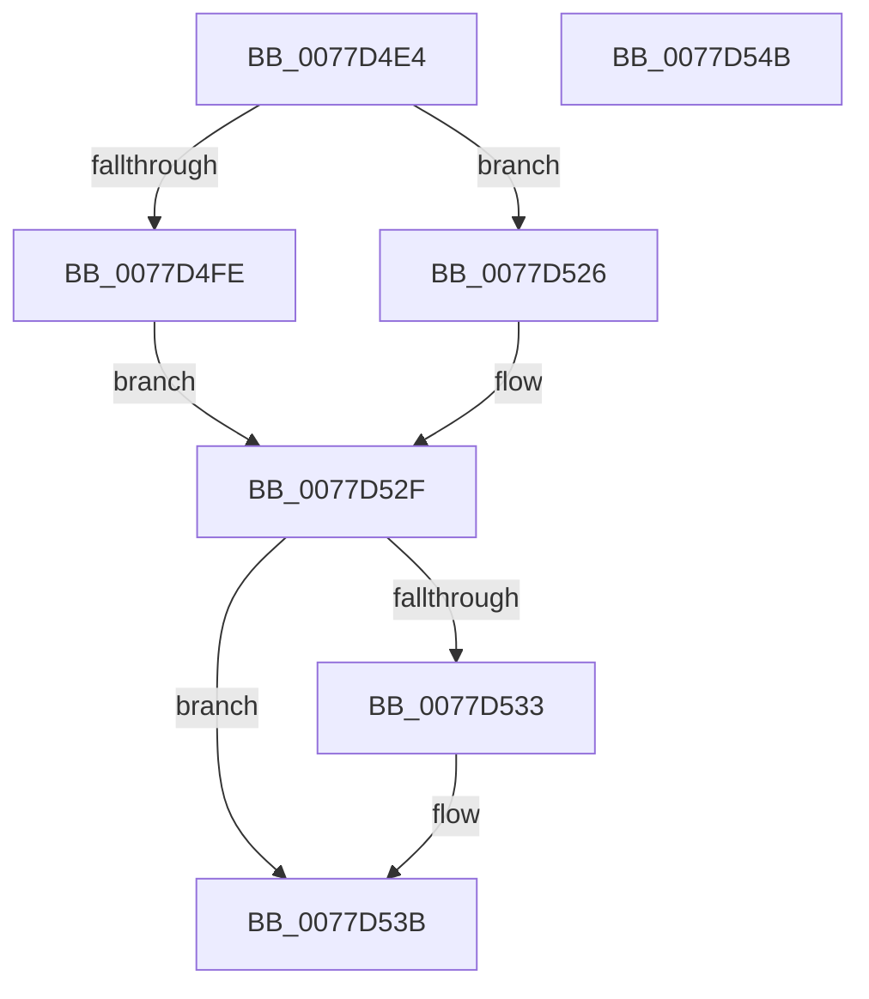

# TtmpResetEvaluationTimer

- RVA: `0x0077D4E4`–`0x0077D54C` (길이 `104` bytes)
- VA: `0x000000014077D4E4`
- 실행 섹션: `PAGE`
- PDB 이름 있음: `예`; PDB Function 태그: `아니요`
- unwind 정보 RVA: `0x000794E0`
- 디코드: `30`개 명령, `104/104` bytes 표시
- 미해석 바이트: `0` (있으면 어셈블리에 `.byte`로 보존)

> 이 문서는 커널 이미지의 기계어와 PDB 기호를 분석해 생성했습니다. 4번과 5번은 함수 원형과 자료형을 바이너리 사용 방식에서 추정한 C 해석이며 원본 소스 복구 결과는 아닙니다.

## 1. Dependencies

- 직접 호출 지점: **4**; 고유 호출 대상: **4**
- 직접 호출자로 확인된 함수: **2**
- RIP 상대 이미지 참조: **0**

### Outgoing calls
- `0x0077D4FE` → [ObfReferenceObject](../../text/20/ObfReferenceObject_function_0020FA20.md) (function, `0x0020FA20`)
- `0x0077D51F` → [KiSetTimerEx](../../text/23/KiSetTimerEx_function_00232CB0.md) (function, `0x00232CB0`)
- `0x0077D52A` → [KeCancelTimer](../../text/23/KeCancelTimer_function_002327E0.md) (function, `0x002327E0`)
- `0x0077D536` → [ObfDereferenceObject](../../text/2F/ObfDereferenceObject_function_002F9350.md) (function, `0x002F9350`)

### Direct callers
- [TtmpSetTerminalPendingCleanup](TtmpSetTerminalPendingCleanup_function_0077D5C4.md) at `0x0077D5E0`
- [TtmpUpdateTerminalState](TtmpUpdateTerminalState_function_0077D7D0.md) at `0x0077D95A`

### Static image references
- 디코드된 RIP-relative 메모리 참조가 없습니다.

## 2. Other-region calls and transfers

- 다른 실행 섹션으로 향하는 call: **4**
  - `0x0077D4FE` → [ObfReferenceObject](../../text/20/ObfReferenceObject_function_0020FA20.md) (`PAGE` → `.text`)
  - `0x0077D51F` → [KiSetTimerEx](../../text/23/KiSetTimerEx_function_00232CB0.md) (`PAGE` → `.text`)
  - `0x0077D52A` → [KeCancelTimer](../../text/23/KeCancelTimer_function_002327E0.md) (`PAGE` → `.text`)
  - `0x0077D536` → [ObfDereferenceObject](../../text/2F/ObfDereferenceObject_function_002F9350.md) (`PAGE` → `.text`)
- 별도 외부 분기/꼬리 이동을 확인하지 못했습니다.

## 3. Assembly (complete function range)

```asm
0077D4E4  48 89 5C 24 08                  mov qword ptr [rsp + 8], rbx
0077D4E9  48 89 74 24 10                  mov qword ptr [rsp + 0x10], rsi
0077D4EE  57                              push rdi
0077D4EF  48 83 EC 30                     sub rsp, 0x30
0077D4F3  48 8B DA                        mov rbx, rdx
0077D4F6  48 8B F9                        mov rdi, rcx
0077D4F9  48 85 D2                        test rdx, rdx
0077D4FC  74 28                           je 0x14077d526
0077D4FE  E8 1D 25 A9 FF                  call 0x14020fa20
0077D503  48 F7 DB                        neg rbx
0077D506  48 8D 87 98 00 00 00            lea rax, [rdi + 0x98]
0077D50D  48 8B D3                        mov rdx, rbx
0077D510  48 89 44 24 20                  mov qword ptr [rsp + 0x20], rax
0077D515  45 33 C9                        xor r9d, r9d
0077D518  48 8D 4F 58                     lea rcx, [rdi + 0x58]
0077D51C  45 33 C0                        xor r8d, r8d
0077D51F  E8 8C 57 AB FF                  call 0x140232cb0
0077D524  EB 09                           jmp 0x14077d52f
0077D526  48 83 C1 58                     add rcx, 0x58
0077D52A  E8 B1 52 AB FF                  call 0x1402327e0
0077D52F  84 C0                           test al, al
0077D531  74 08                           je 0x14077d53b
0077D533  48 8B CF                        mov rcx, rdi
0077D536  E8 15 BE B7 FF                  call 0x1402f9350
0077D53B  48 8B 5C 24 40                  mov rbx, qword ptr [rsp + 0x40]
0077D540  48 8B 74 24 48                  mov rsi, qword ptr [rsp + 0x48]
0077D545  48 83 C4 30                     add rsp, 0x30
0077D549  5F                              pop rdi
0077D54A  C3                              ret
0077D54B  CC                              int3
```

## 4. C-style interpretation (structured pseudocode)

```c
__int64 __fastcall TtmpResetEvaluationTimer(__int64 a1, __int64 a2, int a3, int a4)
{
    __int64 result;
    __int64 v_rbx;
    __int64 v_rsp;
    unsigned __int64 v_stack_m18;
    unsigned __int64 v_stack_p10;
    unsigned __int64 v_stack_p8;

    v_stack_p8 = v_rbx;
    v_stack_p10 = v_rsi;
    v_rsp = (v_rsp) - (48);
    if (a2 == 0) goto loc_0077D526;
    result = ObfReferenceObject(a1, a2, a3, a4);
    v_rbx = -(a2);
    v_stack_m18 = a1 + 152;
    a4 = 0;
    a3 = 0;
    result = KiSetTimerEx(a1 + 88, v_rbx, a3, a4);
    goto loc_0077D52F;
loc_0077D526:
    a1 = (a1 + 88) + (88);
    result = KeCancelTimer(a1, v_rbx, a3, a4);
loc_0077D52F:
    if ((unsigned __int8)(result) != 0) {
        a1 = a1;
        result = ObfDereferenceObject(a1, v_rbx, a3, a4);
    }
    v_rsp = (v_rsp) + (48);
    return result;
}
```

## 5. (Beta) C Style

```c
int64_t TtmpResetEvaluationTimer(void *Arg1, int64_t Arg2, int32_t Arg3, int32_t Arg4)
{
    uint8_t *arg1 = (uint8_t *)Arg1;

    int64_t result;
    int64_t local_rbx;
    int64_t local_rsp;
    uint64_t v_stack_m18;
    uint64_t v_stack_p10;
    uint64_t v_stack_p8;

    v_stack_p8 = local_rbx;
    v_stack_p10 = local_rsi;
    local_rsp = (local_rsp) - (48);
    if (Arg2 == 0) goto loc_0077D526;
    result = ObfReferenceObject(Arg1, Arg2, Arg3, Arg4);
    local_rbx = -(Arg2);
    v_stack_m18 = Arg1 + 152;
    Arg4 = 0;
    Arg3 = 0;
    result = KiSetTimerEx(Arg1 + 88, local_rbx, Arg3, Arg4);
    goto loc_0077D52F;
loc_0077D526:
    Arg1 = (Arg1 + 88) + (88);
    result = KeCancelTimer(Arg1, local_rbx, Arg3, Arg4);
loc_0077D52F:
    if ((uint8_t)(result) != 0) {
        Arg1 = Arg1;
        result = ObfDereferenceObject(Arg1, local_rbx, Arg3, Arg4);
    }
    local_rsp = (local_rsp) + (48);
    return result;
}
```

### 관측된 메모리 오프셋

구조체 형식이 확인되지 않은 접근은 인자 기준의 오프셋으로만 기록했습니다.

| 기준 인자 | 오프셋 표현 | 폭 (bit) | 접근 |
|---|---:|---:|---|
| `Arg1` | `+ 0x58` | `64` | `R` |
| `Arg1` | `+ 0x98` | `64` | `R` |

## 6. Execution-region graph

[열기: 2D/3D 그래프와 함수 탐색 컨트롤 패널](../../../control-panel.html?section=page&rva=0x0077D4E4&view=graph)

- 2D 그래프는 위에서 아래로 흐르고, 3D 그래프는 빈 공간을 드래그해 회전합니다. Shift+드래그는 이동, 휠은 확대·축소, 함수 노드 선택은 대상 보고서 이동입니다.

### Static fallback


