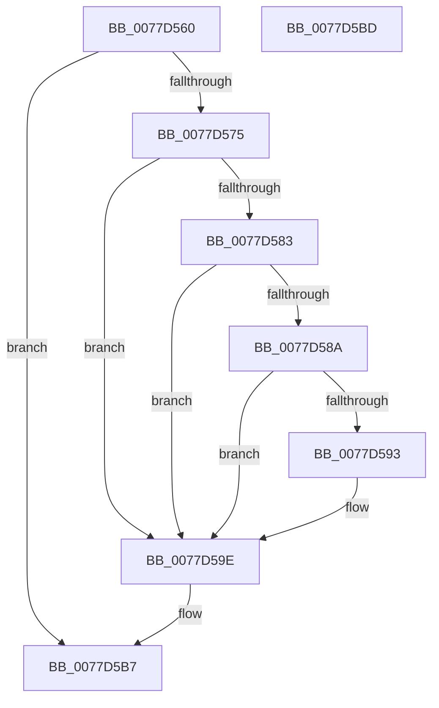

# TtmpScheduledEvaluationWorker

- RVA: `0x0077D560`–`0x0077D5BE` (길이 `94` bytes)
- VA: `0x000000014077D560`
- 실행 섹션: `PAGE`
- PDB 이름 있음: `예`; PDB Function 태그: `아니요`
- unwind 정보 RVA: `0x0005CF00`
- 디코드: `29`개 명령, `94/94` bytes 표시
- 미해석 바이트: `0` (있으면 어셈블리에 `.byte`로 보존)

> 이 문서는 커널 이미지의 기계어와 PDB 기호를 분석해 생성했습니다. 4번과 5번은 함수 원형과 자료형을 바이너리 사용 방식에서 추정한 C 해석이며 원본 소스 복구 결과는 아닙니다.

## 1. Dependencies

- 직접 호출 지점: **5**; 고유 호출 대상: **5**
- 직접 호출자로 확인된 함수: **0**
- RIP 상대 이미지 참조: **1**

### Outgoing calls
- `0x0077D575` → [TtmpAcquireSessionLock](../70/TtmpAcquireSessionLock_function_00700408.md) (function, `0x00700408`)
- `0x0077D599` → [TtmiScheduleSessionWorker](TtmiScheduleSessionWorker_function_00777184.md) (function, `0x00777184`)
- `0x0077D5A5` → [ExReleaseResourceLite](../../text/25/ExReleaseResourceLite_function_0025FA10.md) (function, `0x0025FA10`)
- `0x0077D5AA` → [KeLeaveCriticalRegion](../../text/25/KeLeaveCriticalRegion_function_0025D8B0.md) (function, `0x0025D8B0`)
- `0x0077D5B2` → [ObfDereferenceObject](../../text/2F/ObfDereferenceObject_function_002F9350.md) (function, `0x002F9350`)

### Direct callers
- 이 함수 시작 RVA로 연결되는 직접 call은 확인되지 않았습니다. 간접 호출은 완전히 역산할 수 없습니다.

### Static image references
- `0x0077D59E` → RVA `0x00F06940` (`.data`; read)

## 2. Other-region calls and transfers

- 다른 실행 섹션으로 향하는 call: **3**
  - `0x0077D5A5` → [ExReleaseResourceLite](../../text/25/ExReleaseResourceLite_function_0025FA10.md) (`PAGE` → `.text`)
  - `0x0077D5AA` → [KeLeaveCriticalRegion](../../text/25/KeLeaveCriticalRegion_function_0025D8B0.md) (`PAGE` → `.text`)
  - `0x0077D5B2` → [ObfDereferenceObject](../../text/2F/ObfDereferenceObject_function_002F9350.md) (`PAGE` → `.text`)
- 별도 외부 분기/꼬리 이동을 확인하지 못했습니다.

## 3. Assembly (complete function range)

```asm
0077D560  40 53                           push rbx
0077D562  48 83 EC 20                     sub rsp, 0x20
0077D566  33 C0                           xor eax, eax
0077D568  48 8B D9                        mov rbx, rcx
0077D56B  87 81 F8 00 00 00               xchg dword ptr [rcx + 0xf8], eax
0077D571  85 C0                           test eax, eax
0077D573  74 42                           je 0x14077d5b7
0077D575  E8 8E 2E F8 FF                  call 0x140700408
0077D57A  48 8B 4B 10                     mov rcx, qword ptr [rbx + 0x10]
0077D57E  48 85 C9                        test rcx, rcx
0077D581  74 1B                           je 0x14077d59e
0077D583  8B 43 24                        mov eax, dword ptr [rbx + 0x24]
0077D586  A8 01                           test al, 1
0077D588  75 14                           jne 0x14077d59e
0077D58A  BA 02 00 00 00                  mov edx, 2
0077D58F  84 C2                           test dl, al
0077D591  75 0B                           jne 0x14077d59e
0077D593  83 C8 04                        or eax, 4
0077D596  89 43 24                        mov dword ptr [rbx + 0x24], eax
0077D599  E8 E6 9B FF FF                  call 0x140777184
0077D59E  48 8D 0D 9B 93 78 00            lea rcx, [rip + 0x78939b]
0077D5A5  E8 66 24 AE FF                  call 0x14025fa10
0077D5AA  E8 01 03 AE FF                  call 0x14025d8b0
0077D5AF  48 8B CB                        mov rcx, rbx
0077D5B2  E8 99 BD B7 FF                  call 0x1402f9350
0077D5B7  48 83 C4 20                     add rsp, 0x20
0077D5BB  5B                              pop rbx
0077D5BC  C3                              ret
0077D5BD  CC                              int3
```

## 4. C-style interpretation (structured pseudocode)

```c
__int64 __fastcall TtmpScheduledEvaluationWorker(__int64 a1)
{
    __int64 result;
    __int64 v_rsp;

    v_rsp = (v_rsp) - (32);
    result = 0;
    if (0 == 0) goto loc_0077D5B7;
    result = TtmpAcquireSessionLock(a1, a2, a3, a4);
    if (*(unsigned __int64 *)(a1 + 16) == 0) goto loc_0077D59E;
    if ((((unsigned __int8)((unsigned int)(*(unsigned int *)(a1 + 36)))) & (1)) != 0) goto loc_0077D59E;
    result = (unsigned int)(*(unsigned int *)(a1 + 36));
    if (((2) & ((unsigned __int8)((unsigned int)(*(unsigned int *)(a1 + 36))))) == 0) {
        result = (unsigned int)(((unsigned int)(*(unsigned int *)(a1 + 36))) | (4));
        *(unsigned int *)(a1 + 36) = (unsigned int)(result);
        result = TtmiScheduleSessionWorker(*(unsigned __int64 *)(a1 + 16), 2, a3, a4);
    }
    result = ExReleaseResourceLite(v_rip + 7902107, 2, a3, a4);
    result = KeLeaveCriticalRegion(v_rip + 7902107, 2, a3, a4);
    result = ObfDereferenceObject(a1, 2, a3, a4);
loc_0077D5B7:
    v_rsp = (v_rsp) + (32);
    return result;
}
```

## 5. (Beta) C Style

```c
int64_t TtmpScheduledEvaluationWorker(void *Arg1)
{
    uint8_t *arg1 = (uint8_t *)Arg1;

    int64_t result;
    int64_t local_rsp;

    local_rsp = (local_rsp) - (32);
    result = 0;
    if (0 == 0) goto loc_0077D5B7;
    result = TtmpAcquireSessionLock(Arg1, a2, a3, a4);
    if (*(uint64_t *)(arg1 + 0x10) == 0) goto loc_0077D59E;
    if ((((uint8_t)((uint32_t)(*(uint32_t *)(arg1 + 0x24)))) & (1)) != 0) goto loc_0077D59E;
    result = (uint32_t)(*(uint32_t *)(arg1 + 0x24));
    if (((2) & ((uint8_t)((uint32_t)(*(uint32_t *)(arg1 + 0x24))))) == 0) {
        result = (uint32_t)(((uint32_t)(*(uint32_t *)(arg1 + 0x24))) | (4));
        *(uint32_t *)(arg1 + 0x24) = (uint32_t)(result);
        result = TtmiScheduleSessionWorker(*(uint64_t *)(arg1 + 0x10), 2, a3, a4);
    }
    result = ExReleaseResourceLite(v_rip + 7902107, 2, a3, a4);
    result = KeLeaveCriticalRegion(v_rip + 7902107, 2, a3, a4);
    result = ObfDereferenceObject(Arg1, 2, a3, a4);
loc_0077D5B7:
    local_rsp = (local_rsp) + (32);
    return result;
}
```

### 관측된 메모리 오프셋

구조체 형식이 확인되지 않은 접근은 인자 기준의 오프셋으로만 기록했습니다.

| 기준 인자 | 오프셋 표현 | 폭 (bit) | 접근 |
|---|---:|---:|---|
| `Arg1` | `+ 0x10` | `64` | `R` |
| `Arg1` | `+ 0x24` | `32` | `R` |
| `Arg1` | `+ 0x24` | `32` | `W` |
| `Arg1` | `+ 0xF8` | `32` | `R/W` |

## 6. Execution-region graph

[열기: 2D/3D 그래프와 함수 탐색 컨트롤 패널](../../../control-panel.html?section=page&rva=0x0077D560&view=graph)

- 2D 그래프는 위에서 아래로 흐르고, 3D 그래프는 빈 공간을 드래그해 회전합니다. Shift+드래그는 이동, 휠은 확대·축소, 함수 노드 선택은 대상 보고서 이동입니다.

### Static fallback


