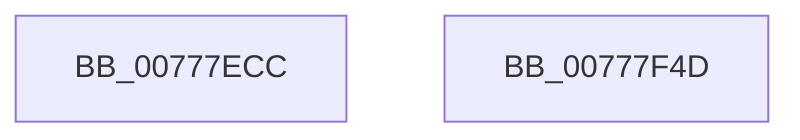

# TtmpSessionPowerControl

- RVA: `0x00777ECC`–`0x00777F4E` (길이 `130` bytes)
- VA: `0x0000000140777ECC`
- 실행 섹션: `PAGE`
- PDB 이름 있음: `예`; PDB Function 태그: `아니요`
- unwind 정보 RVA: `0x0006F978`
- 디코드: `31`개 명령, `130/130` bytes 표시
- 미해석 바이트: `0` (있으면 어셈블리에 `.byte`로 보존)

> 이 문서는 커널 이미지의 기계어와 PDB 기호를 분석해 생성했습니다. 4번과 5번은 함수 원형과 자료형을 바이너리 사용 방식에서 추정한 C 해석이며 원본 소스 복구 결과는 아닙니다.

## 1. Dependencies

- 직접 호출 지점: **6**; 고유 호출 대상: **6**
- 직접 호출자로 확인된 함수: **2**
- RIP 상대 이미지 참조: **1**

### Outgoing calls
- `0x00777EF2` → [TtmiLogSessionPowerControlStart](TtmiLogSessionPowerControlStart_function_0077B130.md) (function, `0x0077B130`)
- `0x00777F06` → [ExReleaseResourceLite](../../text/25/ExReleaseResourceLite_function_0025FA10.md) (function, `0x0025FA10`)
- `0x00777F0B` → [KeLeaveCriticalRegion](../../text/25/KeLeaveCriticalRegion_function_0025D8B0.md) (function, `0x0025D8B0`)
- `0x00777F18` → [PoSessionPowerControl](../76/PoSessionPowerControl_function_0076C038.md) (function, `0x0076C038`)
- `0x00777F1D` → [TtmpAcquireSessionLock](../70/TtmpAcquireSessionLock_function_00700408.md) (function, `0x00700408`)
- `0x00777F32` → [TtmiLogSessionPowerControlStop](TtmiLogSessionPowerControlStop_function_0077B224.md) (function, `0x0077B224`)

### Direct callers
- [TtmpActivateSessionWorker](TtmpActivateSessionWorker_function_0077768C.md) at `0x00777712`
- [TtmpSessionWorker](TtmpSessionWorker_function_00777F60.md) at `0x00778092`

### Static image references
- `0x00777EFF` → RVA `0x00F06940` (`.data`; read)

## 2. Other-region calls and transfers

- 다른 실행 섹션으로 향하는 call: **2**
  - `0x00777F06` → [ExReleaseResourceLite](../../text/25/ExReleaseResourceLite_function_0025FA10.md) (`PAGE` → `.text`)
  - `0x00777F0B` → [KeLeaveCriticalRegion](../../text/25/KeLeaveCriticalRegion_function_0025D8B0.md) (`PAGE` → `.text`)
- 별도 외부 분기/꼬리 이동을 확인하지 못했습니다.

## 3. Assembly (complete function range)

```asm
00777ECC  48 89 5C 24 08                  mov qword ptr [rsp + 8], rbx
00777ED1  48 89 74 24 10                  mov qword ptr [rsp + 0x10], rsi
00777ED6  48 89 7C 24 18                  mov qword ptr [rsp + 0x18], rdi
00777EDB  41 56                           push r14
00777EDD  48 83 EC 20                     sub rsp, 0x20
00777EE1  8B 19                           mov ebx, dword ptr [rcx]
00777EE3  40 8A F2                        mov sil, dl
00777EE6  4C 8B F1                        mov r14, rcx
00777EE9  41 8B D0                        mov edx, r8d
00777EEC  40 8A CE                        mov cl, sil
00777EEF  41 8B F8                        mov edi, r8d
00777EF2  E8 39 32 00 00                  call 0x14077b130
00777EF7  49 83 A6 E8 00 00 00 00         and qword ptr [r14 + 0xe8], 0
00777EFF  48 8D 0D 3A EA 78 00            lea rcx, [rip + 0x78ea3a]
00777F06  E8 05 7B AE FF                  call 0x14025fa10
00777F0B  E8 A0 59 AE FF                  call 0x14025d8b0
00777F10  44 8B C3                        mov r8d, ebx
00777F13  8B D7                           mov edx, edi
00777F15  40 8A CE                        mov cl, sil
00777F18  E8 1B 41 FF FF                  call 0x14076c038
00777F1D  E8 E6 84 F8 FF                  call 0x140700408
00777F22  65 48 8B 04 25 88 01 00 00      mov rax, qword ptr gs:[0x188]
00777F2B  49 89 86 E8 00 00 00            mov qword ptr [r14 + 0xe8], rax
00777F32  E8 ED 32 00 00                  call 0x14077b224
00777F37  48 8B 5C 24 30                  mov rbx, qword ptr [rsp + 0x30]
00777F3C  48 8B 74 24 38                  mov rsi, qword ptr [rsp + 0x38]
00777F41  48 8B 7C 24 40                  mov rdi, qword ptr [rsp + 0x40]
00777F46  48 83 C4 20                     add rsp, 0x20
00777F4A  41 5E                           pop r14
00777F4C  C3                              ret
00777F4D  CC                              int3
```

## 4. C-style interpretation (structured pseudocode)

```c
__int64 __fastcall TtmpSessionPowerControl(__int64 a1, unsigned __int8 a2, int a3)
{
    __int64 result;
    __int64 v_rsp;
    unsigned __int64 v_stack_p10;
    unsigned __int64 v_stack_p18;
    unsigned __int64 v_stack_p8;

    v_stack_p8 = v_rbx;
    v_stack_p10 = v_rsi;
    v_stack_p18 = v_rdi;
    v_rsp = (v_rsp) - (32);
    result = TtmiLogSessionPowerControlStart(a2, (unsigned int)(a3), a3, a4);
    result = ExReleaseResourceLite(v_rip + 7924282, (unsigned int)(a3), a3, a4);
    result = KeLeaveCriticalRegion(v_rip + 7924282, (unsigned int)(a3), a3, a4);
    result = PoSessionPowerControl(a2, (unsigned int)((unsigned int)((unsigned int)(a3))), (unsigned int)((unsigned int)((unsigned int)(*(unsigned int *)(a1)))), a4);
    result = TtmpAcquireSessionLock(a2, (unsigned int)((unsigned int)((unsigned int)(a3))), (unsigned int)((unsigned int)((unsigned int)(*(unsigned int *)(a1)))), a4);
    *(unsigned __int64 *)(a1 + 232) = *(unsigned __int64 *)(gs_base + (0 + 392));
    result = TtmiLogSessionPowerControlStop(a2, (unsigned int)((unsigned int)((unsigned int)(a3))), (unsigned int)((unsigned int)((unsigned int)(*(unsigned int *)(a1)))), a4);
    v_rsp = (v_rsp) + (32);
    return result;
}
```

## 5. (Beta) C Style

```c
int64_t TtmpSessionPowerControl(void *Arg1, uint8_t Arg2, int32_t Arg3)
{
    uint8_t *arg1 = (uint8_t *)Arg1;

    int64_t result;
    int64_t local_rsp;
    uint64_t v_stack_p10;
    uint64_t v_stack_p18;
    uint64_t v_stack_p8;

    v_stack_p8 = local_rbx;
    v_stack_p10 = local_rsi;
    v_stack_p18 = local_rdi;
    local_rsp = (local_rsp) - (32);
    result = TtmiLogSessionPowerControlStart(Arg2, (uint32_t)(Arg3), Arg3, a4);
    result = ExReleaseResourceLite(v_rip + 7924282, (uint32_t)(Arg3), Arg3, a4);
    result = KeLeaveCriticalRegion(v_rip + 7924282, (uint32_t)(Arg3), Arg3, a4);
    result = PoSessionPowerControl(Arg2, (uint32_t)((uint32_t)((uint32_t)(Arg3))), (uint32_t)((uint32_t)((uint32_t)(*(uint32_t *)(arg1)))), a4);
    result = TtmpAcquireSessionLock(Arg2, (uint32_t)((uint32_t)((uint32_t)(Arg3))), (uint32_t)((uint32_t)((uint32_t)(*(uint32_t *)(arg1)))), a4);
    *(uint64_t *)(arg1 + 0xE8) = *(uint64_t *)(gs_base + (0 + 0x188));
    result = TtmiLogSessionPowerControlStop(Arg2, (uint32_t)((uint32_t)((uint32_t)(Arg3))), (uint32_t)((uint32_t)((uint32_t)(*(uint32_t *)(arg1)))), a4);
    local_rsp = (local_rsp) + (32);
    return result;
}
```

### 관측된 메모리 오프셋

구조체 형식이 확인되지 않은 접근은 인자 기준의 오프셋으로만 기록했습니다.

| 기준 인자 | 오프셋 표현 | 폭 (bit) | 접근 |
|---|---:|---:|---|
| `Arg1` | `+ 0x0` | `32` | `R` |
| `Arg1` | `+ 0xE8` | `64` | `R/W` |
| `Arg1` | `+ 0xE8` | `64` | `W` |

## 6. Execution-region graph

[열기: 2D/3D 그래프와 함수 탐색 컨트롤 패널](../../../control-panel.html?section=page&rva=0x00777ECC&view=graph)

- 2D 그래프는 위에서 아래로 흐르고, 3D 그래프는 빈 공간을 드래그해 회전합니다. Shift+드래그는 이동, 휠은 확대·축소, 함수 노드 선택은 대상 보고서 이동입니다.

### Static fallback


