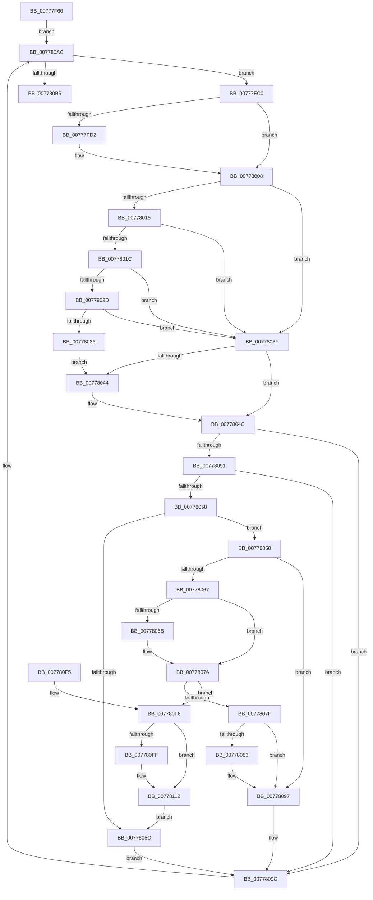

# TtmpSessionWorker

- RVA: `0x00777F60`–`0x0077811D` (길이 `445` bytes)
- VA: `0x0000000140777F60`
- 실행 섹션: `PAGE`
- PDB 이름 있음: `예`; PDB Function 태그: `아니요`
- unwind 정보 RVA: `0x000CDC54`
- 디코드: `134`개 명령, `445/445` bytes 표시
- 미해석 바이트: `0` (있으면 어셈블리에 `.byte`로 보존)

> 이 문서는 커널 이미지의 기계어와 PDB 기호를 분석해 생성했습니다. 4번과 5번은 함수 원형과 자료형을 바이너리 사용 방식에서 추정한 C 해석이며 원본 소스 복구 결과는 아닙니다.

## 1. Dependencies

- 직접 호출 지점: **13**; 고유 호출 대상: **13**
- 직접 호출자로 확인된 함수: **0**
- RIP 상대 이미지 참조: **1**

### Outgoing calls
- `0x00777F7D` → [TtmpAcquireSessionLock](../70/TtmpAcquireSessionLock_function_00700408.md) (function, `0x00700408`)
- `0x00777F88` → [TtmiLogSessionWorkerStart](TtmiLogSessionWorkerStart_function_0077B8BC.md) (function, `0x0077B8BC`)
- `0x00777FC8` → [TtmiLogSessionWorkerPass](TtmiLogSessionWorkerPass_function_0077B7F8.md) (function, `0x0077B7F8`)
- `0x00777FE2` → [TtmiSessionTerminalListWorker](TtmiSessionTerminalListWorker_function_0077CE14.md) (function, `0x0077CE14`)
- `0x0077801F` → [TtmpActivateSessionWorker](TtmpActivateSessionWorker_function_0077768C.md) (function, `0x0077768C`)
- `0x00778047` → [TtmiSessionDeviceListWorker](TtmiSessionDeviceListWorker_function_00775CA0.md) (function, `0x00775CA0`)
- `0x00778071` → [TtmiLogSessionDeactivate](TtmiLogSessionDeactivate_function_0077AEF4.md) (function, `0x0077AEF4`)
- `0x00778092` → [TtmpSessionPowerControl](TtmpSessionPowerControl_function_00777ECC.md) (function, `0x00777ECC`)
- `0x007780C8` → [ExReleaseResourceLite](../../text/25/ExReleaseResourceLite_function_0025FA10.md) (function, `0x0025FA10`)
- `0x007780CD` → [KeLeaveCriticalRegion](../../text/25/KeLeaveCriticalRegion_function_0025D8B0.md) (function, `0x0025D8B0`)
- `0x007780D5` → [TtmpDereferenceSessionMaybeLast](TtmpDereferenceSessionMaybeLast_function_00777898.md) (function, `0x00777898`)
- `0x007780DF` → [TtmiLogSessionWorkerStop](TtmiLogSessionWorkerStop_function_0077B950.md) (function, `0x0077B950`)
- `0x00778108` → [TtmpInitiateModernStandbyTransition](TtmpInitiateModernStandbyTransition_function_00777A18.md) (function, `0x00777A18`)

### Direct callers
- 이 함수 시작 RVA로 연결되는 직접 call은 확인되지 않았습니다. 간접 호출은 완전히 역산할 수 없습니다.

### Static image references
- `0x007780B9` → RVA `0x00F06940` (`.data`; read)

## 2. Other-region calls and transfers

- 다른 실행 섹션으로 향하는 call: **2**
  - `0x007780C8` → [ExReleaseResourceLite](../../text/25/ExReleaseResourceLite_function_0025FA10.md) (`PAGE` → `.text`)
  - `0x007780CD` → [KeLeaveCriticalRegion](../../text/25/KeLeaveCriticalRegion_function_0025D8B0.md) (`PAGE` → `.text`)
- 별도 외부 분기/꼬리 이동을 확인하지 못했습니다.

## 3. Assembly (complete function range)

```asm
00777F60  48 89 5C 24 18                  mov qword ptr [rsp + 0x18], rbx
00777F65  55                              push rbp
00777F66  56                              push rsi
00777F67  57                              push rdi
00777F68  41 56                           push r14
00777F6A  41 57                           push r15
00777F6C  48 83 EC 20                     sub rsp, 0x20
00777F70  48 8B F9                        mov rdi, rcx
00777F73  C6 44 24 58 00                  mov byte ptr [rsp + 0x58], 0
00777F78  C6 44 24 50 00                  mov byte ptr [rsp + 0x50], 0
00777F7D  E8 86 84 F8 FF                  call 0x140700408
00777F82  44 8B 37                        mov r14d, dword ptr [rdi]
00777F85  41 8B CE                        mov ecx, r14d
00777F88  E8 2F 39 00 00                  call 0x14077b8bc
00777F8D  8B 47 04                        mov eax, dword ptr [rdi + 4]
00777F90  33 F6                           xor esi, esi
00777F92  83 E0 FE                        and eax, 0xfffffffe
00777F95  83 C8 02                        or eax, 2
00777F98  89 47 04                        mov dword ptr [rdi + 4], eax
00777F9B  65 48 8B 04 25 88 01 00 00      mov rax, qword ptr gs:[0x188]
00777FA4  44 8D 7E 01                     lea r15d, [rsi + 1]
00777FA8  8B 9F E0 00 00 00               mov ebx, dword ptr [rdi + 0xe0]
00777FAE  21 B7 E0 00 00 00               and dword ptr [rdi + 0xe0], esi
00777FB4  48 89 87 E8 00 00 00            mov qword ptr [rdi + 0xe8], rax
00777FBB  E9 EC 00 00 00                  jmp 0x1407780ac
00777FC0  45 8B C7                        mov r8d, r15d
00777FC3  8B D3                           mov edx, ebx
00777FC5  41 8B CE                        mov ecx, r14d
00777FC8  E8 2B 38 00 00                  call 0x14077b7f8
00777FCD  F6 C3 02                        test bl, 2
00777FD0  74 36                           je 0x140778008
00777FD2  4C 8D 44 24 58                  lea r8, [rsp + 0x58]
00777FD7  48 8B CF                        mov rcx, rdi
00777FDA  48 8D 54 24 50                  lea rdx, [rsp + 0x50]
00777FDF  83 E3 FD                        and ebx, 0xfffffffd
00777FE2  E8 2D 4E 00 00                  call 0x14077ce14
00777FE7  0F B6 44 24 50                  movzx eax, byte ptr [rsp + 0x50]
00777FEC  C1 E0 02                        shl eax, 2
00777FEF  0B C3                           or eax, ebx
00777FF1  83 E3 FB                        and ebx, 0xfffffffb
00777FF4  83 E0 04                        and eax, 4
00777FF7  33 C3                           xor eax, ebx
00777FF9  0F B6 5C 24 58                  movzx ebx, byte ptr [rsp + 0x58]
00777FFE  0B D8                           or ebx, eax
00778000  83 E0 FE                        and eax, 0xfffffffe
00778003  83 E3 01                        and ebx, 1
00778006  33 D8                           xor ebx, eax
00778008  8B EB                           mov ebp, ebx
0077800A  83 E3 FB                        and ebx, 0xfffffffb
0077800D  C1 ED 02                        shr ebp, 2
00778010  40 84 ED                        test bpl, bpl
00778013  74 2A                           je 0x14077803f
00778015  8B 47 04                        mov eax, dword ptr [rdi + 4]
00778018  A8 10                           test al, 0x10
0077801A  74 23                           je 0x14077803f
0077801C  48 8B CF                        mov rcx, rdi
0077801F  E8 68 F6 FF FF                  call 0x14077768c
00778024  8B F0                           mov esi, eax
00778026  3D 03 01 00 00                  cmp eax, 0x103
0077802B  74 12                           je 0x14077803f
0077802D  8B 47 04                        mov eax, dword ptr [rdi + 4]
00778030  0F BA E0 0C                     bt eax, 0xc
00778034  73 09                           jae 0x14077803f
00778036  0F BA F0 0C                     btr eax, 0xc
0077803A  89 47 04                        mov dword ptr [rdi + 4], eax
0077803D  EB 05                           jmp 0x140778044
0077803F  F6 C3 01                        test bl, 1
00778042  74 08                           je 0x14077804c
00778044  48 8B CF                        mov rcx, rdi
00778047  E8 54 DC FF FF                  call 0x140775ca0
0077804C  40 84 ED                        test bpl, bpl
0077804F  74 4B                           je 0x14077809c
00778051  8B 47 04                        mov eax, dword ptr [rdi + 4]
00778054  A8 20                           test al, 0x20
00778056  74 44                           je 0x14077809c
00778058  A8 04                           test al, 4
0077805A  74 04                           je 0x140778060
0077805C  33 F6                           xor esi, esi
0077805E  EB 3C                           jmp 0x14077809c
00778060  A9 80 01 00 00                  test eax, 0x180
00778065  75 30                           jne 0x140778097
00778067  A8 08                           test al, 8
00778069  74 0B                           je 0x140778076
0077806B  83 E0 F7                        and eax, 0xfffffff7
0077806E  89 47 04                        mov dword ptr [rdi + 4], eax
00778071  E8 7E 2E 00 00                  call 0x14077aef4
00778076  8B 47 04                        mov eax, dword ptr [rdi + 4]
00778079  0F BA E0 0A                     bt eax, 0xa
0077807D  72 77                           jb 0x1407780f6
0077807F  A8 40                           test al, 0x40
00778081  75 14                           jne 0x140778097
00778083  44 8B 47 10                     mov r8d, dword ptr [rdi + 0x10]
00778087  83 C8 40                        or eax, 0x40
0077808A  33 D2                           xor edx, edx
0077808C  89 47 04                        mov dword ptr [rdi + 4], eax
0077808F  48 8B CF                        mov rcx, rdi
00778092  E8 35 FE FF FF                  call 0x140777ecc
00778097  BE 03 01 00 00                  mov esi, 0x103
0077809C  8B 9F E0 00 00 00               mov ebx, dword ptr [rdi + 0xe0]
007780A2  83 A7 E0 00 00 00 00            and dword ptr [rdi + 0xe0], 0
007780A9  41 FF C7                        inc r15d
007780AC  83 E3 07                        and ebx, 7
007780AF  0F 85 0B FF FF FF               jne 0x140777fc0
007780B5  83 67 04 FD                     and dword ptr [rdi + 4], 0xfffffffd
007780B9  48 8D 0D 80 E8 78 00            lea rcx, [rip + 0x78e880]
007780C0  48 83 A7 E8 00 00 00 00         and qword ptr [rdi + 0xe8], 0
007780C8  E8 43 79 AE FF                  call 0x14025fa10
007780CD  E8 DE 57 AE FF                  call 0x14025d8b0
007780D2  48 8B CF                        mov rcx, rdi
007780D5  E8 BE F7 FF FF                  call 0x140777898
007780DA  8B D6                           mov edx, esi
007780DC  41 8B CE                        mov ecx, r14d
007780DF  E8 6C 38 00 00                  call 0x14077b950
007780E4  48 8B 5C 24 60                  mov rbx, qword ptr [rsp + 0x60]
007780E9  48 83 C4 20                     add rsp, 0x20
007780ED  41 5F                           pop r15
007780EF  41 5E                           pop r14
007780F1  5F                              pop rdi
007780F2  5E                              pop rsi
007780F3  5D                              pop rbp
007780F4  C3                              ret
007780F5  CC                              int3
007780F6  BB 00 02 00 00                  mov ebx, 0x200
007780FB  85 C3                           test ebx, eax
007780FD  75 13                           jne 0x140778112
007780FF  44 8B 47 10                     mov r8d, dword ptr [rdi + 0x10]
00778103  B2 01                           mov dl, 1
00778105  48 8B CF                        mov rcx, rdi
00778108  E8 0B F9 FF FF                  call 0x140777a18
0077810D  8B 47 04                        mov eax, dword ptr [rdi + 4]
00778110  0B C3                           or eax, ebx
00778112  83 E0 DF                        and eax, 0xffffffdf
00778115  89 47 04                        mov dword ptr [rdi + 4], eax
00778118  E9 3F FF FF FF                  jmp 0x14077805c
```

## 4. C-style interpretation (structured pseudocode)

```c
__int64 __fastcall TtmpSessionWorker(__int64 a1)
{
    __int64 result;
    __int64 v_r15;
    __int64 v_rbp;
    __int64 v_rbx;
    __int64 v_rsi;
    __int64 v_rsp;
    unsigned __int8 v_stack_p10;
    unsigned __int64 v_stack_p18;
    unsigned __int8 v_stack_p8;

    v_stack_p18 = v_rbx;
    v_rsp = (v_rsp) - (32);
    v_stack_p10 = 0;
    v_stack_p8 = 0;
    result = TtmpAcquireSessionLock(a1, a2, a3, a4);
    result = TtmiLogSessionWorkerStart((unsigned int)((unsigned int)((unsigned int)(*(unsigned int *)(a1)))), a2, a3, a4);
    v_rsi = 0;
    result = (unsigned int)(((unsigned int)(*(unsigned int *)(a1 + 4))) & (0xFFFFFFFEULL));
    result = (unsigned int)((result) | (2));
    *(unsigned int *)(a1 + 4) = (unsigned int)(result);
    *(unsigned __int64 *)(a1 + 232) = *(unsigned __int64 *)(gs_base + (0 + 392));
    goto loc_007780AC;
loc_00777FC0:
    result = TtmiLogSessionWorkerPass((unsigned int)((unsigned int)((unsigned int)(*(unsigned int *)(a1)))), (unsigned int)((unsigned int)((unsigned int)(*(unsigned int *)(a1 + 224)))), (unsigned int)((unsigned int)(v_rsi + 1)), a4);
    v_rbx = (unsigned int)(*(unsigned int *)(a1 + 224));
    if ((((unsigned __int8)((unsigned int)(*(unsigned int *)(a1 + 224)))) & (2)) != 0) {
        a3 = v_stack_p10;
        a1 = a1;
        a2 = v_stack_p8;
        v_rbx = (unsigned int)(((unsigned int)(*(unsigned int *)(a1 + 224))) & (0xFFFFFFFDULL));
        result = TtmiSessionTerminalListWorker(a1, a2, a3, a4);
        result = v_stack_p8;
        result = (unsigned int)((result) << (2));
        result = (unsigned int)((result) | ((unsigned int)(v_rbx)));
        v_rbx = (unsigned int)((v_rbx) & (0xFFFFFFFBULL));
        result = (unsigned int)((result) & (4));
        result = (unsigned int)((result) ^ ((unsigned int)(v_rbx)));
        v_rbx = v_stack_p10;
        v_rbx = (unsigned int)((v_rbx) | ((unsigned int)(result)));
        result = (unsigned int)((result) & (0xFFFFFFFEULL));
        v_rbx = (unsigned int)((v_rbx) & (1));
        v_rbx = (unsigned int)((v_rbx) ^ ((unsigned int)(result)));
    }
    v_rbx = (unsigned int)((v_rbx) & (0xFFFFFFFBULL));
    v_rbp = (unsigned int)(((unsigned int)((unsigned int)(v_rbx))) >> (2));
    if ((unsigned __int8)(v_rbp) == 0) goto loc_0077803F;
    if ((((unsigned __int8)((unsigned int)(*(unsigned int *)(a1 + 4)))) & (16)) == 0) goto loc_0077803F;
    result = TtmpActivateSessionWorker(a1, a2, a3, a4);
    if (((unsigned int)(result)) == 259) goto loc_0077803F;
    if (((unsigned int)(result)) >= 259) goto loc_0077803F;
    *(unsigned int *)(a1 + 4) = (unsigned int)((unsigned int)(*(unsigned int *)(a1 + 4)));
    goto loc_00778044;
loc_0077803F:
    result = (unsigned int)(*(unsigned int *)(a1 + 4));
    if ((((unsigned __int8)(v_rbx)) & (1)) != 0) {
        a1 = a1;
        result = TtmiSessionDeviceListWorker(a1, a2, a3, a4);
    }
    if ((unsigned __int8)(v_rbp) == 0) goto loc_0077809C;
    if ((((unsigned __int8)((unsigned int)(*(unsigned int *)(a1 + 4)))) & (32)) == 0) goto loc_0077809C;
    if ((((unsigned __int8)((unsigned int)(*(unsigned int *)(a1 + 4)))) & (4)) == 0) goto loc_00778060;
loc_0077805C:
    v_rsi = 0;
    goto loc_0077809C;
loc_00778060:
    if ((((unsigned int)((unsigned int)(*(unsigned int *)(a1 + 4)))) & (384)) != 0) goto loc_00778097;
    result = (unsigned int)(*(unsigned int *)(a1 + 4));
    if ((((unsigned __int8)((unsigned int)(*(unsigned int *)(a1 + 4)))) & (8)) != 0) {
        result = (unsigned int)(((unsigned int)(*(unsigned int *)(a1 + 4))) & (0xFFFFFFF7ULL));
        *(unsigned int *)(a1 + 4) = (unsigned int)(result);
        result = TtmiLogSessionDeactivate(a1, a2, a3, a4);
    }
    if (condition_is_below) goto loc_007780F6;
    result = (unsigned int)(*(unsigned int *)(a1 + 4));
    if ((((unsigned __int8)((unsigned int)(*(unsigned int *)(a1 + 4)))) & (64)) == 0) {
        a3 = *(unsigned int *)(a1 + 16);
        result = (unsigned int)(((unsigned int)(*(unsigned int *)(a1 + 4))) | (64));
        a2 = 0;
        *(unsigned int *)(a1 + 4) = (unsigned int)(result);
        a1 = a1;
        result = TtmpSessionPowerControl(a1, a2, a3, a4);
    }
loc_0077809C:
    v_r15 = (unsigned int)((v_rsi + 1) + 1);
loc_007780AC:
    v_rbx = (unsigned int)(((unsigned int)(*(unsigned int *)(a1 + 224))) & (7));
    if (condition_is_not_equal) goto loc_00777FC0;
    result = ExReleaseResourceLite(v_rip + 7923840, a2, a3, a4);
    result = KeLeaveCriticalRegion(v_rip + 7923840, a2, a3, a4);
    result = TtmpDereferenceSessionMaybeLast(a1, a2, a3, a4);
    result = TtmiLogSessionWorkerStop((unsigned int)((unsigned int)((unsigned int)(*(unsigned int *)(a1)))), 259, a3, a4);
    v_rsp = (v_rsp) + (32);
    return result;
loc_007780F6:
    if (((512) & ((unsigned int)(result))) == 0) {
        a3 = *(unsigned int *)(a1 + 16);
        a2 = 1;
        a1 = a1;
        result = TtmpInitiateModernStandbyTransition(a1, a2, a3, a4);
        result = *(unsigned int *)(a1 + 4);
        result = (unsigned int)((result) | (512));
    }
    result = (unsigned int)((result) & (0xFFFFFFDFULL));
    *(unsigned int *)(a1 + 4) = (unsigned int)(result);
    goto loc_0077805C;
}
```

## 5. (Beta) C Style

```c
int64_t TtmpSessionWorker(void *Arg1)
{
    uint8_t *arg1 = (uint8_t *)Arg1;

    int64_t result;
    int64_t local_r15;
    int64_t local_rbp;
    int64_t local_rbx;
    int64_t local_rsi;
    int64_t local_rsp;
    uint8_t v_stack_p10;
    uint64_t v_stack_p18;
    uint8_t v_stack_p8;

    v_stack_p18 = local_rbx;
    local_rsp = (local_rsp) - (32);
    v_stack_p10 = 0;
    v_stack_p8 = 0;
    result = TtmpAcquireSessionLock(Arg1, a2, a3, a4);
    result = TtmiLogSessionWorkerStart((uint32_t)((uint32_t)((uint32_t)(*(uint32_t *)(arg1)))), a2, a3, a4);
    local_rsi = 0;
    result = (uint32_t)(((uint32_t)(*(uint32_t *)(arg1 + 0x4))) & (0xFFFFFFFEULL));
    result = (uint32_t)((result) | (2));
    *(uint32_t *)(arg1 + 0x4) = (uint32_t)(result);
    *(uint64_t *)(arg1 + 0xE8) = *(uint64_t *)(gs_base + (0 + 0x188));
    goto loc_007780AC;
loc_00777FC0:
    result = TtmiLogSessionWorkerPass((uint32_t)((uint32_t)((uint32_t)(*(uint32_t *)(arg1)))), (uint32_t)((uint32_t)((uint32_t)(*(uint32_t *)(arg1 + 0xE0)))), (uint32_t)((uint32_t)(local_rsi + 1)), a4);
    local_rbx = (uint32_t)(*(uint32_t *)(arg1 + 0xE0));
    if ((((uint8_t)((uint32_t)(*(uint32_t *)(arg1 + 0xE0)))) & (2)) != 0) {
        a3 = v_stack_p10;
        Arg1 = Arg1;
        a2 = v_stack_p8;
        local_rbx = (uint32_t)(((uint32_t)(*(uint32_t *)(arg1 + 0xE0))) & (0xFFFFFFFDULL));
        result = TtmiSessionTerminalListWorker(Arg1, a2, a3, a4);
        result = v_stack_p8;
        result = (uint32_t)((result) << (2));
        result = (uint32_t)((result) | ((uint32_t)(local_rbx)));
        local_rbx = (uint32_t)((local_rbx) & (0xFFFFFFFBULL));
        result = (uint32_t)((result) & (4));
        result = (uint32_t)((result) ^ ((uint32_t)(local_rbx)));
        local_rbx = v_stack_p10;
        local_rbx = (uint32_t)((local_rbx) | ((uint32_t)(result)));
        result = (uint32_t)((result) & (0xFFFFFFFEULL));
        local_rbx = (uint32_t)((local_rbx) & (1));
        local_rbx = (uint32_t)((local_rbx) ^ ((uint32_t)(result)));
    }
    local_rbx = (uint32_t)((local_rbx) & (0xFFFFFFFBULL));
    local_rbp = (uint32_t)(((uint32_t)((uint32_t)(local_rbx))) >> (2));
    if ((uint8_t)(local_rbp) == 0) goto loc_0077803F;
    if ((((uint8_t)((uint32_t)(*(uint32_t *)(arg1 + 0x4)))) & (16)) == 0) goto loc_0077803F;
    result = TtmpActivateSessionWorker(Arg1, a2, a3, a4);
    if (((uint32_t)(result)) == 259) goto loc_0077803F;
    if (((uint32_t)(result)) >= 259) goto loc_0077803F;
    *(uint32_t *)(arg1 + 0x4) = (uint32_t)((uint32_t)(*(uint32_t *)(arg1 + 0x4)));
    goto loc_00778044;
loc_0077803F:
    result = (uint32_t)(*(uint32_t *)(arg1 + 0x4));
    if ((((uint8_t)(local_rbx)) & (1)) != 0) {
        Arg1 = Arg1;
        result = TtmiSessionDeviceListWorker(Arg1, a2, a3, a4);
    }
    if ((uint8_t)(local_rbp) == 0) goto loc_0077809C;
    if ((((uint8_t)((uint32_t)(*(uint32_t *)(arg1 + 0x4)))) & (32)) == 0) goto loc_0077809C;
    if ((((uint8_t)((uint32_t)(*(uint32_t *)(arg1 + 0x4)))) & (4)) == 0) goto loc_00778060;
loc_0077805C:
    local_rsi = 0;
    goto loc_0077809C;
loc_00778060:
    if ((((uint32_t)((uint32_t)(*(uint32_t *)(arg1 + 0x4)))) & (384)) != 0) goto loc_00778097;
    result = (uint32_t)(*(uint32_t *)(arg1 + 0x4));
    if ((((uint8_t)((uint32_t)(*(uint32_t *)(arg1 + 0x4)))) & (8)) != 0) {
        result = (uint32_t)(((uint32_t)(*(uint32_t *)(arg1 + 0x4))) & (0xFFFFFFF7ULL));
        *(uint32_t *)(arg1 + 0x4) = (uint32_t)(result);
        result = TtmiLogSessionDeactivate(Arg1, a2, a3, a4);
    }
    if (condition_is_below) goto loc_007780F6;
    result = (uint32_t)(*(uint32_t *)(arg1 + 0x4));
    if ((((uint8_t)((uint32_t)(*(uint32_t *)(arg1 + 0x4)))) & (64)) == 0) {
        a3 = *(uint32_t *)(arg1 + 0x10);
        result = (uint32_t)(((uint32_t)(*(uint32_t *)(arg1 + 0x4))) | (64));
        a2 = 0;
        *(uint32_t *)(arg1 + 0x4) = (uint32_t)(result);
        Arg1 = Arg1;
        result = TtmpSessionPowerControl(Arg1, a2, a3, a4);
    }
loc_0077809C:
    local_r15 = (uint32_t)((local_rsi + 1) + 1);
loc_007780AC:
    local_rbx = (uint32_t)(((uint32_t)(*(uint32_t *)(arg1 + 0xE0))) & (7));
    if (condition_is_not_equal) goto loc_00777FC0;
    result = ExReleaseResourceLite(v_rip + 7923840, a2, a3, a4);
    result = KeLeaveCriticalRegion(v_rip + 7923840, a2, a3, a4);
    result = TtmpDereferenceSessionMaybeLast(Arg1, a2, a3, a4);
    result = TtmiLogSessionWorkerStop((uint32_t)((uint32_t)((uint32_t)(*(uint32_t *)(arg1)))), 259, a3, a4);
    local_rsp = (local_rsp) + (32);
    return result;
loc_007780F6:
    if (((512) & ((uint32_t)(result))) == 0) {
        a3 = *(uint32_t *)(arg1 + 0x10);
        a2 = 1;
        Arg1 = Arg1;
        result = TtmpInitiateModernStandbyTransition(Arg1, a2, a3, a4);
        result = *(uint32_t *)(arg1 + 0x4);
        result = (uint32_t)((result) | (512));
    }
    result = (uint32_t)((result) & (0xFFFFFFDFULL));
    *(uint32_t *)(arg1 + 0x4) = (uint32_t)(result);
    goto loc_0077805C;
}
```

### 관측된 메모리 오프셋

구조체 형식이 확인되지 않은 접근은 인자 기준의 오프셋으로만 기록했습니다.

| 기준 인자 | 오프셋 표현 | 폭 (bit) | 접근 |
|---|---:|---:|---|
| `Arg1` | `+ 0x0` | `32` | `R` |
| `Arg1` | `+ 0x4` | `32` | `R` |
| `Arg1` | `+ 0x4` | `32` | `R/W` |
| `Arg1` | `+ 0x4` | `32` | `W` |
| `Arg1` | `+ 0x10` | `32` | `R` |
| `Arg1` | `+ 0xE0` | `32` | `R` |
| `Arg1` | `+ 0xE0` | `32` | `R/W` |
| `Arg1` | `+ 0xE8` | `64` | `R/W` |
| `Arg1` | `+ 0xE8` | `64` | `W` |

## 6. Execution-region graph

[열기: 2D/3D 그래프와 함수 탐색 컨트롤 패널](../../../control-panel.html?section=page&rva=0x00777F60&view=graph)

- 2D 그래프는 위에서 아래로 흐르고, 3D 그래프는 빈 공간을 드래그해 회전합니다. Shift+드래그는 이동, 휠은 확대·축소, 함수 노드 선택은 대상 보고서 이동입니다.

### Static fallback


