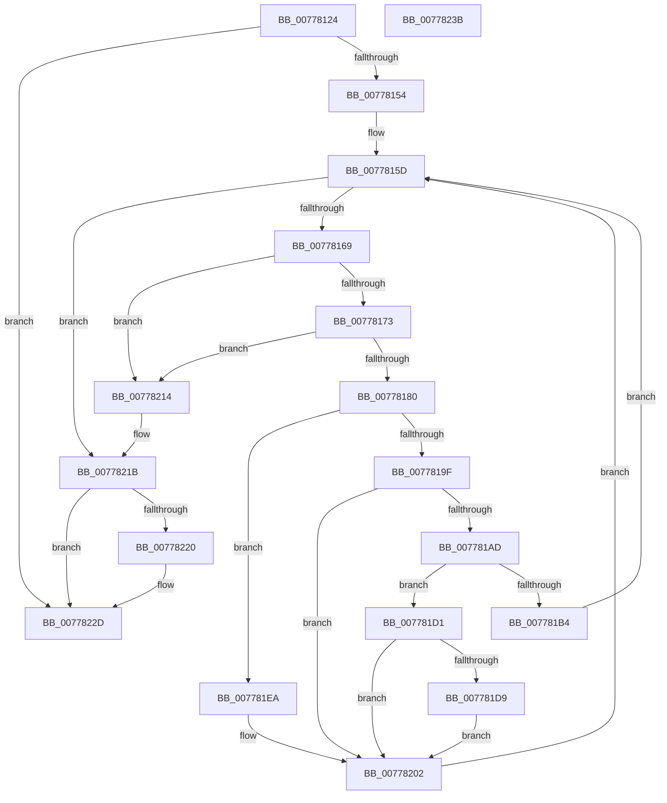

# TtmpSetDisplayRequestEnded

- RVA: `0x00778124`–`0x0077823C` (길이 `280` bytes)
- VA: `0x0000000140778124`
- 실행 섹션: `PAGE`
- PDB 이름 있음: `예`; PDB Function 태그: `아니요`
- unwind 정보 RVA: `0x000AE684`
- 디코드: `77`개 명령, `280/280` bytes 표시
- 미해석 바이트: `0` (있으면 어셈블리에 `.byte`로 보존)

> 이 문서는 커널 이미지의 기계어와 PDB 기호를 분석해 생성했습니다. 4번과 5번은 함수 원형과 자료형을 바이너리 사용 방식에서 추정한 C 해석이며 원본 소스 복구 결과는 아닙니다.

## 1. Dependencies

- 직접 호출 지점: **6**; 고유 호출 대상: **5**
- 직접 호출자로 확인된 함수: **1**
- RIP 상대 이미지 참조: **1**

### Outgoing calls
- `0x00778147` → [TtmpFindPowerRequestEntryById](TtmpFindPowerRequestEntryById_function_007778C4.md) (function, `0x007778C4`)
- `0x00778196` → [TtmiGetTerminalById](TtmiGetTerminalById_function_0077CA04.md) (function, `0x0077CA04`)
- `0x007781CA` → [TtmiLogError](../98/TtmiLogError_function_0098B39C.md) (function, `0x0098B39C`)
- `0x007781FD` → [TtmiLogError](../98/TtmiLogError_function_0098B39C.md) (function, `0x0098B39C`)
- `0x0077820A` → [ExFreePoolWithTag](../../poolcode/B8/ExFreePoolWithTag_function_00B82870.md) (function, `0x00B82870`)
- `0x00778228` → [TtmiScheduleSessionWorker](TtmiScheduleSessionWorker_function_00777184.md) (function, `0x00777184`)

### Direct callers
- [TtmpUpdateDisplayRequiredPowerRequest](TtmpUpdateDisplayRequiredPowerRequest_function_00778304.md) at `0x007783A3`

### Static image references
- `0x007781B8` → RVA `0x00B04250` (` ?? ::NNGAKEGL::`string'`; read)

## 2. Other-region calls and transfers

- 다른 실행 섹션으로 향하는 call: **1**
  - `0x0077820A` → [ExFreePoolWithTag](../../poolcode/B8/ExFreePoolWithTag_function_00B82870.md) (`PAGE` → `POOLCODE`)
- 별도 외부 분기/꼬리 이동을 확인하지 못했습니다.

## 3. Assembly (complete function range)

```asm
00778124  48 8B C4                        mov rax, rsp
00778127  48 89 58 08                     mov qword ptr [rax + 8], rbx
0077812B  56                              push rsi
0077812C  57                              push rdi
0077812D  41 56                           push r14
0077812F  48 83 EC 20                     sub rsp, 0x20
00778133  48 83 60 18 00                  and qword ptr [rax + 0x18], 0
00778138  4C 8D 40 18                     lea r8, [rax + 0x18]
0077813C  48 83 60 20 00                  and qword ptr [rax + 0x20], 0
00778141  48 8B F9                        mov rdi, rcx
00778144  40 32 F6                        xor sil, sil
00778147  E8 78 F7 FF FF                  call 0x1407778c4
0077814C  84 C0                           test al, al
0077814E  0F 84 D9 00 00 00               je 0x14077822d
00778154  48 8B 5C 24 50                  mov rbx, qword ptr [rsp + 0x50]
00778159  48 83 C3 30                     add rbx, 0x30
0077815D  48 8B 03                        mov rax, qword ptr [rbx]
00778160  48 3B C3                        cmp rax, rbx
00778163  0F 84 B2 00 00 00               je 0x14077821b
00778169  48 39 58 08                     cmp qword ptr [rax + 8], rbx
0077816D  0F 85 A1 00 00 00               jne 0x140778214
00778173  48 8B 08                        mov rcx, qword ptr [rax]
00778176  48 39 41 08                     cmp qword ptr [rcx + 8], rax
0077817A  0F 85 94 00 00 00               jne 0x140778214
00778180  48 89 0B                        mov qword ptr [rbx], rcx
00778183  4C 8D 70 F8                     lea r14, [rax - 8]
00778187  48 89 59 08                     mov qword ptr [rcx + 8], rbx
0077818B  48 8B D7                        mov rdx, rdi
0077818E  45 8B 06                        mov r8d, dword ptr [r14]
00778191  48 8D 4C 24 58                  lea rcx, [rsp + 0x58]
00778196  E8 69 48 00 00                  call 0x14077ca04
0077819B  85 C0                           test eax, eax
0077819D  78 4B                           js 0x1407781ea
0077819F  48 8B 4C 24 58                  mov rcx, qword ptr [rsp + 0x58]
007781A4  81 79 18 54 74 6D 54            cmp dword ptr [rcx + 0x18], 0x546d7454
007781AB  75 55                           jne 0x140778202
007781AD  8B 41 20                        mov eax, dword ptr [rcx + 0x20]
007781B0  85 C0                           test eax, eax
007781B2  75 1D                           jne 0x1407781d1
007781B4  41 83 C9 FF                     or r9d, 0xffffffff
007781B8  48 8D 0D 91 C0 38 00            lea rcx, [rip + 0x38c091]
007781BF  BA CF 02 00 00                  mov edx, 0x2cf
007781C4  41 B8 0D 00 00 C0               mov r8d, 0xc000000d
007781CA  E8 CD 31 21 00                  call 0x14098b39c
007781CF  EB 8C                           jmp 0x14077815d
007781D1  83 E8 01                        sub eax, 1
007781D4  89 41 20                        mov dword ptr [rcx + 0x20], eax
007781D7  75 29                           jne 0x140778202
007781D9  8B 41 24                        mov eax, dword ptr [rcx + 0x24]
007781DC  40 B6 01                        mov sil, 1
007781DF  83 C8 20                        or eax, 0x20
007781E2  83 C8 04                        or eax, 4
007781E5  89 41 24                        mov dword ptr [rcx + 0x24], eax
007781E8  EB 18                           jmp 0x140778202
007781EA  41 83 C9 FF                     or r9d, 0xffffffff
007781EE  48 8D 0D 5B C0 38 00            lea rcx, [rip + 0x38c05b]
007781F5  44 8B C0                        mov r8d, eax
007781F8  BA E1 02 00 00                  mov edx, 0x2e1
007781FD  E8 9A 31 21 00                  call 0x14098b39c
00778202  BA 54 74 50 52                  mov edx, 0x52507454
00778207  49 8B CE                        mov rcx, r14
0077820A  E8 61 A6 40 00                  call 0x140b82870
0077820F  E9 49 FF FF FF                  jmp 0x14077815d
00778214  B9 03 00 00 00                  mov ecx, 3
00778219  CD 29                           int 0x29
0077821B  40 84 F6                        test sil, sil
0077821E  74 0D                           je 0x14077822d
00778220  BA 02 00 00 00                  mov edx, 2
00778225  48 8B CF                        mov rcx, rdi
00778228  E8 57 EF FF FF                  call 0x140777184
0077822D  48 8B 5C 24 40                  mov rbx, qword ptr [rsp + 0x40]
00778232  48 83 C4 20                     add rsp, 0x20
00778236  41 5E                           pop r14
00778238  5F                              pop rdi
00778239  5E                              pop rsi
0077823A  C3                              ret
0077823B  CC                              int3
```

## 4. C-style interpretation (structured pseudocode)

```c
__int64 __fastcall TtmpSetDisplayRequestEnded(__int64 a1, __int64 a2, __int64 a3, int a4)
{
    __int64 result;
    __int64 v_rbx;
    __int64 v_rsi;
    __int64 v_rsp;
    unsigned __int64 v_stack_p18;
    unsigned __int64 v_stack_p20;
    unsigned __int64 v_stack_p8;

    *(unsigned __int64 *)(v_rsp + 8) = v_rbx;
    v_rsp = (v_rsp) - (32);
    v_rsi = 0;
    result = TtmpFindPowerRequestEntryById(a1, a2, v_rsp + 24, a4);
    if ((unsigned __int8)(result) == 0) goto loc_0077822D;
    v_rbx = (v_stack_p18) + (48);
loc_0077815D:
    if ((*(unsigned __int64 *)(v_rbx)) == v_rbx) goto loc_0077821B;
    if ((*(unsigned __int64 *)(*(unsigned __int64 *)(v_rbx) + 8)) != v_rbx) goto loc_00778214;
    if ((*(unsigned __int64 *)(*(unsigned __int64 *)(*(unsigned __int64 *)(v_rbx)) + 8)) != (*(unsigned __int64 *)(v_rbx))) goto loc_00778214;
    *(unsigned __int64 *)(v_rbx) = *(unsigned __int64 *)(*(unsigned __int64 *)(v_rbx));
    *(unsigned __int64 *)(*(unsigned __int64 *)(*(unsigned __int64 *)(v_rbx)) + 8) = v_rbx;
    result = TtmiGetTerminalById(v_stack_p20, a1, (unsigned int)(*(unsigned int *)(*(unsigned __int64 *)(v_rbx) - 8)), a4);
    if (sign_flag) goto loc_007781EA;
    if ((*(unsigned int *)(v_stack_p20 + 24)) != 0x546D7454ULL) goto loc_00778202;
    if ((unsigned int)((unsigned int)(*(unsigned int *)(v_stack_p20 + 32))) != 0) goto loc_007781D1;
    a4 = (unsigned int)((a4) | (0xFFFFFFFFULL));
    result = TtmiLogError(v_rip + 3719313, 719, (unsigned int)(0xC000000DULL), a4);
    goto loc_0077815D;
loc_007781D1:
    result = (unsigned int)((result) - (1));
    *(unsigned int *)(v_rip + 3719313 + 32) = (unsigned int)(result);
    if (condition_is_not_equal) goto loc_00778202;
    result = (unsigned int)(((unsigned int)(*(unsigned int *)(v_rip + 3719313 + 36))) | (32));
    result = (unsigned int)((result) | (4));
    *(unsigned int *)(v_rip + 3719313 + 36) = (unsigned int)(result);
    goto loc_00778202;
loc_007781EA:
    a4 = (unsigned int)((a4) | (0xFFFFFFFFULL));
    result = TtmiLogError(v_rip + 3719259, 737, (unsigned int)((unsigned int)(result)), a4);
loc_00778202:
    result = ExFreePoolWithTag(*(unsigned __int64 *)(v_rbx) - 8, (unsigned int)(0x52507454ULL), (unsigned int)((unsigned int)(result)), a4);
    goto loc_0077815D;
loc_00778214:
loc_0077821B:
    if (1 != 0) {
        a2 = 2;
        a1 = a1;
        result = TtmiScheduleSessionWorker(a1, a2, (unsigned int)((unsigned int)(result)), a4);
    }
    v_rsp = (v_rsp) + (32);
    return result;
}
```

## 5. (Beta) C Style

```c
int64_t TtmpSetDisplayRequestEnded(int64_t Arg1, int64_t Arg2, int64_t Arg3, int32_t Arg4)
{
    int64_t result;
    int64_t local_rbx;
    int64_t local_rsi;
    int64_t local_rsp;
    uint64_t v_stack_p18;
    uint64_t v_stack_p20;
    uint64_t v_stack_p8;

    *(uint64_t *)(local_rsp + 0x8) = local_rbx;
    local_rsp = (local_rsp) - (32);
    local_rsi = 0;
    result = TtmpFindPowerRequestEntryById(Arg1, Arg2, local_rsp + 24, Arg4);
    if ((uint8_t)(result) == 0) goto loc_0077822D;
    local_rbx = (v_stack_p18) + (48);
loc_0077815D:
    if ((*(uint64_t *)(local_rbx)) == local_rbx) goto loc_0077821B;
    if ((*(uint64_t *)(*(uint64_t *)(local_rbx) + 0x8)) != local_rbx) goto loc_00778214;
    if ((*(uint64_t *)(*(uint64_t *)(*(uint64_t *)(local_rbx)) + 0x8)) != (*(uint64_t *)(local_rbx))) goto loc_00778214;
    *(uint64_t *)(local_rbx) = *(uint64_t *)(*(uint64_t *)(local_rbx));
    *(uint64_t *)(*(uint64_t *)(*(uint64_t *)(local_rbx)) + 0x8) = local_rbx;
    result = TtmiGetTerminalById(v_stack_p20, Arg1, (uint32_t)(*(uint32_t *)(*(uint64_t *)(local_rbx) - 0x8)), Arg4);
    if (sign_flag) goto loc_007781EA;
    if ((*(uint32_t *)(v_stack_p20 + 0x18)) != 0x546D7454ULL) goto loc_00778202;
    if ((uint32_t)((uint32_t)(*(uint32_t *)(v_stack_p20 + 0x20))) != 0) goto loc_007781D1;
    Arg4 = (uint32_t)((Arg4) | (0xFFFFFFFFULL));
    result = TtmiLogError(v_rip + 3719313, 719, (uint32_t)(0xC000000DULL), Arg4);
    goto loc_0077815D;
loc_007781D1:
    result = (uint32_t)((result) - (1));
    *(uint32_t *)(v_rip + 0x38C091 + 0x20) = (uint32_t)(result);
    if (condition_is_not_equal) goto loc_00778202;
    result = (uint32_t)(((uint32_t)(*(uint32_t *)(v_rip + 0x38C091 + 0x24))) | (32));
    result = (uint32_t)((result) | (4));
    *(uint32_t *)(v_rip + 0x38C091 + 0x24) = (uint32_t)(result);
    goto loc_00778202;
loc_007781EA:
    Arg4 = (uint32_t)((Arg4) | (0xFFFFFFFFULL));
    result = TtmiLogError(v_rip + 3719259, 737, (uint32_t)((uint32_t)(result)), Arg4);
loc_00778202:
    result = ExFreePoolWithTag(*(uint64_t *)(local_rbx) - 8, (uint32_t)(0x52507454ULL), (uint32_t)((uint32_t)(result)), Arg4);
    goto loc_0077815D;
loc_00778214:
loc_0077821B:
    if (1 != 0) {
        Arg2 = 2;
        Arg1 = Arg1;
        result = TtmiScheduleSessionWorker(Arg1, Arg2, (uint32_t)((uint32_t)(result)), Arg4);
    }
    local_rsp = (local_rsp) + (32);
    return result;
}
```

## 6. Execution-region graph

[열기: 2D/3D 그래프와 함수 탐색 컨트롤 패널](../../../control-panel.html?section=page&rva=0x00778124&view=graph)

- 2D 그래프는 위에서 아래로 흐르고, 3D 그래프는 빈 공간을 드래그해 회전합니다. Shift+드래그는 이동, 휠은 확대·축소, 함수 노드 선택은 대상 보고서 이동입니다.

### Static fallback


