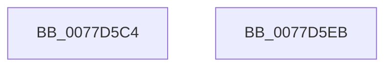

# TtmpSetTerminalPendingCleanup

- RVA: `0x0077D5C4`–`0x0077D5EC` (길이 `40` bytes)
- VA: `0x000000014077D5C4`
- 실행 섹션: `PAGE`
- PDB 이름 있음: `예`; PDB Function 태그: `아니요`
- unwind 정보 RVA: `0x0005CF00`
- 디코드: `13`개 명령, `40/40` bytes 표시
- 미해석 바이트: `0` (있으면 어셈블리에 `.byte`로 보존)

> 이 문서는 커널 이미지의 기계어와 PDB 기호를 분석해 생성했습니다. 4번과 5번은 함수 원형과 자료형을 바이너리 사용 방식에서 추정한 C 해석이며 원본 소스 복구 결과는 아닙니다.

## 1. Dependencies

- 직접 호출 지점: **2**; 고유 호출 대상: **2**
- 직접 호출자로 확인된 함수: **2**
- RIP 상대 이미지 참조: **0**

### Outgoing calls
- `0x0077D5D6` → [TtmiScheduleSessionWorker](TtmiScheduleSessionWorker_function_00777184.md) (function, `0x00777184`)
- `0x0077D5E0` → [TtmpResetEvaluationTimer](TtmpResetEvaluationTimer_function_0077D4E4.md) (function, `0x0077D4E4`)

### Direct callers
- [TtmiCreateTerminal](TtmiCreateTerminal_function_0077C748.md) at `0x0077C9B1`
- [TtmpCloseTerminalHandle](TtmpCloseTerminalHandle_function_0077D390.md) at `0x0077D3CE`

### Static image references
- 디코드된 RIP-relative 메모리 참조가 없습니다.

## 2. Other-region calls and transfers

- 다른 실행 섹션으로 향하는 call: **0**
- 별도 외부 분기/꼬리 이동을 확인하지 못했습니다.

## 3. Assembly (complete function range)

```asm
0077D5C4  40 53                           push rbx
0077D5C6  48 83 EC 20                     sub rsp, 0x20
0077D5CA  83 4A 24 01                     or dword ptr [rdx + 0x24], 1
0077D5CE  48 8B DA                        mov rbx, rdx
0077D5D1  BA 02 00 00 00                  mov edx, 2
0077D5D6  E8 A9 9B FF FF                  call 0x140777184
0077D5DB  33 D2                           xor edx, edx
0077D5DD  48 8B CB                        mov rcx, rbx
0077D5E0  E8 FF FE FF FF                  call 0x14077d4e4
0077D5E5  48 83 C4 20                     add rsp, 0x20
0077D5E9  5B                              pop rbx
0077D5EA  C3                              ret
0077D5EB  CC                              int3
```

## 4. C-style interpretation (structured pseudocode)

```c
__int64 __fastcall TtmpSetTerminalPendingCleanup(__int64 a1, __int64 a2)
{
    __int64 result;
    __int64 v_rsp;

    v_rsp = (v_rsp) - (32);
    result = TtmiScheduleSessionWorker(a1, 2, a3, a4);
    a2 = 0;
    result = TtmpResetEvaluationTimer(0, a2, a3, a4);
    v_rsp = (v_rsp) + (32);
    return result;
}
```

## 5. (Beta) C Style

```c
int64_t TtmpSetTerminalPendingCleanup(int64_t Arg1, void *Arg2)
{
    uint8_t *arg2 = (uint8_t *)Arg2;

    int64_t result;
    int64_t local_rsp;

    local_rsp = (local_rsp) - (32);
    result = TtmiScheduleSessionWorker(Arg1, 2, a3, a4);
    Arg2 = 0;
    result = TtmpResetEvaluationTimer(0, Arg2, a3, a4);
    local_rsp = (local_rsp) + (32);
    return result;
}
```

### 관측된 메모리 오프셋

구조체 형식이 확인되지 않은 접근은 인자 기준의 오프셋으로만 기록했습니다.

| 기준 인자 | 오프셋 표현 | 폭 (bit) | 접근 |
|---|---:|---:|---|
| `Arg2` | `+ 0x24` | `32` | `R/W` |

## 6. Execution-region graph

[열기: 2D/3D 그래프와 함수 탐색 컨트롤 패널](../../../control-panel.html?section=page&rva=0x0077D5C4&view=graph)

- 2D 그래프는 위에서 아래로 흐르고, 3D 그래프는 빈 공간을 드래그해 회전합니다. Shift+드래그는 이동, 휠은 확대·축소, 함수 노드 선택은 대상 보고서 이동입니다.

### Static fallback


