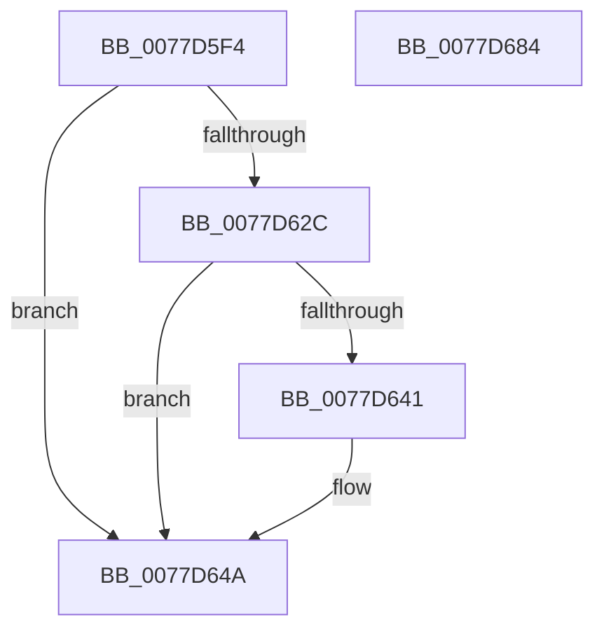

# TtmpShouldEscapeProximity

- RVA: `0x0077D5F4`–`0x0077D685` (길이 `145` bytes)
- VA: `0x000000014077D5F4`
- 실행 섹션: `PAGE`
- PDB 이름 있음: `예`; PDB Function 태그: `아니요`
- unwind 정보 RVA: `0x000794E0`
- 디코드: `34`개 명령, `145/145` bytes 표시
- 미해석 바이트: `0` (있으면 어셈블리에 `.byte`로 보존)

> 이 문서는 커널 이미지의 기계어와 PDB 기호를 분석해 생성했습니다. 4번과 5번은 함수 원형과 자료형을 바이너리 사용 방식에서 추정한 C 해석이며 원본 소스 복구 결과는 아닙니다.

## 1. Dependencies

- 직접 호출 지점: **1**; 고유 호출 대상: **1**
- 직접 호출자로 확인된 함수: **1**
- RIP 상대 이미지 참조: **1**

### Outgoing calls
- `0x0077D665` → [TtmiLogProximityPowerPress](TtmiLogProximityPowerPress_function_0077A7F0.md) (function, `0x0077A7F0`)

### Direct callers
- [TtmiSetPendingOnOffRequest](TtmiSetPendingOnOffRequest_function_0077D074.md) at `0x0077D0A9`

### Static image references
- `0x0077D62C` → RVA `0x00FD9BBC` (`PAGEDATA`; read)

## 2. Other-region calls and transfers

- 다른 실행 섹션으로 향하는 call: **0**
- 별도 외부 분기/꼬리 이동을 확인하지 못했습니다.

## 3. Assembly (complete function range)

```asm
0077D5F4  48 89 5C 24 08                  mov qword ptr [rsp + 8], rbx
0077D5F9  48 89 74 24 10                  mov qword ptr [rsp + 0x10], rsi
0077D5FE  57                              push rdi
0077D5FF  48 83 EC 30                     sub rsp, 0x30
0077D603  FF 81 08 01 00 00               inc dword ptr [rcx + 0x108]
0077D609  48 BE 08 00 00 00 80 F7 FF FF   movabs rsi, 0xfffff78000000008
0077D613  40 32 FF                        xor dil, dil
0077D616  48 83 CA FF                     or rdx, 0xffffffffffffffff
0077D61A  48 8B D9                        mov rbx, rcx
0077D61D  48 8B 36                        mov rsi, qword ptr [rsi]
0077D620  48 8B 81 00 01 00 00            mov rax, qword ptr [rcx + 0x100]
0077D627  48 3B C2                        cmp rax, rdx
0077D62A  73 1E                           jae 0x14077d64a
0077D62C  69 0D 86 C5 85 00 10 27 00 00   imul ecx, dword ptr [rip + 0x85c586], 0x2710
0077D636  48 8B D6                        mov rdx, rsi
0077D639  48 2B D0                        sub rdx, rax
0077D63C  48 3B D1                        cmp rdx, rcx
0077D63F  73 09                           jae 0x14077d64a
0077D641  FF 83 10 01 00 00               inc dword ptr [rbx + 0x110]
0077D647  40 B7 01                        mov dil, 1
0077D64A  8B 8B 10 01 00 00               mov ecx, dword ptr [rbx + 0x110]
0077D650  44 8B 8B 0C 01 00 00            mov r9d, dword ptr [rbx + 0x10c]
0077D657  44 8B 83 08 01 00 00            mov r8d, dword ptr [rbx + 0x108]
0077D65E  89 4C 24 20                     mov dword ptr [rsp + 0x20], ecx
0077D662  40 8A CF                        mov cl, dil
0077D665  E8 86 D1 FF FF                  call 0x14077a7f0
0077D66A  48 89 B3 00 01 00 00            mov qword ptr [rbx + 0x100], rsi
0077D671  40 8A C7                        mov al, dil
0077D674  48 8B 5C 24 40                  mov rbx, qword ptr [rsp + 0x40]
0077D679  48 8B 74 24 48                  mov rsi, qword ptr [rsp + 0x48]
0077D67E  48 83 C4 30                     add rsp, 0x30
0077D682  5F                              pop rdi
0077D683  C3                              ret
0077D684  CC                              int3
```

## 4. C-style interpretation (structured pseudocode)

```c
__int64 __fastcall TtmpShouldEscapeProximity(__int64 a1, __int64 a2)
{
    __int64 result;
    __int64 v_rdi;
    __int64 v_rsp;
    unsigned int v_stack_m18;
    unsigned __int64 v_stack_p10;
    unsigned __int64 v_stack_p8;

    v_stack_p8 = v_rbx;
    v_stack_p10 = v_rsi;
    v_rsp = (v_rsp) - (48);
    v_rdi = 0;
    a2 = (a2) | (-1);
    if ((*(unsigned __int64 *)(a1 + 256)) >= a2) goto loc_0077D64A;
    a1 = (unsigned int)((a1) * (*(unsigned int *)(v_rip + 8766854)));
    a2 = (*(unsigned __int64 *)(v_rsi)) - (*(unsigned __int64 *)(a1 + 256));
    if (a2 < a1) {
        v_rdi = 1;
    }
    v_stack_m18 = (unsigned int)((unsigned int)(*(unsigned int *)(a1 + 272)));
    result = TtmiLogProximityPowerPress((unsigned __int8)(v_rdi), a2, (unsigned int)(*(unsigned int *)(a1 + 264)), (unsigned int)(*(unsigned int *)(a1 + 268)));
    *(unsigned __int64 *)(a1 + 256) = *(unsigned __int64 *)(v_rsi);
    v_rsp = (v_rsp) + (48);
    return (unsigned __int8)(v_rdi);
}
```

## 5. (Beta) C Style

```c
int64_t TtmpShouldEscapeProximity(void *Arg1, int64_t Arg2)
{
    uint8_t *arg1 = (uint8_t *)Arg1;

    int64_t result;
    int64_t local_rdi;
    int64_t local_rsp;
    uint32_t v_stack_m18;
    uint64_t v_stack_p10;
    uint64_t v_stack_p8;

    v_stack_p8 = local_rbx;
    v_stack_p10 = local_rsi;
    local_rsp = (local_rsp) - (48);
    local_rdi = 0;
    Arg2 = (Arg2) | (-1);
    if ((*(uint64_t *)(arg1 + 0x100)) >= Arg2) goto loc_0077D64A;
    Arg1 = (uint32_t)((Arg1) * (*(uint32_t *)(v_rip + 0x85C586)));
    Arg2 = (*(uint64_t *)(local_rsi)) - (*(uint64_t *)(arg1 + 0x100));
    if (Arg2 < Arg1) {
        local_rdi = 1;
    }
    v_stack_m18 = (uint32_t)((uint32_t)(*(uint32_t *)(arg1 + 0x110)));
    result = TtmiLogProximityPowerPress((uint8_t)(local_rdi), Arg2, (uint32_t)(*(uint32_t *)(arg1 + 0x108)), (uint32_t)(*(uint32_t *)(arg1 + 0x10C)));
    *(uint64_t *)(arg1 + 0x100) = *(uint64_t *)(local_rsi);
    local_rsp = (local_rsp) + (48);
    return (uint8_t)(local_rdi);
}
```

### 관측된 메모리 오프셋

구조체 형식이 확인되지 않은 접근은 인자 기준의 오프셋으로만 기록했습니다.

| 기준 인자 | 오프셋 표현 | 폭 (bit) | 접근 |
|---|---:|---:|---|
| `Arg1` | `+ 0x100` | `64` | `R` |
| `Arg1` | `+ 0x100` | `64` | `W` |
| `Arg1` | `+ 0x108` | `32` | `R` |
| `Arg1` | `+ 0x108` | `32` | `R/W` |
| `Arg1` | `+ 0x10C` | `32` | `R` |
| `Arg1` | `+ 0x110` | `32` | `R` |
| `Arg1` | `+ 0x110` | `32` | `R/W` |

## 6. Execution-region graph

[열기: 2D/3D 그래프와 함수 탐색 컨트롤 패널](../../../control-panel.html?section=page&rva=0x0077D5F4&view=graph)

- 2D 그래프는 위에서 아래로 흐르고, 3D 그래프는 빈 공간을 드래그해 회전합니다. Shift+드래그는 이동, 휠은 확대·축소, 함수 노드 선택은 대상 보고서 이동입니다.

### Static fallback


