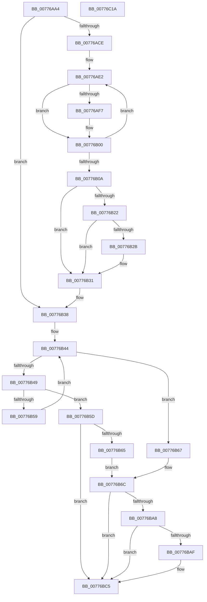

# TtmpStartCallout

- RVA: `0x00776AA4`–`0x00776C1B` (길이 `375` bytes)
- VA: `0x0000000140776AA4`
- 실행 섹션: `PAGE`
- PDB 이름 있음: `예`; PDB Function 태그: `아니요`
- unwind 정보 RVA: `0x000CDBAC`
- 디코드: `95`개 명령, `375/375` bytes 표시
- 미해석 바이트: `0` (있으면 어셈블리에 `.byte`로 보존)

> 이 문서는 커널 이미지의 기계어와 PDB 기호를 분석해 생성했습니다. 4번과 5번은 함수 원형과 자료형을 바이너리 사용 방식에서 추정한 C 해석이며 원본 소스 복구 결과는 아닙니다.

## 1. Dependencies

- 직접 호출 지점: **9**; 고유 호출 대상: **8**
- 직접 호출자로 확인된 함수: **6**
- RIP 상대 이미지 참조: **7**

### Outgoing calls
- `0x00776AEE` → [TtmpGetConfigOverride](TtmpGetConfigOverride_function_007765F8.md) (function, `0x007765F8`)
- `0x00776B19` → [TtmpGetConfigOverride](TtmpGetConfigOverride_function_007765F8.md) (function, `0x007765F8`)
- `0x00776B77` → [memset](../../text/6C/memset_function_006C6C40.md) (function, `0x006C6C40`)
- `0x00776B9F` → [NtPowerInformation](../95/NtPowerInformation_function_00955D80.md) (function, `0x00955D80`)
- `0x00776BC0` → [TtmpCalloutArmWatchdog](TtmpCalloutArmWatchdog_function_007761DC.md) (function, `0x007761DC`)
- `0x00776BCC` → [ExReleaseResourceLite](../../text/25/ExReleaseResourceLite_function_0025FA10.md) (function, `0x0025FA10`)
- `0x00776BD1` → [KeLeaveCriticalRegion](../../text/25/KeLeaveCriticalRegion_function_0025D8B0.md) (function, `0x0025D8B0`)
- `0x00776BD8` → [TtmpGetCalloutTagFromCalloutType](TtmpGetCalloutTagFromCalloutType_function_007765A0.md) (function, `0x007765A0`)
- `0x00776BF0` → [TtmiLogCalloutStart](TtmiLogCalloutStart_function_00778ED8.md) (function, `0x00778ED8`)

### Direct callers
- [TtmiSessionDeviceListWorker](TtmiSessionDeviceListWorker_function_00775CA0.md) at `0x00775DD3`
- [TtmpCallAssignedToTerminal](TtmpCallAssignedToTerminal_function_00775F70.md) at `0x00775FB8`
- [TtmpCallSetBuiltinPanelState](TtmpCallSetBuiltinPanelState_function_0077600C.md) at `0x0077605D`
- [TtmpCallSetDisplayState](TtmpCallSetDisplayState_function_0077608C.md) at `0x007760DC`
- [TtmpCallSetInputMode](TtmpCallSetInputMode_function_0077613C.md) at `0x00776185`
- [TtmpUpdatePrimaryDisplayWnf](TtmpUpdatePrimaryDisplayWnf_function_00776CEC.md) at `0x00776D36`

### Static image references
- `0x00776AB9` → RVA `0x00E67A89` (`.data`; read)
- `0x00776AD2` → RVA `0x00E085C0` (`.data`; read)
- `0x00776B12` → RVA `0x0002B398` (`.rdata`; read)
- `0x00776B2B` → RVA `0x00E67A88` (`.data`; write)
- `0x00776B31` → RVA `0x00E67A89` (`.data`; write)
- `0x00776B4D` → RVA `0x00E085B0` (`.data`; read)
- `0x00776BC5` → RVA `0x00F06940` (`.data`; read)

## 2. Other-region calls and transfers

- 다른 실행 섹션으로 향하는 call: **3**
  - `0x00776B77` → [memset](../../text/6C/memset_function_006C6C40.md) (`PAGE` → `.text`)
  - `0x00776BCC` → [ExReleaseResourceLite](../../text/25/ExReleaseResourceLite_function_0025FA10.md) (`PAGE` → `.text`)
  - `0x00776BD1` → [KeLeaveCriticalRegion](../../text/25/KeLeaveCriticalRegion_function_0025D8B0.md) (`PAGE` → `.text`)
- 별도 외부 분기/꼬리 이동을 확인하지 못했습니다.

## 3. Assembly (complete function range)

```asm
00776AA4  48 8B C4                        mov rax, rsp
00776AA7  48 89 58 10                     mov qword ptr [rax + 0x10], rbx
00776AAB  55                              push rbp
00776AAC  56                              push rsi
00776AAD  57                              push rdi
00776AAE  41 56                           push r14
00776AB0  41 57                           push r15
00776AB2  48 81 EC 90 00 00 00            sub rsp, 0x90
00776AB9  80 3D C9 0F 6F 00 00            cmp byte ptr [rip + 0x6f0fc9], 0
00776AC0  41 8B E9                        mov ebp, r9d
00776AC3  4D 8B F0                        mov r14, r8
00776AC6  4C 8B FA                        mov r15, rdx
00776AC9  48 8B D9                        mov rbx, rcx
00776ACC  75 6A                           jne 0x140776b38
00776ACE  83 60 08 00                     and dword ptr [rax + 8], 0
00776AD2  48 8D 3D E7 1A 69 00            lea rdi, [rip + 0x691ae7]
00776AD9  83 60 20 00                     and dword ptr [rax + 0x20], 0
00776ADD  BE 06 00 00 00                  mov esi, 6
00776AE2  48 8B 57 F8                     mov rdx, qword ptr [rdi - 8]
00776AE6  4C 8D 84 24 D8 00 00 00         lea r8, [rsp + 0xd8]
00776AEE  E8 05 FB FF FF                  call 0x1407765f8
00776AF3  3C 01                           cmp al, 1
00776AF5  75 09                           jne 0x140776b00
00776AF7  8B 84 24 D8 00 00 00            mov eax, dword ptr [rsp + 0xd8]
00776AFE  89 07                           mov dword ptr [rdi], eax
00776B00  48 83 C7 18                     add rdi, 0x18
00776B04  48 83 EE 01                     sub rsi, 1
00776B08  75 D8                           jne 0x140776ae2
00776B0A  4C 8D 84 24 C0 00 00 00         lea r8, [rsp + 0xc0]
00776B12  48 8D 15 7F 48 8B FF            lea rdx, [rip - 0x74b781]
00776B19  E8 DA FA FF FF                  call 0x1407765f8
00776B1E  3C 01                           cmp al, 1
00776B20  75 0F                           jne 0x140776b31
00776B22  39 B4 24 C0 00 00 00            cmp dword ptr [rsp + 0xc0], esi
00776B29  74 06                           je 0x140776b31
00776B2B  88 05 57 0F 6F 00               mov byte ptr [rip + 0x6f0f57], al
00776B31  C6 05 51 0F 6F 00 01            mov byte ptr [rip + 0x6f0f51], 1
00776B38  4C 89 3B                        mov qword ptr [rbx], r15
00776B3B  33 C9                           xor ecx, ecx
00776B3D  4C 89 73 08                     mov qword ptr [rbx + 8], r14
00776B41  89 6B 10                        mov dword ptr [rbx + 0x10], ebp
00776B44  83 F9 06                        cmp ecx, 6
00776B47  73 1E                           jae 0x140776b67
00776B49  48 8D 3C 49                     lea rdi, [rcx + rcx*2]
00776B4D  48 8D 05 5C 1A 69 00            lea rax, [rip + 0x691a5c]
00776B54  39 2C F8                        cmp dword ptr [rax + rdi*8], ebp
00776B57  74 04                           je 0x140776b5d
00776B59  FF C1                           inc ecx
00776B5B  EB E7                           jmp 0x140776b44
00776B5D  8B 7C F8 10                     mov edi, dword ptr [rax + rdi*8 + 0x10]
00776B61  85 FF                           test edi, edi
00776B63  74 60                           je 0x140776bc5
00776B65  EB 05                           jmp 0x140776b6c
00776B67  BF 30 75 00 00                  mov edi, 0x7530
00776B6C  33 D2                           xor edx, edx
00776B6E  48 8D 4C 24 34                  lea rcx, [rsp + 0x34]
00776B73  44 8D 42 5C                     lea r8d, [rdx + 0x5c]
00776B77  E8 C4 00 F5 FF                  call 0x1406c6c40
00776B7C  41 B8 60 00 00 00               mov r8d, 0x60
00776B82  C7 44 24 30 15 00 00 00         mov dword ptr [rsp + 0x30], 0x15
00776B8A  4C 8D 4B 18                     lea r9, [rbx + 0x18]
00776B8E  C7 44 24 20 08 00 00 00         mov dword ptr [rsp + 0x20], 8
00776B96  48 8D 54 24 30                  lea rdx, [rsp + 0x30]
00776B9B  41 8D 48 F7                     lea ecx, [r8 - 9]
00776B9F  E8 DC F1 1D 00                  call 0x140955d80
00776BA4  85 C0                           test eax, eax
00776BA6  78 1D                           js 0x140776bc5
00776BA8  48 83 7B 18 00                  cmp qword ptr [rbx + 0x18], 0
00776BAD  74 16                           je 0x140776bc5
00776BAF  4C 8B 8C 24 E0 00 00 00         mov r9, qword ptr [rsp + 0xe0]
00776BB7  44 8B C7                        mov r8d, edi
00776BBA  41 8B 17                        mov edx, dword ptr [r15]
00776BBD  48 8B CB                        mov rcx, rbx
00776BC0  E8 17 F6 FF FF                  call 0x1407761dc
00776BC5  48 8D 0D 74 FD 78 00            lea rcx, [rip + 0x78fd74]
00776BCC  E8 3F 8E AE FF                  call 0x14025fa10
00776BD1  E8 DA 6C AE FF                  call 0x14025d8b0
00776BD6  8B CD                           mov ecx, ebp
00776BD8  E8 C3 F9 FF FF                  call 0x1407765a0
00776BDD  41 8B 4E 10                     mov ecx, dword ptr [r14 + 0x10]
00776BE1  44 8B C0                        mov r8d, eax
00776BE4  44 8B 8C 24 E8 00 00 00         mov r9d, dword ptr [rsp + 0xe8]
00776BEC  49 8B 56 18                     mov rdx, qword ptr [r14 + 0x18]
00776BF0  E8 E3 22 00 00                  call 0x140778ed8
00776BF5  48 A1 08 00 00 00 80 F7 FF FF   movabs rax, qword ptr [0xfffff78000000008]
00776BFF  48 89 43 20                     mov qword ptr [rbx + 0x20], rax
00776C03  48 8B 9C 24 C8 00 00 00         mov rbx, qword ptr [rsp + 0xc8]
00776C0B  48 81 C4 90 00 00 00            add rsp, 0x90
00776C12  41 5F                           pop r15
00776C14  41 5E                           pop r14
00776C16  5F                              pop rdi
00776C17  5E                              pop rsi
00776C18  5D                              pop rbp
00776C19  C3                              ret
00776C1A  CC                              int3
```

## 4. C-style interpretation (structured pseudocode)

```c
__int64 __fastcall TtmpStartCallout(__int64 a1, __int64 a2, __int64 a3, int a4, __int64 a5, unsigned int a6)
{
    __int64 result;
    __int64 v_rdi;
    __int64 v_rsi;
    __int64 v_rsp;
    unsigned __int64 v_stack_m84;
    unsigned int v_stack_m88;
    unsigned int v_stack_m98;
    unsigned __int64 v_stack_p10;
    unsigned __int64 v_stack_p20;
    unsigned __int64 v_stack_p8;

    *(unsigned __int64 *)(v_rsp + 16) = v_rbx;
    v_rsp = (v_rsp) - (144);
    if ((*(unsigned __int8 *)(v_rip + 7278537)) != 0) goto loc_00776B38;
loc_00776AE2:
    result = TtmpGetConfigOverride(a1, *(unsigned __int64 *)(v_rip + 6888167 - 8), v_stack_p20, a4);
    if (((unsigned __int8)(result)) == 1) {
        result = v_stack_p20;
        *(unsigned int *)(v_rip + 6888167) = (unsigned int)(result);
    }
    v_rdi = (v_rip + 6888167) + (24);
    v_rsi = (6) - (1);
    if (condition_is_not_equal) goto loc_00776AE2;
    result = TtmpGetConfigOverride(a1, v_rip - 7649153, v_stack_p8, a4);
    if (((unsigned __int8)(result)) != 1) goto loc_00776B31;
    if (v_stack_p8 != ((unsigned int)(v_rsi))) {
        *(unsigned __int8 *)(v_rip + 7278423) = (unsigned __int8)(result);
    }
    *(unsigned __int8 *)(v_rip + 7278417) = 1;
loc_00776B38:
    *(unsigned __int64 *)(a1) = a2;
    a1 = 0;
    *(unsigned __int64 *)(a1 + 8) = a3;
    *(unsigned int *)(a1 + 16) = (unsigned int)((unsigned int)(a4));
loc_00776B44:
    if (0 >= 6) goto loc_00776B67;
    if ((*(unsigned int *)(v_rip + 6888028 + a1 + a1 * 2 * 8)) == ((unsigned int)((unsigned int)(a4)))) goto loc_00776B5D;
    a1 = (unsigned int)((a1) + 1);
    goto loc_00776B44;
loc_00776B5D:
    if ((unsigned int)((unsigned int)(*(unsigned int *)(v_rip + 6888028 + a1 + a1 * 2 * 8 + 16))) == 0) goto loc_00776BC5;
    goto loc_00776B6C;
loc_00776B67:
loc_00776B6C:
    a2 = 0;
    result = memset(v_stack_m84, a2, a2 + 92, a4);
    v_stack_m88 = 21;
    v_stack_m98 = 8;
    result = NtPowerInformation(96 - 9, v_stack_m88, 96, a1 + 24);
    if (sign_flag) goto loc_00776BC5;
    if ((*(unsigned __int64 *)(a1 + 24)) != 0) {
        a4 = a5;
        a3 = (unsigned int)((unsigned int)(0x7530ULL));
        a2 = *(unsigned int *)(a2);
        a1 = a1;
        result = TtmpCalloutArmWatchdog(a1, a2, a3, a4);
    }
    result = ExReleaseResourceLite(v_rip + 7929204, a2, a3, a4);
    result = KeLeaveCriticalRegion(v_rip + 7929204, a2, a3, a4);
    result = TtmpGetCalloutTagFromCalloutType((unsigned int)((unsigned int)((unsigned int)(a4))), a2, a3, a4);
    result = TtmiLogCalloutStart((unsigned int)(*(unsigned int *)(a3 + 16)), *(unsigned __int64 *)(a3 + 24), (unsigned int)((unsigned int)(result)), (unsigned int)(a6));
    *(unsigned __int64 *)(a1 + 32) = result;
    v_rsp = (v_rsp) + (144);
    return result;
}
```

## 5. (Beta) C Style

```c
int64_t TtmpStartCallout(void *Arg1, void *Arg2, void *Arg3, int32_t Arg4, int64_t Arg5, uint32_t Arg6)
{
    uint8_t *arg1 = (uint8_t *)Arg1;
    uint8_t *arg2 = (uint8_t *)Arg2;
    uint8_t *arg3 = (uint8_t *)Arg3;

    int64_t result;
    int64_t local_rdi;
    int64_t local_rsi;
    int64_t local_rsp;
    uint64_t v_stack_m84;
    uint32_t v_stack_m88;
    uint32_t v_stack_m98;
    uint64_t v_stack_p10;
    uint64_t v_stack_p20;
    uint64_t v_stack_p8;

    *(uint64_t *)(local_rsp + 0x10) = local_rbx;
    local_rsp = (local_rsp) - (144);
    if ((*(uint8_t *)(v_rip + 0x6F0FC9)) != 0) goto loc_00776B38;
loc_00776AE2:
    result = TtmpGetConfigOverride(Arg1, *(uint64_t *)(v_rip + 0x691AE7 - 0x8), v_stack_p20, Arg4);
    if (((uint8_t)(result)) == 1) {
        result = v_stack_p20;
        *(uint32_t *)(v_rip + 0x691AE7) = (uint32_t)(result);
    }
    local_rdi = (v_rip + 6888167) + (24);
    local_rsi = (6) - (1);
    if (condition_is_not_equal) goto loc_00776AE2;
    result = TtmpGetConfigOverride(Arg1, v_rip - 7649153, v_stack_p8, Arg4);
    if (((uint8_t)(result)) != 1) goto loc_00776B31;
    if (v_stack_p8 != ((uint32_t)(local_rsi))) {
        *(uint8_t *)(v_rip + 0x6F0F57) = (uint8_t)(result);
    }
    *(uint8_t *)(v_rip + 0x6F0F51) = 1;
loc_00776B38:
    *(void **)(arg1) = Arg2;
    Arg1 = 0;
    *(void **)(arg1 + 0x8) = Arg3;
    *(uint32_t *)(arg1 + 0x10) = (uint32_t)((uint32_t)(Arg4));
loc_00776B44:
    if (0 >= 6) goto loc_00776B67;
    if ((*(uint32_t *)(v_rip + 0x691A5C + arg1 + arg1 * 2 * 8)) == ((uint32_t)((uint32_t)(Arg4)))) goto loc_00776B5D;
    Arg1 = (uint32_t)((Arg1) + 1);
    goto loc_00776B44;
loc_00776B5D:
    if ((uint32_t)((uint32_t)(*(uint32_t *)(v_rip + 0x691A5C + arg1 + arg1 * 2 * 8 + 0x10))) == 0) goto loc_00776BC5;
    goto loc_00776B6C;
loc_00776B67:
loc_00776B6C:
    Arg2 = 0;
    result = memset(v_stack_m84, Arg2, Arg2 + 92, Arg4);
    v_stack_m88 = 21;
    v_stack_m98 = 8;
    result = NtPowerInformation(96 - 9, v_stack_m88, 96, Arg1 + 24);
    if (sign_flag) goto loc_00776BC5;
    if ((*(uint64_t *)(arg1 + 0x18)) != 0) {
        Arg4 = Arg5;
        Arg3 = (uint32_t)((uint32_t)(0x7530ULL));
        Arg2 = *(uint32_t *)(arg2);
        Arg1 = Arg1;
        result = TtmpCalloutArmWatchdog(Arg1, Arg2, Arg3, Arg4);
    }
    result = ExReleaseResourceLite(v_rip + 7929204, Arg2, Arg3, Arg4);
    result = KeLeaveCriticalRegion(v_rip + 7929204, Arg2, Arg3, Arg4);
    result = TtmpGetCalloutTagFromCalloutType((uint32_t)((uint32_t)((uint32_t)(Arg4))), Arg2, Arg3, Arg4);
    result = TtmiLogCalloutStart((uint32_t)(*(uint32_t *)(arg3 + 0x10)), *(uint64_t *)(arg3 + 0x18), (uint32_t)((uint32_t)(result)), (uint32_t)(Arg6));
    *(uint64_t *)(arg1 + 0x20) = result;
    local_rsp = (local_rsp) + (144);
    return result;
}
```

### 관측된 메모리 오프셋

구조체 형식이 확인되지 않은 접근은 인자 기준의 오프셋으로만 기록했습니다.

| 기준 인자 | 오프셋 표현 | 폭 (bit) | 접근 |
|---|---:|---:|---|
| `Arg1` | `+ 0x0` | `64` | `W` |
| `Arg1` | `+ 0x8` | `64` | `W` |
| `Arg1` | `+ 0x10` | `32` | `W` |
| `Arg1` | `+ 0x18` | `64` | `R` |
| `Arg1` | `+ 0x20` | `64` | `W` |
| `Arg2` | `+ 0x0` | `32` | `R` |
| `Arg3` | `+ 0x10` | `32` | `R` |
| `Arg3` | `+ 0x18` | `64` | `R` |

## 6. Execution-region graph

[열기: 2D/3D 그래프와 함수 탐색 컨트롤 패널](../../../control-panel.html?section=page&rva=0x00776AA4&view=graph)

- 2D 그래프는 위에서 아래로 흐르고, 3D 그래프는 빈 공간을 드래그해 회전합니다. Shift+드래그는 이동, 휠은 확대·축소, 함수 노드 선택은 대상 보고서 이동입니다.

### Static fallback


