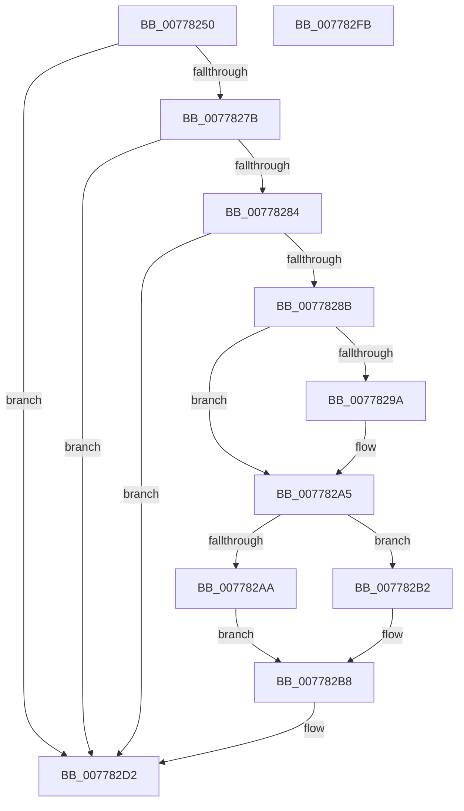

# TtmpTerminal0PowerSettingCallback

- RVA: `0x00778250`–`0x007782FC` (길이 `172` bytes)
- VA: `0x0000000140778250`
- 실행 섹션: `PAGE`
- PDB 이름 있음: `예`; PDB Function 태그: `아니요`
- unwind 정보 RVA: `0x0006F978`
- 디코드: `44`개 명령, `172/172` bytes 표시
- 미해석 바이트: `0` (있으면 어셈블리에 `.byte`로 보존)

> 이 문서는 커널 이미지의 기계어와 PDB 기호를 분석해 생성했습니다. 4번과 5번은 함수 원형과 자료형을 바이너리 사용 방식에서 추정한 C 해석이며 원본 소스 복구 결과는 아닙니다.

## 1. Dependencies

- 직접 호출 지점: **4**; 고유 호출 대상: **4**
- 직접 호출자로 확인된 함수: **0**
- RIP 상대 이미지 참조: **3**

### Outgoing calls
- `0x00778271` → [TtmpAcquireSessionLock](../70/TtmpAcquireSessionLock_function_00700408.md) (function, `0x00700408`)
- `0x007782CD` → [TtmiTerminalSetDisplayTimeouts](TtmiTerminalSetDisplayTimeouts_function_0077D204.md) (function, `0x0077D204`)
- `0x007782D9` → [ExReleaseResourceLite](../../text/25/ExReleaseResourceLite_function_0025FA10.md) (function, `0x0025FA10`)
- `0x007782DE` → [KeLeaveCriticalRegion](../../text/25/KeLeaveCriticalRegion_function_0025D8B0.md) (function, `0x0025D8B0`)

### Direct callers
- 이 함수 시작 RVA로 연결되는 직접 call은 확인되지 않았습니다. 간접 호출은 완전히 역산할 수 없습니다.

### Static image references
- `0x0077828E` → RVA `0x0001C368` (`.rdata`; read)
- `0x0077829E` → RVA `0x0001C370` (`.rdata`; read)
- `0x007782D2` → RVA `0x00F06940` (`.data`; read)

## 2. Other-region calls and transfers

- 다른 실행 섹션으로 향하는 call: **2**
  - `0x007782D9` → [ExReleaseResourceLite](../../text/25/ExReleaseResourceLite_function_0025FA10.md) (`PAGE` → `.text`)
  - `0x007782DE` → [KeLeaveCriticalRegion](../../text/25/KeLeaveCriticalRegion_function_0025D8B0.md) (`PAGE` → `.text`)
- 별도 외부 분기/꼬리 이동을 확인하지 못했습니다.

## 3. Assembly (complete function range)

```asm
00778250  48 89 5C 24 08                  mov qword ptr [rsp + 8], rbx
00778255  48 89 74 24 10                  mov qword ptr [rsp + 0x10], rsi
0077825A  48 89 7C 24 18                  mov qword ptr [rsp + 0x18], rdi
0077825F  41 56                           push r14
00778261  48 83 EC 20                     sub rsp, 0x20
00778265  49 8B F9                        mov rdi, r9
00778268  41 8B D8                        mov ebx, r8d
0077826B  4C 8B F2                        mov r14, rdx
0077826E  48 8B F1                        mov rsi, rcx
00778271  E8 92 81 F8 FF                  call 0x140700408
00778276  83 FB 04                        cmp ebx, 4
00778279  75 57                           jne 0x1407782d2
0077827B  80 BF F0 00 00 00 00            cmp byte ptr [rdi + 0xf0], 0
00778282  74 4E                           je 0x1407782d2
00778284  8B 47 04                        mov eax, dword ptr [rdi + 4]
00778287  84 C3                           test bl, al
00778289  75 47                           jne 0x1407782d2
0077828B  48 8B 06                        mov rax, qword ptr [rsi]
0077828E  48 2B 05 D3 40 8A FF            sub rax, qword ptr [rip - 0x75bf2d]
00778295  41 8B 0E                        mov ecx, dword ptr [r14]
00778298  75 0B                           jne 0x1407782a5
0077829A  48 8B 46 08                     mov rax, qword ptr [rsi + 8]
0077829E  48 2B 05 CB 40 8A FF            sub rax, qword ptr [rip - 0x75bf35]
007782A5  48 85 C0                        test rax, rax
007782A8  75 08                           jne 0x1407782b2
007782AA  89 8F 08 01 00 00               mov dword ptr [rdi + 0x108], ecx
007782B0  EB 06                           jmp 0x1407782b8
007782B2  89 8F 0C 01 00 00               mov dword ptr [rdi + 0x10c], ecx
007782B8  44 8B 8F 0C 01 00 00            mov r9d, dword ptr [rdi + 0x10c]
007782BF  48 8B CF                        mov rcx, rdi
007782C2  44 8B 87 08 01 00 00            mov r8d, dword ptr [rdi + 0x108]
007782C9  48 8B 57 20                     mov rdx, qword ptr [rdi + 0x20]
007782CD  E8 32 4F 00 00                  call 0x14077d204
007782D2  48 8D 0D 67 E6 78 00            lea rcx, [rip + 0x78e667]
007782D9  E8 32 77 AE FF                  call 0x14025fa10
007782DE  E8 CD 55 AE FF                  call 0x14025d8b0
007782E3  48 8B 5C 24 30                  mov rbx, qword ptr [rsp + 0x30]
007782E8  33 C0                           xor eax, eax
007782EA  48 8B 74 24 38                  mov rsi, qword ptr [rsp + 0x38]
007782EF  48 8B 7C 24 40                  mov rdi, qword ptr [rsp + 0x40]
007782F4  48 83 C4 20                     add rsp, 0x20
007782F8  41 5E                           pop r14
007782FA  C3                              ret
007782FB  CC                              int3
```

## 4. C-style interpretation (structured pseudocode)

```c
__int64 __fastcall TtmpTerminal0PowerSettingCallback(__int64 a1, __int64 a2, int a3, __int64 a4)
{
    __int64 result;
    __int64 v_rsp;
    unsigned __int64 v_stack_p10;
    unsigned __int64 v_stack_p18;
    unsigned __int64 v_stack_p8;

    v_stack_p8 = v_rbx;
    v_stack_p10 = v_rsi;
    v_stack_p18 = v_rdi;
    v_rsp = (v_rsp) - (32);
    result = TtmpAcquireSessionLock(a1, a2, a3, a4);
    if (((unsigned int)((unsigned int)(a3))) != 4) goto loc_007782D2;
    if ((*(unsigned __int8 *)(a4 + 240)) == 0) goto loc_007782D2;
    if ((((unsigned __int8)((unsigned int)(a3))) & ((unsigned __int8)((unsigned int)(*(unsigned int *)(a4 + 4))))) != 0) goto loc_007782D2;
    result = (*(unsigned __int64 *)(a1)) - (*(unsigned __int64 *)(v_rip - 7716653));
    if (!(condition_is_not_equal)) {
        result = *(unsigned __int64 *)(a1 + 8);
        result = (result) - (*(unsigned __int64 *)(v_rip - 7716661));
    }
    if (result != 0) goto loc_007782B2;
    *(unsigned int *)(a4 + 264) = (unsigned int)((unsigned int)(*(unsigned int *)(a2)));
    goto loc_007782B8;
loc_007782B2:
    *(unsigned int *)(a4 + 268) = (unsigned int)((unsigned int)(*(unsigned int *)(a2)));
loc_007782B8:
    result = TtmiTerminalSetDisplayTimeouts(a4, *(unsigned __int64 *)(a4 + 32), (unsigned int)(*(unsigned int *)(a4 + 264)), (unsigned int)(*(unsigned int *)(a4 + 268)));
loc_007782D2:
    result = ExReleaseResourceLite(v_rip + 7923303, *(unsigned __int64 *)(a4 + 32), (unsigned int)(*(unsigned int *)(a4 + 264)), (unsigned int)(*(unsigned int *)(a4 + 268)));
    result = KeLeaveCriticalRegion(v_rip + 7923303, *(unsigned __int64 *)(a4 + 32), (unsigned int)(*(unsigned int *)(a4 + 264)), (unsigned int)(*(unsigned int *)(a4 + 268)));
    result = 0;
    v_rsp = (v_rsp) + (32);
    return result;
}
```

## 5. (Beta) C Style

```c
int64_t TtmpTerminal0PowerSettingCallback(void *Arg1, void *Arg2, int32_t Arg3, void *Arg4)
{
    uint8_t *arg1 = (uint8_t *)Arg1;
    uint8_t *arg2 = (uint8_t *)Arg2;
    uint8_t *arg4 = (uint8_t *)Arg4;

    int64_t result;
    int64_t local_rsp;
    uint64_t v_stack_p10;
    uint64_t v_stack_p18;
    uint64_t v_stack_p8;

    v_stack_p8 = local_rbx;
    v_stack_p10 = local_rsi;
    v_stack_p18 = local_rdi;
    local_rsp = (local_rsp) - (32);
    result = TtmpAcquireSessionLock(Arg1, Arg2, Arg3, Arg4);
    if (((uint32_t)((uint32_t)(Arg3))) != 4) goto loc_007782D2;
    if ((*(uint8_t *)(arg4 + 0xF0)) == 0) goto loc_007782D2;
    if ((((uint8_t)((uint32_t)(Arg3))) & ((uint8_t)((uint32_t)(*(uint32_t *)(arg4 + 0x4))))) != 0) goto loc_007782D2;
    result = (*(uint64_t *)(arg1)) - (*(uint64_t *)(v_rip - 0x75BF2D));
    if (!(condition_is_not_equal)) {
        result = *(uint64_t *)(arg1 + 0x8);
        result = (result) - (*(uint64_t *)(v_rip - 0x75BF35));
    }
    if (result != 0) goto loc_007782B2;
    *(uint32_t *)(arg4 + 0x108) = (uint32_t)((uint32_t)(*(uint32_t *)(arg2)));
    goto loc_007782B8;
loc_007782B2:
    *(uint32_t *)(arg4 + 0x10C) = (uint32_t)((uint32_t)(*(uint32_t *)(arg2)));
loc_007782B8:
    result = TtmiTerminalSetDisplayTimeouts(Arg4, *(uint64_t *)(arg4 + 0x20), (uint32_t)(*(uint32_t *)(arg4 + 0x108)), (uint32_t)(*(uint32_t *)(arg4 + 0x10C)));
loc_007782D2:
    result = ExReleaseResourceLite(v_rip + 7923303, *(uint64_t *)(arg4 + 0x20), (uint32_t)(*(uint32_t *)(arg4 + 0x108)), (uint32_t)(*(uint32_t *)(arg4 + 0x10C)));
    result = KeLeaveCriticalRegion(v_rip + 7923303, *(uint64_t *)(arg4 + 0x20), (uint32_t)(*(uint32_t *)(arg4 + 0x108)), (uint32_t)(*(uint32_t *)(arg4 + 0x10C)));
    result = 0;
    local_rsp = (local_rsp) + (32);
    return result;
}
```

### 관측된 메모리 오프셋

구조체 형식이 확인되지 않은 접근은 인자 기준의 오프셋으로만 기록했습니다.

| 기준 인자 | 오프셋 표현 | 폭 (bit) | 접근 |
|---|---:|---:|---|
| `Arg1` | `+ 0x0` | `64` | `R` |
| `Arg1` | `+ 0x8` | `64` | `R` |
| `Arg2` | `+ 0x0` | `32` | `R` |
| `Arg4` | `+ 0x4` | `32` | `R` |
| `Arg4` | `+ 0x20` | `64` | `R` |
| `Arg4` | `+ 0xF0` | `8` | `R` |
| `Arg4` | `+ 0x108` | `32` | `R` |
| `Arg4` | `+ 0x108` | `32` | `W` |
| `Arg4` | `+ 0x10C` | `32` | `R` |
| `Arg4` | `+ 0x10C` | `32` | `W` |

## 6. Execution-region graph

[열기: 2D/3D 그래프와 함수 탐색 컨트롤 패널](../../../control-panel.html?section=page&rva=0x00778250&view=graph)

- 2D 그래프는 위에서 아래로 흐르고, 3D 그래프는 빈 공간을 드래그해 회전합니다. Shift+드래그는 이동, 휠은 확대·축소, 함수 노드 선택은 대상 보고서 이동입니다.

### Static fallback


