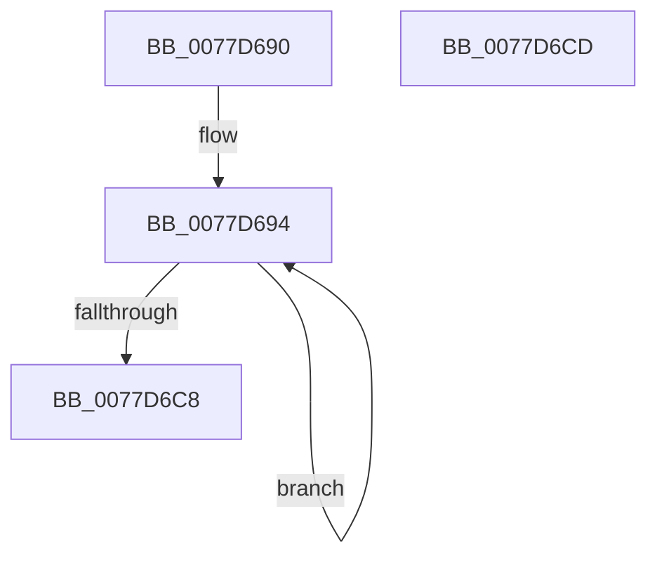

# TtmpTerminalInactivityWorkerRoutine

- RVA: `0x0077D690`–`0x0077D6CE` (길이 `62` bytes)
- VA: `0x000000014077D690`
- 실행 섹션: `PAGE`
- PDB 이름 있음: `예`; PDB Function 태그: `아니요`
- unwind 정보 RVA: `0x00063458`
- 디코드: `16`개 명령, `62/62` bytes 표시
- 미해석 바이트: `0` (있으면 어셈블리에 `.byte`로 보존)

> 이 문서는 커널 이미지의 기계어와 PDB 기호를 분석해 생성했습니다. 4번과 5번은 함수 원형과 자료형을 바이너리 사용 방식에서 추정한 C 해석이며 원본 소스 복구 결과는 아닙니다.

## 1. Dependencies

- 직접 호출 지점: **1**; 고유 호출 대상: **1**
- 직접 호출자로 확인된 함수: **0**
- RIP 상대 이미지 참조: **2**

### Outgoing calls
- `0x0077D6B3` → [ZwUpdateWnfStateData](../../text/6B/ZwUpdateWnfStateData_function_006B0D10.md) (function, `0x006B0D10`)

### Direct callers
- 이 함수 시작 RVA로 연결되는 직접 call은 확인되지 않았습니다. 간접 호출은 완전히 역산할 수 없습니다.

### Static image references
- `0x0077D699` → RVA `0x00020B28` (`.rdata`; read)
- `0x0077D6BB` → RVA `0x00F06848` (`.data`; read/write)

## 2. Other-region calls and transfers

- 다른 실행 섹션으로 향하는 call: **1**
  - `0x0077D6B3` → [ZwUpdateWnfStateData](../../text/6B/ZwUpdateWnfStateData_function_006B0D10.md) (`PAGE` → `.text`)
- 별도 외부 분기/꼬리 이동을 확인하지 못했습니다.

## 3. Assembly (complete function range)

```asm
0077D690  48 83 EC 48                     sub rsp, 0x48
0077D694  83 64 24 30 00                  and dword ptr [rsp + 0x30], 0
0077D699  48 8D 0D 88 34 8A FF            lea rcx, [rip - 0x75cb78]
0077D6A0  83 64 24 28 00                  and dword ptr [rsp + 0x28], 0
0077D6A5  45 33 C9                        xor r9d, r9d
0077D6A8  48 83 64 24 20 00               and qword ptr [rsp + 0x20], 0
0077D6AE  45 33 C0                        xor r8d, r8d
0077D6B1  33 D2                           xor edx, edx
0077D6B3  E8 58 36 F3 FF                  call 0x1406b0d10
0077D6B8  83 C8 FF                        or eax, 0xffffffff
0077D6BB  F0 0F C1 05 85 91 78 00         lock xadd dword ptr [rip + 0x789185], eax
0077D6C3  83 F8 01                        cmp eax, 1
0077D6C6  75 CC                           jne 0x14077d694
0077D6C8  48 83 C4 48                     add rsp, 0x48
0077D6CC  C3                              ret
0077D6CD  CC                              int3
```

## 4. C-style interpretation (structured pseudocode)

```c
__int64 __fastcall TtmpTerminalInactivityWorkerRoutine(__int64 a1, int a2, int a3, int a4)
{
    __int64 result;
    __int64 v_rsp;
    unsigned int v_stack_m18;
    unsigned int v_stack_m20;
    unsigned __int64 v_stack_m28;

    v_rsp = (v_rsp) - (72);
loc_0077D694:
    a4 = 0;
    a3 = 0;
    a2 = 0;
    result = ZwUpdateWnfStateData(v_rip - 7719800, a2, a3, a4);
    result = (unsigned int)((result) | (0xFFFFFFFFULL));
    if (((unsigned int)(result)) != 1) goto loc_0077D694;
    v_rsp = (v_rsp) + (72);
    return result;
}
```

## 5. (Beta) C Style

```c
int64_t TtmpTerminalInactivityWorkerRoutine(int64_t Arg1, int32_t Arg2, int32_t Arg3, int32_t Arg4)
{
    int64_t result;
    int64_t local_rsp;
    uint32_t v_stack_m18;
    uint32_t v_stack_m20;
    uint64_t v_stack_m28;

    local_rsp = (local_rsp) - (72);
loc_0077D694:
    Arg4 = 0;
    Arg3 = 0;
    Arg2 = 0;
    result = ZwUpdateWnfStateData(v_rip - 7719800, Arg2, Arg3, Arg4);
    result = (uint32_t)((result) | (0xFFFFFFFFULL));
    if (((uint32_t)(result)) != 1) goto loc_0077D694;
    local_rsp = (local_rsp) + (72);
    return result;
}
```

## 6. Execution-region graph

[열기: 2D/3D 그래프와 함수 탐색 컨트롤 패널](../../../control-panel.html?section=page&rva=0x0077D690&view=graph)

- 2D 그래프는 위에서 아래로 흐르고, 3D 그래프는 빈 공간을 드래그해 회전합니다. Shift+드래그는 이동, 휠은 확대·축소, 함수 노드 선택은 대상 보고서 이동입니다.

### Static fallback


