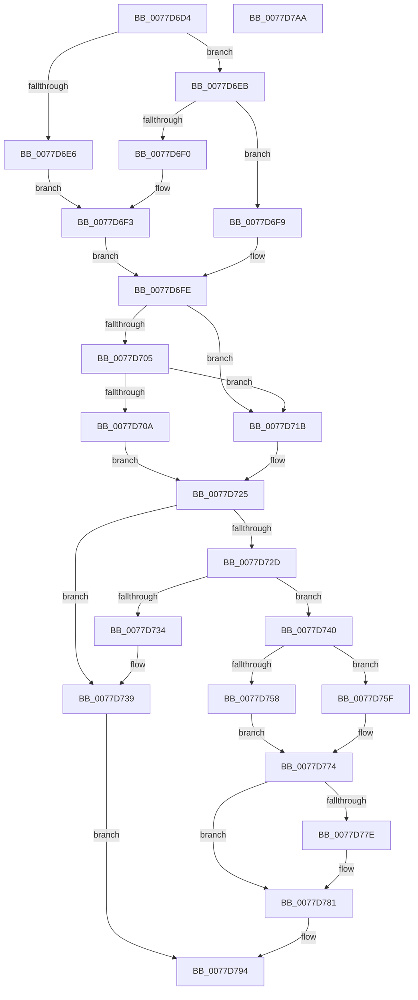

# TtmpTsmIterate

- RVA: `0x0077D6D4`–`0x0077D7AB` (길이 `215` bytes)
- VA: `0x000000014077D6D4`
- 실행 섹션: `PAGE`
- PDB 이름 있음: `예`; PDB Function 태그: `아니요`
- unwind 정보 RVA: `0x0005C788`
- 디코드: `66`개 명령, `215/215` bytes 표시
- 미해석 바이트: `0` (있으면 어셈블리에 `.byte`로 보존)

> 이 문서는 커널 이미지의 기계어와 PDB 기호를 분석해 생성했습니다. 4번과 5번은 함수 원형과 자료형을 바이너리 사용 방식에서 추정한 C 해석이며 원본 소스 복구 결과는 아닙니다.

## 1. Dependencies

- 직접 호출 지점: **2**; 고유 호출 대상: **1**
- 직접 호출자로 확인된 함수: **1**
- RIP 상대 이미지 참조: **0**

### Outgoing calls
- `0x0077D74F` → [TtmpTsmTestTimeout](TtmpTsmTestTimeout_function_0077D7B4.md) (function, `0x0077D7B4`)
- `0x0077D768` → [TtmpTsmTestTimeout](TtmpTsmTestTimeout_function_0077D7B4.md) (function, `0x0077D7B4`)

### Direct callers
- [TtmpUpdateTerminalState](TtmpUpdateTerminalState_function_0077D7D0.md) at `0x0077D87E`

### Static image references
- 디코드된 RIP-relative 메모리 참조가 없습니다.

## 2. Other-region calls and transfers

- 다른 실행 섹션으로 향하는 call: **0**
- 별도 외부 분기/꼬리 이동을 확인하지 못했습니다.

## 3. Assembly (complete function range)

```asm
0077D6D4  48 83 EC 28                     sub rsp, 0x28
0077D6D8  8B 41 2C                        mov eax, dword ptr [rcx + 0x2c]
0077D6DB  4C 8B D2                        mov r10, rdx
0077D6DE  4C 8B C9                        mov r9, rcx
0077D6E1  83 F8 02                        cmp eax, 2
0077D6E4  75 05                           jne 0x14077d6eb
0077D6E6  8D 48 FF                        lea ecx, [rax - 1]
0077D6E9  EB 08                           jmp 0x14077d6f3
0077D6EB  83 F8 01                        cmp eax, 1
0077D6EE  75 09                           jne 0x14077d6f9
0077D6F0  8D 48 02                        lea ecx, [rax + 2]
0077D6F3  45 8B 59 30                     mov r11d, dword ptr [r9 + 0x30]
0077D6F7  EB 05                           jmp 0x14077d6fe
0077D6F9  8B 09                           mov ecx, dword ptr [rcx]
0077D6FB  45 33 DB                        xor r11d, r11d
0077D6FE  41 80 79 29 00                  cmp byte ptr [r9 + 0x29], 0
0077D703  75 16                           jne 0x14077d71b
0077D705  83 F8 01                        cmp eax, 1
0077D708  74 11                           je 0x14077d71b
0077D70A  49 8B 41 08                     mov rax, qword ptr [r9 + 8]
0077D70E  48 89 42 10                     mov qword ptr [rdx + 0x10], rax
0077D712  49 8B 51 10                     mov rdx, qword ptr [r9 + 0x10]
0077D716  48 2B D0                        sub rdx, rax
0077D719  EB 0A                           jmp 0x14077d725
0077D71B  49 8B 41 10                     mov rax, qword ptr [r9 + 0x10]
0077D71F  48 89 42 10                     mov qword ptr [rdx + 0x10], rax
0077D723  33 D2                           xor edx, edx
0077D725  8D 41 FE                        lea eax, [rcx - 2]
0077D728  83 F8 01                        cmp eax, 1
0077D72B  77 0C                           ja 0x14077d739
0077D72D  41 80 79 28 00                  cmp byte ptr [r9 + 0x28], 0
0077D732  74 0C                           je 0x14077d740
0077D734  B9 03 00 00 00                  mov ecx, 3
0077D739  49 83 62 18 00                  and qword ptr [r10 + 0x18], 0
0077D73E  EB 54                           jmp 0x14077d794
0077D740  49 8B 49 20                     mov rcx, qword ptr [r9 + 0x20]
0077D744  4C 8D 44 24 30                  lea r8, [rsp + 0x30]
0077D749  48 83 64 24 30 00               and qword ptr [rsp + 0x30], 0
0077D74F  E8 60 00 00 00                  call 0x14077d7b4
0077D754  84 C0                           test al, al
0077D756  74 07                           je 0x14077d75f
0077D758  B9 01 00 00 00                  mov ecx, 1
0077D75D  EB 15                           jmp 0x14077d774
0077D75F  49 8B 49 18                     mov rcx, qword ptr [r9 + 0x18]
0077D763  4C 8D 44 24 30                  lea r8, [rsp + 0x30]
0077D768  E8 47 00 00 00                  call 0x14077d7b4
0077D76D  F6 D8                           neg al
0077D76F  1B C9                           sbb ecx, ecx
0077D771  83 C1 03                        add ecx, 3
0077D774  48 8B 44 24 30                  mov rax, qword ptr [rsp + 0x30]
0077D779  48 85 C0                        test rax, rax
0077D77C  74 03                           je 0x14077d781
0077D77E  48 2B C2                        sub rax, rdx
0077D781  49 89 42 18                     mov qword ptr [r10 + 0x18], rax
0077D785  BA 0C 00 00 00                  mov edx, 0xc
0077D78A  8D 41 FF                        lea eax, [rcx - 1]
0077D78D  83 F8 01                        cmp eax, 1
0077D790  44 0F 46 DA                     cmovbe r11d, edx
0077D794  41 89 0A                        mov dword ptr [r10], ecx
0077D797  41 39 09                        cmp dword ptr [r9], ecx
0077D79A  0F 95 C0                        setne al
0077D79D  41 88 42 04                     mov byte ptr [r10 + 4], al
0077D7A1  45 89 5A 08                     mov dword ptr [r10 + 8], r11d
0077D7A5  48 83 C4 28                     add rsp, 0x28
0077D7A9  C3                              ret
0077D7AA  CC                              int3
```

## 4. C-style interpretation (structured pseudocode)

```c
__int64 __fastcall TtmpTsmIterate(__int64 a1, __int64 a2)
{
    __int64 result;
    __int64 v_r11;
    __int64 v_rsp;
    unsigned __int64 v_stack_p8;

    v_rsp = (v_rsp) - (40);
    if (((unsigned int)((unsigned int)(*(unsigned int *)(a1 + 44)))) != 2) goto loc_0077D6EB;
    goto loc_0077D6F3;
loc_0077D6EB:
    if (((unsigned int)((unsigned int)(*(unsigned int *)(a1 + 44)))) != 1) goto loc_0077D6F9;
loc_0077D6F3:
    goto loc_0077D6FE;
loc_0077D6F9:
    v_r11 = 0;
loc_0077D6FE:
    if ((*(unsigned __int8 *)(a1 + 41)) != 0) goto loc_0077D71B;
    if (((unsigned int)((unsigned int)(*(unsigned int *)(a1 + 44)))) == 1) goto loc_0077D71B;
    *(unsigned __int64 *)(a2 + 16) = *(unsigned __int64 *)(a1 + 8);
    a2 = (*(unsigned __int64 *)(a1 + 16)) - (*(unsigned __int64 *)(a1 + 8));
    goto loc_0077D725;
loc_0077D71B:
    *(unsigned __int64 *)(a2 + 16) = *(unsigned __int64 *)(a1 + 16);
    a2 = 0;
loc_0077D725:
    if (((unsigned int)((unsigned int)(*(unsigned int *)((unsigned int)(*(unsigned int *)(a1 + 44)) + 2)) - 2)) > 1) goto loc_0077D739;
    if ((*(unsigned __int8 *)(a1 + 40)) == 0) goto loc_0077D740;
loc_0077D739:
    goto loc_0077D794;
loc_0077D740:
    result = TtmpTsmTestTimeout(*(unsigned __int64 *)(a1 + 32), a2, v_stack_p8, a1);
    if ((unsigned __int8)(result) == 0) goto loc_0077D75F;
    goto loc_0077D774;
loc_0077D75F:
    result = TtmpTsmTestTimeout(*(unsigned __int64 *)(a1 + 24), a2, v_stack_p8, a1);
    result = (unsigned __int8)(-(result));
    a1 = (unsigned int)((*(unsigned __int64 *)(a1 + 24)) + (3));
loc_0077D774:
    result = v_stack_p8;
    if (v_stack_p8 != 0) {
        result = (v_stack_p8) - (0);
    }
    *(unsigned __int64 *)(a2 + 24) = result;
    if (((unsigned int)(a1 - 1)) <= 1) { v_r11 = 12; }
loc_0077D794:
    *(unsigned int *)(a2) = (unsigned int)(a1);
    result = ((*(unsigned int *)(a1)) != ((unsigned int)(a1))) ? 1 : 0;
    *(unsigned __int8 *)(a2 + 4) = (unsigned __int8)(result);
    *(unsigned int *)(a2 + 8) = (unsigned int)(v_r11);
    v_rsp = (v_rsp) + (40);
    return result;
}
```

## 5. (Beta) C Style

```c
int64_t TtmpTsmIterate(void *Arg1, void *Arg2)
{
    uint8_t *arg1 = (uint8_t *)Arg1;
    uint8_t *arg2 = (uint8_t *)Arg2;

    int64_t result;
    int64_t local_r11;
    int64_t local_rsp;
    uint64_t v_stack_p8;

    local_rsp = (local_rsp) - (40);
    if (((uint32_t)((uint32_t)(*(uint32_t *)(arg1 + 0x2C)))) != 2) goto loc_0077D6EB;
    goto loc_0077D6F3;
loc_0077D6EB:
    if (((uint32_t)((uint32_t)(*(uint32_t *)(arg1 + 0x2C)))) != 1) goto loc_0077D6F9;
loc_0077D6F3:
    goto loc_0077D6FE;
loc_0077D6F9:
    local_r11 = 0;
loc_0077D6FE:
    if ((*(uint8_t *)(arg1 + 0x29)) != 0) goto loc_0077D71B;
    if (((uint32_t)((uint32_t)(*(uint32_t *)(arg1 + 0x2C)))) == 1) goto loc_0077D71B;
    *(uint64_t *)(arg2 + 0x10) = *(uint64_t *)(arg1 + 0x8);
    Arg2 = (*(uint64_t *)(arg1 + 0x10)) - (*(uint64_t *)(arg1 + 0x8));
    goto loc_0077D725;
loc_0077D71B:
    *(uint64_t *)(arg2 + 0x10) = *(uint64_t *)(arg1 + 0x10);
    Arg2 = 0;
loc_0077D725:
    if (((uint32_t)((uint32_t)(*(uint32_t *)((uint32_t)(*(uint32_t *)(arg1 + 0x2C)) + 0x2)) - 2)) > 1) goto loc_0077D739;
    if ((*(uint8_t *)(arg1 + 0x28)) == 0) goto loc_0077D740;
loc_0077D739:
    goto loc_0077D794;
loc_0077D740:
    result = TtmpTsmTestTimeout(*(uint64_t *)(arg1 + 0x20), Arg2, v_stack_p8, Arg1);
    if ((uint8_t)(result) == 0) goto loc_0077D75F;
    goto loc_0077D774;
loc_0077D75F:
    result = TtmpTsmTestTimeout(*(uint64_t *)(arg1 + 0x18), Arg2, v_stack_p8, Arg1);
    result = (uint8_t)(-(result));
    Arg1 = (uint32_t)((*(uint64_t *)(arg1 + 0x18)) + (3));
loc_0077D774:
    result = v_stack_p8;
    if (v_stack_p8 != 0) {
        result = (v_stack_p8) - (0);
    }
    *(uint64_t *)(arg2 + 0x18) = result;
    if (((uint32_t)(Arg1 - 1)) <= 1) { local_r11 = 12; }
loc_0077D794:
    *(uint32_t *)(arg2) = (uint32_t)(Arg1);
    result = ((*(uint32_t *)(arg1)) != ((uint32_t)(Arg1))) ? 1 : 0;
    *(uint8_t *)(arg2 + 0x4) = (uint8_t)(result);
    *(uint32_t *)(arg2 + 0x8) = (uint32_t)(local_r11);
    local_rsp = (local_rsp) + (40);
    return result;
}
```

### 관측된 메모리 오프셋

구조체 형식이 확인되지 않은 접근은 인자 기준의 오프셋으로만 기록했습니다.

| 기준 인자 | 오프셋 표현 | 폭 (bit) | 접근 |
|---|---:|---:|---|
| `Arg1` | `+ 0x0` | `32` | `R` |
| `Arg1` | `+ 0x8` | `64` | `R` |
| `Arg1` | `+ 0x10` | `64` | `R` |
| `Arg1` | `+ 0x20` | `64` | `R` |
| `Arg1` | `+ 0x28` | `8` | `R` |
| `Arg1` | `+ 0x29` | `8` | `R` |
| `Arg1` | `+ 0x2C` | `32` | `R` |
| `Arg1` | `+ 0x30` | `32` | `R` |
| `Arg2` | `+ 0x10` | `64` | `W` |
| `Arg2` | `+ 0x18` | `64` | `R/W` |

## 6. Execution-region graph

[열기: 2D/3D 그래프와 함수 탐색 컨트롤 패널](../../../control-panel.html?section=page&rva=0x0077D6D4&view=graph)

- 2D 그래프는 위에서 아래로 흐르고, 3D 그래프는 빈 공간을 드래그해 회전합니다. Shift+드래그는 이동, 휠은 확대·축소, 함수 노드 선택은 대상 보고서 이동입니다.

### Static fallback


