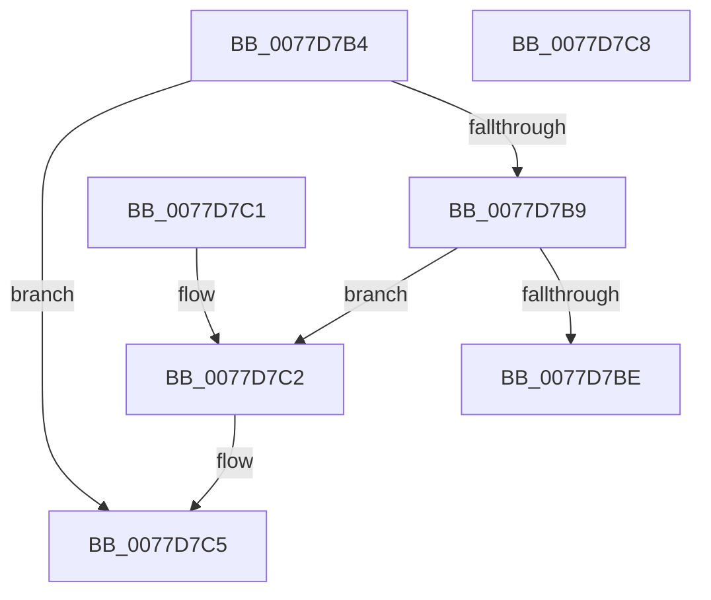

# TtmpTsmTestTimeout

- RVA: `0x0077D7B4`–`0x0077D7C9` (길이 `21` bytes)
- VA: `0x000000014077D7B4`
- 실행 섹션: `PAGE`
- PDB 이름 있음: `예`; PDB Function 태그: `아니요`
- unwind 정보 RVA: `0x000DB714`
- 디코드: `11`개 명령, `21/21` bytes 표시
- 미해석 바이트: `0` (있으면 어셈블리에 `.byte`로 보존)

> 이 문서는 커널 이미지의 기계어와 PDB 기호를 분석해 생성했습니다. 4번과 5번은 함수 원형과 자료형을 바이너리 사용 방식에서 추정한 C 해석이며 원본 소스 복구 결과는 아닙니다.

## 1. Dependencies

- 직접 호출 지점: **0**; 고유 호출 대상: **0**
- 직접 호출자로 확인된 함수: **1**
- RIP 상대 이미지 참조: **0**

### Outgoing calls
- 직접 디코드된 call 명령이 없습니다.

### Direct callers
- [TtmpTsmIterate](TtmpTsmIterate_function_0077D6D4.md) at `0x0077D74F`
- [TtmpTsmIterate](TtmpTsmIterate_function_0077D6D4.md) at `0x0077D768`

### Static image references
- 디코드된 RIP-relative 메모리 참조가 없습니다.

## 2. Other-region calls and transfers

- 다른 실행 섹션으로 향하는 call: **0**
- 별도 외부 분기/꼬리 이동을 확인하지 못했습니다.

## 3. Assembly (complete function range)

```asm
0077D7B4  48 85 C9                        test rcx, rcx
0077D7B7  74 0C                           je 0x14077d7c5
0077D7B9  48 3B CA                        cmp rcx, rdx
0077D7BC  77 04                           ja 0x14077d7c2
0077D7BE  B0 01                           mov al, 1
0077D7C0  C3                              ret
0077D7C1  CC                              int3
0077D7C2  49 89 08                        mov qword ptr [r8], rcx
0077D7C5  32 C0                           xor al, al
0077D7C7  C3                              ret
0077D7C8  CC                              int3
```

## 4. C-style interpretation (structured pseudocode)

```c
__int64 __fastcall TtmpTsmTestTimeout(__int64 a1, __int64 a2, __int64 a3)
{
    __int64 result;

    if (a1 == 0) goto loc_0077D7C5;
    if (a1 > a2) goto loc_0077D7C2;
    return 1;
loc_0077D7C2:
    *(unsigned __int64 *)(a3) = a1;
loc_0077D7C5:
    result = 0;
    return result;
}
```

## 5. (Beta) C Style

```c
int64_t TtmpTsmTestTimeout(int64_t Arg1, int64_t Arg2, void *Arg3)
{
    uint8_t *arg3 = (uint8_t *)Arg3;

    int64_t result;

    if (Arg1 == 0) goto loc_0077D7C5;
    if (Arg1 > Arg2) goto loc_0077D7C2;
    return 1;
loc_0077D7C2:
    *(uint64_t *)(arg3) = Arg1;
loc_0077D7C5:
    result = 0;
    return result;
}
```

### 관측된 메모리 오프셋

구조체 형식이 확인되지 않은 접근은 인자 기준의 오프셋으로만 기록했습니다.

| 기준 인자 | 오프셋 표현 | 폭 (bit) | 접근 |
|---|---:|---:|---|
| `Arg3` | `+ 0x0` | `64` | `W` |

## 6. Execution-region graph

[열기: 2D/3D 그래프와 함수 탐색 컨트롤 패널](../../../control-panel.html?section=page&rva=0x0077D7B4&view=graph)

- 2D 그래프는 위에서 아래로 흐르고, 3D 그래프는 빈 공간을 드래그해 회전합니다. Shift+드래그는 이동, 휠은 확대·축소, 함수 노드 선택은 대상 보고서 이동입니다.

### Static fallback


