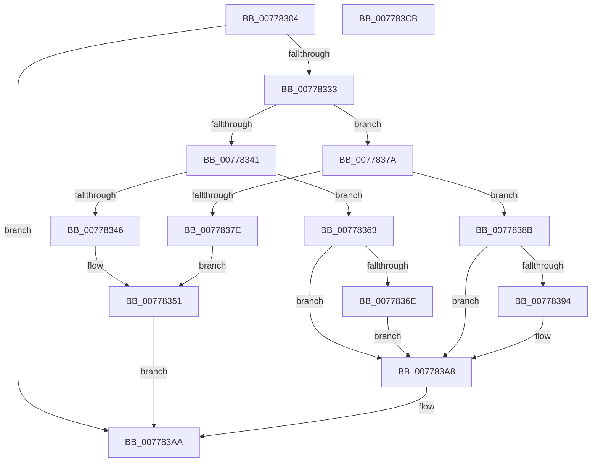

# TtmpUpdateDisplayRequiredPowerRequest

- RVA: `0x00778304`–`0x007783CC` (길이 `200` bytes)
- VA: `0x0000000140778304`
- 실행 섹션: `PAGE`
- PDB 이름 있음: `예`; PDB Function 태그: `아니요`
- unwind 정보 RVA: `0x0006C8E8`
- 디코드: `61`개 명령, `200/200` bytes 표시
- 미해석 바이트: `0` (있으면 어셈블리에 `.byte`로 보존)

> 이 문서는 커널 이미지의 기계어와 PDB 기호를 분석해 생성했습니다. 4번과 5번은 함수 원형과 자료형을 바이너리 사용 방식에서 추정한 C 해석이며 원본 소스 복구 결과는 아닙니다.

## 1. Dependencies

- 직접 호출 지점: **6**; 고유 호출 대상: **5**
- 직접 호출자로 확인된 함수: **1**
- RIP 상대 이미지 참조: **1**

### Outgoing calls
- `0x0077832A` → [TtmpFindPowerRequestEntryById](TtmpFindPowerRequestEntryById_function_007778C4.md) (function, `0x007778C4`)
- `0x0077835C` → [TtmiLogError](../98/TtmiLogError_function_0098B39C.md) (function, `0x0098B39C`)
- `0x00778373` → [TtmpWriteDisplayRequiredPowerRequestUpdatedEvent](TtmpWriteDisplayRequiredPowerRequestUpdatedEvent_function_00778498.md) (function, `0x00778498`)
- `0x00778399` → [TtmpWriteDisplayRequiredPowerRequestUpdatedEvent](TtmpWriteDisplayRequiredPowerRequestUpdatedEvent_function_00778498.md) (function, `0x00778498`)
- `0x007783A3` → [TtmpSetDisplayRequestEnded](TtmpSetDisplayRequestEnded_function_00778124.md) (function, `0x00778124`)
- `0x007783B1` → [TtmiLogSessionDisplayRequiredPowerRequestUpdated](TtmiLogSessionDisplayRequiredPowerRequestUpdated_function_0077B070.md) (function, `0x0077B070`)

### Direct callers
- [TtmNotifySessionDisplayRequiredChange](../98/TtmNotifySessionDisplayRequiredChange_function_0098C6B4.md) at `0x0098C719`

### Static image references
- `0x00778355` → RVA `0x00B04170` (` ?? ::NNGAKEGL::`string'`; read)

## 2. Other-region calls and transfers

- 다른 실행 섹션으로 향하는 call: **0**
- 별도 외부 분기/꼬리 이동을 확인하지 못했습니다.

## 3. Assembly (complete function range)

```asm
00778304  48 8B C4                        mov rax, rsp
00778307  48 89 58 10                     mov qword ptr [rax + 0x10], rbx
0077830B  48 89 68 18                     mov qword ptr [rax + 0x18], rbp
0077830F  48 89 70 20                     mov qword ptr [rax + 0x20], rsi
00778313  57                              push rdi
00778314  48 83 EC 20                     sub rsp, 0x20
00778318  41 8A E8                        mov bpl, r8b
0077831B  33 DB                           xor ebx, ebx
0077831D  4C 8D 40 08                     lea r8, [rax + 8]
00778321  48 89 58 08                     mov qword ptr [rax + 8], rbx
00778325  8B F2                           mov esi, edx
00778327  48 8B F9                        mov rdi, rcx
0077832A  E8 95 F5 FF FF                  call 0x1407778c4
0077832F  84 C0                           test al, al
00778331  74 77                           je 0x1407783aa
00778333  4C 8B 44 24 30                  mov r8, qword ptr [rsp + 0x30]
00778338  41 8B 40 28                     mov eax, dword ptr [r8 + 0x28]
0077833C  40 84 ED                        test bpl, bpl
0077833F  74 39                           je 0x14077837a
00778341  83 F8 FF                        cmp eax, -1
00778344  75 1D                           jne 0x140778363
00778346  BA 41 04 00 00                  mov edx, 0x441
0077834B  41 B8 95 00 00 C0               mov r8d, 0xc0000095
00778351  41 83 C9 FF                     or r9d, 0xffffffff
00778355  48 8D 0D 14 BE 38 00            lea rcx, [rip + 0x38be14]
0077835C  E8 3B 30 21 00                  call 0x14098b39c
00778361  EB 47                           jmp 0x1407783aa
00778363  FF C0                           inc eax
00778365  41 89 40 28                     mov dword ptr [r8 + 0x28], eax
00778369  83 F8 01                        cmp eax, 1
0077836C  75 3A                           jne 0x1407783a8
0077836E  33 D2                           xor edx, edx
00778370  48 8B CF                        mov rcx, rdi
00778373  E8 20 01 00 00                  call 0x140778498
00778378  EB 2E                           jmp 0x1407783a8
0077837A  85 C0                           test eax, eax
0077837C  75 0D                           jne 0x14077838b
0077837E  BA 5A 04 00 00                  mov edx, 0x45a
00778383  41 B8 0D 00 00 C0               mov r8d, 0xc000000d
00778389  EB C6                           jmp 0x140778351
0077838B  83 E8 01                        sub eax, 1
0077838E  41 89 40 28                     mov dword ptr [r8 + 0x28], eax
00778392  75 14                           jne 0x1407783a8
00778394  33 D2                           xor edx, edx
00778396  48 8B CF                        mov rcx, rdi
00778399  E8 FA 00 00 00                  call 0x140778498
0077839E  8B D6                           mov edx, esi
007783A0  48 8B CF                        mov rcx, rdi
007783A3  E8 7C FD FF FF                  call 0x140778124
007783A8  B3 01                           mov bl, 1
007783AA  8B 0F                           mov ecx, dword ptr [rdi]
007783AC  44 8A C3                        mov r8b, bl
007783AF  8B D6                           mov edx, esi
007783B1  E8 BA 2C 00 00                  call 0x14077b070
007783B6  48 8B 5C 24 38                  mov rbx, qword ptr [rsp + 0x38]
007783BB  48 8B 6C 24 40                  mov rbp, qword ptr [rsp + 0x40]
007783C0  48 8B 74 24 48                  mov rsi, qword ptr [rsp + 0x48]
007783C5  48 83 C4 20                     add rsp, 0x20
007783C9  5F                              pop rdi
007783CA  C3                              ret
007783CB  CC                              int3
```

## 4. C-style interpretation (structured pseudocode)

```c
__int64 __fastcall TtmpUpdateDisplayRequiredPowerRequest(__int64 a1, int a2, unsigned __int8 a3, int a4)
{
    __int64 result;
    __int64 v_rbx;
    __int64 v_rsp;
    unsigned __int64 v_stack_p10;
    unsigned __int64 v_stack_p18;
    unsigned __int64 v_stack_p20;
    unsigned __int64 v_stack_p8;

    *(unsigned __int64 *)(v_rsp + 16) = v_rbx;
    *(unsigned __int64 *)(v_rsp + 24) = v_rbp;
    *(unsigned __int64 *)(v_rsp + 32) = v_rsi;
    v_rsp = (v_rsp) - (32);
    v_rbx = 0;
    *(unsigned __int64 *)(v_rsp + 8) = 0;
    result = TtmpFindPowerRequestEntryById(a1, a2, v_rsp + 8, a4);
    if ((unsigned __int8)(result) == 0) goto loc_007783AA;
    if (a3 == 0) goto loc_0077837A;
    if (((unsigned int)((unsigned int)(*(unsigned int *)(v_stack_p8 + 40)))) != -1) goto loc_00778363;
loc_00778351:
    a4 = (unsigned int)((a4) | (0xFFFFFFFFULL));
    result = TtmiLogError(v_rip + 3718676, (unsigned int)(0x441ULL), (unsigned int)(0xC0000095ULL), a4);
    goto loc_007783AA;
loc_00778363:
    result = (unsigned int)((result) + 1);
    *(unsigned int *)((unsigned int)(0xC0000095ULL) + 40) = (unsigned int)(result);
    if (((unsigned int)(result)) != 1) goto loc_007783A8;
    a2 = 0;
    result = TtmpWriteDisplayRequiredPowerRequestUpdatedEvent(a1, a2, (unsigned int)(0xC0000095ULL), a4);
    goto loc_007783A8;
loc_0077837A:
    if ((unsigned int)(result) != 0) goto loc_0077838B;
    goto loc_00778351;
loc_0077838B:
    result = (unsigned int)((result) - (1));
    *(unsigned int *)((unsigned int)(0xC000000DULL) + 40) = (unsigned int)(result);
    if (!(condition_is_not_equal)) {
        a2 = 0;
        a1 = a1;
        result = TtmpWriteDisplayRequiredPowerRequestUpdatedEvent(a1, a2, (unsigned int)(0xC000000DULL), a4);
        a2 = (unsigned int)((unsigned int)(a2));
        a1 = a1;
        result = TtmpSetDisplayRequestEnded(a1, a2, (unsigned int)(0xC000000DULL), a4);
    }
loc_007783AA:
    result = TtmiLogSessionDisplayRequiredPowerRequestUpdated((unsigned int)(*(unsigned int *)(a1)), (unsigned int)((unsigned int)((unsigned int)(a2))), 1, a4);
    v_rsp = (v_rsp) + (32);
    return result;
}
```

## 5. (Beta) C Style

```c
int64_t TtmpUpdateDisplayRequiredPowerRequest(void *Arg1, int32_t Arg2, uint8_t Arg3, int32_t Arg4)
{
    uint8_t *arg1 = (uint8_t *)Arg1;

    int64_t result;
    int64_t local_rbx;
    int64_t local_rsp;
    uint64_t v_stack_p10;
    uint64_t v_stack_p18;
    uint64_t v_stack_p20;
    uint64_t v_stack_p8;

    *(uint64_t *)(local_rsp + 0x10) = local_rbx;
    *(uint64_t *)(local_rsp + 0x18) = local_rbp;
    *(uint64_t *)(local_rsp + 0x20) = local_rsi;
    local_rsp = (local_rsp) - (32);
    local_rbx = 0;
    *(uint64_t *)(local_rsp + 0x8) = 0;
    result = TtmpFindPowerRequestEntryById(Arg1, Arg2, local_rsp + 8, Arg4);
    if ((uint8_t)(result) == 0) goto loc_007783AA;
    if (Arg3 == 0) goto loc_0077837A;
    if (((uint32_t)((uint32_t)(*(uint32_t *)(v_stack_p8 + 0x28)))) != -1) goto loc_00778363;
loc_00778351:
    Arg4 = (uint32_t)((Arg4) | (0xFFFFFFFFULL));
    result = TtmiLogError(v_rip + 3718676, (uint32_t)(0x441ULL), (uint32_t)(0xC0000095ULL), Arg4);
    goto loc_007783AA;
loc_00778363:
    result = (uint32_t)((result) + 1);
    *(uint32_t *)((uint32_t)(0xC0000095ULL) + 0x28) = (uint32_t)(result);
    if (((uint32_t)(result)) != 1) goto loc_007783A8;
    Arg2 = 0;
    result = TtmpWriteDisplayRequiredPowerRequestUpdatedEvent(Arg1, Arg2, (uint32_t)(0xC0000095ULL), Arg4);
    goto loc_007783A8;
loc_0077837A:
    if ((uint32_t)(result) != 0) goto loc_0077838B;
    goto loc_00778351;
loc_0077838B:
    result = (uint32_t)((result) - (1));
    *(uint32_t *)((uint32_t)(0xC000000DULL) + 0x28) = (uint32_t)(result);
    if (!(condition_is_not_equal)) {
        Arg2 = 0;
        Arg1 = Arg1;
        result = TtmpWriteDisplayRequiredPowerRequestUpdatedEvent(Arg1, Arg2, (uint32_t)(0xC000000DULL), Arg4);
        Arg2 = (uint32_t)((uint32_t)(Arg2));
        Arg1 = Arg1;
        result = TtmpSetDisplayRequestEnded(Arg1, Arg2, (uint32_t)(0xC000000DULL), Arg4);
    }
loc_007783AA:
    result = TtmiLogSessionDisplayRequiredPowerRequestUpdated((uint32_t)(*(uint32_t *)(arg1)), (uint32_t)((uint32_t)((uint32_t)(Arg2))), 1, Arg4);
    local_rsp = (local_rsp) + (32);
    return result;
}
```

### 관측된 메모리 오프셋

구조체 형식이 확인되지 않은 접근은 인자 기준의 오프셋으로만 기록했습니다.

| 기준 인자 | 오프셋 표현 | 폭 (bit) | 접근 |
|---|---:|---:|---|
| `Arg1` | `+ 0x0` | `32` | `R` |

## 6. Execution-region graph

[열기: 2D/3D 그래프와 함수 탐색 컨트롤 패널](../../../control-panel.html?section=page&rva=0x00778304&view=graph)

- 2D 그래프는 위에서 아래로 흐르고, 3D 그래프는 빈 공간을 드래그해 회전합니다. Shift+드래그는 이동, 휠은 확대·축소, 함수 노드 선택은 대상 보고서 이동입니다.

### Static fallback


