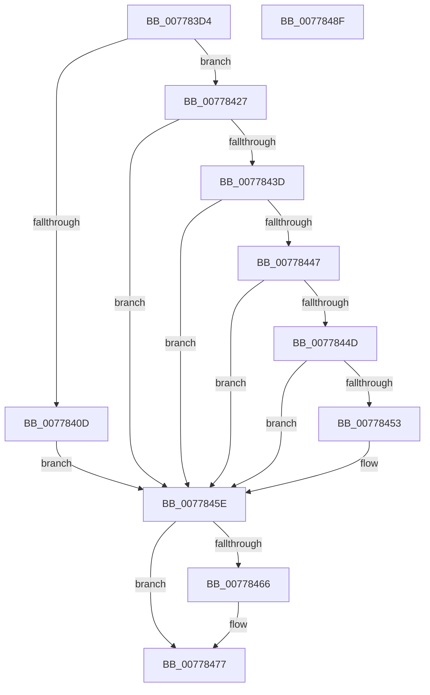

# TtmpUpdatePowerRequestAttribute

- RVA: `0x007783D4`–`0x00778490` (길이 `188` bytes)
- VA: `0x00000001407783D4`
- 실행 섹션: `PAGE`
- PDB 이름 있음: `예`; PDB Function 태그: `아니요`
- unwind 정보 RVA: `0x000C82A0`
- 디코드: `52`개 명령, `188/188` bytes 표시
- 미해석 바이트: `0` (있으면 어셈블리에 `.byte`로 보존)

> 이 문서는 커널 이미지의 기계어와 PDB 기호를 분석해 생성했습니다. 4번과 5번은 함수 원형과 자료형을 바이너리 사용 방식에서 추정한 C 해석이며 원본 소스 복구 결과는 아닙니다.

## 1. Dependencies

- 직접 호출 지점: **5**; 고유 호출 대상: **5**
- 직접 호출자로 확인된 함수: **1**
- RIP 상대 이미지 참조: **2**

### Outgoing calls
- `0x00778404` → [TtmpAcquireSessionById](../98/TtmpAcquireSessionById_function_0098B4F4.md) (function, `0x0098B4F4`)
- `0x00778420` → [TtmiLogError](../98/TtmiLogError_function_0098B39C.md) (function, `0x0098B39C`)
- `0x00778434` → [TtmpFindPowerRequestEntryById](TtmpFindPowerRequestEntryById_function_007778C4.md) (function, `0x007778C4`)
- `0x0077846D` → [ExReleaseResourceLite](../../text/25/ExReleaseResourceLite_function_0025FA10.md) (function, `0x0025FA10`)
- `0x00778472` → [KeLeaveCriticalRegion](../../text/25/KeLeaveCriticalRegion_function_0025D8B0.md) (function, `0x0025D8B0`)

### Direct callers
- [TtmNotifySessionPowerRequestPresent](TtmNotifySessionPowerRequestPresent_function_00776F88.md) at `0x00776FCB`

### Static image references
- `0x00778411` → RVA `0x00B04410` (` ?? ::NNGAKEGL::`string'`; read)
- `0x00778466` → RVA `0x00F06940` (`.data`; read)

## 2. Other-region calls and transfers

- 다른 실행 섹션으로 향하는 call: **2**
  - `0x0077846D` → [ExReleaseResourceLite](../../text/25/ExReleaseResourceLite_function_0025FA10.md) (`PAGE` → `.text`)
  - `0x00778472` → [KeLeaveCriticalRegion](../../text/25/KeLeaveCriticalRegion_function_0025D8B0.md) (`PAGE` → `.text`)
- 별도 외부 분기/꼬리 이동을 확인하지 못했습니다.

## 3. Assembly (complete function range)

```asm
007783D4  48 8B C4                        mov rax, rsp
007783D7  48 89 58 08                     mov qword ptr [rax + 8], rbx
007783DB  48 89 68 10                     mov qword ptr [rax + 0x10], rbp
007783DF  48 89 70 18                     mov qword ptr [rax + 0x18], rsi
007783E3  41 56                           push r14
007783E5  48 83 EC 30                     sub rsp, 0x30
007783E9  48 83 60 E8 00                  and qword ptr [rax - 0x18], 0
007783EE  44 8B F2                        mov r14d, edx
007783F1  48 83 60 F0 00                  and qword ptr [rax - 0x10], 0
007783F6  8B D1                           mov edx, ecx
007783F8  48 8D 48 E8                     lea rcx, [rax - 0x18]
007783FC  49 8B F1                        mov rsi, r9
007783FF  41 8B E8                        mov ebp, r8d
00778402  32 DB                           xor bl, bl
00778404  E8 EB 30 21 00                  call 0x14098b4f4
00778409  85 C0                           test eax, eax
0077840B  79 1A                           jns 0x140778427
0077840D  41 83 C9 FF                     or r9d, 0xffffffff
00778411  48 8D 0D F8 BF 38 00            lea rcx, [rip + 0x38bff8]
00778418  44 8B C0                        mov r8d, eax
0077841B  BA A5 0D 00 00                  mov edx, 0xda5
00778420  E8 77 2F 21 00                  call 0x14098b39c
00778425  EB 37                           jmp 0x14077845e
00778427  48 8B 4C 24 20                  mov rcx, qword ptr [rsp + 0x20]
0077842C  4C 8D 44 24 28                  lea r8, [rsp + 0x28]
00778431  41 8B D6                        mov edx, r14d
00778434  E8 8B F4 FF FF                  call 0x1407778c4
00778439  84 C0                           test al, al
0077843B  74 21                           je 0x14077845e
0077843D  48 8B 4C 24 28                  mov rcx, qword ptr [rsp + 0x28]
00778442  39 69 14                        cmp dword ptr [rcx + 0x14], ebp
00778445  75 17                           jne 0x14077845e
00778447  48 39 71 18                     cmp qword ptr [rcx + 0x18], rsi
0077844B  75 11                           jne 0x14077845e
0077844D  83 79 28 00                     cmp dword ptr [rcx + 0x28], 0
00778451  75 0B                           jne 0x14077845e
00778453  48 8B 44 24 60                  mov rax, qword ptr [rsp + 0x60]
00778458  B3 01                           mov bl, 1
0077845A  48 89 41 20                     mov qword ptr [rcx + 0x20], rax
0077845E  48 83 7C 24 20 00               cmp qword ptr [rsp + 0x20], 0
00778464  74 11                           je 0x140778477
00778466  48 8D 0D D3 E4 78 00            lea rcx, [rip + 0x78e4d3]
0077846D  E8 9E 75 AE FF                  call 0x14025fa10
00778472  E8 39 54 AE FF                  call 0x14025d8b0
00778477  48 8B 6C 24 48                  mov rbp, qword ptr [rsp + 0x48]
0077847C  8A C3                           mov al, bl
0077847E  48 8B 5C 24 40                  mov rbx, qword ptr [rsp + 0x40]
00778483  48 8B 74 24 50                  mov rsi, qword ptr [rsp + 0x50]
00778488  48 83 C4 30                     add rsp, 0x30
0077848C  41 5E                           pop r14
0077848E  C3                              ret
0077848F  CC                              int3
```

## 4. C-style interpretation (structured pseudocode)

```c
__int64 __fastcall TtmpUpdatePowerRequestAttribute(int a1, int a2, int a3, __int64 a4, __int64 a5)
{
    __int64 result;
    __int64 v_rbx;
    __int64 v_rsp;
    unsigned __int64 v_stack_m10;
    unsigned __int64 v_stack_m18;
    unsigned __int64 v_stack_p10;
    unsigned __int64 v_stack_p18;
    unsigned __int64 v_stack_p8;

    *(unsigned __int64 *)(v_rsp + 8) = v_rbx;
    *(unsigned __int64 *)(v_rsp + 16) = v_rbp;
    *(unsigned __int64 *)(v_rsp + 24) = v_rsi;
    v_rsp = (v_rsp) - (48);
    v_rbx = 0;
    result = TtmpAcquireSessionById(v_rsp - 24, (unsigned int)(a1), a3, a4);
    if (!sign_flag) goto loc_00778427;
    a4 = (unsigned int)((a4) | (0xFFFFFFFFULL));
    result = TtmiLogError(v_rip + 3719160, (unsigned int)(0xDA5ULL), (unsigned int)((unsigned int)(result)), a4);
    goto loc_0077845E;
loc_00778427:
    result = TtmpFindPowerRequestEntryById(v_stack_m18, (unsigned int)((unsigned int)((unsigned int)(a2))), v_stack_m10, a4);
    if ((unsigned __int8)(result) == 0) goto loc_0077845E;
    if ((*(unsigned int *)(v_stack_m10 + 20)) != ((unsigned int)((unsigned int)(a3)))) goto loc_0077845E;
    if ((*(unsigned __int64 *)(v_stack_m10 + 24)) != a4) goto loc_0077845E;
    if ((*(unsigned int *)(v_stack_m10 + 40)) == 0) {
        result = a5;
        v_rbx = 1;
        *(unsigned __int64 *)(v_stack_m10 + 32) = result;
    }
    if (v_stack_m18 != 0) {
        a1 = v_rip + 7922899;
        result = ExReleaseResourceLite(a1, (unsigned int)((unsigned int)((unsigned int)(a2))), v_stack_m10, a4);
        result = KeLeaveCriticalRegion(a1, (unsigned int)((unsigned int)((unsigned int)(a2))), v_stack_m10, a4);
    }
    v_rsp = (v_rsp) + (48);
    return (unsigned __int8)(v_rbx);
}
```

## 5. (Beta) C Style

```c
int64_t TtmpUpdatePowerRequestAttribute(int32_t Arg1, int32_t Arg2, int32_t Arg3, int64_t Arg4, int64_t Arg5)
{
    int64_t result;
    int64_t local_rbx;
    int64_t local_rsp;
    uint64_t v_stack_m10;
    uint64_t v_stack_m18;
    uint64_t v_stack_p10;
    uint64_t v_stack_p18;
    uint64_t v_stack_p8;

    *(uint64_t *)(local_rsp + 0x8) = local_rbx;
    *(uint64_t *)(local_rsp + 0x10) = local_rbp;
    *(uint64_t *)(local_rsp + 0x18) = local_rsi;
    local_rsp = (local_rsp) - (48);
    local_rbx = 0;
    result = TtmpAcquireSessionById(local_rsp - 24, (uint32_t)(Arg1), Arg3, Arg4);
    if (!sign_flag) goto loc_00778427;
    Arg4 = (uint32_t)((Arg4) | (0xFFFFFFFFULL));
    result = TtmiLogError(v_rip + 3719160, (uint32_t)(0xDA5ULL), (uint32_t)((uint32_t)(result)), Arg4);
    goto loc_0077845E;
loc_00778427:
    result = TtmpFindPowerRequestEntryById(v_stack_m18, (uint32_t)((uint32_t)((uint32_t)(Arg2))), v_stack_m10, Arg4);
    if ((uint8_t)(result) == 0) goto loc_0077845E;
    if ((*(uint32_t *)(v_stack_m10 + 0x14)) != ((uint32_t)((uint32_t)(Arg3)))) goto loc_0077845E;
    if ((*(uint64_t *)(v_stack_m10 + 0x18)) != Arg4) goto loc_0077845E;
    if ((*(uint32_t *)(v_stack_m10 + 0x28)) == 0) {
        result = Arg5;
        local_rbx = 1;
        *(uint64_t *)(v_stack_m10 + 0x20) = result;
    }
    if (v_stack_m18 != 0) {
        Arg1 = v_rip + 7922899;
        result = ExReleaseResourceLite(Arg1, (uint32_t)((uint32_t)((uint32_t)(Arg2))), v_stack_m10, Arg4);
        result = KeLeaveCriticalRegion(Arg1, (uint32_t)((uint32_t)((uint32_t)(Arg2))), v_stack_m10, Arg4);
    }
    local_rsp = (local_rsp) + (48);
    return (uint8_t)(local_rbx);
}
```

## 6. Execution-region graph

[열기: 2D/3D 그래프와 함수 탐색 컨트롤 패널](../../../control-panel.html?section=page&rva=0x007783D4&view=graph)

- 2D 그래프는 위에서 아래로 흐르고, 3D 그래프는 빈 공간을 드래그해 회전합니다. Shift+드래그는 이동, 휠은 확대·축소, 함수 노드 선택은 대상 보고서 이동입니다.

### Static fallback


