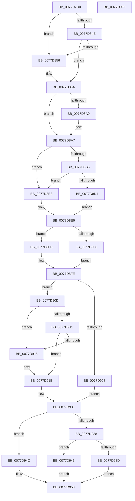

# TtmpUpdateTerminalState

- RVA: `0x0077D7D0`–`0x0077D981` (길이 `433` bytes)
- VA: `0x000000014077D7D0`
- 실행 섹션: `PAGE`
- PDB 이름 있음: `예`; PDB Function 태그: `아니요`
- unwind 정보 RVA: `0x000BD490`
- 디코드: `131`개 명령, `433/433` bytes 표시
- 미해석 바이트: `0` (있으면 어셈블리에 `.byte`로 보존)

> 이 문서는 커널 이미지의 기계어와 PDB 기호를 분석해 생성했습니다. 4번과 5번은 함수 원형과 자료형을 바이너리 사용 방식에서 추정한 C 해석이며 원본 소스 복구 결과는 아닙니다.

## 1. Dependencies

- 직접 호출 지점: **4**; 고유 호출 대상: **4**
- 직접 호출자로 확인된 함수: **1**
- RIP 상대 이미지 참조: **0**

### Outgoing calls
- `0x0077D87E` → [TtmpTsmIterate](TtmpTsmIterate_function_0077D6D4.md) (function, `0x0077D6D4`)
- `0x0077D88E` → [TtmiLogTerminalStateMachine](TtmiLogTerminalStateMachine_function_0077C4B4.md) (function, `0x0077C4B4`)
- `0x0077D8A2` → [TtmiResetInactivityTimer](TtmiResetInactivityTimer_function_0077CCF0.md) (function, `0x0077CCF0`)
- `0x0077D95A` → [TtmpResetEvaluationTimer](TtmpResetEvaluationTimer_function_0077D4E4.md) (function, `0x0077D4E4`)

### Direct callers
- [TtmiSessionTerminalListWorker](TtmiSessionTerminalListWorker_function_0077CE14.md) at `0x0077CF80`

### Static image references
- 디코드된 RIP-relative 메모리 참조가 없습니다.

## 2. Other-region calls and transfers

- 다른 실행 섹션으로 향하는 call: **0**
- 별도 외부 분기/꼬리 이동을 확인하지 못했습니다.

## 3. Assembly (complete function range)

```asm
0077D7D0  48 8B C4                        mov rax, rsp
0077D7D3  48 89 58 08                     mov qword ptr [rax + 8], rbx
0077D7D7  48 89 70 10                     mov qword ptr [rax + 0x10], rsi
0077D7DB  48 89 78 18                     mov qword ptr [rax + 0x18], rdi
0077D7DF  4C 89 60 20                     mov qword ptr [rax + 0x20], r12
0077D7E3  55                              push rbp
0077D7E4  41 56                           push r14
0077D7E6  41 57                           push r15
0077D7E8  48 8B EC                        mov rbp, rsp
0077D7EB  48 81 EC 80 00 00 00            sub rsp, 0x80
0077D7F2  8B 42 28                        mov eax, dword ptr [rdx + 0x28]
0077D7F5  45 33 E4                        xor r12d, r12d
0077D7F8  89 45 C0                        mov dword ptr [rbp - 0x40], eax
0077D7FB  0F 57 C0                        xorps xmm0, xmm0
0077D7FE  48 8B 42 50                     mov rax, qword ptr [rdx + 0x50]
0077D802  49 BE 08 00 00 00 80 F7 FF FF   movabs r14, 0xfffff78000000008
0077D80C  48 89 45 C8                     mov qword ptr [rbp - 0x38], rax
0077D810  4D 8B F9                        mov r15, r9
0077D813  49 8B F8                        mov rdi, r8
0077D816  44 89 65 C4                     mov dword ptr [rbp - 0x3c], r12d
0077D81A  48 8B DA                        mov rbx, rdx
0077D81D  66 44 89 65 EA                  mov word ptr [rbp - 0x16], r12w
0077D822  4D 8B 36                        mov r14, qword ptr [r14]
0077D825  48 8B 42 40                     mov rax, qword ptr [rdx + 0x40]
0077D829  48 89 45 D8                     mov qword ptr [rbp - 0x28], rax
0077D82D  48 8B 42 48                     mov rax, qword ptr [rdx + 0x48]
0077D831  48 89 45 E0                     mov qword ptr [rbp - 0x20], rax
0077D835  8B 42 24                        mov eax, dword ptr [rdx + 0x24]
0077D838  44 89 65 F0                     mov dword ptr [rbp - 0x10], r12d
0077D83C  0F 11 45 A0                     movups xmmword ptr [rbp - 0x60], xmm0
0077D840  4C 89 75 D0                     mov qword ptr [rbp - 0x30], r14
0077D844  0F 11 45 B0                     movups xmmword ptr [rbp - 0x50], xmm0
0077D848  44 39 62 20                     cmp dword ptr [rdx + 0x20], r12d
0077D84C  77 08                           ja 0x14077d856
0077D84E  44 88 65 E8                     mov byte ptr [rbp - 0x18], r12b
0077D852  A8 08                           test al, 8
0077D854  74 04                           je 0x14077d85a
0077D856  C6 45 E8 01                     mov byte ptr [rbp - 0x18], 1
0077D85A  8B 72 38                        mov esi, dword ptr [rdx + 0x38]
0077D85D  48 8D 4D C0                     lea rcx, [rbp - 0x40]
0077D861  A8 60                           test al, 0x60
0077D863  89 75 F0                        mov dword ptr [rbp - 0x10], esi
0077D866  0F 95 45 E9                     setne byte ptr [rbp - 0x17]
0077D86A  83 E0 9F                        and eax, 0xffffff9f
0077D86D  89 42 24                        mov dword ptr [rdx + 0x24], eax
0077D870  8B 42 34                        mov eax, dword ptr [rdx + 0x34]
0077D873  4C 89 62 34                     mov qword ptr [rdx + 0x34], r12
0077D877  48 8D 55 A0                     lea rdx, [rbp - 0x60]
0077D87B  89 45 EC                        mov dword ptr [rbp - 0x14], eax
0077D87E  E8 51 FE FF FF                  call 0x14077d6d4
0077D883  8B 4B 1C                        mov ecx, dword ptr [rbx + 0x1c]
0077D886  4C 8D 45 A0                     lea r8, [rbp - 0x60]
0077D88A  48 8D 55 C0                     lea rdx, [rbp - 0x40]
0077D88E  E8 21 EC FF FF                  call 0x14077c4b4
0077D893  48 8B 45 B0                     mov rax, qword ptr [rbp - 0x50]
0077D897  48 89 43 50                     mov qword ptr [rbx + 0x50], rax
0077D89B  49 3B C6                        cmp rax, r14
0077D89E  75 07                           jne 0x14077d8a7
0077D8A0  8B CE                           mov ecx, esi
0077D8A2  E8 49 F4 FF FF                  call 0x14077ccf0
0077D8A7  44 8B 45 A0                     mov r8d, dword ptr [rbp - 0x60]
0077D8AB  44 89 43 28                     mov dword ptr [rbx + 0x28], r8d
0077D8AF  44 38 65 A4                     cmp byte ptr [rbp - 0x5c], r12b
0077D8B3  74 2E                           je 0x14077d8e3
0077D8B5  8B 45 A8                        mov eax, dword ptr [rbp - 0x58]
0077D8B8  41 83 F8 01                     cmp r8d, 1
0077D8BC  8B 53 24                        mov edx, dword ptr [rbx + 0x24]
0077D8BF  41 8B CC                        mov ecx, r12d
0077D8C2  89 43 2C                        mov dword ptr [rbx + 0x2c], eax
0077D8C5  0F 95 C1                        setne cl
0077D8C8  8B C2                           mov eax, edx
0077D8CA  C1 E8 04                        shr eax, 4
0077D8CD  83 E0 01                        and eax, 1
0077D8D0  3B C1                           cmp eax, ecx
0077D8D2  74 0F                           je 0x14077d8e3
0077D8D4  C1 E1 04                        shl ecx, 4
0077D8D7  83 E2 EF                        and edx, 0xffffffef
0077D8DA  0B CA                           or ecx, edx
0077D8DC  B0 01                           mov al, 1
0077D8DE  89 4B 24                        mov dword ptr [rbx + 0x24], ecx
0077D8E1  EB 03                           jmp 0x14077d8e6
0077D8E3  41 8A C4                        mov al, r12b
0077D8E6  88 07                           mov byte ptr [rdi], al
0077D8E8  8B 43 24                        mov eax, dword ptr [rbx + 0x24]
0077D8EB  44 8B 43 2C                     mov r8d, dword ptr [rbx + 0x2c]
0077D8EF  C1 E8 03                        shr eax, 3
0077D8F2  A8 01                           test al, 1
0077D8F4  75 05                           jne 0x14077d8fb
0077D8F6  8B 43 28                        mov eax, dword ptr [rbx + 0x28]
0077D8F9  EB 03                           jmp 0x14077d8fe
0077D8FB  41 8B C4                        mov eax, r12d
0077D8FE  8B 8B 14 01 00 00               mov ecx, dword ptr [rbx + 0x114]
0077D904  3B C8                           cmp ecx, eax
0077D906  75 05                           jne 0x14077d90d
0077D908  41 8A D4                        mov dl, r12b
0077D90B  EB 24                           jmp 0x14077d931
0077D90D  85 C9                           test ecx, ecx
0077D90F  74 04                           je 0x14077d915
0077D911  85 C0                           test eax, eax
0077D913  75 06                           jne 0x14077d91b
0077D915  41 B8 16 00 00 00               mov r8d, 0x16
0077D91B  B9 18 01 00 00                  mov ecx, 0x118
0077D920  48 8B D3                        mov rdx, rbx
0077D923  B2 01                           mov dl, 1
0077D925  44 89 04 19                     mov dword ptr [rcx + rbx], r8d
0077D929  8B C8                           mov ecx, eax
0077D92B  89 83 14 01 00 00               mov dword ptr [rbx + 0x114], eax
0077D931  41 88 17                        mov byte ptr [r15], dl
0077D934  85 C9                           test ecx, ecx
0077D936  74 14                           je 0x14077d94c
0077D938  83 F9 01                        cmp ecx, 1
0077D93B  74 06                           je 0x14077d943
0077D93D  44 89 63 30                     mov dword ptr [rbx + 0x30], r12d
0077D941  EB 10                           jmp 0x14077d953
0077D943  C7 43 30 02 00 00 00            mov dword ptr [rbx + 0x30], 2
0077D94A  EB 07                           jmp 0x14077d953
0077D94C  C7 43 30 01 00 00 00            mov dword ptr [rbx + 0x30], 1
0077D953  48 8B 55 B8                     mov rdx, qword ptr [rbp - 0x48]
0077D957  48 8B CB                        mov rcx, rbx
0077D95A  E8 85 FB FF FF                  call 0x14077d4e4
0077D95F  4C 8D 9C 24 80 00 00 00         lea r11, [rsp + 0x80]
0077D967  49 8B 5B 20                     mov rbx, qword ptr [r11 + 0x20]
0077D96B  49 8B 73 28                     mov rsi, qword ptr [r11 + 0x28]
0077D96F  49 8B 7B 30                     mov rdi, qword ptr [r11 + 0x30]
0077D973  4D 8B 63 38                     mov r12, qword ptr [r11 + 0x38]
0077D977  49 8B E3                        mov rsp, r11
0077D97A  41 5F                           pop r15
0077D97C  41 5E                           pop r14
0077D97E  5D                              pop rbp
0077D97F  C3                              ret
0077D980  CC                              int3
```

## 4. C-style interpretation (structured pseudocode)

```c
__int64 __fastcall TtmpUpdateTerminalState(__int64 a1, __int64 a2, __int64 a3, __int64 a4)
{
    __int64 result;
    __int64 v_r12;
    __int64 v_rsp;
    unsigned __int64 v_stack_m18;
    unsigned int v_stack_m28;
    unsigned int v_stack_m2C;
    unsigned __int16 v_stack_m2E;
    unsigned __int8 v_stack_m2F;
    unsigned __int8 v_stack_m30;
    unsigned __int64 v_stack_m38;
    unsigned __int64 v_stack_m40;
    unsigned __int64 v_stack_m48;
    unsigned __int64 v_stack_m50;
    unsigned int v_stack_m54;
    unsigned int v_stack_m58;
    unsigned __int64 v_stack_m60;
    unsigned __int64 v_stack_m68;
    unsigned int v_stack_m70;
    unsigned __int8 v_stack_m74;
    unsigned __int64 v_stack_m78;

    *(unsigned __int64 *)(v_rsp + 8) = v_rbx;
    *(unsigned __int64 *)(v_rsp + 16) = v_rsi;
    *(unsigned __int64 *)(v_rsp + 24) = v_rdi;
    *(unsigned __int64 *)(v_rsp + 32) = v_r12;
    v_rsp = (v_rsp) - (128);
    v_r12 = 0;
    v_stack_m58 = (unsigned int)((unsigned int)(*(unsigned int *)(a2 + 40)));
    v_stack_m50 = *(unsigned __int64 *)(a2 + 80);
    v_stack_m54 = 0;
    v_stack_m2E = 0;
    v_stack_m40 = *(unsigned __int64 *)(a2 + 64);
    v_stack_m38 = *(unsigned __int64 *)(a2 + 72);
    v_stack_m28 = 0;
    v_stack_m78 = v_xmm0;
    v_stack_m48 = *(unsigned __int64 *)(v_r14);
    v_stack_m68 = v_xmm0;
    if ((*(unsigned int *)(a2 + 32)) > 0) goto loc_0077D856;
    v_stack_m30 = 0;
    if ((((unsigned __int8)((unsigned int)(*(unsigned int *)(a2 + 36)))) & (8)) != 0) {
        v_stack_m30 = 1;
    }
    v_stack_m28 = (unsigned int)((unsigned int)(*(unsigned int *)(a2 + 56)));
    result = (unsigned int)(((unsigned int)(*(unsigned int *)(a2 + 36))) & (0xFFFFFF9FULL));
    *(unsigned int *)(a2 + 36) = (unsigned int)(result);
    *(unsigned __int64 *)(a2 + 52) = 0;
    v_stack_m2C = (unsigned int)((unsigned int)(*(unsigned int *)(a2 + 52)));
    result = TtmpTsmIterate(v_stack_m58, v_stack_m78, a3, a4);
    result = TtmiLogTerminalStateMachine((unsigned int)(*(unsigned int *)(a2 + 28)), v_stack_m58, v_stack_m78, a4);
    *(unsigned __int64 *)(a2 + 80) = v_stack_m68;
    result = v_stack_m68;
    if (v_stack_m68 == (*(unsigned __int64 *)(v_r14))) {
        a1 = (unsigned int)((unsigned int)(*(unsigned int *)(a2 + 56)));
        result = TtmiResetInactivityTimer(a1, v_stack_m58, v_stack_m78, a4);
    }
    *(unsigned int *)(a2 + 40) = (unsigned int)((unsigned int)(v_stack_m78));
    if (v_stack_m74 == 0) goto loc_0077D8E3;
    *(unsigned int *)(a2 + 44) = (unsigned int)((unsigned int)(v_stack_m70));
    a1 = (((unsigned int)((unsigned int)(v_stack_m78))) != 1) ? 1 : 0;
    result = (unsigned int)(((unsigned int)((unsigned int)((unsigned int)(*(unsigned int *)(a2 + 36))))) >> (4));
    result = (unsigned int)((result) & (1));
    if (((unsigned int)(result)) == ((unsigned int)(a1))) goto loc_0077D8E3;
    a1 = (unsigned int)((a1) << (4));
    a2 = (unsigned int)(((unsigned int)(*(unsigned int *)(a2 + 36))) & (0xFFFFFFEFULL));
    a1 = (unsigned int)((a1) | ((unsigned int)(a2)));
    *(unsigned int *)(a2 + 36) = (unsigned int)(a1);
    goto loc_0077D8E6;
loc_0077D8E3:
loc_0077D8E6:
    *(unsigned __int8 *)(a3) = 0;
    result = (unsigned int)(((unsigned int)(*(unsigned int *)(a2 + 36))) >> (3));
    if ((((unsigned __int8)(result)) & (1)) != 0) goto loc_0077D8FB;
    goto loc_0077D8FE;
loc_0077D8FB:
loc_0077D8FE:
    if (((unsigned int)((unsigned int)(*(unsigned int *)(a2 + 276)))) != 0) goto loc_0077D90D;
    goto loc_0077D931;
loc_0077D90D:
    if ((unsigned int)((unsigned int)(*(unsigned int *)(a2 + 276))) == 0) goto loc_0077D915;
    if (0 == 0) {
        a3 = 22;
    }
    *(unsigned int *)(280 + a2 * 1) = (unsigned int)(a3);
    *(unsigned int *)(a2 + 276) = 0;
loc_0077D931:
    *(unsigned __int8 *)(a4) = 1;
    if (0 == 0) goto loc_0077D94C;
    if (0 == 1) goto loc_0077D943;
    *(unsigned int *)(a2 + 48) = 0;
    goto loc_0077D953;
loc_0077D943:
    *(unsigned int *)(a2 + 48) = 2;
    goto loc_0077D953;
loc_0077D94C:
    *(unsigned int *)(a2 + 48) = 1;
loc_0077D953:
    result = TtmpResetEvaluationTimer(a2, v_stack_m60, a3, a4);
    return result;
}
```

## 5. (Beta) C Style

```c
int64_t TtmpUpdateTerminalState(int64_t Arg1, void *Arg2, void *Arg3, void *Arg4)
{
    uint8_t *arg2 = (uint8_t *)Arg2;
    uint8_t *arg3 = (uint8_t *)Arg3;
    uint8_t *arg4 = (uint8_t *)Arg4;

    int64_t result;
    int64_t local_r12;
    int64_t local_rsp;
    uint64_t v_stack_m18;
    uint32_t v_stack_m28;
    uint32_t v_stack_m2C;
    uint16_t v_stack_m2E;
    uint8_t v_stack_m2F;
    uint8_t v_stack_m30;
    uint64_t v_stack_m38;
    uint64_t v_stack_m40;
    uint64_t v_stack_m48;
    uint64_t v_stack_m50;
    uint32_t v_stack_m54;
    uint32_t v_stack_m58;
    uint64_t v_stack_m60;
    uint64_t v_stack_m68;
    uint32_t v_stack_m70;
    uint8_t v_stack_m74;
    uint64_t v_stack_m78;

    *(uint64_t *)(local_rsp + 0x8) = local_rbx;
    *(uint64_t *)(local_rsp + 0x10) = local_rsi;
    *(uint64_t *)(local_rsp + 0x18) = local_rdi;
    *(uint64_t *)(local_rsp + 0x20) = local_r12;
    local_rsp = (local_rsp) - (128);
    local_r12 = 0;
    v_stack_m58 = (uint32_t)((uint32_t)(*(uint32_t *)(arg2 + 0x28)));
    v_stack_m50 = *(uint64_t *)(arg2 + 0x50);
    v_stack_m54 = 0;
    v_stack_m2E = 0;
    v_stack_m40 = *(uint64_t *)(arg2 + 0x40);
    v_stack_m38 = *(uint64_t *)(arg2 + 0x48);
    v_stack_m28 = 0;
    v_stack_m78 = v_xmm0;
    v_stack_m48 = *(uint64_t *)(local_r14);
    v_stack_m68 = v_xmm0;
    if ((*(uint32_t *)(arg2 + 0x20)) > 0) goto loc_0077D856;
    v_stack_m30 = 0;
    if ((((uint8_t)((uint32_t)(*(uint32_t *)(arg2 + 0x24)))) & (8)) != 0) {
        v_stack_m30 = 1;
    }
    v_stack_m28 = (uint32_t)((uint32_t)(*(uint32_t *)(arg2 + 0x38)));
    result = (uint32_t)(((uint32_t)(*(uint32_t *)(arg2 + 0x24))) & (0xFFFFFF9FULL));
    *(uint32_t *)(arg2 + 0x24) = (uint32_t)(result);
    *(uint64_t *)(arg2 + 0x34) = 0;
    v_stack_m2C = (uint32_t)((uint32_t)(*(uint32_t *)(arg2 + 0x34)));
    result = TtmpTsmIterate(v_stack_m58, v_stack_m78, Arg3, Arg4);
    result = TtmiLogTerminalStateMachine((uint32_t)(*(uint32_t *)(arg2 + 0x1C)), v_stack_m58, v_stack_m78, Arg4);
    *(uint64_t *)(arg2 + 0x50) = v_stack_m68;
    result = v_stack_m68;
    if (v_stack_m68 == (*(uint64_t *)(local_r14))) {
        Arg1 = (uint32_t)((uint32_t)(*(uint32_t *)(arg2 + 0x38)));
        result = TtmiResetInactivityTimer(Arg1, v_stack_m58, v_stack_m78, Arg4);
    }
    *(uint32_t *)(arg2 + 0x28) = (uint32_t)((uint32_t)(v_stack_m78));
    if (v_stack_m74 == 0) goto loc_0077D8E3;
    *(uint32_t *)(arg2 + 0x2C) = (uint32_t)((uint32_t)(v_stack_m70));
    Arg1 = (((uint32_t)((uint32_t)(v_stack_m78))) != 1) ? 1 : 0;
    result = (uint32_t)(((uint32_t)((uint32_t)((uint32_t)(*(uint32_t *)(arg2 + 0x24))))) >> (4));
    result = (uint32_t)((result) & (1));
    if (((uint32_t)(result)) == ((uint32_t)(Arg1))) goto loc_0077D8E3;
    Arg1 = (uint32_t)((Arg1) << (4));
    Arg2 = (uint32_t)(((uint32_t)(*(uint32_t *)(arg2 + 0x24))) & (0xFFFFFFEFULL));
    Arg1 = (uint32_t)((Arg1) | ((uint32_t)(Arg2)));
    *(uint32_t *)(arg2 + 0x24) = (uint32_t)(Arg1);
    goto loc_0077D8E6;
loc_0077D8E3:
loc_0077D8E6:
    *(uint8_t *)(arg3) = 0;
    result = (uint32_t)(((uint32_t)(*(uint32_t *)(arg2 + 0x24))) >> (3));
    if ((((uint8_t)(result)) & (1)) != 0) goto loc_0077D8FB;
    goto loc_0077D8FE;
loc_0077D8FB:
loc_0077D8FE:
    if (((uint32_t)((uint32_t)(*(uint32_t *)(arg2 + 0x114)))) != 0) goto loc_0077D90D;
    goto loc_0077D931;
loc_0077D90D:
    if ((uint32_t)((uint32_t)(*(uint32_t *)(arg2 + 0x114))) == 0) goto loc_0077D915;
    if (0 == 0) {
        Arg3 = 22;
    }
    *(uint32_t *)(280 + arg2 * 1) = (uint32_t)(Arg3);
    *(uint32_t *)(arg2 + 0x114) = 0;
loc_0077D931:
    *(uint8_t *)(arg4) = 1;
    if (0 == 0) goto loc_0077D94C;
    if (0 == 1) goto loc_0077D943;
    *(uint32_t *)(arg2 + 0x30) = 0;
    goto loc_0077D953;
loc_0077D943:
    *(uint32_t *)(arg2 + 0x30) = 2;
    goto loc_0077D953;
loc_0077D94C:
    *(uint32_t *)(arg2 + 0x30) = 1;
loc_0077D953:
    result = TtmpResetEvaluationTimer(Arg2, v_stack_m60, Arg3, Arg4);
    return result;
}
```

### 관측된 메모리 오프셋

구조체 형식이 확인되지 않은 접근은 인자 기준의 오프셋으로만 기록했습니다.

| 기준 인자 | 오프셋 표현 | 폭 (bit) | 접근 |
|---|---:|---:|---|
| `Arg2` | `+ 0x1C` | `32` | `R` |
| `Arg2` | `+ 0x20` | `32` | `R` |
| `Arg2` | `+ 0x24` | `32` | `R` |
| `Arg2` | `+ 0x24` | `32` | `W` |
| `Arg2` | `+ 0x28` | `32` | `R` |
| `Arg2` | `+ 0x28` | `32` | `W` |
| `Arg2` | `+ 0x2C` | `32` | `R` |
| `Arg2` | `+ 0x2C` | `32` | `W` |
| `Arg2` | `+ 0x30` | `32` | `W` |
| `Arg2` | `+ 0x34` | `32` | `R` |
| `Arg2` | `+ 0x34` | `64` | `W` |
| `Arg2` | `+ 0x38` | `32` | `R` |
| `Arg2` | `+ 0x40` | `64` | `R` |
| `Arg2` | `+ 0x48` | `64` | `R` |
| `Arg2` | `+ 0x50` | `64` | `R` |
| `Arg2` | `+ 0x50` | `64` | `W` |
| `Arg2` | `+ 0x114` | `32` | `R` |
| `Arg2` | `+ 0x114` | `32` | `W` |
| `Arg3` | `+ 0x0` | `8` | `W` |
| `Arg4` | `+ 0x0` | `8` | `W` |

## 6. Execution-region graph

[열기: 2D/3D 그래프와 함수 탐색 컨트롤 패널](../../../control-panel.html?section=page&rva=0x0077D7D0&view=graph)

- 2D 그래프는 위에서 아래로 흐르고, 3D 그래프는 빈 공간을 드래그해 회전합니다. Shift+드래그는 이동, 휠은 확대·축소, 함수 노드 선택은 대상 보고서 이동입니다.

### Static fallback


