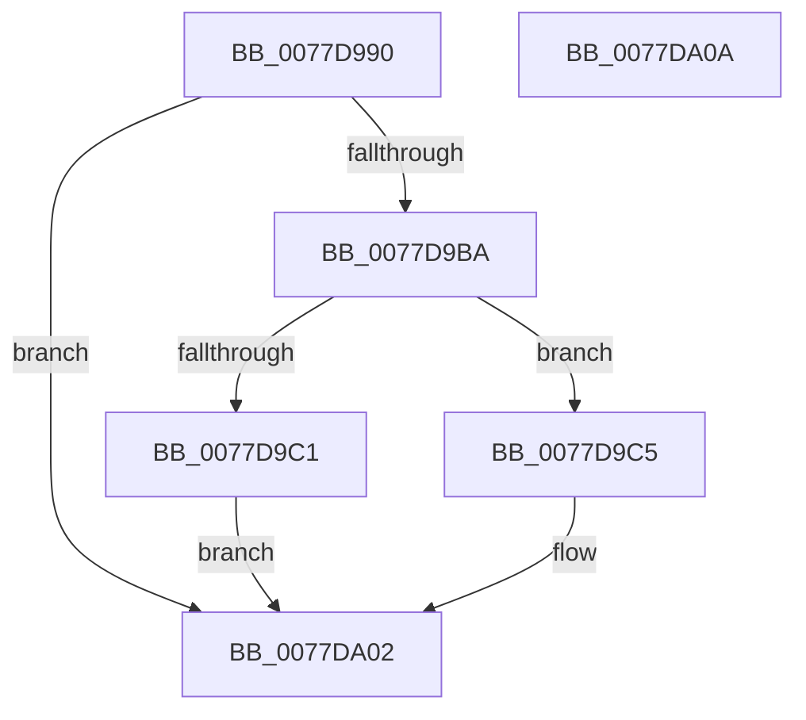

# TtmpWnfInactivityTimeoutCallback

- RVA: `0x0077D990`–`0x0077DA0B` (길이 `123` bytes)
- VA: `0x000000014077D990`
- 실행 섹션: `PAGE`
- PDB 이름 있음: `예`; PDB Function 태그: `아니요`
- unwind 정보 RVA: `0x000AA39C`
- 디코드: `33`개 명령, `123/123` bytes 표시
- 미해석 바이트: `0` (있으면 어셈블리에 `.byte`로 보존)

> 이 문서는 커널 이미지의 기계어와 PDB 기호를 분석해 생성했습니다. 4번과 5번은 함수 원형과 자료형을 바이너리 사용 방식에서 추정한 C 해석이며 원본 소스 복구 결과는 아닙니다.

## 1. Dependencies

- 직접 호출 지점: **5**; 고유 호출 대상: **5**
- 직접 호출자로 확인된 함수: **0**
- RIP 상대 이미지 참조: **2**

### Outgoing calls
- `0x0077D9AF` → [ExQueryWnfStateData](../A4/ExQueryWnfStateData_function_00A4A480.md) (function, `0x00A4A480`)
- `0x0077D9CE` → [ExAcquireResourceExclusiveLite](../../text/21/ExAcquireResourceExclusiveLite_function_00214E20.md) (function, `0x00214E20`)
- `0x0077D9E7` → [TtmiLogInactivityTimoutUpdate](TtmiLogInactivityTimoutUpdate_function_0077A43C.md) (function, `0x0077A43C`)
- `0x0077D9F3` → [ExReleaseResourceLite](../../text/25/ExReleaseResourceLite_function_0025FA10.md) (function, `0x0025FA10`)
- `0x0077D9FD` → [TtmiResetInactivityTimer](TtmiResetInactivityTimer_function_0077CCF0.md) (function, `0x0077CCF0`)

### Direct callers
- 이 함수 시작 RVA로 연결되는 직접 call은 확인되지 않았습니다. 간접 호출은 완전히 역산할 수 없습니다.

### Static image references
- `0x0077D9C7` → RVA `0x00F067E0` (`.data`; read)
- `0x0077D9E0` → RVA `0x00F068E0` (`.data`; write)

## 2. Other-region calls and transfers

- 다른 실행 섹션으로 향하는 call: **2**
  - `0x0077D9CE` → [ExAcquireResourceExclusiveLite](../../text/21/ExAcquireResourceExclusiveLite_function_00214E20.md) (`PAGE` → `.text`)
  - `0x0077D9F3` → [ExReleaseResourceLite](../../text/25/ExReleaseResourceLite_function_0025FA10.md) (`PAGE` → `.text`)
- 별도 외부 분기/꼬리 이동을 확인하지 못했습니다.

## 3. Assembly (complete function range)

```asm
0077D990  48 8B C4                        mov rax, rsp
0077D993  53                              push rbx
0077D994  48 83 EC 30                     sub rsp, 0x30
0077D998  83 60 EC 00                     and dword ptr [rax - 0x14], 0
0077D99C  4C 8D 48 E8                     lea r9, [rax - 0x18]
0077D9A0  4C 8D 40 EC                     lea r8, [rax - 0x14]
0077D9A4  C7 40 E8 04 00 00 00            mov dword ptr [rax - 0x18], 4
0077D9AB  48 8D 50 20                     lea rdx, [rax + 0x20]
0077D9AF  E8 CC CA 2C 00                  call 0x140a4a480
0077D9B4  8B D8                           mov ebx, eax
0077D9B6  85 C0                           test eax, eax
0077D9B8  78 48                           js 0x14077da02
0077D9BA  83 7C 24 20 04                  cmp dword ptr [rsp + 0x20], 4
0077D9BF  74 04                           je 0x14077d9c5
0077D9C1  33 DB                           xor ebx, ebx
0077D9C3  EB 3D                           jmp 0x14077da02
0077D9C5  B2 01                           mov dl, 1
0077D9C7  48 8D 0D 12 8E 78 00            lea rcx, [rip + 0x788e12]
0077D9CE  E8 4D 74 A9 FF                  call 0x140214e20
0077D9D3  8B 4C 24 24                     mov ecx, dword ptr [rsp + 0x24]
0077D9D7  69 D1 10 27 00 00               imul edx, ecx, 0x2710
0077D9DD  48 F7 DA                        neg rdx
0077D9E0  48 89 15 F9 8E 78 00            mov qword ptr [rip + 0x788ef9], rdx
0077D9E7  E8 50 CA FF FF                  call 0x14077a43c
0077D9EC  48 8D 0D ED 8D 78 00            lea rcx, [rip + 0x788ded]
0077D9F3  E8 18 20 AE FF                  call 0x14025fa10
0077D9F8  B9 0D 00 00 00                  mov ecx, 0xd
0077D9FD  E8 EE F2 FF FF                  call 0x14077ccf0
0077DA02  8B C3                           mov eax, ebx
0077DA04  48 83 C4 30                     add rsp, 0x30
0077DA08  5B                              pop rbx
0077DA09  C3                              ret
0077DA0A  CC                              int3
```

## 4. C-style interpretation (structured pseudocode)

```c
__int64 __fastcall TtmpWnfInactivityTimeoutCallback(void)
{
    __int64 result;
    __int64 v_rbx;
    __int64 v_rsp;
    unsigned int v_stack_m14;
    unsigned int v_stack_m18;

    v_rsp = (v_rsp) - (48);
    *(unsigned int *)(v_rsp - 24) = 4;
    result = ExQueryWnfStateData(a1, v_rsp + 32, v_rsp - 20, v_rsp - 24);
    if (sign_flag) goto loc_0077DA02;
    if (v_stack_m18 == 4) goto loc_0077D9C5;
    v_rbx = 0;
    goto loc_0077DA02;
loc_0077D9C5:
    result = ExAcquireResourceExclusiveLite(v_rip + 7900690, 1, v_rsp - 20, v_rsp - 24);
    a2 = (unsigned int)((1) * ((unsigned int)((unsigned int)(v_stack_m14))));
    a2 = -(a2);
    *(unsigned __int64 *)(v_rip + 7900921) = a2;
    result = TtmiLogInactivityTimoutUpdate((unsigned int)(v_stack_m14), a2, v_rsp - 20, v_rsp - 24);
    result = ExReleaseResourceLite(v_rip + 7900653, a2, v_rsp - 20, v_rsp - 24);
    result = TtmiResetInactivityTimer(13, a2, v_rsp - 20, v_rsp - 24);
loc_0077DA02:
    v_rsp = (v_rsp) + (48);
    return 0;
}
```

## 5. (Beta) C Style

```c
void TtmpWnfInactivityTimeoutCallback(void)
{
    int64_t result;
    int64_t local_rbx;
    int64_t local_rsp;
    uint32_t v_stack_m14;
    uint32_t v_stack_m18;

    local_rsp = (local_rsp) - (48);
    *(uint32_t *)(local_rsp - 0x18) = 4;
    result = ExQueryWnfStateData(a1, local_rsp + 32, local_rsp - 20, local_rsp - 24);
    if (sign_flag) goto loc_0077DA02;
    if (v_stack_m18 == 4) goto loc_0077D9C5;
    local_rbx = 0;
    goto loc_0077DA02;
loc_0077D9C5:
    result = ExAcquireResourceExclusiveLite(v_rip + 7900690, 1, local_rsp - 20, local_rsp - 24);
    a2 = (uint32_t)((1) * ((uint32_t)((uint32_t)(v_stack_m14))));
    a2 = -(a2);
    *(uint64_t *)(v_rip + 0x788EF9) = a2;
    result = TtmiLogInactivityTimoutUpdate((uint32_t)(v_stack_m14), a2, local_rsp - 20, local_rsp - 24);
    result = ExReleaseResourceLite(v_rip + 7900653, a2, local_rsp - 20, local_rsp - 24);
    result = TtmiResetInactivityTimer(13, a2, local_rsp - 20, local_rsp - 24);
loc_0077DA02:
    local_rsp = (local_rsp) + (48);
    return 0;
}
```

## 6. Execution-region graph

[열기: 2D/3D 그래프와 함수 탐색 컨트롤 패널](../../../control-panel.html?section=page&rva=0x0077D990&view=graph)

- 2D 그래프는 위에서 아래로 흐르고, 3D 그래프는 빈 공간을 드래그해 회전합니다. Shift+드래그는 이동, 휠은 확대·축소, 함수 노드 선택은 대상 보고서 이동입니다.

### Static fallback


