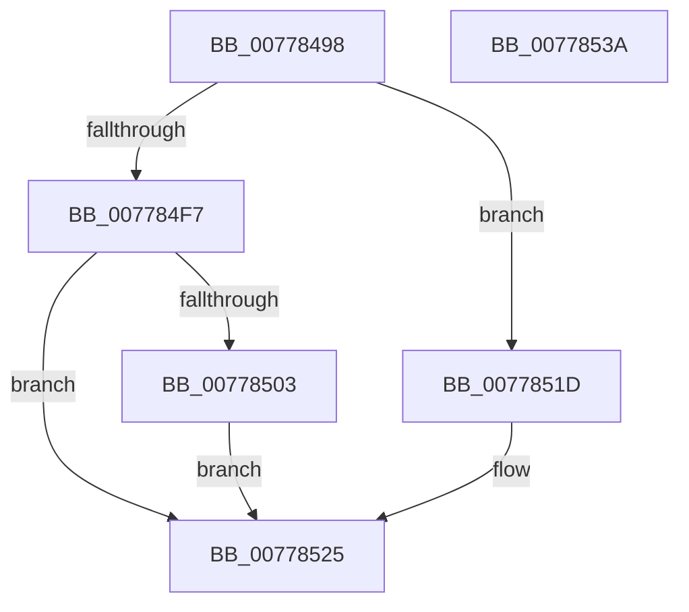

# TtmpWriteDisplayRequiredPowerRequestUpdatedEvent

- RVA: `0x00778498`–`0x0077853B` (길이 `163` bytes)
- VA: `0x0000000140778498`
- 실행 섹션: `PAGE`
- PDB 이름 있음: `예`; PDB Function 태그: `아니요`
- unwind 정보 RVA: `0x000CDC6C`
- 디코드: `42`개 명령, `163/163` bytes 표시
- 미해석 바이트: `0` (있으면 어셈블리에 `.byte`로 보존)

> 이 문서는 커널 이미지의 기계어와 PDB 기호를 분석해 생성했습니다. 4번과 5번은 함수 원형과 자료형을 바이너리 사용 방식에서 추정한 C 해석이며 원본 소스 복구 결과는 아닙니다.

## 1. Dependencies

- 직접 호출 지점: **4**; 고유 호출 대상: **4**
- 직접 호출자로 확인된 함수: **2**
- RIP 상대 이미지 참조: **1**

### Outgoing calls
- `0x007784C0` → [memset](../../text/6C/memset_function_006C6C40.md) (function, `0x006C6C40`)
- `0x007784FA` → [TtmiWriteEventToSingleQueue](TtmiWriteEventToSingleQueue_function_0077DE04.md) (function, `0x0077DE04`)
- `0x00778516` → [TtmiLogError](../98/TtmiLogError_function_0098B39C.md) (function, `0x0098B39C`)
- `0x00778520` → [TtmiWriteEventToAllQueues](TtmiWriteEventToAllQueues_function_007775AC.md) (function, `0x007775AC`)

### Direct callers
- [TtmpPublishDisplayRequiredPowerRequestEvents](TtmpPublishDisplayRequiredPowerRequestEvents_function_00777E14.md) at `0x00777EA4`
- [TtmpUpdateDisplayRequiredPowerRequest](TtmpUpdateDisplayRequiredPowerRequest_function_00778304.md) at `0x00778373`
- [TtmpUpdateDisplayRequiredPowerRequest](TtmpUpdateDisplayRequiredPowerRequest_function_00778304.md) at `0x00778399`

### Static image references
- `0x00778507` → RVA `0x00B042B0` (` ?? ::NNGAKEGL::`string'`; read)

## 2. Other-region calls and transfers

- 다른 실행 섹션으로 향하는 call: **1**
  - `0x007784C0` → [memset](../../text/6C/memset_function_006C6C40.md) (`PAGE` → `.text`)
- 별도 외부 분기/꼬리 이동을 확인하지 못했습니다.

## 3. Assembly (complete function range)

```asm
00778498  48 89 5C 24 08                  mov qword ptr [rsp + 8], rbx
0077849D  48 89 74 24 10                  mov qword ptr [rsp + 0x10], rsi
007784A2  57                              push rdi
007784A3  48 81 EC 40 02 00 00            sub rsp, 0x240
007784AA  49 8B D8                        mov rbx, r8
007784AD  48 8B FA                        mov rdi, rdx
007784B0  48 8B F1                        mov rsi, rcx
007784B3  33 D2                           xor edx, edx
007784B5  41 B8 20 02 00 00               mov r8d, 0x220
007784BB  48 8D 4C 24 20                  lea rcx, [rsp + 0x20]
007784C0  E8 7B E7 F4 FF                  call 0x1406c6c40
007784C5  8B 43 10                        mov eax, dword ptr [rbx + 0x10]
007784C8  48 8D 54 24 20                  lea rdx, [rsp + 0x20]
007784CD  83 7B 28 00                     cmp dword ptr [rbx + 0x28], 0
007784D1  89 44 24 28                     mov dword ptr [rsp + 0x28], eax
007784D5  8B 43 14                        mov eax, dword ptr [rbx + 0x14]
007784D8  0F 97 44 24 38                  seta byte ptr [rsp + 0x38]
007784DD  89 44 24 2C                     mov dword ptr [rsp + 0x2c], eax
007784E1  48 8B 43 20                     mov rax, qword ptr [rbx + 0x20]
007784E5  48 89 44 24 30                  mov qword ptr [rsp + 0x30], rax
007784EA  C7 44 24 20 06 00 00 00         mov dword ptr [rsp + 0x20], 6
007784F2  48 85 FF                        test rdi, rdi
007784F5  74 26                           je 0x14077851d
007784F7  48 8B CF                        mov rcx, rdi
007784FA  E8 05 59 00 00                  call 0x14077de04
007784FF  85 C0                           test eax, eax
00778501  79 22                           jns 0x140778525
00778503  41 83 C9 FF                     or r9d, 0xffffffff
00778507  48 8D 0D A2 BD 38 00            lea rcx, [rip + 0x38bda2]
0077850E  44 8B C0                        mov r8d, eax
00778511  BA 2C 02 00 00                  mov edx, 0x22c
00778516  E8 81 2E 21 00                  call 0x14098b39c
0077851B  EB 08                           jmp 0x140778525
0077851D  48 8B CE                        mov rcx, rsi
00778520  E8 87 F0 FF FF                  call 0x1407775ac
00778525  4C 8D 9C 24 40 02 00 00         lea r11, [rsp + 0x240]
0077852D  49 8B 5B 10                     mov rbx, qword ptr [r11 + 0x10]
00778531  49 8B 73 18                     mov rsi, qword ptr [r11 + 0x18]
00778535  49 8B E3                        mov rsp, r11
00778538  5F                              pop rdi
00778539  C3                              ret
0077853A  CC                              int3
```

## 4. C-style interpretation (structured pseudocode)

```c
__int64 __fastcall TtmpWriteDisplayRequiredPowerRequestUpdatedEvent(__int64 a1, __int64 a2, __int64 a3, int a4)
{
    __int64 result;
    __int64 v_rsp;
    unsigned __int8 v_stack_m210;
    unsigned __int64 v_stack_m218;
    unsigned int v_stack_m21C;
    unsigned int v_stack_m220;
    unsigned __int64 v_stack_m228;
    unsigned __int64 v_stack_m8;
    unsigned __int64 v_stack_p10;
    unsigned __int64 v_stack_p8;

    v_stack_p8 = v_rbx;
    v_stack_p10 = v_rsi;
    v_rsp = (v_rsp) - (576);
    a2 = 0;
    result = memset(v_stack_m228, a2, 544, a4);
    v_stack_m220 = (unsigned int)((unsigned int)(*(unsigned int *)(a3 + 16)));
    v_stack_m21C = (unsigned int)((unsigned int)(*(unsigned int *)(a3 + 20)));
    v_stack_m218 = *(unsigned __int64 *)(a3 + 32);
    v_stack_m228 = 6;
    if (0 == 0) goto loc_0077851D;
    result = TtmiWriteEventToSingleQueue(0, v_stack_m228, 544, a4);
    if (!sign_flag) goto loc_00778525;
    a4 = (unsigned int)((a4) | (0xFFFFFFFFULL));
    result = TtmiLogError(v_rip + 3718562, 556, (unsigned int)((unsigned int)(result)), a4);
    goto loc_00778525;
loc_0077851D:
    result = TtmiWriteEventToAllQueues(a1, 556, (unsigned int)((unsigned int)(result)), a4);
loc_00778525:
    return result;
}
```

## 5. (Beta) C Style

```c
int64_t TtmpWriteDisplayRequiredPowerRequestUpdatedEvent(int64_t Arg1, int64_t Arg2, void *Arg3, int32_t Arg4)
{
    uint8_t *arg3 = (uint8_t *)Arg3;

    int64_t result;
    int64_t local_rsp;
    uint8_t v_stack_m210;
    uint64_t v_stack_m218;
    uint32_t v_stack_m21C;
    uint32_t v_stack_m220;
    uint64_t v_stack_m228;
    uint64_t v_stack_m8;
    uint64_t v_stack_p10;
    uint64_t v_stack_p8;

    v_stack_p8 = local_rbx;
    v_stack_p10 = local_rsi;
    local_rsp = (local_rsp) - (576);
    Arg2 = 0;
    result = memset(v_stack_m228, Arg2, 544, Arg4);
    v_stack_m220 = (uint32_t)((uint32_t)(*(uint32_t *)(arg3 + 0x10)));
    v_stack_m21C = (uint32_t)((uint32_t)(*(uint32_t *)(arg3 + 0x14)));
    v_stack_m218 = *(uint64_t *)(arg3 + 0x20);
    v_stack_m228 = 6;
    if (0 == 0) goto loc_0077851D;
    result = TtmiWriteEventToSingleQueue(0, v_stack_m228, 544, Arg4);
    if (!sign_flag) goto loc_00778525;
    Arg4 = (uint32_t)((Arg4) | (0xFFFFFFFFULL));
    result = TtmiLogError(v_rip + 3718562, 556, (uint32_t)((uint32_t)(result)), Arg4);
    goto loc_00778525;
loc_0077851D:
    result = TtmiWriteEventToAllQueues(Arg1, 556, (uint32_t)((uint32_t)(result)), Arg4);
loc_00778525:
    return result;
}
```

### 관측된 메모리 오프셋

구조체 형식이 확인되지 않은 접근은 인자 기준의 오프셋으로만 기록했습니다.

| 기준 인자 | 오프셋 표현 | 폭 (bit) | 접근 |
|---|---:|---:|---|
| `Arg3` | `+ 0x10` | `32` | `R` |
| `Arg3` | `+ 0x14` | `32` | `R` |
| `Arg3` | `+ 0x20` | `64` | `R` |
| `Arg3` | `+ 0x28` | `32` | `R` |

## 6. Execution-region graph

[열기: 2D/3D 그래프와 함수 탐색 컨트롤 패널](../../../control-panel.html?section=page&rva=0x00778498&view=graph)

- 2D 그래프는 위에서 아래로 흐르고, 3D 그래프는 빈 공간을 드래그해 회전합니다. Shift+드래그는 이동, 휠은 확대·축소, 함수 노드 선택은 대상 보고서 이동입니다.

### Static fallback


