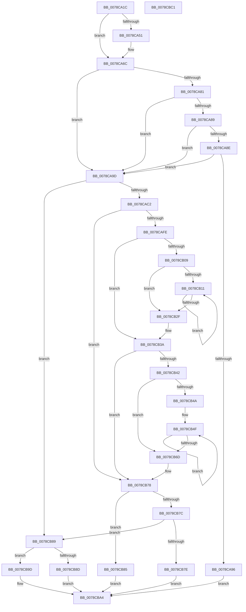

# CompareNamesCaseSensitive

- RVA: `0x0078CA1C`–`0x0078CBC2` (길이 `422` bytes)
- VA: `0x000000014078CA1C`
- 실행 섹션: `PAGE`
- PDB 이름 있음: `예`; PDB Function 태그: `아니요`
- unwind 정보 RVA: `0x0005D79C`
- 디코드: `134`개 명령, `422/422` bytes 표시
- 미해석 바이트: `0` (있으면 어셈블리에 `.byte`로 보존)

> 이 문서는 커널 이미지의 기계어와 PDB 기호를 분석해 생성했습니다. 4번과 5번은 함수 원형과 자료형을 바이너리 사용 방식에서 추정한 C 해석이며 원본 소스 복구 결과는 아닙니다.

## 1. Dependencies

- 직접 호출 지점: **3**; 고유 호출 대상: **3**
- 직접 호출자로 확인된 함수: **2**
- RIP 상대 이미지 참조: **0**

### Outgoing calls
- `0x0078CA48` → [RtlpIsUtf8Process](../90/RtlpIsUtf8Process_function_0090DB60.md) (function, `0x0090DB60`)
- `0x0078CA55` → [PsGetCurrentServerSiloGlobals](../../text/2F/PsGetCurrentServerSiloGlobals_function_002FE1F0.md) (function, `0x002FE1F0`)
- `0x0078CAB2` → [RtlCompareMemory](../../text/6B/RtlCompareMemory_function_006BA670.md) (function, `0x006BA670`)

### Direct callers
- [PfxFindPrefix](PfxFindPrefix_function_0078CCA0.md) at `0x0078CCF7`
- [PfxInsertPrefix](PfxInsertPrefix_function_0078CDA0.md) at `0x0078CE15`

### Static image references
- 디코드된 RIP-relative 메모리 참조가 없습니다.

## 2. Other-region calls and transfers

- 다른 실행 섹션으로 향하는 call: **2**
  - `0x0078CA55` → [PsGetCurrentServerSiloGlobals](../../text/2F/PsGetCurrentServerSiloGlobals_function_002FE1F0.md) (`PAGE` → `.text`)
  - `0x0078CAB2` → [RtlCompareMemory](../../text/6B/RtlCompareMemory_function_006BA670.md) (`PAGE` → `.text`)
- 별도 외부 분기/꼬리 이동을 확인하지 못했습니다.

## 3. Assembly (complete function range)

```asm
0078CA1C  48 89 5C 24 10                  mov qword ptr [rsp + 0x10], rbx
0078CA21  48 89 6C 24 18                  mov qword ptr [rsp + 0x18], rbp
0078CA26  48 89 74 24 20                  mov qword ptr [rsp + 0x20], rsi
0078CA2B  57                              push rdi
0078CA2C  41 54                           push r12
0078CA2E  41 55                           push r13
0078CA30  41 56                           push r14
0078CA32  41 57                           push r15
0078CA34  48 83 EC 20                     sub rsp, 0x20
0078CA38  4C 8B F1                        mov r14, rcx
0078CA3B  33 FF                           xor edi, edi
0078CA3D  33 C9                           xor ecx, ecx
0078CA3F  44 8A EF                        mov r13b, dil
0078CA42  44 8B E7                        mov r12d, edi
0078CA45  4C 8B FA                        mov r15, rdx
0078CA48  E8 13 11 18 00                  call 0x14090db60
0078CA4D  84 C0                           test al, al
0078CA4F  75 1B                           jne 0x14078ca6c
0078CA51  F0 09 3C 24                     lock or dword ptr [rsp], edi
0078CA55  E8 96 17 B7 FF                  call 0x1402fe1f0
0078CA5A  66 39 B8 14 04 00 00            cmp word ptr [rax + 0x414], di
0078CA61  4C 8B A0 98 04 00 00            mov r12, qword ptr [rax + 0x498]
0078CA68  41 0F 95 C5                     setne r13b
0078CA6C  41 0F B7 36                     movzx esi, word ptr [r14]
0078CA70  B8 5C 00 00 00                  mov eax, 0x5c
0078CA75  41 0F B7 2F                     movzx ebp, word ptr [r15]
0078CA79  8D 50 A5                        lea edx, [rax - 0x5b]
0078CA7C  66 3B F2                        cmp si, dx
0078CA7F  75 1C                           jne 0x14078ca9d
0078CA81  49 8B 4E 08                     mov rcx, qword ptr [r14 + 8]
0078CA85  38 01                           cmp byte ptr [rcx], al
0078CA87  75 14                           jne 0x14078ca9d
0078CA89  66 3B EA                        cmp bp, dx
0078CA8C  76 0F                           jbe 0x14078ca9d
0078CA8E  49 8B 4F 08                     mov rcx, qword ptr [r15 + 8]
0078CA92  38 01                           cmp byte ptr [rcx], al
0078CA94  75 07                           jne 0x14078ca9d
0078CA96  8B C2                           mov eax, edx
0078CA98  E9 07 01 00 00                  jmp 0x14078cba4
0078CA9D  49 8B 57 08                     mov rdx, qword ptr [r15 + 8]
0078CAA1  8B C6                           mov eax, esi
0078CAA3  49 8B 4E 08                     mov rcx, qword ptr [r14 + 8]
0078CAA7  66 3B F5                        cmp si, bp
0078CAAA  0F 43 C5                        cmovae eax, ebp
0078CAAD  44 8B C0                        mov r8d, eax
0078CAB0  8B D8                           mov ebx, eax
0078CAB2  E8 B9 DB F2 FF                  call 0x1406ba670
0078CAB7  4C 8B C0                        mov r8, rax
0078CABA  3B C3                           cmp eax, ebx
0078CABC  0F 83 C7 00 00 00               jae 0x14078cb89
0078CAC2  49 8B 47 08                     mov rax, qword ptr [r15 + 8]
0078CAC6  BA 5C 00 00 00                  mov edx, 0x5c
0078CACB  4D 8B 76 08                     mov r14, qword ptr [r14 + 8]
0078CACF  44 8B D7                        mov r10d, edi
0078CAD2  41 8B C8                        mov ecx, r8d
0078CAD5  44 8B DF                        mov r11d, edi
0078CAD8  48 89 44 24 50                  mov qword ptr [rsp + 0x50], rax
0078CADD  0F B6 1C 01                     movzx ebx, byte ptr [rcx + rax]
0078CAE1  46 0F B6 0C 31                  movzx r9d, byte ptr [rcx + r14]
0078CAE6  44 3A CA                        cmp r9b, dl
0078CAE9  45 0F 45 D1                     cmovne r10d, r9d
0078CAED  3A DA                           cmp bl, dl
0078CAEF  41 8A D2                        mov dl, r10b
0078CAF2  44 0F 45 DB                     cmovne r11d, ebx
0078CAF6  41 8A C3                        mov al, r11b
0078CAF9  45 84 ED                        test r13b, r13b
0078CAFC  74 7A                           je 0x14078cb78
0078CAFE  41 BD 5C 00 00 00               mov r13d, 0x5c
0078CB04  45 3A CD                        cmp r9b, r13b
0078CB07  75 31                           jne 0x14078cb3a
0078CB09  44 8B CF                        mov r9d, edi
0078CB0C  45 85 C0                        test r8d, r8d
0078CB0F  74 1E                           je 0x14078cb2f
0078CB11  41 8B C1                        mov eax, r9d
0078CB14  42 0F B6 0C 30                  movzx ecx, byte ptr [rax + r14]
0078CB19  41 0F B7 04 4C                  movzx eax, word ptr [r12 + rcx*2]
0078CB1E  66 F7 D8                        neg ax
0078CB21  1B C9                           sbb ecx, ecx
0078CB23  F7 D9                           neg ecx
0078CB25  FF C1                           inc ecx
0078CB27  44 03 C9                        add r9d, ecx
0078CB2A  45 3B C8                        cmp r9d, r8d
0078CB2D  72 E2                           jb 0x14078cb11
0078CB2F  45 3B C8                        cmp r9d, r8d
0078CB32  41 0F B6 D2                     movzx edx, r10b
0078CB36  41 0F 45 D5                     cmovne edx, r13d
0078CB3A  41 8A C3                        mov al, r11b
0078CB3D  41 3A DD                        cmp bl, r13b
0078CB40  75 36                           jne 0x14078cb78
0078CB42  44 8B CF                        mov r9d, edi
0078CB45  45 85 C0                        test r8d, r8d
0078CB48  74 23                           je 0x14078cb6d
0078CB4A  4C 8B 54 24 50                  mov r10, qword ptr [rsp + 0x50]
0078CB4F  41 8B C1                        mov eax, r9d
0078CB52  42 0F B6 0C 10                  movzx ecx, byte ptr [rax + r10]
0078CB57  41 0F B7 04 4C                  movzx eax, word ptr [r12 + rcx*2]
0078CB5C  66 F7 D8                        neg ax
0078CB5F  1B C9                           sbb ecx, ecx
0078CB61  F7 D9                           neg ecx
0078CB63  FF C1                           inc ecx
0078CB65  44 03 C9                        add r9d, ecx
0078CB68  45 3B C8                        cmp r9d, r8d
0078CB6B  72 E2                           jb 0x14078cb4f
0078CB6D  45 3B C8                        cmp r9d, r8d
0078CB70  41 0F B6 C3                     movzx eax, r11b
0078CB74  41 0F 45 C5                     cmovne eax, r13d
0078CB78  3A D0                           cmp dl, al
0078CB7A  72 09                           jb 0x14078cb85
0078CB7C  76 0B                           jbe 0x14078cb89
0078CB7E  B8 03 00 00 00                  mov eax, 3
0078CB83  EB 1F                           jmp 0x14078cba4
0078CB85  33 C0                           xor eax, eax
0078CB87  EB 1B                           jmp 0x14078cba4
0078CB89  3B EE                           cmp ebp, esi
0078CB8B  76 10                           jbe 0x14078cb9d
0078CB8D  49 8B 4F 08                     mov rcx, qword ptr [r15 + 8]
0078CB91  80 3C 0E 5C                     cmp byte ptr [rsi + rcx], 0x5c
0078CB95  40 0F 94 C7                     sete dil
0078CB99  8B C7                           mov eax, edi
0078CB9B  EB 07                           jmp 0x14078cba4
0078CB9D  1B C0                           sbb eax, eax
0078CB9F  F7 D8                           neg eax
0078CBA1  83 C0 02                        add eax, 2
0078CBA4  48 8B 5C 24 58                  mov rbx, qword ptr [rsp + 0x58]
0078CBA9  48 8B 6C 24 60                  mov rbp, qword ptr [rsp + 0x60]
0078CBAE  48 8B 74 24 68                  mov rsi, qword ptr [rsp + 0x68]
0078CBB3  48 83 C4 20                     add rsp, 0x20
0078CBB7  41 5F                           pop r15
0078CBB9  41 5E                           pop r14
0078CBBB  41 5D                           pop r13
0078CBBD  41 5C                           pop r12
0078CBBF  5F                              pop rdi
0078CBC0  C3                              ret
0078CBC1  CC                              int3
```

## 4. C-style interpretation (structured pseudocode)

```c
__int64 __fastcall CompareNamesCaseSensitive(__int64 a1, __int64 a2)
{
    __int64 result;
    __int64 v_r10;
    __int64 v_r11;
    __int64 v_r12;
    __int64 v_r13;
    __int64 v_rdi;
    __int64 v_rsp;
    unsigned int v_stack_m48;
    unsigned __int64 v_stack_p10;
    unsigned __int64 v_stack_p18;
    unsigned __int64 v_stack_p20;
    unsigned __int64 v_stack_p8;

    v_stack_p10 = v_rbx;
    v_stack_p18 = v_rbp;
    v_stack_p20 = v_rsi;
    v_rsp = (v_rsp) - (32);
    v_rdi = 0;
    a1 = 0;
    result = RtlpIsUtf8Process(a1, a2, a3, a4);
    v_r12 = 0;
    v_r13 = 0;
    if ((unsigned __int8)(result) == 0) {
        result = PsGetCurrentServerSiloGlobals(a1, a2, a3, a4);
        v_r12 = *(unsigned __int64 *)(result + 1176);
        v_r13 = ((*(unsigned __int16 *)(result + 1044)) != 0) ? 1 : 0;
    }
    if (((unsigned __int16)(*(unsigned __int16 *)(a1))) != ((unsigned __int16)(92 - 91))) goto loc_0078CA9D;
    if ((*(unsigned __int8 *)(*(unsigned __int64 *)(a1 + 8))) != 92) goto loc_0078CA9D;
    if (((unsigned __int16)(*(unsigned __int16 *)(a2))) <= ((unsigned __int16)(92 - 91))) goto loc_0078CA9D;
    if ((*(unsigned __int8 *)(*(unsigned __int64 *)(a2 + 8))) != 92) goto loc_0078CA9D;
    goto loc_0078CBA4;
loc_0078CA9D:
    result = (unsigned int)((unsigned int)(*(unsigned __int16 *)(a1)));
    if (((unsigned __int16)(*(unsigned __int16 *)(a1))) >= ((unsigned __int16)(*(unsigned __int16 *)(a2)))) { result = (unsigned int)(*(unsigned __int16 *)(a2)); }
    result = RtlCompareMemory(*(unsigned __int64 *)(a1 + 8), *(unsigned __int64 *)(a2 + 8), (unsigned int)((unsigned int)(result)), a4);
    if (((unsigned int)(result)) >= ((unsigned int)((unsigned int)((unsigned int)(result))))) goto loc_0078CB89;
    v_stack_p8 = *(unsigned __int64 *)(a2 + 8);
    v_r10 = 0;
    if (((unsigned __int8)(*(unsigned __int8 *)((unsigned int)((unsigned int)(result)) + *(unsigned __int64 *)(a1 + 8) * 1))) != 92) { v_r10 = (unsigned int)(*(unsigned __int8 *)((unsigned int)((unsigned int)(result)) + *(unsigned __int64 *)(a1 + 8) * 1)); }
    v_r11 = 0;
    if (((unsigned __int8)(*(unsigned __int8 *)((unsigned int)((unsigned int)(result)) + *(unsigned __int64 *)(a2 + 8) * 1))) != 92) { v_r11 = (unsigned int)(*(unsigned __int8 *)((unsigned int)((unsigned int)(result)) + *(unsigned __int64 *)(a2 + 8) * 1)); }
    if ((unsigned __int8)(v_r13) == 0) goto loc_0078CB78;
    if (((unsigned __int8)(*(unsigned __int8 *)((unsigned int)((unsigned int)(result)) + *(unsigned __int64 *)(a1 + 8) * 1))) != 92) goto loc_0078CB3A;
    if ((unsigned int)(result) == 0) goto loc_0078CB2F;
loc_0078CB11:
    result = (unsigned __int16)(-(*(unsigned __int16 *)(v_r12 + *(unsigned __int8 *)(0 + *(unsigned __int64 *)(a1 + 8) * 1) * 2)));
    a1 = (unsigned int)(-(*(unsigned __int8 *)(0 + *(unsigned __int64 *)(a1 + 8) * 1)));
    a1 = (unsigned int)((a1) + 1);
    a4 = (unsigned int)((0) + ((unsigned int)(a1)));
    if (((unsigned int)(a4)) < ((unsigned int)(result))) goto loc_0078CB11;
loc_0078CB2F:
    a2 = (unsigned __int8)(v_r10);
    if (((unsigned int)(a4)) != ((unsigned int)(result))) { a2 = 92; }
loc_0078CB3A:
    if (((unsigned __int8)(*(unsigned __int8 *)((unsigned int)((unsigned int)(result)) + *(unsigned __int64 *)(a2 + 8) * 1))) != 92) goto loc_0078CB78;
    if ((unsigned int)(result) == 0) goto loc_0078CB6D;
loc_0078CB4F:
    result = (unsigned __int16)(-(*(unsigned __int16 *)(v_r12 + *(unsigned __int8 *)(0 + v_stack_p8 * 1) * 2)));
    a1 = (unsigned int)(-(*(unsigned __int8 *)(0 + v_stack_p8 * 1)));
    a1 = (unsigned int)((a1) + 1);
    a4 = (unsigned int)((0) + ((unsigned int)(a1)));
    if (((unsigned int)(a4)) < ((unsigned int)(result))) goto loc_0078CB4F;
loc_0078CB6D:
    result = (unsigned __int8)(v_r11);
    if (((unsigned int)(a4)) != ((unsigned int)(result))) { result = 92; }
loc_0078CB78:
    if (((unsigned __int8)(a2)) < ((unsigned __int8)(result))) goto loc_0078CB85;
    if (((unsigned __int8)(a2)) <= ((unsigned __int8)(result))) goto loc_0078CB89;
    goto loc_0078CBA4;
loc_0078CB85:
    result = 0;
    goto loc_0078CBA4;
loc_0078CB89:
    if (((unsigned int)(*(unsigned __int16 *)(a2))) <= ((unsigned int)(*(unsigned __int16 *)(a1)))) goto loc_0078CB9D;
    v_rdi = ((*(unsigned __int8 *)(*(unsigned __int16 *)(a1) + *(unsigned __int64 *)(a2 + 8) * 1)) == 92) ? 1 : 0;
    goto loc_0078CBA4;
loc_0078CB9D:
    result = (unsigned int)(-((unsigned int)((unsigned int)(v_rdi))));
    result = (unsigned int)((result) + (2));
loc_0078CBA4:
    v_rsp = (v_rsp) + (32);
    return result;
}
```

## 5. (Beta) C Style

```c
int64_t CompareNamesCaseSensitive(void *Arg1, void *Arg2)
{
    uint8_t *arg1 = (uint8_t *)Arg1;
    uint8_t *arg2 = (uint8_t *)Arg2;

    int64_t result;
    int64_t local_r10;
    int64_t local_r11;
    int64_t local_r12;
    int64_t local_r13;
    int64_t local_rdi;
    int64_t local_rsp;
    uint32_t v_stack_m48;
    uint64_t v_stack_p10;
    uint64_t v_stack_p18;
    uint64_t v_stack_p20;
    uint64_t v_stack_p8;

    v_stack_p10 = local_rbx;
    v_stack_p18 = local_rbp;
    v_stack_p20 = local_rsi;
    local_rsp = (local_rsp) - (32);
    local_rdi = 0;
    Arg1 = 0;
    result = RtlpIsUtf8Process(Arg1, Arg2, a3, a4);
    local_r12 = 0;
    local_r13 = 0;
    if ((uint8_t)(result) == 0) {
        result = PsGetCurrentServerSiloGlobals(Arg1, Arg2, a3, a4);
        local_r12 = *(uint64_t *)(result + 0x498);
        local_r13 = ((*(uint16_t *)(result + 0x414)) != 0) ? 1 : 0;
    }
    if (((uint16_t)(*(uint16_t *)(arg1))) != ((uint16_t)(92 - 91))) goto loc_0078CA9D;
    if ((*(uint8_t *)(*(uint64_t *)(arg1 + 0x8))) != 92) goto loc_0078CA9D;
    if (((uint16_t)(*(uint16_t *)(arg2))) <= ((uint16_t)(92 - 91))) goto loc_0078CA9D;
    if ((*(uint8_t *)(*(uint64_t *)(arg2 + 0x8))) != 92) goto loc_0078CA9D;
    goto loc_0078CBA4;
loc_0078CA9D:
    result = (uint32_t)((uint32_t)(*(uint16_t *)(arg1)));
    if (((uint16_t)(*(uint16_t *)(arg1))) >= ((uint16_t)(*(uint16_t *)(arg2)))) { result = (uint32_t)(*(uint16_t *)(arg2)); }
    result = RtlCompareMemory(*(uint64_t *)(arg1 + 0x8), *(uint64_t *)(arg2 + 0x8), (uint32_t)((uint32_t)(result)), a4);
    if (((uint32_t)(result)) >= ((uint32_t)((uint32_t)((uint32_t)(result))))) goto loc_0078CB89;
    v_stack_p8 = *(uint64_t *)(arg2 + 0x8);
    local_r10 = 0;
    if (((uint8_t)(*(uint8_t *)((uint32_t)((uint32_t)(result)) + *(uint64_t *)(arg1 + 0x8) * 1))) != 92) { local_r10 = (uint32_t)(*(uint8_t *)((uint32_t)((uint32_t)(result)) + *(uint64_t *)(arg1 + 0x8) * 1)); }
    local_r11 = 0;
    if (((uint8_t)(*(uint8_t *)((uint32_t)((uint32_t)(result)) + *(uint64_t *)(arg2 + 0x8) * 1))) != 92) { local_r11 = (uint32_t)(*(uint8_t *)((uint32_t)((uint32_t)(result)) + *(uint64_t *)(arg2 + 0x8) * 1)); }
    if ((uint8_t)(local_r13) == 0) goto loc_0078CB78;
    if (((uint8_t)(*(uint8_t *)((uint32_t)((uint32_t)(result)) + *(uint64_t *)(arg1 + 0x8) * 1))) != 92) goto loc_0078CB3A;
    if ((uint32_t)(result) == 0) goto loc_0078CB2F;
loc_0078CB11:
    result = (uint16_t)(-(*(uint16_t *)(local_r12 + *(uint8_t *)(0 + *(uint64_t *)(arg1 + 0x8) * 1) * 2)));
    Arg1 = (uint32_t)(-(*(uint8_t *)(0 + *(uint64_t *)(arg1 + 0x8) * 1)));
    Arg1 = (uint32_t)((Arg1) + 1);
    a4 = (uint32_t)((0) + ((uint32_t)(Arg1)));
    if (((uint32_t)(a4)) < ((uint32_t)(result))) goto loc_0078CB11;
loc_0078CB2F:
    Arg2 = (uint8_t)(local_r10);
    if (((uint32_t)(a4)) != ((uint32_t)(result))) { Arg2 = 92; }
loc_0078CB3A:
    if (((uint8_t)(*(uint8_t *)((uint32_t)((uint32_t)(result)) + *(uint64_t *)(arg2 + 0x8) * 1))) != 92) goto loc_0078CB78;
    if ((uint32_t)(result) == 0) goto loc_0078CB6D;
loc_0078CB4F:
    result = (uint16_t)(-(*(uint16_t *)(local_r12 + *(uint8_t *)(0 + v_stack_p8 * 1) * 2)));
    Arg1 = (uint32_t)(-(*(uint8_t *)(0 + v_stack_p8 * 1)));
    Arg1 = (uint32_t)((Arg1) + 1);
    a4 = (uint32_t)((0) + ((uint32_t)(Arg1)));
    if (((uint32_t)(a4)) < ((uint32_t)(result))) goto loc_0078CB4F;
loc_0078CB6D:
    result = (uint8_t)(local_r11);
    if (((uint32_t)(a4)) != ((uint32_t)(result))) { result = 92; }
loc_0078CB78:
    if (((uint8_t)(Arg2)) < ((uint8_t)(result))) goto loc_0078CB85;
    if (((uint8_t)(Arg2)) <= ((uint8_t)(result))) goto loc_0078CB89;
    goto loc_0078CBA4;
loc_0078CB85:
    result = 0;
    goto loc_0078CBA4;
loc_0078CB89:
    if (((uint32_t)(*(uint16_t *)(arg2))) <= ((uint32_t)(*(uint16_t *)(arg1)))) goto loc_0078CB9D;
    local_rdi = ((*(uint8_t *)(*(uint16_t *)(arg1) + *(uint64_t *)(arg2 + 0x8) * 1)) == 92) ? 1 : 0;
    goto loc_0078CBA4;
loc_0078CB9D:
    result = (uint32_t)(-((uint32_t)((uint32_t)(local_rdi))));
    result = (uint32_t)((result) + (2));
loc_0078CBA4:
    local_rsp = (local_rsp) + (32);
    return result;
}
```

### 관측된 메모리 오프셋

구조체 형식이 확인되지 않은 접근은 인자 기준의 오프셋으로만 기록했습니다.

| 기준 인자 | 오프셋 표현 | 폭 (bit) | 접근 |
|---|---:|---:|---|
| `Arg1` | `+ 0x0` | `16` | `R` |
| `Arg1` | `+ 0x8` | `64` | `R` |
| `Arg2` | `+ 0x0` | `16` | `R` |
| `Arg2` | `+ 0x8` | `64` | `R` |

## 6. Execution-region graph

[열기: 2D/3D 그래프와 함수 탐색 컨트롤 패널](../../../control-panel.html?section=page&rva=0x0078CA1C&view=graph)

- 2D 그래프는 위에서 아래로 흐르고, 3D 그래프는 빈 공간을 드래그해 회전합니다. Shift+드래그는 이동, 휠은 확대·축소, 함수 노드 선택은 대상 보고서 이동입니다.

### Static fallback


