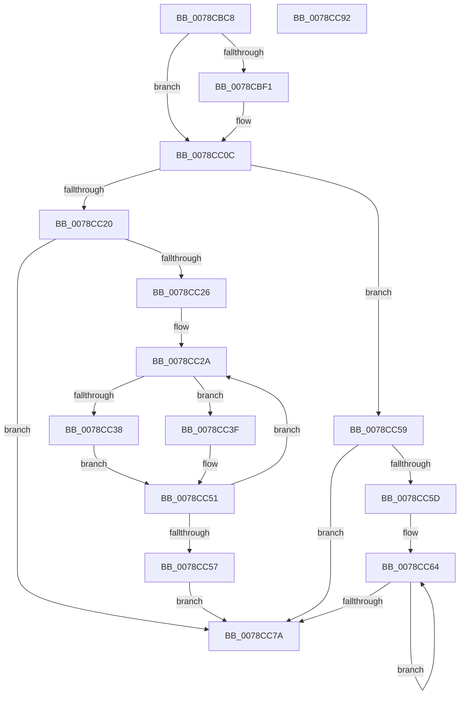

# ComputeNameLength

- RVA: `0x0078CBC8`–`0x0078CC93` (길이 `203` bytes)
- VA: `0x000000014078CBC8`
- 실행 섹션: `PAGE`
- PDB 이름 있음: `예`; PDB Function 태그: `아니요`
- unwind 정보 RVA: `0x0005C954`
- 디코드: `62`개 명령, `203/203` bytes 표시
- 미해석 바이트: `0` (있으면 어셈블리에 `.byte`로 보존)

> 이 문서는 커널 이미지의 기계어와 PDB 기호를 분석해 생성했습니다. 4번과 5번은 함수 원형과 자료형을 바이너리 사용 방식에서 추정한 C 해석이며 원본 소스 복구 결과는 아닙니다.

## 1. Dependencies

- 직접 호출 지점: **2**; 고유 호출 대상: **2**
- 직접 호출자로 확인된 함수: **2**
- RIP 상대 이미지 참조: **0**

### Outgoing calls
- `0x0078CBE8` → [RtlpIsUtf8Process](../90/RtlpIsUtf8Process_function_0090DB60.md) (function, `0x0090DB60`)
- `0x0078CBF5` → [PsGetCurrentServerSiloGlobals](../../text/2F/PsGetCurrentServerSiloGlobals_function_002FE1F0.md) (function, `0x002FE1F0`)

### Direct callers
- [PfxFindPrefix](PfxFindPrefix_function_0078CCA0.md) at `0x0078CCC1`
- [PfxInsertPrefix](PfxInsertPrefix_function_0078CDA0.md) at `0x0078CDC4`

### Static image references
- 디코드된 RIP-relative 메모리 참조가 없습니다.

## 2. Other-region calls and transfers

- 다른 실행 섹션으로 향하는 call: **1**
  - `0x0078CBF5` → [PsGetCurrentServerSiloGlobals](../../text/2F/PsGetCurrentServerSiloGlobals_function_002FE1F0.md) (`PAGE` → `.text`)
- 별도 외부 분기/꼬리 이동을 확인하지 못했습니다.

## 3. Assembly (complete function range)

```asm
0078CBC8  48 89 5C 24 08                  mov qword ptr [rsp + 8], rbx
0078CBCD  48 89 6C 24 10                  mov qword ptr [rsp + 0x10], rbp
0078CBD2  48 89 74 24 18                  mov qword ptr [rsp + 0x18], rsi
0078CBD7  57                              push rdi
0078CBD8  48 83 EC 20                     sub rsp, 0x20
0078CBDC  48 8B D9                        mov rbx, rcx
0078CBDF  33 ED                           xor ebp, ebp
0078CBE1  33 C9                           xor ecx, ecx
0078CBE3  40 8A FD                        mov dil, bpl
0078CBE6  8B F5                           mov esi, ebp
0078CBE8  E8 73 0F 18 00                  call 0x14090db60
0078CBED  84 C0                           test al, al
0078CBEF  75 1B                           jne 0x14078cc0c
0078CBF1  F0 09 2C 24                     lock or dword ptr [rsp], ebp
0078CBF5  E8 F6 15 B7 FF                  call 0x1402fe1f0
0078CBFA  66 39 A8 14 04 00 00            cmp word ptr [rax + 0x414], bp
0078CC01  48 8B B0 98 04 00 00            mov rsi, qword ptr [rax + 0x498]
0078CC08  40 0F 95 C7                     setne dil
0078CC0C  0F B7 0B                        movzx ecx, word ptr [rbx]
0078CC0F  41 BB 01 00 00 00               mov r11d, 1
0078CC15  41 2B CB                        sub ecx, r11d
0078CC18  45 8B C3                        mov r8d, r11d
0078CC1B  40 84 FF                        test dil, dil
0078CC1E  74 39                           je 0x14078cc59
0078CC20  8B D5                           mov edx, ebp
0078CC22  85 C9                           test ecx, ecx
0078CC24  74 54                           je 0x14078cc7a
0078CC26  4C 8B 53 08                     mov r10, qword ptr [rbx + 8]
0078CC2A  8B C2                           mov eax, edx
0078CC2C  46 0F B6 0C 10                  movzx r9d, byte ptr [rax + r10]
0078CC31  66 42 39 2C 4E                  cmp word ptr [rsi + r9*2], bp
0078CC36  74 07                           je 0x14078cc3f
0078CC38  B8 02 00 00 00                  mov eax, 2
0078CC3D  EB 12                           jmp 0x14078cc51
0078CC3F  41 8D 40 01                     lea eax, [r8 + 1]
0078CC43  41 80 F9 5C                     cmp r9b, 0x5c
0078CC47  41 0F 45 C0                     cmovne eax, r8d
0078CC4B  44 8B C0                        mov r8d, eax
0078CC4E  41 8B C3                        mov eax, r11d
0078CC51  03 D0                           add edx, eax
0078CC53  3B D1                           cmp edx, ecx
0078CC55  72 D3                           jb 0x14078cc2a
0078CC57  EB 21                           jmp 0x14078cc7a
0078CC59  85 C9                           test ecx, ecx
0078CC5B  74 1D                           je 0x14078cc7a
0078CC5D  48 8B 43 08                     mov rax, qword ptr [rbx + 8]
0078CC61  44 8B C9                        mov r9d, ecx
0078CC64  80 38 5C                        cmp byte ptr [rax], 0x5c
0078CC67  41 8D 50 01                     lea edx, [r8 + 1]
0078CC6B  41 0F 45 D0                     cmovne edx, r8d
0078CC6F  49 03 C3                        add rax, r11
0078CC72  44 8B C2                        mov r8d, edx
0078CC75  4D 2B CB                        sub r9, r11
0078CC78  75 EA                           jne 0x14078cc64
0078CC7A  48 8B 5C 24 30                  mov rbx, qword ptr [rsp + 0x30]
0078CC7F  41 8B C0                        mov eax, r8d
0078CC82  48 8B 6C 24 38                  mov rbp, qword ptr [rsp + 0x38]
0078CC87  48 8B 74 24 40                  mov rsi, qword ptr [rsp + 0x40]
0078CC8C  48 83 C4 20                     add rsp, 0x20
0078CC90  5F                              pop rdi
0078CC91  C3                              ret
0078CC92  CC                              int3
```

## 4. C-style interpretation (structured pseudocode)

```c
__int64 __fastcall ComputeNameLength(__int64 a1)
{
    __int64 result;
    __int64 v_rbp;
    __int64 v_rdi;
    __int64 v_rsi;
    __int64 v_rsp;
    unsigned int v_stack_m28;
    unsigned __int64 v_stack_p10;
    unsigned __int64 v_stack_p18;
    unsigned __int64 v_stack_p8;

    v_stack_p8 = v_rbx;
    v_stack_p10 = v_rbp;
    v_stack_p18 = v_rsi;
    v_rsp = (v_rsp) - (32);
    v_rbp = 0;
    a1 = 0;
    result = RtlpIsUtf8Process(a1, a2, a3, a4);
    v_rsi = 0;
    v_rdi = 0;
    if ((unsigned __int8)(result) == 0) {
        result = PsGetCurrentServerSiloGlobals(a1, a2, a3, a4);
        v_rsi = *(unsigned __int64 *)(result + 1176);
        v_rdi = ((*(unsigned __int16 *)(result + 1044)) != 0) ? 1 : 0;
    }
    a1 = (unsigned int)((*(unsigned __int16 *)(a1)) - (1));
    if ((unsigned __int8)(v_rdi) == 0) goto loc_0078CC59;
    if ((unsigned int)(a1) == 0) goto loc_0078CC7A;
loc_0078CC2A:
    if ((*(unsigned __int16 *)(v_rsi + *(unsigned __int8 *)(0 + *(unsigned __int64 *)(a1 + 8) * 1) * 2)) == 0) goto loc_0078CC3F;
    goto loc_0078CC51;
loc_0078CC3F:
    result = 1 + 1;
    if (((unsigned __int8)(*(unsigned __int8 *)(0 + *(unsigned __int64 *)(a1 + 8) * 1))) != 92) { result = 1; }
loc_0078CC51:
    a2 = (unsigned int)((0) + (1));
    if (((unsigned int)(a2)) < ((unsigned int)(a1))) goto loc_0078CC2A;
    goto loc_0078CC7A;
loc_0078CC59:
    if ((unsigned int)(a1) == 0) goto loc_0078CC7A;
loc_0078CC64:
    a2 = (unsigned int)((unsigned int)(result)) + 1;
    if ((*(unsigned __int8 *)(*(unsigned __int64 *)(a1 + 8))) != 92) { a2 = (unsigned int)((unsigned int)((unsigned int)(result))); }
    result = (*(unsigned __int64 *)(a1 + 8)) + (1);
    a4 = ((unsigned int)((unsigned int)(a1))) - (1);
    if (condition_is_not_equal) goto loc_0078CC64;
loc_0078CC7A:
    v_rsp = (v_rsp) + (32);
    return (unsigned int)((unsigned int)((unsigned int)((unsigned int)(a2))));
}
```

## 5. (Beta) C Style

```c
int64_t ComputeNameLength(void *Arg1)
{
    uint8_t *arg1 = (uint8_t *)Arg1;

    int64_t result;
    int64_t local_rbp;
    int64_t local_rdi;
    int64_t local_rsi;
    int64_t local_rsp;
    uint32_t v_stack_m28;
    uint64_t v_stack_p10;
    uint64_t v_stack_p18;
    uint64_t v_stack_p8;

    v_stack_p8 = local_rbx;
    v_stack_p10 = local_rbp;
    v_stack_p18 = local_rsi;
    local_rsp = (local_rsp) - (32);
    local_rbp = 0;
    Arg1 = 0;
    result = RtlpIsUtf8Process(Arg1, a2, a3, a4);
    local_rsi = 0;
    local_rdi = 0;
    if ((uint8_t)(result) == 0) {
        result = PsGetCurrentServerSiloGlobals(Arg1, a2, a3, a4);
        local_rsi = *(uint64_t *)(result + 0x498);
        local_rdi = ((*(uint16_t *)(result + 0x414)) != 0) ? 1 : 0;
    }
    Arg1 = (uint32_t)((*(uint16_t *)(arg1)) - (1));
    if ((uint8_t)(local_rdi) == 0) goto loc_0078CC59;
    if ((uint32_t)(Arg1) == 0) goto loc_0078CC7A;
loc_0078CC2A:
    if ((*(uint16_t *)(local_rsi + *(uint8_t *)(0 + *(uint64_t *)(arg1 + 0x8) * 1) * 2)) == 0) goto loc_0078CC3F;
    goto loc_0078CC51;
loc_0078CC3F:
    result = 1 + 1;
    if (((uint8_t)(*(uint8_t *)(0 + *(uint64_t *)(arg1 + 0x8) * 1))) != 92) { result = 1; }
loc_0078CC51:
    a2 = (uint32_t)((0) + (1));
    if (((uint32_t)(a2)) < ((uint32_t)(Arg1))) goto loc_0078CC2A;
    goto loc_0078CC7A;
loc_0078CC59:
    if ((uint32_t)(Arg1) == 0) goto loc_0078CC7A;
loc_0078CC64:
    a2 = (uint32_t)((uint32_t)(result)) + 1;
    if ((*(uint8_t *)(*(uint64_t *)(arg1 + 0x8))) != 92) { a2 = (uint32_t)((uint32_t)((uint32_t)(result))); }
    result = (*(uint64_t *)(arg1 + 0x8)) + (1);
    a4 = ((uint32_t)((uint32_t)(Arg1))) - (1);
    if (condition_is_not_equal) goto loc_0078CC64;
loc_0078CC7A:
    local_rsp = (local_rsp) + (32);
    return (uint32_t)((uint32_t)((uint32_t)((uint32_t)(a2))));
}
```

### 관측된 메모리 오프셋

구조체 형식이 확인되지 않은 접근은 인자 기준의 오프셋으로만 기록했습니다.

| 기준 인자 | 오프셋 표현 | 폭 (bit) | 접근 |
|---|---:|---:|---|
| `Arg1` | `+ 0x0` | `16` | `R` |
| `Arg1` | `+ 0x8` | `64` | `R` |

## 6. Execution-region graph

[열기: 2D/3D 그래프와 함수 탐색 컨트롤 패널](../../../control-panel.html?section=page&rva=0x0078CBC8&view=graph)

- 2D 그래프는 위에서 아래로 흐르고, 3D 그래프는 빈 공간을 드래그해 회전합니다. Shift+드래그는 이동, 휠은 확대·축소, 함수 노드 선택은 대상 보고서 이동입니다.

### Static fallback


