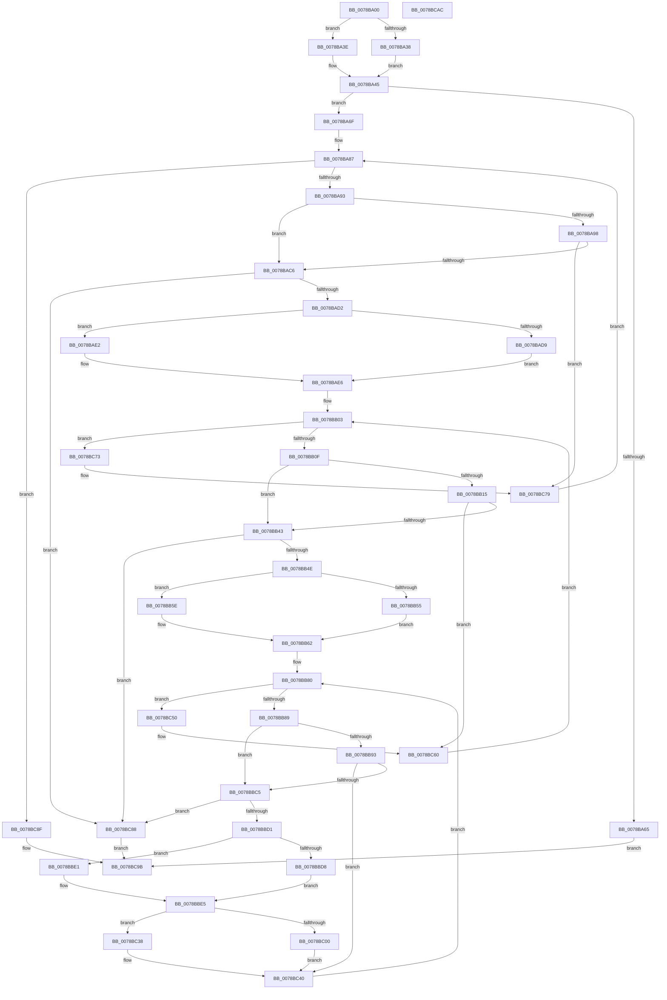

# LdrEnumResources

- RVA: `0x0078BA00`–`0x0078BCAD` (길이 `685` bytes)
- VA: `0x000000014078BA00`
- 실행 섹션: `PAGE`
- PDB 이름 있음: `예`; PDB Function 태그: `아니요`
- unwind 정보 RVA: `0x000BECA4`
- 디코드: `180`개 명령, `685/685` bytes 표시
- 미해석 바이트: `0` (있으면 어셈블리에 `.byte`로 보존)

> 이 문서는 커널 이미지의 기계어와 PDB 기호를 분석해 생성했습니다. 4번과 5번은 함수 원형과 자료형을 바이너리 사용 방식에서 추정한 C 해석이며 원본 소스 복구 결과는 아닙니다.

## 1. Dependencies

- 직접 호출 지점: **4**; 고유 호출 대상: **2**
- 직접 호출자로 확인된 함수: **0**
- RIP 상대 이미지 참조: **0**

### Outgoing calls
- `0x0078BA58` → [RtlImageDirectoryEntryToData](../../text/43/RtlImageDirectoryEntryToData_function_004328D0.md) (function, `0x004328D0`)
- `0x0078BAB9` → [LdrpCompareResourceNamesWithValidation](../../text/47/LdrpCompareResourceNamesWithValidation_function_0047E3D4.md) (function, `0x0047E3D4`)
- `0x0078BB36` → [LdrpCompareResourceNamesWithValidation](../../text/47/LdrpCompareResourceNamesWithValidation_function_0047E3D4.md) (function, `0x0047E3D4`)
- `0x0078BBBC` → [LdrpCompareResourceNamesWithValidation](../../text/47/LdrpCompareResourceNamesWithValidation_function_0047E3D4.md) (function, `0x0047E3D4`)

### Direct callers
- 이 함수 시작 RVA로 연결되는 직접 call은 확인되지 않았습니다. 간접 호출은 완전히 역산할 수 없습니다.

### Static image references
- 디코드된 RIP-relative 메모리 참조가 없습니다.

## 2. Other-region calls and transfers

- 다른 실행 섹션으로 향하는 call: **4**
  - `0x0078BA58` → [RtlImageDirectoryEntryToData](../../text/43/RtlImageDirectoryEntryToData_function_004328D0.md) (`PAGE` → `.text`)
  - `0x0078BAB9` → [LdrpCompareResourceNamesWithValidation](../../text/47/LdrpCompareResourceNamesWithValidation_function_0047E3D4.md) (`PAGE` → `.text`)
  - `0x0078BB36` → [LdrpCompareResourceNamesWithValidation](../../text/47/LdrpCompareResourceNamesWithValidation_function_0047E3D4.md) (`PAGE` → `.text`)
  - `0x0078BBBC` → [LdrpCompareResourceNamesWithValidation](../../text/47/LdrpCompareResourceNamesWithValidation_function_0047E3D4.md) (`PAGE` → `.text`)
- 별도 외부 분기/꼬리 이동을 확인하지 못했습니다.

## 3. Assembly (complete function range)

```asm
0078BA00  44 89 44 24 18                  mov dword ptr [rsp + 0x18], r8d
0078BA05  48 89 54 24 10                  mov qword ptr [rsp + 0x10], rdx
0078BA0A  48 89 4C 24 08                  mov qword ptr [rsp + 8], rcx
0078BA0F  53                              push rbx
0078BA10  55                              push rbp
0078BA11  56                              push rsi
0078BA12  57                              push rdi
0078BA13  41 54                           push r12
0078BA15  41 55                           push r13
0078BA17  41 56                           push r14
0078BA19  41 57                           push r15
0078BA1B  48 83 EC 58                     sub rsp, 0x58
0078BA1F  33 ED                           xor ebp, ebp
0078BA21  4D 8B E1                        mov r12, r9
0078BA24  45 8B F8                        mov r15d, r8d
0078BA27  4C 8B EA                        mov r13, rdx
0078BA2A  89 6C 24 30                     mov dword ptr [rsp + 0x30], ebp
0078BA2E  48 39 AC 24 C0 00 00 00         cmp qword ptr [rsp + 0xc0], rbp
0078BA36  75 06                           jne 0x14078ba3e
0078BA38  89 6C 24 34                     mov dword ptr [rsp + 0x34], ebp
0078BA3C  EB 07                           jmp 0x14078ba45
0078BA3E  41 8B 01                        mov eax, dword ptr [r9]
0078BA41  89 44 24 34                     mov dword ptr [rsp + 0x34], eax
0078BA45  41 89 29                        mov dword ptr [r9], ebp
0078BA48  41 B8 02 00 00 00               mov r8d, 2
0078BA4E  4C 8D 8C 24 B8 00 00 00         lea r9, [rsp + 0xb8]
0078BA56  B2 01                           mov dl, 1
0078BA58  E8 73 6E CA FF                  call 0x1404328d0
0078BA5D  48 8B D8                        mov rbx, rax
0078BA60  48 85 C0                        test rax, rax
0078BA63  75 0A                           jne 0x14078ba6f
0078BA65  B8 89 00 00 C0                  mov eax, 0xc0000089
0078BA6A  E9 2C 02 00 00                  jmp 0x14078bc9b
0078BA6F  0F B7 48 0E                     movzx ecx, word ptr [rax + 0xe]
0078BA73  4C 8D 70 10                     lea r14, [rax + 0x10]
0078BA77  0F B7 40 0C                     movzx eax, word ptr [rax + 0xc]
0078BA7B  8B FD                           mov edi, ebp
0078BA7D  03 C8                           add ecx, eax
0078BA7F  89 6C 24 40                     mov dword ptr [rsp + 0x40], ebp
0078BA83  89 4C 24 4C                     mov dword ptr [rsp + 0x4c], ecx
0078BA87  89 7C 24 3C                     mov dword ptr [rsp + 0x3c], edi
0078BA8B  3B F9                           cmp edi, ecx
0078BA8D  0F 83 FC 01 00 00               jae 0x14078bc8f
0078BA93  45 85 FF                        test r15d, r15d
0078BA96  74 2E                           je 0x14078bac6
0078BA98  4D 8B 45 00                     mov r8, qword ptr [r13]
0078BA9C  48 8D 84 24 B8 00 00 00         lea rax, [rsp + 0xb8]
0078BAA4  48 89 44 24 28                  mov qword ptr [rsp + 0x28], rax
0078BAA9  4C 8B CB                        mov r9, rbx
0078BAAC  4C 89 74 24 20                  mov qword ptr [rsp + 0x20], r14
0078BAB1  40 88 AC 24 B8 00 00 00         mov byte ptr [rsp + 0xb8], bpl
0078BAB9  E8 16 29 CF FF                  call 0x14047e3d4
0078BABE  85 C0                           test eax, eax
0078BAC0  0F 85 B3 01 00 00               jne 0x14078bc79
0078BAC6  41 8B 46 04                     mov eax, dword ptr [r14 + 4]
0078BACA  85 C0                           test eax, eax
0078BACC  0F 89 B6 01 00 00               jns 0x14078bc88
0078BAD2  41 8B 36                        mov esi, dword ptr [r14]
0078BAD5  85 F6                           test esi, esi
0078BAD7  79 09                           jns 0x14078bae2
0078BAD9  0F BA F6 1F                     btr esi, 0x1f
0078BADD  48 03 F3                        add rsi, rbx
0078BAE0  EB 04                           jmp 0x14078bae6
0078BAE2  41 0F B7 36                     movzx esi, word ptr [r14]
0078BAE6  0F BA F0 1F                     btr eax, 0x1f
0078BAEA  48 8D 6B 10                     lea rbp, [rbx + 0x10]
0078BAEE  48 03 E8                        add rbp, rax
0078BAF1  0F B7 4C 18 0E                  movzx ecx, word ptr [rax + rbx + 0xe]
0078BAF6  0F B7 44 18 0C                  movzx eax, word ptr [rax + rbx + 0xc]
0078BAFB  03 C8                           add ecx, eax
0078BAFD  89 4C 24 48                     mov dword ptr [rsp + 0x48], ecx
0078BB01  33 C0                           xor eax, eax
0078BB03  89 44 24 38                     mov dword ptr [rsp + 0x38], eax
0078BB07  3B C1                           cmp eax, ecx
0078BB09  0F 83 64 01 00 00               jae 0x14078bc73
0078BB0F  41 83 FF 01                     cmp r15d, 1
0078BB13  76 2E                           jbe 0x14078bb43
0078BB15  4D 8B 45 08                     mov r8, qword ptr [r13 + 8]
0078BB19  48 8D 84 24 B8 00 00 00         lea rax, [rsp + 0xb8]
0078BB21  48 89 44 24 28                  mov qword ptr [rsp + 0x28], rax
0078BB26  4C 8B CB                        mov r9, rbx
0078BB29  48 89 6C 24 20                  mov qword ptr [rsp + 0x20], rbp
0078BB2E  C6 84 24 B8 00 00 00 00         mov byte ptr [rsp + 0xb8], 0
0078BB36  E8 99 28 CF FF                  call 0x14047e3d4
0078BB3B  85 C0                           test eax, eax
0078BB3D  0F 85 1D 01 00 00               jne 0x14078bc60
0078BB43  8B 45 04                        mov eax, dword ptr [rbp + 4]
0078BB46  85 C0                           test eax, eax
0078BB48  0F 89 3A 01 00 00               jns 0x14078bc88
0078BB4E  8B 7D 00                        mov edi, dword ptr [rbp]
0078BB51  85 FF                           test edi, edi
0078BB53  79 09                           jns 0x14078bb5e
0078BB55  0F BA F7 1F                     btr edi, 0x1f
0078BB59  48 03 FB                        add rdi, rbx
0078BB5C  EB 04                           jmp 0x14078bb62
0078BB5E  0F B7 7D 00                     movzx edi, word ptr [rbp]
0078BB62  0F BA F0 1F                     btr eax, 0x1f
0078BB66  4C 8D 7B 10                     lea r15, [rbx + 0x10]
0078BB6A  4C 03 F8                        add r15, rax
0078BB6D  0F B7 4C 18 0E                  movzx ecx, word ptr [rax + rbx + 0xe]
0078BB72  0F B7 44 18 0C                  movzx eax, word ptr [rax + rbx + 0xc]
0078BB77  03 C8                           add ecx, eax
0078BB79  89 4C 24 44                     mov dword ptr [rsp + 0x44], ecx
0078BB7D  45 33 ED                        xor r13d, r13d
0078BB80  44 3B E9                        cmp r13d, ecx
0078BB83  0F 83 C7 00 00 00               jae 0x14078bc50
0078BB89  83 BC 24 B0 00 00 00 02         cmp dword ptr [rsp + 0xb0], 2
0078BB91  76 32                           jbe 0x14078bbc5
0078BB93  48 8D 84 24 B8 00 00 00         lea rax, [rsp + 0xb8]
0078BB9B  C6 84 24 B8 00 00 00 00         mov byte ptr [rsp + 0xb8], 0
0078BBA3  48 89 44 24 28                  mov qword ptr [rsp + 0x28], rax
0078BBA8  4C 8B CB                        mov r9, rbx
0078BBAB  48 8B 84 24 A8 00 00 00         mov rax, qword ptr [rsp + 0xa8]
0078BBB3  4C 89 7C 24 20                  mov qword ptr [rsp + 0x20], r15
0078BBB8  4C 8B 40 10                     mov r8, qword ptr [rax + 0x10]
0078BBBC  E8 13 28 CF FF                  call 0x14047e3d4
0078BBC1  85 C0                           test eax, eax
0078BBC3  75 7B                           jne 0x14078bc40
0078BBC5  41 8B 47 04                     mov eax, dword ptr [r15 + 4]
0078BBC9  85 C0                           test eax, eax
0078BBCB  0F 88 B7 00 00 00               js 0x14078bc88
0078BBD1  41 8B 0F                        mov ecx, dword ptr [r15]
0078BBD4  85 C9                           test ecx, ecx
0078BBD6  79 09                           jns 0x14078bbe1
0078BBD8  0F BA F1 1F                     btr ecx, 0x1f
0078BBDC  48 03 CB                        add rcx, rbx
0078BBDF  EB 04                           jmp 0x14078bbe5
0078BBE1  41 0F B7 0F                     movzx ecx, word ptr [r15]
0078BBE5  44 8B 4C 24 30                  mov r9d, dword ptr [rsp + 0x30]
0078BBEA  4C 8B C0                        mov r8, rax
0078BBED  4B 8D 14 89                     lea rdx, [r9 + r9*4]
0078BBF1  41 FF C1                        inc r9d
0078BBF4  44 89 4C 24 30                  mov dword ptr [rsp + 0x30], r9d
0078BBF9  44 3B 4C 24 34                  cmp r9d, dword ptr [rsp + 0x34]
0078BBFE  77 38                           ja 0x14078bc38
0078BC00  4C 8B 8C 24 C0 00 00 00         mov r9, qword ptr [rsp + 0xc0]
0078BC08  49 89 34 D1                     mov qword ptr [r9 + rdx*8], rsi
0078BC0C  49 89 7C D1 08                  mov qword ptr [r9 + rdx*8 + 8], rdi
0078BC11  49 89 4C D1 10                  mov qword ptr [r9 + rdx*8 + 0x10], rcx
0078BC16  8B 04 18                        mov eax, dword ptr [rax + rbx]
0078BC19  48 03 84 24 A0 00 00 00         add rax, qword ptr [rsp + 0xa0]
0078BC21  49 89 44 D1 18                  mov qword ptr [r9 + rdx*8 + 0x18], rax
0078BC26  41 8B 44 18 04                  mov eax, dword ptr [r8 + rbx + 4]
0078BC2B  41 83 64 D1 24 00               and dword ptr [r9 + rdx*8 + 0x24], 0
0078BC31  41 89 44 D1 20                  mov dword ptr [r9 + rdx*8 + 0x20], eax
0078BC36  EB 08                           jmp 0x14078bc40
0078BC38  C7 44 24 40 04 00 00 C0         mov dword ptr [rsp + 0x40], 0xc0000004
0078BC40  8B 4C 24 44                     mov ecx, dword ptr [rsp + 0x44]
0078BC44  41 FF C5                        inc r13d
0078BC47  49 83 C7 08                     add r15, 8
0078BC4B  E9 30 FF FF FF                  jmp 0x14078bb80
0078BC50  44 8B BC 24 B0 00 00 00         mov r15d, dword ptr [rsp + 0xb0]
0078BC58  4C 8B AC 24 A8 00 00 00         mov r13, qword ptr [rsp + 0xa8]
0078BC60  8B 44 24 38                     mov eax, dword ptr [rsp + 0x38]
0078BC64  8B 4C 24 48                     mov ecx, dword ptr [rsp + 0x48]
0078BC68  FF C0                           inc eax
0078BC6A  48 83 C5 08                     add rbp, 8
0078BC6E  E9 90 FE FF FF                  jmp 0x14078bb03
0078BC73  8B 7C 24 3C                     mov edi, dword ptr [rsp + 0x3c]
0078BC77  33 ED                           xor ebp, ebp
0078BC79  8B 4C 24 4C                     mov ecx, dword ptr [rsp + 0x4c]
0078BC7D  FF C7                           inc edi
0078BC7F  49 83 C6 08                     add r14, 8
0078BC83  E9 FF FD FF FF                  jmp 0x14078ba87
0078BC88  B8 7B 00 00 C0                  mov eax, 0xc000007b
0078BC8D  EB 0C                           jmp 0x14078bc9b
0078BC8F  8B 44 24 30                     mov eax, dword ptr [rsp + 0x30]
0078BC93  41 89 04 24                     mov dword ptr [r12], eax
0078BC97  8B 44 24 40                     mov eax, dword ptr [rsp + 0x40]
0078BC9B  48 83 C4 58                     add rsp, 0x58
0078BC9F  41 5F                           pop r15
0078BCA1  41 5E                           pop r14
0078BCA3  41 5D                           pop r13
0078BCA5  41 5C                           pop r12
0078BCA7  5F                              pop rdi
0078BCA8  5E                              pop rsi
0078BCA9  5D                              pop rbp
0078BCAA  5B                              pop rbx
0078BCAB  C3                              ret
0078BCAC  CC                              int3
```

## 4. C-style interpretation (structured pseudocode)

```c
__int64 __fastcall LdrEnumResources(__int64 a1, __int64 a2, int a3, __int64 a4, __int64 a5)
{
    __int64 result;
    __int64 v_r13;
    __int64 v_r14;
    __int64 v_r15;
    __int64 v_rbp;
    __int64 v_rdi;
    __int64 v_rsi;
    __int64 v_rsp;
    unsigned int v_stack_m4C;
    unsigned int v_stack_m50;
    unsigned int v_stack_m54;
    unsigned int v_stack_m58;
    unsigned int v_stack_m5C;
    unsigned int v_stack_m60;
    unsigned int v_stack_m64;
    unsigned int v_stack_m68;
    unsigned __int64 v_stack_m70;
    unsigned __int64 v_stack_m78;
    unsigned __int64 v_stack_p10;
    unsigned int v_stack_p18;
    unsigned __int64 v_stack_p20;
    unsigned __int64 v_stack_p8;

    v_stack_p18 = a3;
    v_stack_p10 = a2;
    v_stack_p8 = a1;
    v_rsp = (v_rsp) - (88);
    v_rbp = 0;
    v_stack_m68 = 0;
    if (a5 != 0) goto loc_0078BA3E;
    v_stack_m64 = 0;
    goto loc_0078BA45;
loc_0078BA3E:
    v_stack_m64 = (unsigned int)((unsigned int)(*(unsigned int *)(a4)));
loc_0078BA45:
    *(unsigned int *)(a4) = 0;
    result = RtlImageDirectoryEntryToData(a1, 1, 2, v_stack_p20);
    if (result != 0) goto loc_0078BA6F;
    goto loc_0078BC9B;
loc_0078BA6F:
    a1 = (unsigned int)((*(unsigned __int16 *)((unsigned int)(0xC0000089ULL) + 14)) + ((unsigned int)(*(unsigned __int16 *)((unsigned int)(0xC0000089ULL) + 12))));
    v_stack_m58 = 0;
    v_stack_m4C = (unsigned int)(a1);
loc_0078BA87:
    v_stack_m5C = 0;
    if (0 >= ((unsigned int)(a1))) goto loc_0078BC8F;
    if ((unsigned int)((unsigned int)(a3)) == 0) goto loc_0078BAC6;
    v_stack_m70 = v_stack_p20;
    v_stack_m78 = (unsigned int)(0xC0000089ULL) + 16;
    v_stack_p20 = 0;
    result = LdrpCompareResourceNamesWithValidation(a1, 1, *(unsigned __int64 *)(a2), result);
    if ((unsigned int)(result) != 0) goto loc_0078BC79;
loc_0078BAC6:
    if (!sign_flag) goto loc_0078BC88;
    if (!sign_flag) goto loc_0078BAE2;
    v_rsi = ((unsigned int)(*(unsigned int *)((unsigned int)(0xC0000089ULL) + 16))) + (result);
    goto loc_0078BAE6;
loc_0078BAE2:
loc_0078BAE6:
    v_rbp = (result + 16) + ((unsigned int)(*(unsigned int *)((unsigned int)(0xC0000089ULL) + 16 + 4)));
    a1 = (unsigned int)((*(unsigned __int16 *)((unsigned int)(*(unsigned int *)((unsigned int)(0xC0000089ULL) + 16 + 4)) + result * 1 + 14)) + ((unsigned int)(*(unsigned __int16 *)((unsigned int)(*(unsigned int *)((unsigned int)(0xC0000089ULL) + 16 + 4)) + result * 1 + 12))));
    v_stack_m50 = (unsigned int)(a1);
    result = 0;
loc_0078BB03:
    v_stack_m60 = 0;
    if (0 >= ((unsigned int)(a1))) goto loc_0078BC73;
    if (((unsigned int)((unsigned int)(a3))) <= 1) goto loc_0078BB43;
    v_stack_m70 = v_stack_p20;
    v_stack_m78 = v_rbp;
    v_stack_p20 = 0;
    result = LdrpCompareResourceNamesWithValidation(a1, 1, *(unsigned __int64 *)(a2 + 8), 0);
    if ((unsigned int)(result) != 0) goto loc_0078BC60;
loc_0078BB43:
    if (!sign_flag) goto loc_0078BC88;
    if (!sign_flag) goto loc_0078BB5E;
    v_rdi = ((unsigned int)(*(unsigned int *)(v_rbp))) + (result);
    goto loc_0078BB62;
loc_0078BB5E:
loc_0078BB62:
    v_r15 = (result + 16) + ((unsigned int)(*(unsigned int *)(v_rbp + 4)));
    a1 = (unsigned int)((*(unsigned __int16 *)((unsigned int)(*(unsigned int *)(v_rbp + 4)) + result * 1 + 14)) + ((unsigned int)(*(unsigned __int16 *)((unsigned int)(*(unsigned int *)(v_rbp + 4)) + result * 1 + 12))));
    v_stack_m54 = (unsigned int)(a1);
    v_r13 = 0;
loc_0078BB80:
    if (0 >= ((unsigned int)(a1))) goto loc_0078BC50;
    if (v_stack_p18 <= 2) goto loc_0078BBC5;
    v_stack_p20 = 0;
    v_stack_m70 = v_stack_p20;
    v_stack_m78 = v_r15;
    result = LdrpCompareResourceNamesWithValidation(a1, 1, *(unsigned __int64 *)(v_stack_p10 + 16), result);
    if ((unsigned int)(result) != 0) goto loc_0078BC40;
loc_0078BBC5:
    if (sign_flag) goto loc_0078BC88;
    if (!sign_flag) goto loc_0078BBE1;
    a1 = ((unsigned int)(*(unsigned int *)(v_r15))) + (result);
    goto loc_0078BBE5;
loc_0078BBE1:
loc_0078BBE5:
    a4 = (unsigned int)(((unsigned int)(v_stack_m68)) + 1);
    v_stack_m68 = (unsigned int)(a4);
    if (((unsigned int)(a4)) > v_stack_m64) goto loc_0078BC38;
    *(unsigned __int64 *)(a5 + (unsigned int)(v_stack_m68) + (unsigned int)(v_stack_m68) * 4 * 8) = *(unsigned __int16 *)((unsigned int)(0xC0000089ULL) + 16);
    *(unsigned __int64 *)(a5 + (unsigned int)(v_stack_m68) + (unsigned int)(v_stack_m68) * 4 * 8 + 8) = *(unsigned __int16 *)(v_rbp);
    *(unsigned __int64 *)(a5 + (unsigned int)(v_stack_m68) + (unsigned int)(v_stack_m68) * 4 * 8 + 16) = *(unsigned __int16 *)(v_r15);
    result = ((unsigned int)(*(unsigned int *)((unsigned int)(*(unsigned int *)(v_r15 + 4)) + result * 1))) + (v_stack_p8);
    *(unsigned __int64 *)(a5 + (unsigned int)(v_stack_m68) + (unsigned int)(v_stack_m68) * 4 * 8 + 24) = result;
    *(unsigned int *)(a5 + (unsigned int)(v_stack_m68) + (unsigned int)(v_stack_m68) * 4 * 8 + 32) = (unsigned int)((unsigned int)(*(unsigned int *)((unsigned int)(*(unsigned int *)(v_r15 + 4)) + result * 1 + 4)));
    goto loc_0078BC40;
loc_0078BC38:
    v_stack_m58 = 0xC0000004ULL;
loc_0078BC40:
    v_r13 = (unsigned int)((v_r13) + 1);
    v_r15 = (v_r15) + (8);
    goto loc_0078BB80;
loc_0078BC50:
loc_0078BC60:
    result = (unsigned int)(((unsigned int)(v_stack_m60)) + 1);
    v_rbp = (v_rbp) + (8);
    goto loc_0078BB03;
loc_0078BC73:
    v_rbp = 0;
loc_0078BC79:
    v_rdi = (unsigned int)(((unsigned int)(v_stack_m5C)) + 1);
    v_r14 = ((unsigned int)(0xC0000089ULL) + 16) + (8);
    goto loc_0078BA87;
loc_0078BC88:
    goto loc_0078BC9B;
loc_0078BC8F:
    *(unsigned int *)(a4) = (unsigned int)((unsigned int)(v_stack_m68));
loc_0078BC9B:
    v_rsp = (v_rsp) + (88);
    return (unsigned int)(v_stack_m58);
}
```

## 5. (Beta) C Style

```c
int64_t LdrEnumResources(int64_t Arg1, int64_t Arg2, int32_t Arg3, void *Arg4, void *Arg5)
{
    uint8_t *arg4 = (uint8_t *)Arg4;
    uint8_t *arg5 = (uint8_t *)Arg5;

    int64_t result;
    int64_t local_r13;
    int64_t local_r14;
    int64_t local_r15;
    int64_t local_rbp;
    int64_t local_rdi;
    int64_t local_rsi;
    int64_t local_rsp;
    uint32_t v_stack_m4C;
    uint32_t v_stack_m50;
    uint32_t v_stack_m54;
    uint32_t v_stack_m58;
    uint32_t v_stack_m5C;
    uint32_t v_stack_m60;
    uint32_t v_stack_m64;
    uint32_t v_stack_m68;
    uint64_t v_stack_m70;
    uint64_t v_stack_m78;
    uint64_t v_stack_p10;
    uint32_t v_stack_p18;
    uint64_t v_stack_p20;
    uint64_t v_stack_p8;

    v_stack_p18 = Arg3;
    v_stack_p10 = Arg2;
    v_stack_p8 = Arg1;
    local_rsp = (local_rsp) - (88);
    local_rbp = 0;
    v_stack_m68 = 0;
    if (Arg5 != NULL) goto loc_0078BA3E;
    v_stack_m64 = 0;
    goto loc_0078BA45;
loc_0078BA3E:
    v_stack_m64 = (uint32_t)((uint32_t)(*(uint32_t *)(arg4)));
loc_0078BA45:
    *(uint32_t *)(arg4) = 0;
    result = RtlImageDirectoryEntryToData(Arg1, 1, 2, v_stack_p20);
    if (result != 0) goto loc_0078BA6F;
    goto loc_0078BC9B;
loc_0078BA6F:
    Arg1 = (uint32_t)((*(uint16_t *)((uint32_t)(0xC0000089ULL) + 0xE)) + ((uint32_t)(*(uint16_t *)((uint32_t)(0xC0000089ULL) + 0xC))));
    v_stack_m58 = 0;
    v_stack_m4C = (uint32_t)(Arg1);
loc_0078BA87:
    v_stack_m5C = 0;
    if (0 >= ((uint32_t)(Arg1))) goto loc_0078BC8F;
    if ((uint32_t)((uint32_t)(Arg3)) == 0) goto loc_0078BAC6;
    v_stack_m70 = v_stack_p20;
    v_stack_m78 = (uint32_t)(0xC0000089ULL) + 16;
    v_stack_p20 = 0;
    result = LdrpCompareResourceNamesWithValidation(Arg1, 1, *(uint64_t *)(Arg2), result);
    if ((uint32_t)(result) != 0) goto loc_0078BC79;
loc_0078BAC6:
    if (!sign_flag) goto loc_0078BC88;
    if (!sign_flag) goto loc_0078BAE2;
    local_rsi = ((uint32_t)(*(uint32_t *)((uint32_t)(0xC0000089ULL) + 0x10))) + (result);
    goto loc_0078BAE6;
loc_0078BAE2:
loc_0078BAE6:
    local_rbp = (result + 16) + ((uint32_t)(*(uint32_t *)((uint32_t)(0xC0000089ULL) + 0x10 + 0x4)));
    Arg1 = (uint32_t)((*(uint16_t *)((uint32_t)(*(uint32_t *)((uint32_t)(0xC0000089ULL) + 0x10 + 0x4)) + result * 1 + 0xE)) + ((uint32_t)(*(uint16_t *)((uint32_t)(*(uint32_t *)((uint32_t)(0xC0000089ULL) + 0x10 + 0x4)) + result * 1 + 0xC))));
    v_stack_m50 = (uint32_t)(Arg1);
    result = 0;
loc_0078BB03:
    v_stack_m60 = 0;
    if (0 >= ((uint32_t)(Arg1))) goto loc_0078BC73;
    if (((uint32_t)((uint32_t)(Arg3))) <= 1) goto loc_0078BB43;
    v_stack_m70 = v_stack_p20;
    v_stack_m78 = local_rbp;
    v_stack_p20 = 0;
    result = LdrpCompareResourceNamesWithValidation(Arg1, 1, *(uint64_t *)(Arg2 + 0x8), 0);
    if ((uint32_t)(result) != 0) goto loc_0078BC60;
loc_0078BB43:
    if (!sign_flag) goto loc_0078BC88;
    if (!sign_flag) goto loc_0078BB5E;
    local_rdi = ((uint32_t)(*(uint32_t *)(local_rbp))) + (result);
    goto loc_0078BB62;
loc_0078BB5E:
loc_0078BB62:
    local_r15 = (result + 16) + ((uint32_t)(*(uint32_t *)(local_rbp + 0x4)));
    Arg1 = (uint32_t)((*(uint16_t *)((uint32_t)(*(uint32_t *)(local_rbp + 0x4)) + result * 1 + 0xE)) + ((uint32_t)(*(uint16_t *)((uint32_t)(*(uint32_t *)(local_rbp + 0x4)) + result * 1 + 0xC))));
    v_stack_m54 = (uint32_t)(Arg1);
    local_r13 = 0;
loc_0078BB80:
    if (0 >= ((uint32_t)(Arg1))) goto loc_0078BC50;
    if (v_stack_p18 <= 2) goto loc_0078BBC5;
    v_stack_p20 = 0;
    v_stack_m70 = v_stack_p20;
    v_stack_m78 = local_r15;
    result = LdrpCompareResourceNamesWithValidation(Arg1, 1, *(uint64_t *)(v_stack_p10 + 0x10), result);
    if ((uint32_t)(result) != 0) goto loc_0078BC40;
loc_0078BBC5:
    if (sign_flag) goto loc_0078BC88;
    if (!sign_flag) goto loc_0078BBE1;
    Arg1 = ((uint32_t)(*(uint32_t *)(local_r15))) + (result);
    goto loc_0078BBE5;
loc_0078BBE1:
loc_0078BBE5:
    Arg4 = (uint32_t)(((uint32_t)(v_stack_m68)) + 1);
    v_stack_m68 = (uint32_t)(Arg4);
    if (((uint32_t)(Arg4)) > v_stack_m64) goto loc_0078BC38;
    *(uint64_t *)(arg5 + (uint32_t)(v_stack_m68) + (uint32_t)(v_stack_m68) * 4 * 8) = *(uint16_t *)((uint32_t)(0xC0000089ULL) + 0x10);
    *(uint64_t *)(arg5 + (uint32_t)(v_stack_m68) + (uint32_t)(v_stack_m68) * 4 * 8 + 0x8) = *(uint16_t *)(local_rbp);
    *(uint64_t *)(arg5 + (uint32_t)(v_stack_m68) + (uint32_t)(v_stack_m68) * 4 * 8 + 0x10) = *(uint16_t *)(local_r15);
    result = ((uint32_t)(*(uint32_t *)((uint32_t)(*(uint32_t *)(local_r15 + 0x4)) + result * 1))) + (v_stack_p8);
    *(uint64_t *)(arg5 + (uint32_t)(v_stack_m68) + (uint32_t)(v_stack_m68) * 4 * 8 + 0x18) = result;
    *(uint32_t *)(arg5 + (uint32_t)(v_stack_m68) + (uint32_t)(v_stack_m68) * 4 * 8 + 0x20) = (uint32_t)((uint32_t)(*(uint32_t *)((uint32_t)(*(uint32_t *)(local_r15 + 0x4)) + result * 1 + 0x4)));
    goto loc_0078BC40;
loc_0078BC38:
    v_stack_m58 = 0xC0000004ULL;
loc_0078BC40:
    local_r13 = (uint32_t)((local_r13) + 1);
    local_r15 = (local_r15) + (8);
    goto loc_0078BB80;
loc_0078BC50:
loc_0078BC60:
    result = (uint32_t)(((uint32_t)(v_stack_m60)) + 1);
    local_rbp = (local_rbp) + (8);
    goto loc_0078BB03;
loc_0078BC73:
    local_rbp = 0;
loc_0078BC79:
    local_rdi = (uint32_t)(((uint32_t)(v_stack_m5C)) + 1);
    local_r14 = ((uint32_t)(0xC0000089ULL) + 16) + (8);
    goto loc_0078BA87;
loc_0078BC88:
    goto loc_0078BC9B;
loc_0078BC8F:
    *(uint32_t *)(arg4) = (uint32_t)((uint32_t)(v_stack_m68));
loc_0078BC9B:
    local_rsp = (local_rsp) + (88);
    return (uint32_t)(v_stack_m58);
}
```

### 관측된 메모리 오프셋

구조체 형식이 확인되지 않은 접근은 인자 기준의 오프셋으로만 기록했습니다.

| 기준 인자 | 오프셋 표현 | 폭 (bit) | 접근 |
|---|---:|---:|---|
| `Arg4` | `+ 0x0` | `32` | `R` |
| `Arg4` | `+ 0x0` | `32` | `W` |
| `Arg5` | `+ 0x0 + rdx*8` | `64` | `W` |
| `Arg5` | `+ 0x8 + rdx*8` | `64` | `W` |
| `Arg5` | `+ 0x10 + rdx*8` | `64` | `W` |
| `Arg5` | `+ 0x18 + rdx*8` | `64` | `W` |
| `Arg5` | `+ 0x20 + rdx*8` | `32` | `W` |
| `Arg5` | `+ 0x24 + rdx*8` | `32` | `R/W` |

## 6. Execution-region graph

[열기: 2D/3D 그래프와 함수 탐색 컨트롤 패널](../../../control-panel.html?section=page&rva=0x0078BA00&view=graph)

- 2D 그래프는 위에서 아래로 흐르고, 3D 그래프는 빈 공간을 드래그해 회전합니다. Shift+드래그는 이동, 휠은 확대·축소, 함수 노드 선택은 대상 보고서 이동입니다.

### Static fallback


