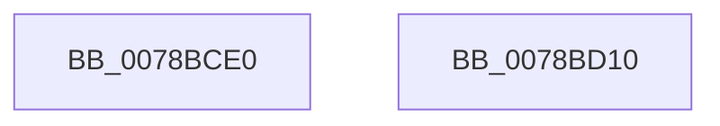

# LdrFindResourceEx_U

- RVA: `0x0078BCE0`–`0x0078BD11` (길이 `49` bytes)
- VA: `0x000000014078BCE0`
- 실행 섹션: `PAGE`
- PDB 이름 있음: `예`; PDB Function 태그: `아니요`
- unwind 정보 RVA: `0x00064C80`
- 디코드: `16`개 명령, `49/49` bytes 표시
- 미해석 바이트: `0` (있으면 어셈블리에 `.byte`로 보존)

> 이 문서는 커널 이미지의 기계어와 PDB 기호를 분석해 생성했습니다. 4번과 5번은 함수 원형과 자료형을 바이너리 사용 방식에서 추정한 C 해석이며 원본 소스 복구 결과는 아닙니다.

## 1. Dependencies

- 직접 호출 지점: **1**; 고유 호출 대상: **1**
- 직접 호출자로 확인된 함수: **0**
- RIP 상대 이미지 참조: **0**

### Outgoing calls
- `0x0078BD05` → [LdrpSearchResourceSection_U](../99/LdrpSearchResourceSection_U_function_0099B2DC.md) (function, `0x0099B2DC`)

### Direct callers
- 이 함수 시작 RVA로 연결되는 직접 call은 확인되지 않았습니다. 간접 호출은 완전히 역산할 수 없습니다.

### Static image references
- 디코드된 RIP-relative 메모리 참조가 없습니다.

## 2. Other-region calls and transfers

- 다른 실행 섹션으로 향하는 call: **0**
- 별도 외부 분기/꼬리 이동을 확인하지 못했습니다.

## 3. Assembly (complete function range)

```asm
0078BCE0  40 53                           push rbx
0078BCE2  48 83 EC 30                     sub rsp, 0x30
0078BCE6  48 8B 44 24 60                  mov rax, qword ptr [rsp + 0x60]
0078BCEB  45 8B D1                        mov r10d, r9d
0078BCEE  4D 8B D8                        mov r11, r8
0078BCF1  48 89 44 24 20                  mov qword ptr [rsp + 0x20], rax
0078BCF6  48 8B DA                        mov rbx, rdx
0078BCF9  44 8B C9                        mov r9d, ecx
0078BCFC  45 8B C2                        mov r8d, r10d
0078BCFF  49 8B D3                        mov rdx, r11
0078BD02  48 8B CB                        mov rcx, rbx
0078BD05  E8 D2 F5 20 00                  call 0x14099b2dc
0078BD0A  48 83 C4 30                     add rsp, 0x30
0078BD0E  5B                              pop rbx
0078BD0F  C3                              ret
0078BD10  CC                              int3
```

## 4. C-style interpretation (structured pseudocode)

```c
__int64 __fastcall LdrFindResourceEx_U(int a1, __int64 a2, __int64 a3, int a4, __int64 a5)
{
    __int64 result;
    __int64 v_rsp;
    unsigned __int64 v_stack_m18;

    v_rsp = (v_rsp) - (48);
    v_stack_m18 = a5;
    result = LdrpSearchResourceSection_U(a2, a3, (unsigned int)((unsigned int)((unsigned int)(a4))), (unsigned int)(a1));
    v_rsp = (v_rsp) + (48);
    return result;
}
```

## 5. (Beta) C Style

```c
int64_t LdrFindResourceEx_U(int32_t Arg1, int64_t Arg2, int64_t Arg3, int32_t Arg4, int64_t Arg5)
{
    int64_t result;
    int64_t local_rsp;
    uint64_t v_stack_m18;

    local_rsp = (local_rsp) - (48);
    v_stack_m18 = Arg5;
    result = LdrpSearchResourceSection_U(Arg2, Arg3, (uint32_t)((uint32_t)((uint32_t)(Arg4))), (uint32_t)(Arg1));
    local_rsp = (local_rsp) + (48);
    return result;
}
```

## 6. Execution-region graph

[열기: 2D/3D 그래프와 함수 탐색 컨트롤 패널](../../../control-panel.html?section=page&rva=0x0078BCE0&view=graph)

- 2D 그래프는 위에서 아래로 흐르고, 3D 그래프는 빈 공간을 드래그해 회전합니다. Shift+드래그는 이동, 휠은 확대·축소, 함수 노드 선택은 대상 보고서 이동입니다.

### Static fallback


