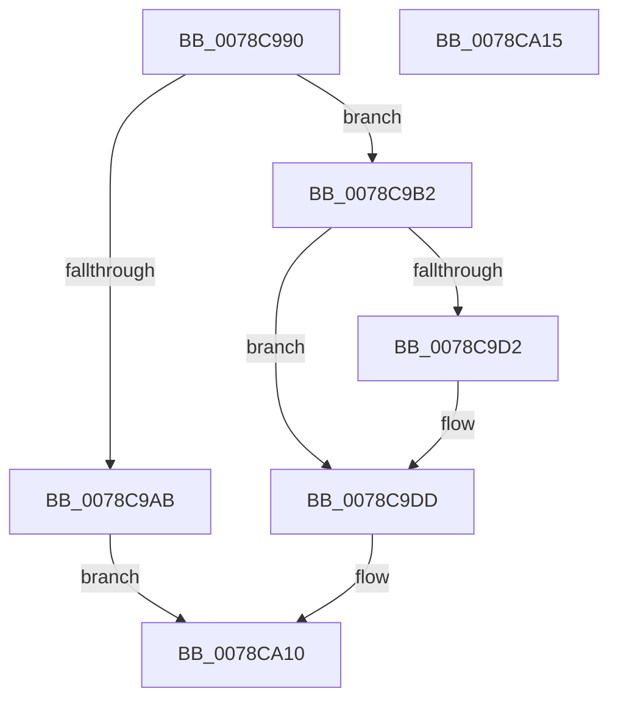

# LdrResFindResourceDirectory

- RVA: `0x0078C990`–`0x0078CA16` (길이 `134` bytes)
- VA: `0x000000014078C990`
- 실행 섹션: `PAGE`
- PDB 이름 있음: `예`; PDB Function 태그: `아니요`
- unwind 정보 RVA: `0x0006C2A4`
- 디코드: `31`개 명령, `134/134` bytes 표시
- 미해석 바이트: `0` (있으면 어셈블리에 `.byte`로 보존)

> 이 문서는 커널 이미지의 기계어와 PDB 기호를 분석해 생성했습니다. 4번과 5번은 함수 원형과 자료형을 바이너리 사용 방식에서 추정한 C 해석이며 원본 소스 복구 결과는 아닙니다.

## 1. Dependencies

- 직접 호출 지점: **1**; 고유 호출 대상: **1**
- 직접 호출자로 확인된 함수: **0**
- RIP 상대 이미지 참조: **0**

### Outgoing calls
- `0x0078CA0B` → [LdrResSearchResource](../98/LdrResSearchResource_function_0098F7A0.md) (function, `0x0098F7A0`)

### Direct callers
- 이 함수 시작 RVA로 연결되는 직접 call은 확인되지 않았습니다. 간접 호출은 완전히 역산할 수 없습니다.

### Static image references
- 디코드된 RIP-relative 메모리 참조가 없습니다.

## 2. Other-region calls and transfers

- 다른 실행 섹션으로 향하는 call: **0**
- 별도 외부 분기/꼬리 이동을 확인하지 못했습니다.

## 3. Assembly (complete function range)

```asm
0078C990  48 83 EC 58                     sub rsp, 0x58
0078C994  4D 8B D9                        mov r11, r9
0078C997  4D 8B D0                        mov r10, r8
0078C99A  44 8B 8C 24 90 00 00 00         mov r9d, dword ptr [rsp + 0x90]
0078C9A2  41 F7 C1 00 0C 00 00            test r9d, 0xc00
0078C9A9  74 07                           je 0x14078c9b2
0078C9AB  B8 0D 00 00 C0                  mov eax, 0xc000000d
0078C9B0  EB 5E                           jmp 0x14078ca10
0078C9B2  48 8B 44 24 40                  mov rax, qword ptr [rsp + 0x40]
0078C9B7  48 85 D2                        test rdx, rdx
0078C9BA  48 0F 45 C2                     cmovne rax, rdx
0078C9BE  45 33 C0                        xor r8d, r8d
0078C9C1  48 85 D2                        test rdx, rdx
0078C9C4  48 89 44 24 40                  mov qword ptr [rsp + 0x40], rax
0078C9C9  41 0F 95 C0                     setne r8b
0078C9CD  4D 85 D2                        test r10, r10
0078C9D0  74 0B                           je 0x14078c9dd
0078C9D2  4C 89 54 24 48                  mov qword ptr [rsp + 0x48], r10
0078C9D7  41 B8 02 00 00 00               mov r8d, 2
0078C9DD  48 8B 84 24 88 00 00 00         mov rax, qword ptr [rsp + 0x88]
0078C9E5  48 8D 54 24 40                  lea rdx, [rsp + 0x40]
0078C9EA  48 89 44 24 38                  mov qword ptr [rsp + 0x38], rax
0078C9EF  41 83 C9 02                     or r9d, 2
0078C9F3  48 8B 84 24 80 00 00 00         mov rax, qword ptr [rsp + 0x80]
0078C9FB  48 89 44 24 30                  mov qword ptr [rsp + 0x30], rax
0078CA00  48 83 64 24 28 00               and qword ptr [rsp + 0x28], 0
0078CA06  4C 89 5C 24 20                  mov qword ptr [rsp + 0x20], r11
0078CA0B  E8 90 2D 20 00                  call 0x14098f7a0
0078CA10  48 83 C4 58                     add rsp, 0x58
0078CA14  C3                              ret
0078CA15  CC                              int3
```

## 4. C-style interpretation (structured pseudocode)

```c
__int64 __fastcall LdrResFindResourceDirectory(__int64 a1, __int64 a2, __int64 a3, __int64 a4, __int64 a5, __int64 a6, unsigned int a7)
{
    __int64 result;
    __int64 v_rsp;
    unsigned __int64 v_stack_m10;
    unsigned __int64 v_stack_m18;
    unsigned __int64 v_stack_m20;
    unsigned __int64 v_stack_m28;
    unsigned __int64 v_stack_m30;
    unsigned __int64 v_stack_m38;

    v_rsp = (v_rsp) - (88);
    if ((((unsigned int)((unsigned int)(a7))) & (0xC00ULL)) == 0) goto loc_0078C9B2;
    goto loc_0078CA10;
loc_0078C9B2:
    result = v_stack_m18;
    if (a2 != 0) { result = a2; }
    a3 = 0;
    v_stack_m18 = result;
    a3 = (a2 != 0) ? 1 : 0;
    if (a3 != 0) {
        v_stack_m10 = a3;
        a3 = 2;
    }
    v_stack_m20 = a6;
    a4 = (unsigned int)(((unsigned int)(a7)) | (2));
    v_stack_m28 = a5;
    v_stack_m38 = a4;
    result = LdrResSearchResource(a1, v_stack_m18, a3, a4);
loc_0078CA10:
    v_rsp = (v_rsp) + (88);
    return result;
}
```

## 5. (Beta) C Style

```c
int64_t LdrResFindResourceDirectory(int64_t Arg1, int64_t Arg2, int64_t Arg3, int64_t Arg4, int64_t Arg5, int64_t Arg6, uint32_t Arg7)
{
    int64_t result;
    int64_t local_rsp;
    uint64_t v_stack_m10;
    uint64_t v_stack_m18;
    uint64_t v_stack_m20;
    uint64_t v_stack_m28;
    uint64_t v_stack_m30;
    uint64_t v_stack_m38;

    local_rsp = (local_rsp) - (88);
    if ((((uint32_t)((uint32_t)(Arg7))) & (0xC00ULL)) == 0) goto loc_0078C9B2;
    goto loc_0078CA10;
loc_0078C9B2:
    result = v_stack_m18;
    if (Arg2 != 0) { result = Arg2; }
    Arg3 = 0;
    v_stack_m18 = result;
    Arg3 = (Arg2 != 0) ? 1 : 0;
    if (Arg3 != 0) {
        v_stack_m10 = Arg3;
        Arg3 = 2;
    }
    v_stack_m20 = Arg6;
    Arg4 = (uint32_t)(((uint32_t)(Arg7)) | (2));
    v_stack_m28 = Arg5;
    v_stack_m38 = Arg4;
    result = LdrResSearchResource(Arg1, v_stack_m18, Arg3, Arg4);
loc_0078CA10:
    local_rsp = (local_rsp) + (88);
    return result;
}
```

## 6. Execution-region graph

[열기: 2D/3D 그래프와 함수 탐색 컨트롤 패널](../../../control-panel.html?section=page&rva=0x0078C990&view=graph)

- 2D 그래프는 위에서 아래로 흐르고, 3D 그래프는 빈 공간을 드래그해 회전합니다. Shift+드래그는 이동, 휠은 확대·축소, 함수 노드 선택은 대상 보고서 이동입니다.

### Static fallback


