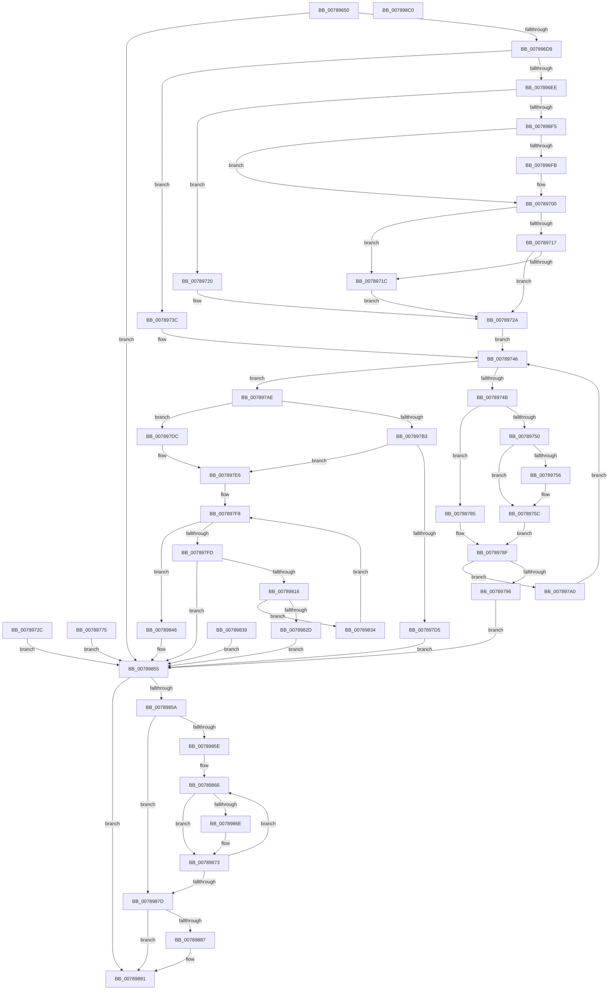

# NtAlertMultipleThreadByThreadId

- RVA: `0x00789650`–`0x007898C1` (길이 `625` bytes)
- VA: `0x0000000140789650`
- 실행 섹션: `PAGE`
- PDB 이름 있음: `예`; PDB Function 태그: `아니요`
- unwind 정보 RVA: `0x000CF578`
- 디코드: `170`개 명령, `625/625` bytes 표시
- 미해석 바이트: `0` (있으면 어셈블리에 `.byte`로 보존)

> 이 문서는 커널 이미지의 기계어와 PDB 기호를 분석해 생성했습니다. 4번과 5번은 함수 원형과 자료형을 바이너리 사용 방식에서 추정한 C 해석이며 원본 소스 복구 결과는 아닙니다.

## 1. Dependencies

- 직접 호출 지점: **12**; 고유 호출 대상: **10**
- 직접 호출자로 확인된 함수: **0**
- RIP 상대 이미지 참조: **1**

### Outgoing calls
- `0x007896A0` → [memset](../../text/6C/memset_function_006C6C40.md) (function, `0x006C6C40`)
- `0x007896B1` → [PsGetCurrentThreadProcess](../../text/47/PsGetCurrentThreadProcess_function_0047C7E0.md) (function, `0x0047C7E0`)
- `0x007896CA` → [RtlULongLongMult](../../text/43/RtlULongLongMult_function_0043E530.md) (function, `0x0043E530`)
- `0x007896FB` → [ExRaiseDatatypeMisalignment](../89/ExRaiseDatatypeMisalignment_function_00899FD0.md) (function, `0x00899FD0`)
- `0x00789756` → [ExRaiseDatatypeMisalignment](../89/ExRaiseDatatypeMisalignment_function_00899FD0.md) (function, `0x00899FD0`)
- `0x007897C3` → [ExAllocatePool2](../../poolcode/B8/ExAllocatePool2_function_00B820F0.md) (function, `0x00B820F0`)
- `0x007897F0` → [memset](../../text/6C/memset_function_006C6C40.md) (function, `0x006C6C40`)
- `0x0078980B` → [PsLookupThreadByThreadId](../86/PsLookupThreadByThreadId_function_00868300.md) (function, `0x00868300`)
- `0x0078984E` → [KeAlertMultipleThreadByThreadId](../../text/5B/KeAlertMultipleThreadByThreadId_function_005B8DA0.md) (function, `0x005B8DA0`)
- `0x0078986E` → [ObfDereferenceObject](../../text/2F/ObfDereferenceObject_function_002F9350.md) (function, `0x002F9350`)
- `0x0078988C` → [ExFreePoolWithTag](../../poolcode/B8/ExFreePoolWithTag_function_00B82870.md) (function, `0x00B82870`)
- `0x0078989E` → [_security_check_cookie](../../text/6A/_security_check_cookie_function_006AC640.md) (function, `0x006AC640`)

### Direct callers
- 이 함수 시작 RVA로 연결되는 직접 call은 확인되지 않았습니다. 간접 호출은 완전히 역산할 수 없습니다.

### Static image references
- `0x0078966A` → RVA `0x00E0A740` (`.data`; read)

## 2. Other-region calls and transfers

- 다른 실행 섹션으로 향하는 call: **9**
  - `0x007896A0` → [memset](../../text/6C/memset_function_006C6C40.md) (`PAGE` → `.text`)
  - `0x007896B1` → [PsGetCurrentThreadProcess](../../text/47/PsGetCurrentThreadProcess_function_0047C7E0.md) (`PAGE` → `.text`)
  - `0x007896CA` → [RtlULongLongMult](../../text/43/RtlULongLongMult_function_0043E530.md) (`PAGE` → `.text`)
  - `0x007897C3` → [ExAllocatePool2](../../poolcode/B8/ExAllocatePool2_function_00B820F0.md) (`PAGE` → `POOLCODE`)
  - `0x007897F0` → [memset](../../text/6C/memset_function_006C6C40.md) (`PAGE` → `.text`)
  - `0x0078984E` → [KeAlertMultipleThreadByThreadId](../../text/5B/KeAlertMultipleThreadByThreadId_function_005B8DA0.md) (`PAGE` → `.text`)
  - `0x0078986E` → [ObfDereferenceObject](../../text/2F/ObfDereferenceObject_function_002F9350.md) (`PAGE` → `.text`)
  - `0x0078988C` → [ExFreePoolWithTag](../../poolcode/B8/ExFreePoolWithTag_function_00B82870.md) (`PAGE` → `POOLCODE`)
  - `0x0078989E` → [_security_check_cookie](../../text/6A/_security_check_cookie_function_006AC640.md) (`PAGE` → `.text`)
- 별도 외부 분기/꼬리 이동을 확인하지 못했습니다.

## 3. Assembly (complete function range)

```asm
00789650  48 89 5C 24 18                  mov qword ptr [rsp + 0x18], rbx
00789655  48 89 74 24 20                  mov qword ptr [rsp + 0x20], rsi
0078965A  57                              push rdi
0078965B  41 54                           push r12
0078965D  41 55                           push r13
0078965F  41 56                           push r14
00789661  41 57                           push r15
00789663  48 81 EC 80 02 00 00            sub rsp, 0x280
0078966A  48 8B 05 CF 10 68 00            mov rax, qword ptr [rip + 0x6810cf]
00789671  48 33 C4                        xor rax, rsp
00789674  48 89 84 24 70 02 00 00         mov qword ptr [rsp + 0x270], rax
0078967C  45 8B F9                        mov r15d, r9d
0078967F  4D 8B F0                        mov r14, r8
00789682  8B F2                           mov esi, edx
00789684  4C 8B E1                        mov r12, rcx
00789687  89 74 24 20                     mov dword ptr [rsp + 0x20], esi
0078968B  45 33 ED                        xor r13d, r13d
0078968E  4C 21 6C 24 28                  and qword ptr [rsp + 0x28], r13
00789693  33 D2                           xor edx, edx
00789695  41 B8 00 02 00 00               mov r8d, 0x200
0078969B  48 8D 4C 24 70                  lea rcx, [rsp + 0x70]
007896A0  E8 9B D5 F3 FF                  call 0x1406c6c40
007896A5  33 DB                           xor ebx, ebx
007896A7  48 89 5C 24 30                  mov qword ptr [rsp + 0x30], rbx
007896AC  48 21 5C 24 38                  and qword ptr [rsp + 0x38], rbx
007896B1  E8 2A 31 CF FF                  call 0x14047c7e0
007896B6  48 89 44 24 40                  mov qword ptr [rsp + 0x40], rax
007896BB  8B CE                           mov ecx, esi
007896BD  48 89 4C 24 48                  mov qword ptr [rsp + 0x48], rcx
007896C2  4C 8D 44 24 28                  lea r8, [rsp + 0x28]
007896C7  8D 53 08                        lea edx, [rbx + 8]
007896CA  E8 61 4E CB FF                  call 0x14043e530
007896CF  8B F8                           mov edi, eax
007896D1  85 C0                           test eax, eax
007896D3  0F 88 7C 01 00 00               js 0x140789855
007896D9  65 48 8B 04 25 88 01 00 00      mov rax, qword ptr gs:[0x188]
007896E2  44 8A 80 32 02 00 00            mov r8b, byte ptr [rax + 0x232]
007896E9  45 84 C0                        test r8b, r8b
007896EC  74 4E                           je 0x14078973c
007896EE  48 39 5C 24 28                  cmp qword ptr [rsp + 0x28], rbx
007896F3  74 2B                           je 0x140789720
007896F5  41 F6 C4 07                     test r12b, 7
007896F9  74 05                           je 0x140789700
007896FB  E8 D0 08 11 00                  call 0x140899fd0
00789700  48 8B 54 24 28                  mov rdx, qword ptr [rsp + 0x28]
00789705  49 03 D4                        add rdx, r12
00789708  48 B9 00 00 FF FF FF 7F 00 00   movabs rcx, 0x7fffffff0000
00789712  48 3B D1                        cmp rdx, rcx
00789715  77 05                           ja 0x14078971c
00789717  49 3B D4                        cmp rdx, r12
0078971A  73 0E                           jae 0x14078972a
0078971C  8A 01                           mov al, byte ptr [rcx]
0078971E  EB 0A                           jmp 0x14078972a
00789720  48 B9 00 00 FF FF FF 7F 00 00   movabs rcx, 0x7fffffff0000
0078972A  EB 1A                           jmp 0x140789746
0078972C  8B F8                           mov edi, eax
0078972E  48 8B 5C 24 30                  mov rbx, qword ptr [rsp + 0x30]
00789733  8B 74 24 20                     mov esi, dword ptr [rsp + 0x20]
00789737  E9 19 01 00 00                  jmp 0x140789855
0078973C  48 B9 00 00 FF FF FF 7F 00 00   movabs rcx, 0x7fffffff0000
00789746  45 85 FF                        test r15d, r15d
00789749  74 63                           je 0x1407897ae
0078974B  45 84 C0                        test r8b, r8b
0078974E  74 35                           je 0x140789785
00789750  41 F6 C6 07                     test r14b, 7
00789754  74 06                           je 0x14078975c
00789756  E8 75 08 11 00                  call 0x140899fd0
0078975B  CC                              int3
0078975C  49 8B C6                        mov rax, r14
0078975F  4C 3B F1                        cmp r14, rcx
00789762  48 0F 43 C1                     cmovae rax, rcx
00789766  90                              nop
00789767  8A 00                           mov al, byte ptr [rax]
00789769  41 0F 10 06                     movups xmm0, xmmword ptr [r14]
0078976D  F3 0F 7F 44 24 50               movdqu xmmword ptr [rsp + 0x50], xmm0
00789773  EB 1A                           jmp 0x14078978f
00789775  8B F8                           mov edi, eax
00789777  48 8B 5C 24 30                  mov rbx, qword ptr [rsp + 0x30]
0078977C  8B 74 24 20                     mov esi, dword ptr [rsp + 0x20]
00789780  E9 D0 00 00 00                  jmp 0x140789855
00789785  41 0F 10 06                     movups xmm0, xmmword ptr [r14]
00789789  F3 0F 7F 44 24 50               movdqu xmmword ptr [rsp + 0x50], xmm0
0078978F  80 7C 24 50 00                  cmp byte ptr [rsp + 0x50], 0
00789794  74 0A                           je 0x1407897a0
00789796  BF 0D 00 00 C0                  mov edi, 0xc000000d
0078979B  E9 B5 00 00 00                  jmp 0x140789855
007897A0  4C 8B 6C 24 58                  mov r13, qword ptr [rsp + 0x58]
007897A5  41 FF CF                        dec r15d
007897A8  49 83 C6 10                     add r14, 0x10
007897AC  EB 98                           jmp 0x140789746
007897AE  83 FE 40                        cmp esi, 0x40
007897B1  76 29                           jbe 0x1407897dc
007897B3  41 B8 4B 65 41 6D               mov r8d, 0x6d41654b
007897B9  48 8B 54 24 28                  mov rdx, qword ptr [rsp + 0x28]
007897BE  B9 43 00 00 00                  mov ecx, 0x43
007897C3  E8 28 89 3F 00                  call 0x140b820f0
007897C8  48 8B D8                        mov rbx, rax
007897CB  48 89 44 24 30                  mov qword ptr [rsp + 0x30], rax
007897D0  48 85 C0                        test rax, rax
007897D3  75 11                           jne 0x1407897e6
007897D5  BF 17 00 00 C0                  mov edi, 0xc0000017
007897DA  EB 79                           jmp 0x140789855
007897DC  48 8D 5C 24 70                  lea rbx, [rsp + 0x70]
007897E1  48 89 5C 24 30                  mov qword ptr [rsp + 0x30], rbx
007897E6  4C 8B 44 24 28                  mov r8, qword ptr [rsp + 0x28]
007897EB  33 D2                           xor edx, edx
007897ED  48 8B CB                        mov rcx, rbx
007897F0  E8 4B D4 F3 FF                  call 0x1406c6c40
007897F5  45 33 F6                        xor r14d, r14d
007897F8  44 3B F6                        cmp r14d, esi
007897FB  73 49                           jae 0x140789846
007897FD  4B 8B 0C F4                     mov rcx, qword ptr [r12 + r14*8]
00789801  48 89 4C 24 60                  mov qword ptr [rsp + 0x60], rcx
00789806  48 8D 54 24 38                  lea rdx, [rsp + 0x38]
0078980B  E8 F0 EA 0D 00                  call 0x140868300
00789810  8B F8                           mov edi, eax
00789812  85 C0                           test eax, eax
00789814  78 3F                           js 0x140789855
00789816  48 8B 44 24 38                  mov rax, qword ptr [rsp + 0x38]
0078981B  4A 89 04 F3                     mov qword ptr [rbx + r14*8], rax
0078981F  48 8B 4C 24 40                  mov rcx, qword ptr [rsp + 0x40]
00789824  48 3B 88 20 02 00 00            cmp rcx, qword ptr [rax + 0x220]
0078982B  74 07                           je 0x140789834
0078982D  BF 22 00 00 C0                  mov edi, 0xc0000022
00789832  EB 21                           jmp 0x140789855
00789834  41 FF C6                        inc r14d
00789837  EB BF                           jmp 0x1407897f8
00789839  8B F8                           mov edi, eax
0078983B  48 8B 5C 24 30                  mov rbx, qword ptr [rsp + 0x30]
00789840  8B 74 24 20                     mov esi, dword ptr [rsp + 0x20]
00789844  EB 0F                           jmp 0x140789855
00789846  4D 8B C5                        mov r8, r13
00789849  8B D6                           mov edx, esi
0078984B  48 8B CB                        mov rcx, rbx
0078984E  E8 4D F5 E2 FF                  call 0x1405b8da0
00789853  33 FF                           xor edi, edi
00789855  48 85 DB                        test rbx, rbx
00789858  74 37                           je 0x140789891
0078985A  85 F6                           test esi, esi
0078985C  74 1F                           je 0x14078987d
0078985E  48 8B F3                        mov rsi, rbx
00789861  4C 8B 74 24 48                  mov r14, qword ptr [rsp + 0x48]
00789866  48 8B 0E                        mov rcx, qword ptr [rsi]
00789869  48 85 C9                        test rcx, rcx
0078986C  74 05                           je 0x140789873
0078986E  E8 DD FA B6 FF                  call 0x1402f9350
00789873  48 83 C6 08                     add rsi, 8
00789877  49 83 EE 01                     sub r14, 1
0078987B  75 E9                           jne 0x140789866
0078987D  48 8D 44 24 70                  lea rax, [rsp + 0x70]
00789882  48 3B D8                        cmp rbx, rax
00789885  74 0A                           je 0x140789891
00789887  33 D2                           xor edx, edx
00789889  48 8B CB                        mov rcx, rbx
0078988C  E8 DF 8F 3F 00                  call 0x140b82870
00789891  8B C7                           mov eax, edi
00789893  48 8B 8C 24 70 02 00 00         mov rcx, qword ptr [rsp + 0x270]
0078989B  48 33 CC                        xor rcx, rsp
0078989E  E8 9D 2D F2 FF                  call 0x1406ac640
007898A3  4C 8D 9C 24 80 02 00 00         lea r11, [rsp + 0x280]
007898AB  49 8B 5B 40                     mov rbx, qword ptr [r11 + 0x40]
007898AF  49 8B 73 48                     mov rsi, qword ptr [r11 + 0x48]
007898B3  49 8B E3                        mov rsp, r11
007898B6  41 5F                           pop r15
007898B8  41 5E                           pop r14
007898BA  41 5D                           pop r13
007898BC  41 5C                           pop r12
007898BE  5F                              pop rdi
007898BF  C3                              ret
007898C0  CC                              int3
```

## 4. C-style interpretation (structured pseudocode)

```c
__int64 __fastcall NtAlertMultipleThreadByThreadId(__int64 a1, int a2, __int64 a3, int a4)
{
    __int64 result;
    __int64 v_r13;
    __int64 v_r14;
    __int64 v_r15;
    __int64 v_rbx;
    __int64 v_rdi;
    __int64 v_rsi;
    __int64 v_rsp;
    unsigned __int64 v_stack_m238;
    unsigned __int64 v_stack_m248;
    unsigned __int64 v_stack_m250;
    unsigned __int64 v_stack_m258;
    unsigned __int64 v_stack_m260;
    unsigned __int64 v_stack_m268;
    unsigned __int64 v_stack_m270;
    unsigned __int64 v_stack_m278;
    unsigned __int64 v_stack_m28;
    unsigned __int64 v_stack_m280;
    unsigned int v_stack_m288;
    unsigned __int64 v_stack_m38;
    unsigned __int64 v_stack_p18;
    unsigned __int64 v_stack_p20;

    v_stack_p18 = v_rbx;
    v_stack_p20 = v_rsi;
    v_rsp = (v_rsp) - (640);
    result = (*(unsigned __int64 *)(v_rip + 6820047)) ^ (v_rsp);
    v_stack_m38 = result;
    v_stack_m288 = (unsigned int)((unsigned int)(a2));
    v_r13 = 0;
    a2 = 0;
    result = memset(v_stack_m238, a2, 512, a4);
    v_rbx = 0;
    v_stack_m278 = 0;
    result = PsGetCurrentThreadProcess(v_stack_m238, a2, 512, a4);
    v_stack_m268 = result;
    v_stack_m260 = (unsigned int)((unsigned int)((unsigned int)(a2)));
    result = RtlULongLongMult((unsigned int)((unsigned int)((unsigned int)(a2))), v_rbx + 8, v_stack_m280, a4);
    if (sign_flag) goto loc_00789855;
    if ((unsigned __int8)(*(unsigned __int8 *)(*(unsigned __int64 *)(gs_base + (0 + 392)) + 562)) == 0) goto loc_0078973C;
    if (v_stack_m280 == 0) goto loc_00789720;
    result = *(unsigned __int64 *)(gs_base + (0 + 392));
    if ((((unsigned __int8)(a1)) & (7)) != 0) {
        result = ExRaiseDatatypeMisalignment((unsigned int)((unsigned int)((unsigned int)(a2))), v_rbx + 8, *(unsigned __int8 *)(*(unsigned __int64 *)(gs_base + (0 + 392)) + 562), a4);
    }
    a2 = (v_stack_m280) + (a1);
    if (a2 > ((unsigned int)((unsigned int)((unsigned int)(a2))))) goto loc_0078971C;
    if (a2 >= a1) goto loc_0078972A;
loc_0078971C:
    goto loc_0078972A;
loc_00789720:
loc_0078972A:
    goto loc_00789746;
loc_0078973C:
loc_00789746:
    if ((unsigned int)((unsigned int)(a4)) == 0) goto loc_007897AE;
    if ((unsigned __int8)(*(unsigned __int8 *)(*(unsigned __int64 *)(gs_base + (0 + 392)) + 562)) == 0) goto loc_00789785;
    result = *(unsigned __int8 *)((unsigned int)((unsigned int)((unsigned int)(a2))));
    if ((((unsigned __int8)(a3)) & (7)) != 0) {
        result = ExRaiseDatatypeMisalignment((unsigned int)((unsigned int)((unsigned int)(a2))), a2, *(unsigned __int8 *)(*(unsigned __int64 *)(gs_base + (0 + 392)) + 562), a4);
    }
    if (a3 >= ((unsigned int)((unsigned int)((unsigned int)(a2))))) { a3 = (unsigned int)((unsigned int)((unsigned int)(a2))); }
    v_stack_m258 = v_xmm0;
    goto loc_0078978F;
loc_00789785:
    v_stack_m258 = v_xmm0;
loc_0078978F:
    if (v_stack_m258 == 0) goto loc_007897A0;
    goto loc_00789855;
loc_007897A0:
    v_r15 = (unsigned int)(((unsigned int)(a4)) - 1);
    v_r14 = (a3) + (16);
    goto loc_00789746;
loc_007897AE:
    if (((unsigned int)((unsigned int)(a2))) <= 64) goto loc_007897DC;
    result = ExAllocatePool2(67, v_stack_m280, (unsigned int)(0x6D41654BULL), a4);
    v_stack_m278 = result;
    if (result != 0) goto loc_007897E6;
    goto loc_00789855;
loc_007897DC:
    v_stack_m278 = v_stack_m238;
loc_007897E6:
    a2 = 0;
    result = memset(v_stack_m238, a2, v_stack_m280, a4);
    v_r14 = 0;
loc_007897F8:
    if (0 >= ((unsigned int)((unsigned int)(a2)))) goto loc_00789846;
    v_stack_m248 = *(unsigned __int64 *)(a1 + v_r14 * 8);
    result = PsLookupThreadByThreadId(*(unsigned __int64 *)(a1 + v_r14 * 8), v_stack_m270, v_stack_m280, a4);
    if (sign_flag) goto loc_00789855;
    *(unsigned __int64 *)(v_stack_m238 + v_r14 * 8) = v_stack_m270;
    if (v_stack_m268 == (*(unsigned __int64 *)(v_stack_m270 + 544))) goto loc_00789834;
    goto loc_00789855;
loc_00789834:
    v_r14 = (unsigned int)((v_r14) + 1);
    goto loc_007897F8;
loc_00789846:
    result = KeAlertMultipleThreadByThreadId(v_stack_m238, (unsigned int)((unsigned int)((unsigned int)(a2))), v_stack_m250, a4);
    v_rdi = 0;
loc_00789855:
    if (v_stack_m238 == 0) goto loc_00789891;
    if ((unsigned int)((unsigned int)(a2)) == 0) goto loc_0078987D;
loc_00789866:
    if (*(unsigned __int64 *)(v_stack_m238) != 0) {
        result = ObfDereferenceObject(*(unsigned __int64 *)(v_stack_m238), (unsigned int)((unsigned int)((unsigned int)(a2))), v_stack_m250, a4);
    }
    v_rsi = (v_stack_m238) + (8);
    v_r14 = (v_stack_m260) - (1);
    if (condition_is_not_equal) goto loc_00789866;
loc_0078987D:
    result = v_stack_m238;
    if (v_stack_m238 != v_stack_m238) {
        a2 = 0;
        a1 = v_stack_m238;
        result = ExFreePoolWithTag(a1, a2, v_stack_m250, a4);
    }
    a1 = (v_stack_m38) ^ (v_rsp);
    result = _security_check_cookie(a1, a2, v_stack_m250, a4);
    return result;
}
```

## 5. (Beta) C Style

```c
int64_t NtAlertMultipleThreadByThreadId(int64_t Arg1, int32_t Arg2, int64_t Arg3, int32_t Arg4)
{
    int64_t result;
    int64_t local_r13;
    int64_t local_r14;
    int64_t local_r15;
    int64_t local_rbx;
    int64_t local_rdi;
    int64_t local_rsi;
    int64_t local_rsp;
    uint64_t v_stack_m238;
    uint64_t v_stack_m248;
    uint64_t v_stack_m250;
    uint64_t v_stack_m258;
    uint64_t v_stack_m260;
    uint64_t v_stack_m268;
    uint64_t v_stack_m270;
    uint64_t v_stack_m278;
    uint64_t v_stack_m28;
    uint64_t v_stack_m280;
    uint32_t v_stack_m288;
    uint64_t v_stack_m38;
    uint64_t v_stack_p18;
    uint64_t v_stack_p20;

    v_stack_p18 = local_rbx;
    v_stack_p20 = local_rsi;
    local_rsp = (local_rsp) - (640);
    result = (*(uint64_t *)(v_rip + 0x6810CF)) ^ (local_rsp);
    v_stack_m38 = result;
    v_stack_m288 = (uint32_t)((uint32_t)(Arg2));
    local_r13 = 0;
    Arg2 = 0;
    result = memset(v_stack_m238, Arg2, 512, Arg4);
    local_rbx = 0;
    v_stack_m278 = 0;
    result = PsGetCurrentThreadProcess(v_stack_m238, Arg2, 512, Arg4);
    v_stack_m268 = result;
    v_stack_m260 = (uint32_t)((uint32_t)((uint32_t)(Arg2)));
    result = RtlULongLongMult((uint32_t)((uint32_t)((uint32_t)(Arg2))), local_rbx + 8, v_stack_m280, Arg4);
    if (sign_flag) goto loc_00789855;
    if ((uint8_t)(*(uint8_t *)(*(uint64_t *)(gs_base + (0 + 0x188)) + 0x232)) == 0) goto loc_0078973C;
    if (v_stack_m280 == 0) goto loc_00789720;
    result = *(uint64_t *)(gs_base + (0 + 0x188));
    if ((((uint8_t)(Arg1)) & (7)) != 0) {
        result = ExRaiseDatatypeMisalignment((uint32_t)((uint32_t)((uint32_t)(Arg2))), local_rbx + 8, *(uint8_t *)(*(uint64_t *)(gs_base + (0 + 0x188)) + 0x232), Arg4);
    }
    Arg2 = (v_stack_m280) + (Arg1);
    if (Arg2 > ((uint32_t)((uint32_t)((uint32_t)(Arg2))))) goto loc_0078971C;
    if (Arg2 >= Arg1) goto loc_0078972A;
loc_0078971C:
    goto loc_0078972A;
loc_00789720:
loc_0078972A:
    goto loc_00789746;
loc_0078973C:
loc_00789746:
    if ((uint32_t)((uint32_t)(Arg4)) == 0) goto loc_007897AE;
    if ((uint8_t)(*(uint8_t *)(*(uint64_t *)(gs_base + (0 + 0x188)) + 0x232)) == 0) goto loc_00789785;
    result = *(uint8_t *)((uint32_t)((uint32_t)((uint32_t)(Arg2))));
    if ((((uint8_t)(Arg3)) & (7)) != 0) {
        result = ExRaiseDatatypeMisalignment((uint32_t)((uint32_t)((uint32_t)(Arg2))), Arg2, *(uint8_t *)(*(uint64_t *)(gs_base + (0 + 0x188)) + 0x232), Arg4);
    }
    if (Arg3 >= ((uint32_t)((uint32_t)((uint32_t)(Arg2))))) { Arg3 = (uint32_t)((uint32_t)((uint32_t)(Arg2))); }
    v_stack_m258 = v_xmm0;
    goto loc_0078978F;
loc_00789785:
    v_stack_m258 = v_xmm0;
loc_0078978F:
    if (v_stack_m258 == 0) goto loc_007897A0;
    goto loc_00789855;
loc_007897A0:
    local_r15 = (uint32_t)(((uint32_t)(Arg4)) - 1);
    local_r14 = (Arg3) + (16);
    goto loc_00789746;
loc_007897AE:
    if (((uint32_t)((uint32_t)(Arg2))) <= 64) goto loc_007897DC;
    result = ExAllocatePool2(67, v_stack_m280, (uint32_t)(0x6D41654BULL), Arg4);
    v_stack_m278 = result;
    if (result != 0) goto loc_007897E6;
    goto loc_00789855;
loc_007897DC:
    v_stack_m278 = v_stack_m238;
loc_007897E6:
    Arg2 = 0;
    result = memset(v_stack_m238, Arg2, v_stack_m280, Arg4);
    local_r14 = 0;
loc_007897F8:
    if (0 >= ((uint32_t)((uint32_t)(Arg2)))) goto loc_00789846;
    v_stack_m248 = *(uint64_t *)(Arg1 + local_r14 * 8);
    result = PsLookupThreadByThreadId(*(uint64_t *)(Arg1 + local_r14 * 8), v_stack_m270, v_stack_m280, Arg4);
    if (sign_flag) goto loc_00789855;
    *(uint64_t *)(v_stack_m238 + local_r14 * 8) = v_stack_m270;
    if (v_stack_m268 == (*(uint64_t *)(v_stack_m270 + 0x220))) goto loc_00789834;
    goto loc_00789855;
loc_00789834:
    local_r14 = (uint32_t)((local_r14) + 1);
    goto loc_007897F8;
loc_00789846:
    result = KeAlertMultipleThreadByThreadId(v_stack_m238, (uint32_t)((uint32_t)((uint32_t)(Arg2))), v_stack_m250, Arg4);
    local_rdi = 0;
loc_00789855:
    if (v_stack_m238 == 0) goto loc_00789891;
    if ((uint32_t)((uint32_t)(Arg2)) == 0) goto loc_0078987D;
loc_00789866:
    if (*(uint64_t *)(v_stack_m238) != 0) {
        result = ObfDereferenceObject(*(uint64_t *)(v_stack_m238), (uint32_t)((uint32_t)((uint32_t)(Arg2))), v_stack_m250, Arg4);
    }
    local_rsi = (v_stack_m238) + (8);
    local_r14 = (v_stack_m260) - (1);
    if (condition_is_not_equal) goto loc_00789866;
loc_0078987D:
    result = v_stack_m238;
    if (v_stack_m238 != v_stack_m238) {
        Arg2 = 0;
        Arg1 = v_stack_m238;
        result = ExFreePoolWithTag(Arg1, Arg2, v_stack_m250, Arg4);
    }
    Arg1 = (v_stack_m38) ^ (local_rsp);
    result = _security_check_cookie(Arg1, Arg2, v_stack_m250, Arg4);
    return result;
}
```

## 6. Execution-region graph

[열기: 2D/3D 그래프와 함수 탐색 컨트롤 패널](../../../control-panel.html?section=page&rva=0x00789650&view=graph)

- 2D 그래프는 위에서 아래로 흐르고, 3D 그래프는 빈 공간을 드래그해 회전합니다. Shift+드래그는 이동, 휠은 확대·축소, 함수 노드 선택은 대상 보고서 이동입니다.

### Static fallback


