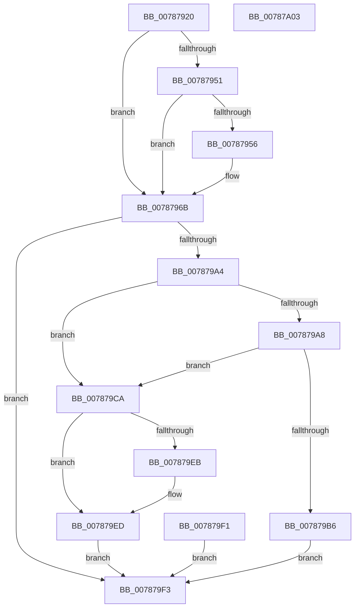

# NtAlertResumeThread

- RVA: `0x00787920`–`0x00787A04` (길이 `228` bytes)
- VA: `0x0000000140787920`
- 실행 섹션: `PAGE`
- PDB 이름 있음: `예`; PDB Function 태그: `아니요`
- unwind 정보 RVA: `0x000CF374`
- 디코드: `59`개 명령, `228/228` bytes 표시
- 미해석 바이트: `0` (있으면 어셈블리에 `.byte`로 보존)

> 이 문서는 커널 이미지의 기계어와 PDB 기호를 분석해 생성했습니다. 4번과 5번은 함수 원형과 자료형을 바이너리 사용 방식에서 추정한 C 해석이며 원본 소스 복구 결과는 아닙니다.

## 1. Dependencies

- 직접 호출 지점: **4**; 고유 호출 대상: **3**
- 직접 호출자로 확인된 함수: **0**
- RIP 상대 이미지 참조: **1**

### Outgoing calls
- `0x0078799B` → [ObpReferenceObjectByHandleWithTag](../86/ObpReferenceObjectByHandleWithTag_function_00869650.md) (function, `0x00869650`)
- `0x007879BE` → [ObfDereferenceObjectWithTag](../../text/2F/ObfDereferenceObjectWithTag_function_002F78E0.md) (function, `0x002F78E0`)
- `0x007879CF` → [KeAlertResumeThread](../../text/5B/KeAlertResumeThread_function_005B8E60.md) (function, `0x005B8E60`)
- `0x007879E0` → [ObfDereferenceObjectWithTag](../../text/2F/ObfDereferenceObjectWithTag_function_002F78E0.md) (function, `0x002F78E0`)

### Direct callers
- 이 함수 시작 RVA로 연결되는 직접 call은 확인되지 않았습니다. 간접 호출은 완전히 역산할 수 없습니다.

### Static image references
- `0x0078796B` → RVA `0x00FC6AC8` (`ALMOSTRO`; read)

## 2. Other-region calls and transfers

- 다른 실행 섹션으로 향하는 call: **3**
  - `0x007879BE` → [ObfDereferenceObjectWithTag](../../text/2F/ObfDereferenceObjectWithTag_function_002F78E0.md) (`PAGE` → `.text`)
  - `0x007879CF` → [KeAlertResumeThread](../../text/5B/KeAlertResumeThread_function_005B8E60.md) (`PAGE` → `.text`)
  - `0x007879E0` → [ObfDereferenceObjectWithTag](../../text/2F/ObfDereferenceObjectWithTag_function_002F78E0.md) (`PAGE` → `.text`)
- 별도 외부 분기/꼬리 이동을 확인하지 못했습니다.

## 3. Assembly (complete function range)

```asm
00787920  48 89 5C 24 08                  mov qword ptr [rsp + 8], rbx
00787925  48 89 74 24 10                  mov qword ptr [rsp + 0x10], rsi
0078792A  57                              push rdi
0078792B  48 83 EC 50                     sub rsp, 0x50
0078792F  48 8B FA                        mov rdi, rdx
00787932  4C 8B D1                        mov r10, rcx
00787935  48 C7 44 24 70 00 00 00 00      mov qword ptr [rsp + 0x70], 0
0078793E  65 48 8B 04 25 88 01 00 00      mov rax, qword ptr gs:[0x188]
00787947  8A 98 32 02 00 00               mov bl, byte ptr [rax + 0x232]
0078794D  84 DB                           test bl, bl
0078794F  74 1A                           je 0x14078796b
00787951  48 85 D2                        test rdx, rdx
00787954  74 15                           je 0x14078796b
00787956  48 B9 00 00 FF FF FF 7F 00 00   movabs rcx, 0x7fffffff0000
00787960  48 3B D1                        cmp rdx, rcx
00787963  48 0F 42 CA                     cmovb rcx, rdx
00787967  8B 01                           mov eax, dword ptr [rcx]
00787969  89 01                           mov dword ptr [rcx], eax
0078796B  4C 8B 05 56 F1 83 00            mov r8, qword ptr [rip + 0x83f156]
00787972  48 83 64 24 38 00               and qword ptr [rsp + 0x38], 0
00787978  48 83 64 24 30 00               and qword ptr [rsp + 0x30], 0
0078797E  48 8D 44 24 70                  lea rax, [rsp + 0x70]
00787983  48 89 44 24 28                  mov qword ptr [rsp + 0x28], rax
00787988  C7 44 24 20 50 73 53 75         mov dword ptr [rsp + 0x20], 0x75537350
00787990  44 8A CB                        mov r9b, bl
00787993  BA 02 00 00 00                  mov edx, 2
00787998  49 8B CA                        mov rcx, r10
0078799B  E8 B0 1C 0E 00                  call 0x140869650
007879A0  85 C0                           test eax, eax
007879A2  78 4F                           js 0x1407879f3
007879A4  84 DB                           test bl, bl
007879A6  74 22                           je 0x1407879ca
007879A8  48 8B 5C 24 70                  mov rbx, qword ptr [rsp + 0x70]
007879AD  F7 43 74 00 04 00 00            test dword ptr [rbx + 0x74], 0x400
007879B4  74 14                           je 0x1407879ca
007879B6  BA 50 73 53 75                  mov edx, 0x75537350
007879BB  48 8B CB                        mov rcx, rbx
007879BE  E8 1D FF B6 FF                  call 0x1402f78e0
007879C3  B8 22 00 00 C0                  mov eax, 0xc0000022
007879C8  EB 29                           jmp 0x1407879f3
007879CA  48 8B 4C 24 70                  mov rcx, qword ptr [rsp + 0x70]
007879CF  E8 8C 14 E3 FF                  call 0x1405b8e60
007879D4  8B F0                           mov esi, eax
007879D6  BA 50 73 53 75                  mov edx, 0x75537350
007879DB  48 8B 4C 24 70                  mov rcx, qword ptr [rsp + 0x70]
007879E0  E8 FB FE B6 FF                  call 0x1402f78e0
007879E5  90                              nop
007879E6  48 85 FF                        test rdi, rdi
007879E9  74 02                           je 0x1407879ed
007879EB  89 37                           mov dword ptr [rdi], esi
007879ED  33 C0                           xor eax, eax
007879EF  EB 02                           jmp 0x1407879f3
007879F1  EB 00                           jmp 0x1407879f3
007879F3  48 8B 5C 24 60                  mov rbx, qword ptr [rsp + 0x60]
007879F8  48 8B 74 24 68                  mov rsi, qword ptr [rsp + 0x68]
007879FD  48 83 C4 50                     add rsp, 0x50
00787A01  5F                              pop rdi
00787A02  C3                              ret
00787A03  CC                              int3
```

## 4. C-style interpretation (structured pseudocode)

```c
__int64 __fastcall NtAlertResumeThread(__int64 a1, __int64 a2)
{
    __int64 result;
    __int64 v_rsp;
    unsigned __int64 v_stack_m20;
    unsigned __int64 v_stack_m28;
    unsigned __int64 v_stack_m30;
    unsigned int v_stack_m38;
    unsigned __int64 v_stack_p10;
    unsigned __int64 v_stack_p18;
    unsigned __int64 v_stack_p8;

    v_stack_p8 = v_rbx;
    v_stack_p10 = v_rsi;
    v_rsp = (v_rsp) - (80);
    v_stack_p18 = 0;
    if ((unsigned __int8)(*(unsigned __int8 *)(*(unsigned __int64 *)(gs_base + (0 + 392)) + 562)) == 0) goto loc_0078796B;
    result = *(unsigned __int64 *)(gs_base + (0 + 392));
    if (a2 != 0) {
        if (a2 < a1) { a1 = a2; }
        result = *(unsigned int *)(a1);
        *(unsigned int *)(a1) = (unsigned int)(result);
    }
    v_stack_m30 = v_stack_p18;
    v_stack_m38 = 0x75537350ULL;
    result = ObpReferenceObjectByHandleWithTag(a1, 2, *(unsigned __int64 *)(v_rip + 8646998), (unsigned __int8)(*(unsigned __int8 *)(*(unsigned __int64 *)(gs_base + (0 + 392)) + 562)));
    if (sign_flag) goto loc_007879F3;
    if ((unsigned __int8)(*(unsigned __int8 *)(*(unsigned __int64 *)(gs_base + (0 + 392)) + 562)) == 0) goto loc_007879CA;
    if (((*(unsigned int *)(v_stack_p18 + 116)) & (0x400ULL)) == 0) goto loc_007879CA;
    result = ObfDereferenceObjectWithTag(v_stack_p18, (unsigned int)(0x75537350ULL), *(unsigned __int64 *)(v_rip + 8646998), (unsigned __int8)(*(unsigned __int8 *)(*(unsigned __int64 *)(gs_base + (0 + 392)) + 562)));
    goto loc_007879F3;
loc_007879CA:
    result = KeAlertResumeThread(v_stack_p18, (unsigned int)(0x75537350ULL), *(unsigned __int64 *)(v_rip + 8646998), (unsigned __int8)(*(unsigned __int8 *)(*(unsigned __int64 *)(gs_base + (0 + 392)) + 562)));
    result = ObfDereferenceObjectWithTag(v_stack_p18, (unsigned int)(0x75537350ULL), *(unsigned __int64 *)(v_rip + 8646998), (unsigned __int8)(*(unsigned __int8 *)(*(unsigned __int64 *)(gs_base + (0 + 392)) + 562)));
    if (a2 != 0) {
        *(unsigned int *)(a2) = (unsigned int)((unsigned int)((unsigned int)(result)));
    }
    result = 0;
    goto loc_007879F3;
loc_007879F3:
    v_rsp = (v_rsp) + (80);
    return result;
}
```

## 5. (Beta) C Style

```c
int64_t NtAlertResumeThread(int64_t Arg1, int64_t Arg2)
{
    int64_t result;
    int64_t local_rsp;
    uint64_t v_stack_m20;
    uint64_t v_stack_m28;
    uint64_t v_stack_m30;
    uint32_t v_stack_m38;
    uint64_t v_stack_p10;
    uint64_t v_stack_p18;
    uint64_t v_stack_p8;

    v_stack_p8 = local_rbx;
    v_stack_p10 = local_rsi;
    local_rsp = (local_rsp) - (80);
    v_stack_p18 = 0;
    if ((uint8_t)(*(uint8_t *)(*(uint64_t *)(gs_base + (0 + 0x188)) + 0x232)) == 0) goto loc_0078796B;
    result = *(uint64_t *)(gs_base + (0 + 0x188));
    if (Arg2 != 0) {
        if (Arg2 < Arg1) { Arg1 = Arg2; }
        result = *(uint32_t *)(Arg1);
        *(uint32_t *)(Arg1) = (uint32_t)(result);
    }
    v_stack_m30 = v_stack_p18;
    v_stack_m38 = 0x75537350ULL;
    result = ObpReferenceObjectByHandleWithTag(Arg1, 2, *(uint64_t *)(v_rip + 0x83F156), (uint8_t)(*(uint8_t *)(*(uint64_t *)(gs_base + (0 + 0x188)) + 0x232)));
    if (sign_flag) goto loc_007879F3;
    if ((uint8_t)(*(uint8_t *)(*(uint64_t *)(gs_base + (0 + 0x188)) + 0x232)) == 0) goto loc_007879CA;
    if (((*(uint32_t *)(v_stack_p18 + 0x74)) & (0x400ULL)) == 0) goto loc_007879CA;
    result = ObfDereferenceObjectWithTag(v_stack_p18, (uint32_t)(0x75537350ULL), *(uint64_t *)(v_rip + 0x83F156), (uint8_t)(*(uint8_t *)(*(uint64_t *)(gs_base + (0 + 0x188)) + 0x232)));
    goto loc_007879F3;
loc_007879CA:
    result = KeAlertResumeThread(v_stack_p18, (uint32_t)(0x75537350ULL), *(uint64_t *)(v_rip + 0x83F156), (uint8_t)(*(uint8_t *)(*(uint64_t *)(gs_base + (0 + 0x188)) + 0x232)));
    result = ObfDereferenceObjectWithTag(v_stack_p18, (uint32_t)(0x75537350ULL), *(uint64_t *)(v_rip + 0x83F156), (uint8_t)(*(uint8_t *)(*(uint64_t *)(gs_base + (0 + 0x188)) + 0x232)));
    if (Arg2 != 0) {
        *(uint32_t *)(Arg2) = (uint32_t)((uint32_t)((uint32_t)(result)));
    }
    result = 0;
    goto loc_007879F3;
loc_007879F3:
    local_rsp = (local_rsp) + (80);
    return result;
}
```

## 6. Execution-region graph

[열기: 2D/3D 그래프와 함수 탐색 컨트롤 패널](../../../control-panel.html?section=page&rva=0x00787920&view=graph)

- 2D 그래프는 위에서 아래로 흐르고, 3D 그래프는 빈 공간을 드래그해 회전합니다. Shift+드래그는 이동, 휠은 확대·축소, 함수 노드 선택은 대상 보고서 이동입니다.

### Static fallback


