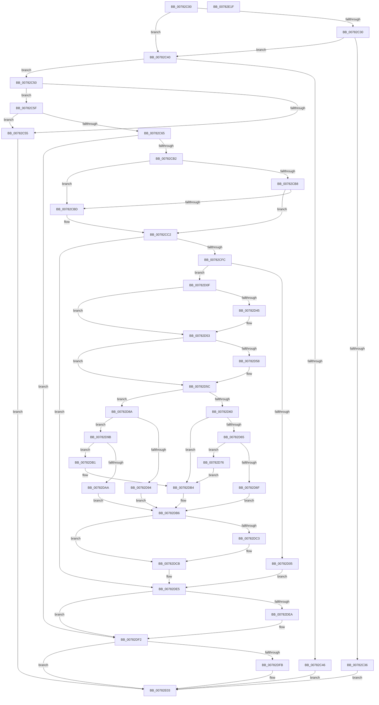

# NtChangeProcessState

- RVA: `0x00782C00`–`0x00782E20` (길이 `544` bytes)
- VA: `0x0000000140782C00`
- 실행 섹션: `PAGE`
- PDB 이름 있음: `예`; PDB Function 태그: `아니요`
- unwind 정보 RVA: `0x0006F120`
- 디코드: `148`개 명령, `544/544` bytes 표시
- 미해석 바이트: `0` (있으면 어셈블리에 `.byte`로 보존)

> 이 문서는 커널 이미지의 기계어와 PDB 기호를 분석해 생성했습니다. 4번과 5번은 함수 원형과 자료형을 바이너리 사용 방식에서 추정한 C 해석이며 원본 소스 복구 결과는 아닙니다.

## 1. Dependencies

- 직접 호출 지점: **11**; 고유 호출 대상: **9**
- 직접 호출자로 확인된 함수: **0**
- RIP 상대 이미지 참조: **2**

### Outgoing calls
- `0x00782CA3` → [ObpReferenceObjectByHandleWithTag](../86/ObpReferenceObjectByHandleWithTag_function_00869650.md) (function, `0x00869650`)
- `0x00782CE9` → [ObpReferenceObjectByHandleWithTag](../86/ObpReferenceObjectByHandleWithTag_function_00869650.md) (function, `0x00869650`)
- `0x00782D35` → [KeAbPreAcquire](../../text/21/KeAbPreAcquire_function_00210230.md) (function, `0x00210230`)
- `0x00782D4E` → [ExfAcquirePushLockExclusiveEx](../../text/20/ExfAcquirePushLockExclusiveEx_function_0020FC90.md) (function, `0x0020FC90`)
- `0x00782D80` → [PsThawMultiProcess](../../text/45/PsThawMultiProcess_function_0045FFE0.md) (function, `0x0045FFE0`)
- `0x00782DA1` → [PsFreezeProcess](../AA/PsFreezeProcess_function_00AA6D04.md) (function, `0x00AA6D04`)
- `0x00782DC6` → [ExfTryToWakePushLock](../../text/26/ExfTryToWakePushLock_function_00265DD0.md) (function, `0x00265DD0`)
- `0x00782DCE` → [KeAbPostRelease](../../text/2E/KeAbPostRelease_function_002E1600.md) (function, `0x002E1600`)
- `0x00782DD6` → [KiLeaveCriticalRegionUnsafe](../../text/25/KiLeaveCriticalRegionUnsafe_function_0025F010.md) (function, `0x0025F010`)
- `0x00782DED` → [ObfDereferenceObjectWithTag](../../text/2F/ObfDereferenceObjectWithTag_function_002F78E0.md) (function, `0x002F78E0`)
- `0x00782DFE` → [ObfDereferenceObjectWithTag](../../text/2F/ObfDereferenceObjectWithTag_function_002F78E0.md) (function, `0x002F78E0`)

### Direct callers
- 이 함수 시작 RVA로 연결되는 직접 call은 확인되지 않았습니다. 간접 호출은 완전히 역산할 수 없습니다.

### Static image references
- `0x00782C85` → RVA `0x00FC7238` (`ALMOSTRO`; read)
- `0x00782CD5` → RVA `0x00FC6A98` (`ALMOSTRO`; read)

## 2. Other-region calls and transfers

- 다른 실행 섹션으로 향하는 call: **8**
  - `0x00782D35` → [KeAbPreAcquire](../../text/21/KeAbPreAcquire_function_00210230.md) (`PAGE` → `.text`)
  - `0x00782D4E` → [ExfAcquirePushLockExclusiveEx](../../text/20/ExfAcquirePushLockExclusiveEx_function_0020FC90.md) (`PAGE` → `.text`)
  - `0x00782D80` → [PsThawMultiProcess](../../text/45/PsThawMultiProcess_function_0045FFE0.md) (`PAGE` → `.text`)
  - `0x00782DC6` → [ExfTryToWakePushLock](../../text/26/ExfTryToWakePushLock_function_00265DD0.md) (`PAGE` → `.text`)
  - `0x00782DCE` → [KeAbPostRelease](../../text/2E/KeAbPostRelease_function_002E1600.md) (`PAGE` → `.text`)
  - `0x00782DD6` → [KiLeaveCriticalRegionUnsafe](../../text/25/KiLeaveCriticalRegionUnsafe_function_0025F010.md) (`PAGE` → `.text`)
  - `0x00782DED` → [ObfDereferenceObjectWithTag](../../text/2F/ObfDereferenceObjectWithTag_function_002F78E0.md) (`PAGE` → `.text`)
  - `0x00782DFE` → [ObfDereferenceObjectWithTag](../../text/2F/ObfDereferenceObjectWithTag_function_002F78E0.md) (`PAGE` → `.text`)
- 별도 외부 분기/꼬리 이동을 확인하지 못했습니다.

## 3. Assembly (complete function range)

```asm
00782C00  48 89 5C 24 08                  mov qword ptr [rsp + 8], rbx
00782C05  48 89 74 24 10                  mov qword ptr [rsp + 0x10], rsi
00782C0A  48 89 7C 24 18                  mov qword ptr [rsp + 0x18], rdi
00782C0F  55                              push rbp
00782C10  41 56                           push r14
00782C12  41 57                           push r15
00782C14  48 8B EC                        mov rbp, rsp
00782C17  48 83 EC 50                     sub rsp, 0x50
00782C1B  48 83 65 F0 00                  and qword ptr [rbp - 0x10], 0
00782C20  41 8B F0                        mov esi, r8d
00782C23  48 83 65 F8 00                  and qword ptr [rbp - 8], 0
00782C28  4C 8B F2                        mov r14, rdx
00782C2B  45 85 C0                        test r8d, r8d
00782C2E  74 10                           je 0x140782c40
00782C30  41 83 F8 01                     cmp r8d, 1
00782C34  74 0A                           je 0x140782c40
00782C36  BF 03 00 00 C0                  mov edi, 0xc0000003
00782C3B  E9 C3 01 00 00                  jmp 0x140782e03
00782C40  83 7D 40 00                     cmp dword ptr [rbp + 0x40], 0
00782C44  74 0A                           je 0x140782c50
00782C46  BF 04 00 00 C0                  mov edi, 0xc0000004
00782C4B  E9 B3 01 00 00                  jmp 0x140782e03
00782C50  4D 85 C9                        test r9, r9
00782C53  74 0A                           je 0x140782c5f
00782C55  BF 0D 00 00 C0                  mov edi, 0xc000000d
00782C5A  E9 A4 01 00 00                  jmp 0x140782e03
00782C5F  83 7D 48 00                     cmp dword ptr [rbp + 0x48], 0
00782C63  75 F0                           jne 0x140782c55
00782C65  65 48 8B 04 25 88 01 00 00      mov rax, qword ptr gs:[0x188]
00782C6E  41 BF 50 73 50 63               mov r15d, 0x63507350
00782C74  48 83 64 24 38 00               and qword ptr [rsp + 0x38], 0
00782C7A  BA 01 00 00 00                  mov edx, 1
00782C7F  48 83 64 24 30 00               and qword ptr [rsp + 0x30], 0
00782C85  4C 8B 05 AC 45 84 00            mov r8, qword ptr [rip + 0x8445ac]
00782C8C  8A 98 32 02 00 00               mov bl, byte ptr [rax + 0x232]
00782C92  48 8D 45 F8                     lea rax, [rbp - 8]
00782C96  48 89 44 24 28                  mov qword ptr [rsp + 0x28], rax
00782C9B  44 8A CB                        mov r9b, bl
00782C9E  44 89 7C 24 20                  mov dword ptr [rsp + 0x20], r15d
00782CA3  E8 A8 69 0E 00                  call 0x140869650
00782CA8  8B F8                           mov edi, eax
00782CAA  85 C0                           test eax, eax
00782CAC  0F 88 40 01 00 00               js 0x140782df2
00782CB2  33 D2                           xor edx, edx
00782CB4  85 F6                           test esi, esi
00782CB6  74 05                           je 0x140782cbd
00782CB8  83 FE 01                        cmp esi, 1
00782CBB  75 05                           jne 0x140782cc2
00782CBD  BA 00 08 00 00                  mov edx, 0x800
00782CC2  48 83 64 24 38 00               and qword ptr [rsp + 0x38], 0
00782CC8  48 8D 45 F0                     lea rax, [rbp - 0x10]
00782CCC  48 83 64 24 30 00               and qword ptr [rsp + 0x30], 0
00782CD2  44 8A CB                        mov r9b, bl
00782CD5  4C 8B 05 BC 3D 84 00            mov r8, qword ptr [rip + 0x843dbc]
00782CDC  49 8B CE                        mov rcx, r14
00782CDF  48 89 44 24 28                  mov qword ptr [rsp + 0x28], rax
00782CE4  44 89 7C 24 20                  mov dword ptr [rsp + 0x20], r15d
00782CE9  E8 62 69 0E 00                  call 0x140869650
00782CEE  48 8B 4D F0                     mov rcx, qword ptr [rbp - 0x10]
00782CF2  8B F8                           mov edi, eax
00782CF4  85 C0                           test eax, eax
00782CF6  0F 88 E9 00 00 00               js 0x140782de5
00782CFC  48 8B 45 F8                     mov rax, qword ptr [rbp - 8]
00782D00  48 39 08                        cmp qword ptr [rax], rcx
00782D03  74 0A                           je 0x140782d0f
00782D05  BF 0D 00 00 C0                  mov edi, 0xc000000d
00782D0A  E9 D6 00 00 00                  jmp 0x140782de5
00782D0F  65 4C 8B 3C 25 88 01 00 00      mov r15, qword ptr gs:[0x188]
00782D18  48 83 CB FF                     or rbx, 0xffffffffffffffff
00782D1C  4C 8B 75 F8                     mov r14, qword ptr [rbp - 8]
00782D20  45 33 C0                        xor r8d, r8d
00782D23  49 83 C6 08                     add r14, 8
00782D27  33 D2                           xor edx, edx
00782D29  49 8B CE                        mov rcx, r14
00782D2C  66 41 01 9F E4 01 00 00         add word ptr [r15 + 0x1e4], bx
00782D34  90                              nop
00782D35  E8 F6 D4 A8 FF                  call 0x140210230
00782D3A  F0 49 0F BA 2E 00               lock bts qword ptr [r14], 0
00782D40  48 8B F8                        mov rdi, rax
00782D43  73 0E                           jae 0x140782d53
00782D45  4D 8B C6                        mov r8, r14
00782D48  48 8B D0                        mov rdx, rax
00782D4B  49 8B CE                        mov rcx, r14
00782D4E  E8 3D CF A8 FF                  call 0x14020fc90
00782D53  48 85 FF                        test rdi, rdi
00782D56  74 04                           je 0x140782d5c
00782D58  C6 47 0A 01                     mov byte ptr [rdi + 0xa], 1
00782D5C  85 F6                           test esi, esi
00782D5E  74 2A                           je 0x140782d8a
00782D60  83 FE 01                        cmp esi, 1
00782D63  75 4F                           jne 0x140782db4
00782D65  48 8B 7D F8                     mov rdi, qword ptr [rbp - 8]
00782D69  83 7F 10 00                     cmp dword ptr [rdi + 0x10], 0
00782D6D  75 07                           jne 0x140782d76
00782D6F  BF 0D 00 00 C0                  mov edi, 0xc000000d
00782D74  EB 40                           jmp 0x140782db6
00782D76  48 8B 4D F0                     mov rcx, qword ptr [rbp - 0x10]
00782D7A  33 D2                           xor edx, edx
00782D7C  44 8D 42 01                     lea r8d, [rdx + 1]
00782D80  E8 5B D2 CD FF                  call 0x14045ffe0
00782D85  FF 4F 10                        dec dword ptr [rdi + 0x10]
00782D88  EB 2A                           jmp 0x140782db4
00782D8A  48 8B 7D F8                     mov rdi, qword ptr [rbp - 8]
00782D8E  83 7F 10 FF                     cmp dword ptr [rdi + 0x10], -1
00782D92  75 07                           jne 0x140782d9b
00782D94  BF 4A 00 00 C0                  mov edi, 0xc000004a
00782D99  EB 1B                           jmp 0x140782db6
00782D9B  48 8B 4D F0                     mov rcx, qword ptr [rbp - 0x10]
00782D9F  33 D2                           xor edx, edx
00782DA1  E8 5E 3F 32 00                  call 0x140aa6d04
00782DA6  84 C0                           test al, al
00782DA8  75 07                           jne 0x140782db1
00782DAA  BF 0A 01 00 C0                  mov edi, 0xc000010a
00782DAF  EB 05                           jmp 0x140782db6
00782DB1  FF 47 10                        inc dword ptr [rdi + 0x10]
00782DB4  33 FF                           xor edi, edi
00782DB6  F0 49 0F C1 1E                  lock xadd qword ptr [r14], rbx
00782DBB  80 E3 06                        and bl, 6
00782DBE  80 FB 02                        cmp bl, 2
00782DC1  75 08                           jne 0x140782dcb
00782DC3  49 8B CE                        mov rcx, r14
00782DC6  E8 05 30 AE FF                  call 0x140265dd0
00782DCB  49 8B CE                        mov rcx, r14
00782DCE  E8 2D E8 B5 FF                  call 0x1402e1600
00782DD3  49 8B CF                        mov rcx, r15
00782DD6  E8 35 C2 AD FF                  call 0x14025f010
00782DDB  48 8B 4D F0                     mov rcx, qword ptr [rbp - 0x10]
00782DDF  41 BF 50 73 50 63               mov r15d, 0x63507350
00782DE5  48 85 C9                        test rcx, rcx
00782DE8  74 08                           je 0x140782df2
00782DEA  41 8B D7                        mov edx, r15d
00782DED  E8 EE 4A B7 FF                  call 0x1402f78e0
00782DF2  48 8B 4D F8                     mov rcx, qword ptr [rbp - 8]
00782DF6  48 85 C9                        test rcx, rcx
00782DF9  74 08                           je 0x140782e03
00782DFB  41 8B D7                        mov edx, r15d
00782DFE  E8 DD 4A B7 FF                  call 0x1402f78e0
00782E03  4C 8D 5C 24 50                  lea r11, [rsp + 0x50]
00782E08  8B C7                           mov eax, edi
00782E0A  49 8B 5B 20                     mov rbx, qword ptr [r11 + 0x20]
00782E0E  49 8B 73 28                     mov rsi, qword ptr [r11 + 0x28]
00782E12  49 8B 7B 30                     mov rdi, qword ptr [r11 + 0x30]
00782E16  49 8B E3                        mov rsp, r11
00782E19  41 5F                           pop r15
00782E1B  41 5E                           pop r14
00782E1D  5D                              pop rbp
00782E1E  C3                              ret
00782E1F  CC                              int3
```

## 4. C-style interpretation (structured pseudocode)

```c
__int64 __fastcall NtChangeProcessState(__int64 a1, __int64 a2, int a3, __int64 a4, unsigned int a5, unsigned int a6)
{
    __int64 result;
    __int64 v_r14;
    __int64 v_rbx;
    __int64 v_rdi;
    __int64 v_rsp;
    unsigned __int64 v_stack_m18;
    unsigned __int64 v_stack_m20;
    unsigned __int64 v_stack_m28;
    unsigned __int64 v_stack_m30;
    unsigned __int64 v_stack_m38;
    unsigned __int64 v_stack_m40;
    unsigned int v_stack_m48;
    unsigned __int64 v_stack_p10;
    unsigned __int64 v_stack_p18;
    unsigned __int64 v_stack_p8;

    v_stack_p8 = v_rbx;
    v_stack_p10 = v_rsi;
    v_stack_p18 = v_rdi;
    v_rsp = (v_rsp) - (80);
    if (a3 == 0) goto loc_00782C40;
    if (a3 == 1) goto loc_00782C40;
    goto loc_00782E03;
loc_00782C40:
    if (a5 == 0) goto loc_00782C50;
    goto loc_00782E03;
loc_00782C50:
    if (a4 == 0) goto loc_00782C5F;
loc_00782C55:
    goto loc_00782E03;
loc_00782C5F:
    if (a6 != 0) goto loc_00782C55;
    v_stack_m40 = v_stack_m20;
    v_stack_m48 = (unsigned int)((unsigned int)(0x63507350ULL));
    result = ObpReferenceObjectByHandleWithTag(a1, 1, *(unsigned __int64 *)(v_rip + 8668588), (unsigned __int8)(*(unsigned __int8 *)(*(unsigned __int64 *)(gs_base + (0 + 392)) + 562)));
    if (sign_flag) goto loc_00782DF2;
    a2 = 0;
    if ((unsigned int)((unsigned int)(a3)) == 0) goto loc_00782CBD;
    if (((unsigned int)((unsigned int)(a3))) == 1) {
        a2 = 0x800ULL;
    }
    v_stack_m40 = v_stack_m28;
    v_stack_m48 = (unsigned int)((unsigned int)(0x63507350ULL));
    result = ObpReferenceObjectByHandleWithTag(a2, a2, *(unsigned __int64 *)(v_rip + 8666556), (unsigned __int8)(*(unsigned __int8 *)(*(unsigned __int64 *)(gs_base + (0 + 392)) + 562)));
    if (sign_flag) goto loc_00782DE5;
    if ((*(unsigned __int64 *)(v_stack_m20)) == v_stack_m28) goto loc_00782D0F;
    goto loc_00782DE5;
loc_00782D0F:
    v_rbx = (*(unsigned __int8 *)(*(unsigned __int64 *)(gs_base + (0 + 392)) + 562)) | (-1);
    a3 = 0;
    v_r14 = (v_stack_m20) + (8);
    a2 = 0;
    result = KeAbPreAcquire(v_r14, a2, a3, (unsigned __int8)(*(unsigned __int8 *)(*(unsigned __int64 *)(gs_base + (0 + 392)) + 562)));
    if (!(condition_is_above_or_equal)) {
        a3 = v_r14;
        a2 = result;
        a1 = v_r14;
        result = ExfAcquirePushLockExclusiveEx(a1, a2, a3, (unsigned __int8)(*(unsigned __int8 *)(*(unsigned __int64 *)(gs_base + (0 + 392)) + 562)));
    }
    if (result != 0) {
        *(unsigned __int8 *)(result + 10) = 1;
    }
    if ((unsigned int)((unsigned int)(a3)) == 0) goto loc_00782D8A;
    if (((unsigned int)((unsigned int)(a3))) != 1) goto loc_00782DB4;
    if ((*(unsigned int *)(v_stack_m20 + 16)) != 0) goto loc_00782D76;
    goto loc_00782DB6;
loc_00782D76:
    a2 = 0;
    result = PsThawMultiProcess(v_stack_m28, a2, a2 + 1, (unsigned __int8)(*(unsigned __int8 *)(*(unsigned __int64 *)(gs_base + (0 + 392)) + 562)));
    goto loc_00782DB4;
loc_00782D8A:
    if ((*(unsigned int *)(v_stack_m20 + 16)) != -1) goto loc_00782D9B;
    goto loc_00782DB6;
loc_00782D9B:
    a2 = 0;
    result = PsFreezeProcess(v_stack_m28, a2, a2 + 1, (unsigned __int8)(*(unsigned __int8 *)(*(unsigned __int64 *)(gs_base + (0 + 392)) + 562)));
    if ((unsigned __int8)(result) != 0) goto loc_00782DB1;
    goto loc_00782DB6;
loc_00782DB1:
loc_00782DB4:
    v_rdi = 0;
loc_00782DB6:
    v_rbx = (unsigned __int8)((v_rbx) & (6));
    if (((unsigned __int8)(v_rbx)) == 2) {
        a1 = v_r14;
        result = ExfTryToWakePushLock(a1, a2, a2 + 1, (unsigned __int8)(*(unsigned __int8 *)(*(unsigned __int64 *)(gs_base + (0 + 392)) + 562)));
    }
    result = KeAbPostRelease(v_r14, a2, a2 + 1, (unsigned __int8)(*(unsigned __int8 *)(*(unsigned __int64 *)(gs_base + (0 + 392)) + 562)));
    result = KiLeaveCriticalRegionUnsafe(*(unsigned __int64 *)(gs_base + (0 + 392)), a2, a2 + 1, (unsigned __int8)(*(unsigned __int8 *)(*(unsigned __int64 *)(gs_base + (0 + 392)) + 562)));
loc_00782DE5:
    if (v_stack_m28 != 0) {
        a2 = (unsigned int)((unsigned int)(0x63507350ULL));
        result = ObfDereferenceObjectWithTag(v_stack_m28, a2, a2 + 1, (unsigned __int8)(*(unsigned __int8 *)(*(unsigned __int64 *)(gs_base + (0 + 392)) + 562)));
    }
    if (v_stack_m20 != 0) {
        a2 = (unsigned int)((unsigned int)(0x63507350ULL));
        result = ObfDereferenceObjectWithTag(v_stack_m20, a2, a2 + 1, (unsigned __int8)(*(unsigned __int8 *)(*(unsigned __int64 *)(gs_base + (0 + 392)) + 562)));
    }
    return 0;
}
```

## 5. (Beta) C Style

```c
int64_t NtChangeProcessState(int64_t Arg1, int64_t Arg2, int32_t Arg3, int64_t Arg4, uint32_t Arg5, uint32_t Arg6)
{
    int64_t result;
    int64_t local_r14;
    int64_t local_rbx;
    int64_t local_rdi;
    int64_t local_rsp;
    uint64_t v_stack_m18;
    uint64_t v_stack_m20;
    uint64_t v_stack_m28;
    uint64_t v_stack_m30;
    uint64_t v_stack_m38;
    uint64_t v_stack_m40;
    uint32_t v_stack_m48;
    uint64_t v_stack_p10;
    uint64_t v_stack_p18;
    uint64_t v_stack_p8;

    v_stack_p8 = local_rbx;
    v_stack_p10 = local_rsi;
    v_stack_p18 = local_rdi;
    local_rsp = (local_rsp) - (80);
    if (Arg3 == 0) goto loc_00782C40;
    if (Arg3 == 1) goto loc_00782C40;
    goto loc_00782E03;
loc_00782C40:
    if (Arg5 == 0) goto loc_00782C50;
    goto loc_00782E03;
loc_00782C50:
    if (Arg4 == 0) goto loc_00782C5F;
loc_00782C55:
    goto loc_00782E03;
loc_00782C5F:
    if (Arg6 != 0) goto loc_00782C55;
    v_stack_m40 = v_stack_m20;
    v_stack_m48 = (uint32_t)((uint32_t)(0x63507350ULL));
    result = ObpReferenceObjectByHandleWithTag(Arg1, 1, *(uint64_t *)(v_rip + 0x8445AC), (uint8_t)(*(uint8_t *)(*(uint64_t *)(gs_base + (0 + 0x188)) + 0x232)));
    if (sign_flag) goto loc_00782DF2;
    Arg2 = 0;
    if ((uint32_t)((uint32_t)(Arg3)) == 0) goto loc_00782CBD;
    if (((uint32_t)((uint32_t)(Arg3))) == 1) {
        Arg2 = 0x800ULL;
    }
    v_stack_m40 = v_stack_m28;
    v_stack_m48 = (uint32_t)((uint32_t)(0x63507350ULL));
    result = ObpReferenceObjectByHandleWithTag(Arg2, Arg2, *(uint64_t *)(v_rip + 0x843DBC), (uint8_t)(*(uint8_t *)(*(uint64_t *)(gs_base + (0 + 0x188)) + 0x232)));
    if (sign_flag) goto loc_00782DE5;
    if ((*(uint64_t *)(v_stack_m20)) == v_stack_m28) goto loc_00782D0F;
    goto loc_00782DE5;
loc_00782D0F:
    local_rbx = (*(uint8_t *)(*(uint64_t *)(gs_base + (0 + 0x188)) + 0x232)) | (-1);
    Arg3 = 0;
    local_r14 = (v_stack_m20) + (8);
    Arg2 = 0;
    result = KeAbPreAcquire(local_r14, Arg2, Arg3, (uint8_t)(*(uint8_t *)(*(uint64_t *)(gs_base + (0 + 0x188)) + 0x232)));
    if (!(condition_is_above_or_equal)) {
        Arg3 = local_r14;
        Arg2 = result;
        Arg1 = local_r14;
        result = ExfAcquirePushLockExclusiveEx(Arg1, Arg2, Arg3, (uint8_t)(*(uint8_t *)(*(uint64_t *)(gs_base + (0 + 0x188)) + 0x232)));
    }
    if (result != 0) {
        *(uint8_t *)(result + 0xA) = 1;
    }
    if ((uint32_t)((uint32_t)(Arg3)) == 0) goto loc_00782D8A;
    if (((uint32_t)((uint32_t)(Arg3))) != 1) goto loc_00782DB4;
    if ((*(uint32_t *)(v_stack_m20 + 0x10)) != 0) goto loc_00782D76;
    goto loc_00782DB6;
loc_00782D76:
    Arg2 = 0;
    result = PsThawMultiProcess(v_stack_m28, Arg2, Arg2 + 1, (uint8_t)(*(uint8_t *)(*(uint64_t *)(gs_base + (0 + 0x188)) + 0x232)));
    goto loc_00782DB4;
loc_00782D8A:
    if ((*(uint32_t *)(v_stack_m20 + 0x10)) != -1) goto loc_00782D9B;
    goto loc_00782DB6;
loc_00782D9B:
    Arg2 = 0;
    result = PsFreezeProcess(v_stack_m28, Arg2, Arg2 + 1, (uint8_t)(*(uint8_t *)(*(uint64_t *)(gs_base + (0 + 0x188)) + 0x232)));
    if ((uint8_t)(result) != 0) goto loc_00782DB1;
    goto loc_00782DB6;
loc_00782DB1:
loc_00782DB4:
    local_rdi = 0;
loc_00782DB6:
    local_rbx = (uint8_t)((local_rbx) & (6));
    if (((uint8_t)(local_rbx)) == 2) {
        Arg1 = local_r14;
        result = ExfTryToWakePushLock(Arg1, Arg2, Arg2 + 1, (uint8_t)(*(uint8_t *)(*(uint64_t *)(gs_base + (0 + 0x188)) + 0x232)));
    }
    result = KeAbPostRelease(local_r14, Arg2, Arg2 + 1, (uint8_t)(*(uint8_t *)(*(uint64_t *)(gs_base + (0 + 0x188)) + 0x232)));
    result = KiLeaveCriticalRegionUnsafe(*(uint64_t *)(gs_base + (0 + 0x188)), Arg2, Arg2 + 1, (uint8_t)(*(uint8_t *)(*(uint64_t *)(gs_base + (0 + 0x188)) + 0x232)));
loc_00782DE5:
    if (v_stack_m28 != 0) {
        Arg2 = (uint32_t)((uint32_t)(0x63507350ULL));
        result = ObfDereferenceObjectWithTag(v_stack_m28, Arg2, Arg2 + 1, (uint8_t)(*(uint8_t *)(*(uint64_t *)(gs_base + (0 + 0x188)) + 0x232)));
    }
    if (v_stack_m20 != 0) {
        Arg2 = (uint32_t)((uint32_t)(0x63507350ULL));
        result = ObfDereferenceObjectWithTag(v_stack_m20, Arg2, Arg2 + 1, (uint8_t)(*(uint8_t *)(*(uint64_t *)(gs_base + (0 + 0x188)) + 0x232)));
    }
    return 0;
}
```

## 6. Execution-region graph

[열기: 2D/3D 그래프와 함수 탐색 컨트롤 패널](../../../control-panel.html?section=page&rva=0x00782C00&view=graph)

- 2D 그래프는 위에서 아래로 흐르고, 3D 그래프는 빈 공간을 드래그해 회전합니다. Shift+드래그는 이동, 휠은 확대·축소, 함수 노드 선택은 대상 보고서 이동입니다.

### Static fallback


