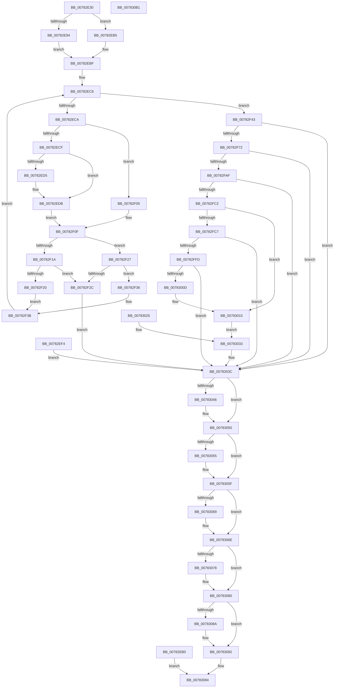

# NtCreateCpuPartition

- RVA: `0x00782E30`–`0x007830B2` (길이 `642` bytes)
- VA: `0x0000000140782E30`
- 실행 섹션: `PAGE`
- PDB 이름 있음: `예`; PDB Function 태그: `아니요`
- unwind 정보 RVA: `0x000CF0F8`
- 디코드: `176`개 명령, `642/642` bytes 표시
- 미해석 바이트: `0` (있으면 어셈블리에 `.byte`로 보존)

> 이 문서는 커널 이미지의 기계어와 PDB 기호를 분석해 생성했습니다. 4번과 5번은 함수 원형과 자료형을 바이너리 사용 방식에서 추정한 C 해석이며 원본 소스 복구 결과는 아닙니다.

## 1. Dependencies

- 직접 호출 지점: **11**; 고유 호출 대상: **11**
- 직접 호출자로 확인된 함수: **0**
- RIP 상대 이미지 참조: **1**

### Outgoing calls
- `0x00782ED5` → [ExRaiseDatatypeMisalignment](../89/ExRaiseDatatypeMisalignment_function_00899FD0.md) (function, `0x00899FD0`)
- `0x00782F63` → [PspReferenceCpuPartitionByHandle](PspReferenceCpuPartitionByHandle_function_007846F4.md) (function, `0x007846F4`)
- `0x00782FA0` → [PsCreateCpuPartition](PsCreateCpuPartition_function_00783A8C.md) (function, `0x00783A8C`)
- `0x00782FB7` → [PspQueryAndCheckCpuPartitionName](PspQueryAndCheckCpuPartitionName_function_0078445C.md) (function, `0x0078445C`)
- `0x00782FF2` → [ObOpenObjectByPointer](../8B/ObOpenObjectByPointer_function_008B7420.md) (function, `0x008B7420`)
- `0x00783002` → [ZwMakePermanentObject](../../text/6A/ZwMakePermanentObject_function_006AF3D0.md) (function, `0x006AF3D0`)
- `0x0078304B` → [ObfDereferenceObjectWithTag](../../text/2F/ObfDereferenceObjectWithTag_function_002F78E0.md) (function, `0x002F78E0`)
- `0x0078305A` → [ZwMakeTemporaryObject](../../text/6A/ZwMakeTemporaryObject_function_006AF3F0.md) (function, `0x006AF3F0`)
- `0x00783069` → [ZwClose](../../text/6A/ZwClose_function_006AD2B0.md) (function, `0x006AD2B0`)
- `0x0078307B` → [ObCloseHandle](../8A/ObCloseHandle_function_008A1870.md) (function, `0x008A1870`)
- `0x0078308D` → [ObfDereferenceObject](../../text/2F/ObfDereferenceObject_function_002F9350.md) (function, `0x002F9350`)

### Direct callers
- 이 함수 시작 RVA로 연결되는 직접 call은 확인되지 않았습니다. 간접 호출은 완전히 역산할 수 없습니다.

### Static image references
- `0x00782FD5` → RVA `0x00FC6DF0` (`ALMOSTRO`; read)

## 2. Other-region calls and transfers

- 다른 실행 섹션으로 향하는 call: **5**
  - `0x00783002` → [ZwMakePermanentObject](../../text/6A/ZwMakePermanentObject_function_006AF3D0.md) (`PAGE` → `.text`)
  - `0x0078304B` → [ObfDereferenceObjectWithTag](../../text/2F/ObfDereferenceObjectWithTag_function_002F78E0.md) (`PAGE` → `.text`)
  - `0x0078305A` → [ZwMakeTemporaryObject](../../text/6A/ZwMakeTemporaryObject_function_006AF3F0.md) (`PAGE` → `.text`)
  - `0x00783069` → [ZwClose](../../text/6A/ZwClose_function_006AD2B0.md) (`PAGE` → `.text`)
  - `0x0078308D` → [ObfDereferenceObject](../../text/2F/ObfDereferenceObject_function_002F9350.md) (`PAGE` → `.text`)
- 별도 외부 분기/꼬리 이동을 확인하지 못했습니다.

## 3. Assembly (complete function range)

```asm
00782E30  48 8B C4                        mov rax, rsp
00782E33  48 89 58 08                     mov qword ptr [rax + 8], rbx
00782E37  48 89 70 18                     mov qword ptr [rax + 0x18], rsi
00782E3B  89 50 10                        mov dword ptr [rax + 0x10], edx
00782E3E  57                              push rdi
00782E3F  41 54                           push r12
00782E41  41 55                           push r13
00782E43  41 56                           push r14
00782E45  41 57                           push r15
00782E47  48 81 EC 80 00 00 00            sub rsp, 0x80
00782E4E  4D 8B F0                        mov r14, r8
00782E51  4C 8B E9                        mov r13, rcx
00782E54  0F 57 C0                        xorps xmm0, xmm0
00782E57  0F 11 40 C0                     movups xmmword ptr [rax - 0x40], xmm0
00782E5B  33 DB                           xor ebx, ebx
00782E5D  44 8A E3                        mov r12b, bl
00782E60  40 8A F3                        mov sil, bl
00782E63  88 5C 24 40                     mov byte ptr [rsp + 0x40], bl
00782E67  48 89 58 B0                     mov qword ptr [rax - 0x50], rbx
00782E6B  44 8B D3                        mov r10d, ebx
00782E6E  48 89 58 B8                     mov qword ptr [rax - 0x48], rbx
00782E72  48 89 58 A8                     mov qword ptr [rax - 0x58], rbx
00782E76  48 89 58 A0                     mov qword ptr [rax - 0x60], rbx
00782E7A  65 48 8B 04 25 88 01 00 00      mov rax, qword ptr gs:[0x188]
00782E83  44 8A B8 32 02 00 00            mov r15b, byte ptr [rax + 0x232]
00782E8A  44 88 7C 24 41                  mov byte ptr [rsp + 0x41], r15b
00782E8F  45 84 FF                        test r15b, r15b
00782E92  74 21                           je 0x140782eb5
00782E94  48 BA 00 00 FF FF FF 7F 00 00   movabs rdx, 0x7fffffff0000
00782E9E  48 8B CA                        mov rcx, rdx
00782EA1  4C 3B EA                        cmp r13, rdx
00782EA4  49 0F 42 CD                     cmovb rcx, r13
00782EA8  48 8B 01                        mov rax, qword ptr [rcx]
00782EAB  48 89 01                        mov qword ptr [rcx], rax
00782EAE  EB 0F                           jmp 0x140782ebf
00782EB0  E9 DF 01 00 00                  jmp 0x140783094
00782EB5  48 BA 00 00 FF FF FF 7F 00 00   movabs rdx, 0x7fffffff0000
00782EBF  8B 8C 24 D0 00 00 00            mov ecx, dword ptr [rsp + 0xd0]
00782EC6  85 C9                           test ecx, ecx
00782EC8  74 79                           je 0x140782f43
00782ECA  45 84 FF                        test r15b, r15b
00782ECD  74 36                           je 0x140782f05
00782ECF  41 F6 C1 07                     test r9b, 7
00782ED3  74 06                           je 0x140782edb
00782ED5  E8 F6 70 11 00                  call 0x140899fd0
00782EDA  CC                              int3
00782EDB  49 8B C1                        mov rax, r9
00782EDE  4C 3B CA                        cmp r9, rdx
00782EE1  48 0F 43 C2                     cmovae rax, rdx
00782EE5  90                              nop
00782EE6  8A 00                           mov al, byte ptr [rax]
00782EE8  41 0F 10 01                     movups xmm0, xmmword ptr [r9]
00782EEC  F3 0F 7F 44 24 68               movdqu xmmword ptr [rsp + 0x68], xmm0
00782EF2  EB 1B                           jmp 0x140782f0f
00782EF4  8B F8                           mov edi, eax
00782EF6  33 DB                           xor ebx, ebx
00782EF8  44 8A 7C 24 41                  mov r15b, byte ptr [rsp + 0x41]
00782EFD  40 8A F3                        mov sil, bl
00782F00  E9 37 01 00 00                  jmp 0x14078303c
00782F05  41 0F 10 01                     movups xmm0, xmmword ptr [r9]
00782F09  F3 0F 7F 44 24 68               movdqu xmmword ptr [rsp + 0x68], xmm0
00782F0F  0F B6 44 24 68                  movzx eax, byte ptr [rsp + 0x68]
00782F14  48 83 E8 01                     sub rax, 1
00782F18  74 0D                           je 0x140782f27
00782F1A  48 83 F8 01                     cmp rax, 1
00782F1E  75 0C                           jne 0x140782f2c
00782F20  4C 8B 64 24 70                  mov r12, qword ptr [rsp + 0x70]
00782F25  EB 14                           jmp 0x140782f3b
00782F27  4D 85 D2                        test r10, r10
00782F2A  74 0A                           je 0x140782f36
00782F2C  BF 0D 00 00 C0                  mov edi, 0xc000000d
00782F31  E9 06 01 00 00                  jmp 0x14078303c
00782F36  4C 8B 54 24 70                  mov r10, qword ptr [rsp + 0x70]
00782F3B  49 83 C1 10                     add r9, 0x10
00782F3F  FF C9                           dec ecx
00782F41  EB 83                           jmp 0x140782ec6
00782F43  48 83 C8 FF                     or rax, 0xffffffffffffffff
00782F47  4D 85 D2                        test r10, r10
00782F4A  4C 0F 44 D0                     cmove r10, rax
00782F4E  48 8D 44 24 58                  lea rax, [rsp + 0x58]
00782F53  48 89 44 24 20                  mov qword ptr [rsp + 0x20], rax
00782F58  45 8A C7                        mov r8b, r15b
00782F5B  BA 02 00 00 00                  mov edx, 2
00782F60  49 8B CA                        mov rcx, r10
00782F63  E8 8C 17 00 00                  call 0x1407846f4
00782F68  8B F8                           mov edi, eax
00782F6A  85 C0                           test eax, eax
00782F6C  0F 88 CA 00 00 00               js 0x14078303c
00782F72  48 8D 44 24 50                  lea rax, [rsp + 0x50]
00782F77  48 89 44 24 30                  mov qword ptr [rsp + 0x30], rax
00782F7C  48 8D 44 24 60                  lea rax, [rsp + 0x60]
00782F81  48 89 44 24 28                  mov qword ptr [rsp + 0x28], rax
00782F86  48 8B 44 24 58                  mov rax, qword ptr [rsp + 0x58]
00782F8B  48 89 44 24 20                  mov qword ptr [rsp + 0x20], rax
00782F90  45 33 C9                        xor r9d, r9d
00782F93  45 8A C7                        mov r8b, r15b
00782F96  8B 94 24 B8 00 00 00            mov edx, dword ptr [rsp + 0xb8]
00782F9D  49 8B CE                        mov rcx, r14
00782FA0  E8 E7 0A 00 00                  call 0x140783a8c
00782FA5  8B F8                           mov edi, eax
00782FA7  85 C0                           test eax, eax
00782FA9  0F 88 8D 00 00 00               js 0x14078303c
00782FAF  4C 8B 74 24 60                  mov r14, qword ptr [rsp + 0x60]
00782FB4  49 8B CE                        mov rcx, r14
00782FB7  E8 A0 14 00 00                  call 0x14078445c
00782FBC  8B F8                           mov edi, eax
00782FBE  85 C0                           test eax, eax
00782FC0  78 7A                           js 0x14078303c
00782FC2  45 84 E4                        test r12b, r12b
00782FC5  74 4E                           je 0x140783015
00782FC7  48 8D 44 24 48                  lea rax, [rsp + 0x48]
00782FCC  48 89 44 24 30                  mov qword ptr [rsp + 0x30], rax
00782FD1  88 5C 24 28                     mov byte ptr [rsp + 0x28], bl
00782FD5  48 8B 05 14 3E 84 00            mov rax, qword ptr [rip + 0x843e14]
00782FDC  48 89 44 24 20                  mov qword ptr [rsp + 0x20], rax
00782FE1  41 B9 07 00 0F 00               mov r9d, 0xf0007
00782FE7  45 33 C0                        xor r8d, r8d
00782FEA  BA 00 02 00 00                  mov edx, 0x200
00782FEF  49 8B CE                        mov rcx, r14
00782FF2  E8 29 44 13 00                  call 0x1408b7420
00782FF7  8B F8                           mov edi, eax
00782FF9  85 C0                           test eax, eax
00782FFB  78 3F                           js 0x14078303c
00782FFD  48 8B 4C 24 48                  mov rcx, qword ptr [rsp + 0x48]
00783002  E8 C9 C3 F2 FF                  call 0x1406af3d0
00783007  8B F8                           mov edi, eax
00783009  85 C0                           test eax, eax
0078300B  78 2F                           js 0x14078303c
0078300D  40 B6 01                        mov sil, 1
00783010  40 88 74 24 40                  mov byte ptr [rsp + 0x40], sil
00783015  48 8B 44 24 50                  mov rax, qword ptr [rsp + 0x50]
0078301A  49 89 45 00                     mov qword ptr [r13], rax
0078301E  48 89 5C 24 50                  mov qword ptr [rsp + 0x50], rbx
00783023  EB 0E                           jmp 0x140783033
00783025  8B F8                           mov edi, eax
00783027  33 DB                           xor ebx, ebx
00783029  44 8A 7C 24 41                  mov r15b, byte ptr [rsp + 0x41]
0078302E  40 8A 74 24 40                  mov sil, byte ptr [rsp + 0x40]
00783033  40 0F B6 F6                     movzx esi, sil
00783037  85 FF                           test edi, edi
00783039  0F 49 F3                        cmovns esi, ebx
0078303C  48 8B 4C 24 58                  mov rcx, qword ptr [rsp + 0x58]
00783041  48 85 C9                        test rcx, rcx
00783044  74 0A                           je 0x140783050
00783046  BA 50 73 70 50                  mov edx, 0x50707350
0078304B  E8 90 48 B7 FF                  call 0x1402f78e0
00783050  40 84 F6                        test sil, sil
00783053  74 0A                           je 0x14078305f
00783055  48 8B 4C 24 48                  mov rcx, qword ptr [rsp + 0x48]
0078305A  E8 91 C3 F2 FF                  call 0x1406af3f0
0078305F  48 8B 4C 24 48                  mov rcx, qword ptr [rsp + 0x48]
00783064  48 85 C9                        test rcx, rcx
00783067  74 05                           je 0x14078306e
00783069  E8 42 A2 F2 FF                  call 0x1406ad2b0
0078306E  48 8B 4C 24 50                  mov rcx, qword ptr [rsp + 0x50]
00783073  48 85 C9                        test rcx, rcx
00783076  74 08                           je 0x140783080
00783078  41 8A D7                        mov dl, r15b
0078307B  E8 F0 E7 11 00                  call 0x1408a1870
00783080  4C 8B 74 24 60                  mov r14, qword ptr [rsp + 0x60]
00783085  4D 85 F6                        test r14, r14
00783088  74 08                           je 0x140783092
0078308A  49 8B CE                        mov rcx, r14
0078308D  E8 BE 62 B7 FF                  call 0x1402f9350
00783092  8B C7                           mov eax, edi
00783094  4C 8D 9C 24 80 00 00 00         lea r11, [rsp + 0x80]
0078309C  49 8B 5B 30                     mov rbx, qword ptr [r11 + 0x30]
007830A0  49 8B 73 40                     mov rsi, qword ptr [r11 + 0x40]
007830A4  49 8B E3                        mov rsp, r11
007830A7  41 5F                           pop r15
007830A9  41 5E                           pop r14
007830AB  41 5D                           pop r13
007830AD  41 5C                           pop r12
007830AF  5F                              pop rdi
007830B0  C3                              ret
007830B1  CC                              int3
```

## 4. C-style interpretation (structured pseudocode)

```c
__int64 __fastcall NtCreateCpuPartition(__int64 a1, int a2, __int64 a3, __int64 a4, unsigned int a5)
{
    __int64 result;
    __int64 v_r10;
    __int64 v_rbx;
    __int64 v_rsi;
    __int64 v_rsp;
    unsigned __int64 v_stack_m28;
    unsigned __int64 v_stack_m38;
    unsigned __int64 v_stack_m40;
    unsigned __int64 v_stack_m48;
    unsigned __int64 v_stack_m50;
    unsigned __int64 v_stack_m58;
    unsigned __int64 v_stack_m60;
    unsigned __int8 v_stack_m67;
    unsigned __int8 v_stack_m68;
    unsigned __int64 v_stack_m78;
    unsigned __int64 v_stack_m80;
    unsigned __int64 v_stack_m88;
    unsigned int v_stack_p10;

    *(unsigned __int64 *)(v_rsp + 8) = v_rbx;
    *(unsigned __int64 *)(v_rsp + 24) = v_rsi;
    *(unsigned int *)(v_rsp + 16) = a2;
    v_rsp = (v_rsp) - (128);
    *(unsigned __int64 *)(v_rsp - 64) = v_xmm0;
    v_rbx = 0;
    v_stack_m68 = 0;
    *(unsigned __int64 *)(v_rsp - 80) = 0;
    *(unsigned __int64 *)(v_rsp - 72) = 0;
    *(unsigned __int64 *)(v_rsp - 88) = 0;
    *(unsigned __int64 *)(v_rsp - 96) = 0;
    v_stack_m67 = (unsigned __int8)(*(unsigned __int8 *)(*(unsigned __int64 *)(gs_base + (0 + 392)) + 562));
    if ((unsigned __int8)(*(unsigned __int8 *)(*(unsigned __int64 *)(gs_base + (0 + 392)) + 562)) == 0) goto loc_00782EB5;
    if (a1 < a2) { a2 = a1; }
    *(unsigned __int64 *)(a2) = *(unsigned __int64 *)(a2);
    goto loc_00782EBF;
loc_00782EB5:
loc_00782EBF:
loc_00782EC6:
    if ((unsigned int)((unsigned int)(a5)) == 0) goto loc_00782F43;
    if ((unsigned __int8)(*(unsigned __int8 *)(*(unsigned __int64 *)(gs_base + (0 + 392)) + 562)) == 0) goto loc_00782F05;
    result = *(unsigned __int64 *)(a2);
    if ((((unsigned __int8)(a4)) & (7)) != 0) {
        result = ExRaiseDatatypeMisalignment((unsigned int)(a5), a2, a3, a4);
    }
    if (a4 >= a2) { a4 = a2; }
    v_stack_m40 = v_xmm0;
    goto loc_00782F0F;
loc_00782F05:
    v_stack_m40 = v_xmm0;
loc_00782F0F:
    result = (v_stack_m40) - (1);
    if (condition_is_equal) goto loc_00782F27;
    if (result != 1) goto loc_00782F2C;
    goto loc_00782F3B;
loc_00782F27:
    if (0 == 0) goto loc_00782F36;
loc_00782F2C:
    goto loc_0078303C;
loc_00782F36:
loc_00782F3B:
    a4 = (a4) + (16);
    a1 = (unsigned int)(((unsigned int)(a5)) - 1);
    goto loc_00782EC6;
loc_00782F43:
    result = (result) | (-1);
    v_r10 = v_stack_m38;
    if (v_stack_m38 == 0) { v_r10 = result; }
    v_stack_m88 = v_stack_m50;
    result = PspReferenceCpuPartitionByHandle(v_r10, 2, (unsigned __int8)(*(unsigned __int8 *)(*(unsigned __int64 *)(gs_base + (0 + 392)) + 562)), a4);
    if (sign_flag) goto loc_0078303C;
    v_stack_m78 = v_stack_m58;
    v_stack_m80 = v_stack_m48;
    v_stack_m88 = v_stack_m50;
    a4 = 0;
    result = PsCreateCpuPartition(a3, (unsigned int)(v_stack_p10), (unsigned __int8)(*(unsigned __int8 *)(*(unsigned __int64 *)(gs_base + (0 + 392)) + 562)), a4);
    if (sign_flag) goto loc_0078303C;
    result = PspQueryAndCheckCpuPartitionName(v_stack_m48, (unsigned int)(v_stack_p10), (unsigned __int8)(*(unsigned __int8 *)(*(unsigned __int64 *)(gs_base + (0 + 392)) + 562)), a4);
    if (sign_flag) goto loc_0078303C;
    if ((unsigned __int8)(v_stack_m38) == 0) goto loc_00783015;
    v_stack_m78 = v_stack_m60;
    v_stack_m80 = 0;
    v_stack_m88 = *(unsigned __int64 *)(v_rip + 8666644);
    a3 = 0;
    result = ObOpenObjectByPointer(v_stack_m48, 512, a3, (unsigned int)(0xF0007ULL));
    if (sign_flag) goto loc_0078303C;
    result = ZwMakePermanentObject(v_stack_m60, 512, a3, (unsigned int)(0xF0007ULL));
    if (sign_flag) goto loc_0078303C;
    v_stack_m68 = 1;
loc_00783015:
    *(unsigned __int64 *)(a1) = v_stack_m58;
    v_stack_m58 = 0;
    goto loc_00783033;
loc_00783033:
    v_rsi = 1;
    if (!sign_flag) { v_rsi = 0; }
loc_0078303C:
    result = v_stack_m58;
    if (v_stack_m50 != 0) {
        a2 = 0x50707350ULL;
        result = ObfDereferenceObjectWithTag(v_stack_m50, a2, a3, (unsigned int)(0xF0007ULL));
    }
    if ((unsigned __int8)(v_rsi) != 0) {
        a1 = v_stack_m60;
        result = ZwMakeTemporaryObject(a1, a2, a3, (unsigned int)(0xF0007ULL));
    }
    if (v_stack_m60 != 0) {
        result = ZwClose(v_stack_m60, a2, a3, (unsigned int)(0xF0007ULL));
    }
    if (v_stack_m58 != 0) {
        a2 = (unsigned __int8)(*(unsigned __int8 *)(*(unsigned __int64 *)(gs_base + (0 + 392)) + 562));
        result = ObCloseHandle(v_stack_m58, a2, a3, (unsigned int)(0xF0007ULL));
    }
    if (v_stack_m48 != 0) {
        a1 = v_stack_m48;
        result = ObfDereferenceObject(a1, a2, a3, (unsigned int)(0xF0007ULL));
    }
loc_00783094:
    return (unsigned int)((unsigned int)((unsigned int)((unsigned int)(result))));
}
```

## 5. (Beta) C Style

```c
int64_t NtCreateCpuPartition(int64_t Arg1, int32_t Arg2, int64_t Arg3, int64_t Arg4, uint32_t Arg5)
{
    int64_t result;
    int64_t local_r10;
    int64_t local_rbx;
    int64_t local_rsi;
    int64_t local_rsp;
    uint64_t v_stack_m28;
    uint64_t v_stack_m38;
    uint64_t v_stack_m40;
    uint64_t v_stack_m48;
    uint64_t v_stack_m50;
    uint64_t v_stack_m58;
    uint64_t v_stack_m60;
    uint8_t v_stack_m67;
    uint8_t v_stack_m68;
    uint64_t v_stack_m78;
    uint64_t v_stack_m80;
    uint64_t v_stack_m88;
    uint32_t v_stack_p10;

    *(uint64_t *)(local_rsp + 0x8) = local_rbx;
    *(uint64_t *)(local_rsp + 0x18) = local_rsi;
    *(uint32_t *)(local_rsp + 0x10) = Arg2;
    local_rsp = (local_rsp) - (128);
    *(uint64_t *)(local_rsp - 0x40) = v_xmm0;
    local_rbx = 0;
    v_stack_m68 = 0;
    *(uint64_t *)(local_rsp - 0x50) = 0;
    *(uint64_t *)(local_rsp - 0x48) = 0;
    *(uint64_t *)(local_rsp - 0x58) = 0;
    *(uint64_t *)(local_rsp - 0x60) = 0;
    v_stack_m67 = (uint8_t)(*(uint8_t *)(*(uint64_t *)(gs_base + (0 + 0x188)) + 0x232));
    if ((uint8_t)(*(uint8_t *)(*(uint64_t *)(gs_base + (0 + 0x188)) + 0x232)) == 0) goto loc_00782EB5;
    if (Arg1 < Arg2) { Arg2 = Arg1; }
    *(uint64_t *)(Arg2) = *(uint64_t *)(Arg2);
    goto loc_00782EBF;
loc_00782EB5:
loc_00782EBF:
loc_00782EC6:
    if ((uint32_t)((uint32_t)(Arg5)) == 0) goto loc_00782F43;
    if ((uint8_t)(*(uint8_t *)(*(uint64_t *)(gs_base + (0 + 0x188)) + 0x232)) == 0) goto loc_00782F05;
    result = *(uint64_t *)(Arg2);
    if ((((uint8_t)(Arg4)) & (7)) != 0) {
        result = ExRaiseDatatypeMisalignment((uint32_t)(Arg5), Arg2, Arg3, Arg4);
    }
    if (Arg4 >= Arg2) { Arg4 = Arg2; }
    v_stack_m40 = v_xmm0;
    goto loc_00782F0F;
loc_00782F05:
    v_stack_m40 = v_xmm0;
loc_00782F0F:
    result = (v_stack_m40) - (1);
    if (condition_is_equal) goto loc_00782F27;
    if (result != 1) goto loc_00782F2C;
    goto loc_00782F3B;
loc_00782F27:
    if (0 == 0) goto loc_00782F36;
loc_00782F2C:
    goto loc_0078303C;
loc_00782F36:
loc_00782F3B:
    Arg4 = (Arg4) + (16);
    Arg1 = (uint32_t)(((uint32_t)(Arg5)) - 1);
    goto loc_00782EC6;
loc_00782F43:
    result = (result) | (-1);
    local_r10 = v_stack_m38;
    if (v_stack_m38 == 0) { local_r10 = result; }
    v_stack_m88 = v_stack_m50;
    result = PspReferenceCpuPartitionByHandle(local_r10, 2, (uint8_t)(*(uint8_t *)(*(uint64_t *)(gs_base + (0 + 0x188)) + 0x232)), Arg4);
    if (sign_flag) goto loc_0078303C;
    v_stack_m78 = v_stack_m58;
    v_stack_m80 = v_stack_m48;
    v_stack_m88 = v_stack_m50;
    Arg4 = 0;
    result = PsCreateCpuPartition(Arg3, (uint32_t)(v_stack_p10), (uint8_t)(*(uint8_t *)(*(uint64_t *)(gs_base + (0 + 0x188)) + 0x232)), Arg4);
    if (sign_flag) goto loc_0078303C;
    result = PspQueryAndCheckCpuPartitionName(v_stack_m48, (uint32_t)(v_stack_p10), (uint8_t)(*(uint8_t *)(*(uint64_t *)(gs_base + (0 + 0x188)) + 0x232)), Arg4);
    if (sign_flag) goto loc_0078303C;
    if ((uint8_t)(v_stack_m38) == 0) goto loc_00783015;
    v_stack_m78 = v_stack_m60;
    v_stack_m80 = 0;
    v_stack_m88 = *(uint64_t *)(v_rip + 0x843E14);
    Arg3 = 0;
    result = ObOpenObjectByPointer(v_stack_m48, 512, Arg3, (uint32_t)(0xF0007ULL));
    if (sign_flag) goto loc_0078303C;
    result = ZwMakePermanentObject(v_stack_m60, 512, Arg3, (uint32_t)(0xF0007ULL));
    if (sign_flag) goto loc_0078303C;
    v_stack_m68 = 1;
loc_00783015:
    *(uint64_t *)(Arg1) = v_stack_m58;
    v_stack_m58 = 0;
    goto loc_00783033;
loc_00783033:
    local_rsi = 1;
    if (!sign_flag) { local_rsi = 0; }
loc_0078303C:
    result = v_stack_m58;
    if (v_stack_m50 != 0) {
        Arg2 = 0x50707350ULL;
        result = ObfDereferenceObjectWithTag(v_stack_m50, Arg2, Arg3, (uint32_t)(0xF0007ULL));
    }
    if ((uint8_t)(local_rsi) != 0) {
        Arg1 = v_stack_m60;
        result = ZwMakeTemporaryObject(Arg1, Arg2, Arg3, (uint32_t)(0xF0007ULL));
    }
    if (v_stack_m60 != 0) {
        result = ZwClose(v_stack_m60, Arg2, Arg3, (uint32_t)(0xF0007ULL));
    }
    if (v_stack_m58 != 0) {
        Arg2 = (uint8_t)(*(uint8_t *)(*(uint64_t *)(gs_base + (0 + 0x188)) + 0x232));
        result = ObCloseHandle(v_stack_m58, Arg2, Arg3, (uint32_t)(0xF0007ULL));
    }
    if (v_stack_m48 != 0) {
        Arg1 = v_stack_m48;
        result = ObfDereferenceObject(Arg1, Arg2, Arg3, (uint32_t)(0xF0007ULL));
    }
loc_00783094:
    return (uint32_t)((uint32_t)((uint32_t)((uint32_t)(result))));
}
```

## 6. Execution-region graph

[열기: 2D/3D 그래프와 함수 탐색 컨트롤 패널](../../../control-panel.html?section=page&rva=0x00782E30&view=graph)

- 2D 그래프는 위에서 아래로 흐르고, 3D 그래프는 빈 공간을 드래그해 회전합니다. Shift+드래그는 이동, 휠은 확대·축소, 함수 노드 선택은 대상 보고서 이동입니다.

### Static fallback


