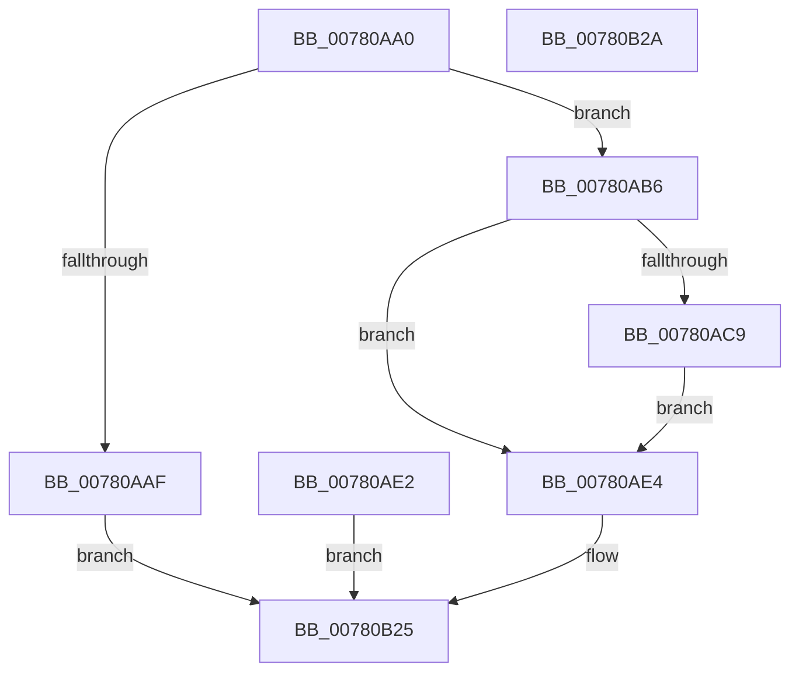

# NtCreateProcessEx

- RVA: `0x00780AA0`–`0x00780B2B` (길이 `139` bytes)
- VA: `0x0000000140780AA0`
- 실행 섹션: `PAGE`
- PDB 이름 있음: `예`; PDB Function 태그: `아니요`
- unwind 정보 RVA: `0x000CE190`
- 디코드: `33`개 명령, `139/139` bytes 표시
- 미해석 바이트: `0` (있으면 어셈블리에 `.byte`로 보존)

> 이 문서는 커널 이미지의 기계어와 PDB 기호를 분석해 생성했습니다. 4번과 5번은 함수 원형과 자료형을 바이너리 사용 방식에서 추정한 C 해석이며 원본 소스 복구 결과는 아닙니다.

## 1. Dependencies

- 직접 호출 지점: **1**; 고유 호출 대상: **1**
- 직접 호출자로 확인된 함수: **1**
- RIP 상대 이미지 참조: **0**

### Outgoing calls
- `0x00780B20` → [PspCreateProcess](../A1/PspCreateProcess_function_00A12758.md) (function, `0x00A12758`)

### Direct callers
- [NtCreateProcess](NtCreateProcess_function_00780A10.md) at `0x00780A7C`

### Static image references
- 디코드된 RIP-relative 메모리 참조가 없습니다.

## 2. Other-region calls and transfers

- 다른 실행 섹션으로 향하는 call: **0**
- 별도 외부 분기/꼬리 이동을 확인하지 못했습니다.

## 3. Assembly (complete function range)

```asm
00780AA0  48 83 EC 58                     sub rsp, 0x58
00780AA4  44 8B DA                        mov r11d, edx
00780AA7  4C 8B D1                        mov r10, rcx
00780AAA  4D 85 C9                        test r9, r9
00780AAD  75 07                           jne 0x140780ab6
00780AAF  B8 0D 00 00 C0                  mov eax, 0xc000000d
00780AB4  EB 6F                           jmp 0x140780b25
00780AB6  65 48 8B 04 25 88 01 00 00      mov rax, qword ptr gs:[0x188]
00780ABF  8A 90 32 02 00 00               mov dl, byte ptr [rax + 0x232]
00780AC5  84 D2                           test dl, dl
00780AC7  74 1B                           je 0x140780ae4
00780AC9  48 B9 00 00 FF FF FF 7F 00 00   movabs rcx, 0x7fffffff0000
00780AD3  4C 3B D1                        cmp r10, rcx
00780AD6  49 0F 42 CA                     cmovb rcx, r10
00780ADA  48 8B 01                        mov rax, qword ptr [rcx]
00780ADD  48 89 01                        mov qword ptr [rcx], rax
00780AE0  EB 02                           jmp 0x140780ae4
00780AE2  EB 41                           jmp 0x140780b25
00780AE4  48 8B 84 24 98 00 00 00         mov rax, qword ptr [rsp + 0x98]
00780AEC  48 89 44 24 40                  mov qword ptr [rsp + 0x40], rax
00780AF1  48 8B 84 24 90 00 00 00         mov rax, qword ptr [rsp + 0x90]
00780AF9  48 89 44 24 38                  mov qword ptr [rsp + 0x38], rax
00780AFE  48 8B 84 24 88 00 00 00         mov rax, qword ptr [rsp + 0x88]
00780B06  48 89 44 24 30                  mov qword ptr [rsp + 0x30], rax
00780B0B  8B 84 24 80 00 00 00            mov eax, dword ptr [rsp + 0x80]
00780B12  89 44 24 28                     mov dword ptr [rsp + 0x28], eax
00780B16  88 54 24 20                     mov byte ptr [rsp + 0x20], dl
00780B1A  41 8B D3                        mov edx, r11d
00780B1D  49 8B CA                        mov rcx, r10
00780B20  E8 33 1C 29 00                  call 0x140a12758
00780B25  48 83 C4 58                     add rsp, 0x58
00780B29  C3                              ret
00780B2A  CC                              int3
```

## 4. C-style interpretation (structured pseudocode)

```c
__int64 __fastcall NtCreateProcessEx(__int64 a1, int a2, __int64 a3, __int64 a4, unsigned int a5, __int64 a6, __int64 a7, __int64 a8)
{
    __int64 result;
    __int64 v_rsp;
    unsigned __int64 v_stack_m18;
    unsigned __int64 v_stack_m20;
    unsigned __int64 v_stack_m28;
    unsigned int v_stack_m30;
    unsigned __int8 v_stack_m38;

    v_rsp = (v_rsp) - (88);
    if (a4 != 0) goto loc_00780AB6;
    goto loc_00780B25;
loc_00780AB6:
    if ((unsigned __int8)(*(unsigned __int8 *)(*(unsigned __int64 *)(gs_base + (0 + 392)) + 562)) == 0) goto loc_00780AE4;
    if (a1 < a1) { a1 = a1; }
    *(unsigned __int64 *)(a1) = *(unsigned __int64 *)(a1);
    goto loc_00780AE4;
loc_00780AE4:
    v_stack_m18 = a8;
    v_stack_m20 = a7;
    v_stack_m28 = a6;
    v_stack_m30 = (unsigned int)((unsigned int)(a5));
    v_stack_m38 = (unsigned __int8)(*(unsigned __int8 *)(*(unsigned __int64 *)(gs_base + (0 + 392)) + 562));
    result = PspCreateProcess(a1, (unsigned int)((unsigned int)((unsigned int)(a2))), a3, a4);
loc_00780B25:
    v_rsp = (v_rsp) + (88);
    return result;
}
```

## 5. (Beta) C Style

```c
int64_t NtCreateProcessEx(int64_t Arg1, int32_t Arg2, int64_t Arg3, int64_t Arg4, uint32_t Arg5, int64_t Arg6, int64_t Arg7, int64_t Arg8)
{
    int64_t result;
    int64_t local_rsp;
    uint64_t v_stack_m18;
    uint64_t v_stack_m20;
    uint64_t v_stack_m28;
    uint32_t v_stack_m30;
    uint8_t v_stack_m38;

    local_rsp = (local_rsp) - (88);
    if (Arg4 != 0) goto loc_00780AB6;
    goto loc_00780B25;
loc_00780AB6:
    if ((uint8_t)(*(uint8_t *)(*(uint64_t *)(gs_base + (0 + 0x188)) + 0x232)) == 0) goto loc_00780AE4;
    if (Arg1 < Arg1) { Arg1 = Arg1; }
    *(uint64_t *)(Arg1) = *(uint64_t *)(Arg1);
    goto loc_00780AE4;
loc_00780AE4:
    v_stack_m18 = Arg8;
    v_stack_m20 = Arg7;
    v_stack_m28 = Arg6;
    v_stack_m30 = (uint32_t)((uint32_t)(Arg5));
    v_stack_m38 = (uint8_t)(*(uint8_t *)(*(uint64_t *)(gs_base + (0 + 0x188)) + 0x232));
    result = PspCreateProcess(Arg1, (uint32_t)((uint32_t)((uint32_t)(Arg2))), Arg3, Arg4);
loc_00780B25:
    local_rsp = (local_rsp) + (88);
    return result;
}
```

## 6. Execution-region graph

[열기: 2D/3D 그래프와 함수 탐색 컨트롤 패널](../../../control-panel.html?section=page&rva=0x00780AA0&view=graph)

- 2D 그래프는 위에서 아래로 흐르고, 3D 그래프는 빈 공간을 드래그해 회전합니다. Shift+드래그는 이동, 휠은 확대·축소, 함수 노드 선택은 대상 보고서 이동입니다.

### Static fallback


