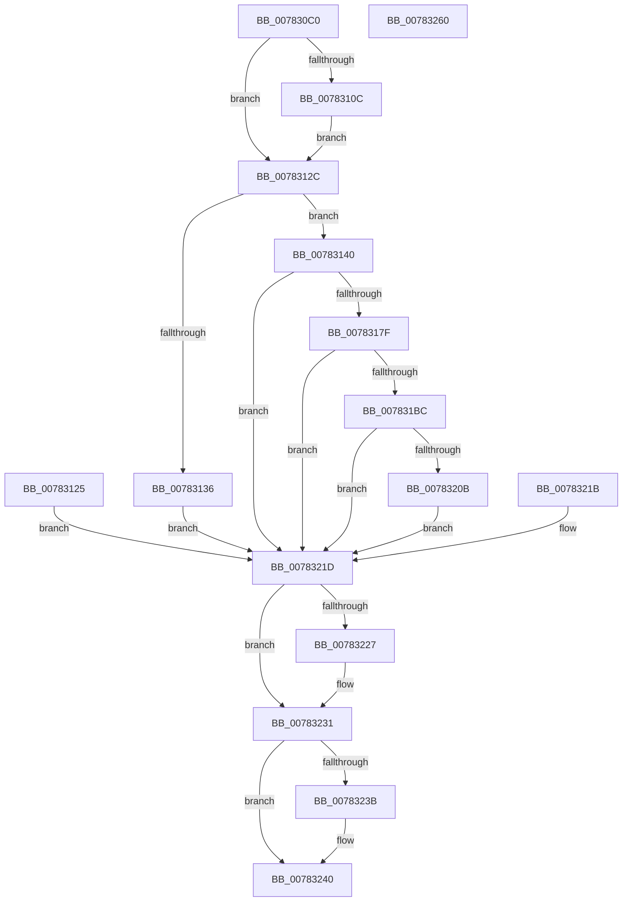

# NtCreateProcessStateChange

- RVA: `0x007830C0`–`0x00783261` (길이 `417` bytes)
- VA: `0x00000001407830C0`
- 실행 섹션: `PAGE`
- PDB 이름 있음: `예`; PDB Function 태그: `아니요`
- unwind 정보 RVA: `0x000CF060`
- 디코드: `102`개 명령, `417/417` bytes 표시
- 미해석 바이트: `0` (있으면 어셈블리에 `.byte`로 보존)

> 이 문서는 커널 이미지의 기계어와 PDB 기호를 분석해 생성했습니다. 4번과 5번은 함수 원형과 자료형을 바이너리 사용 방식에서 추정한 C 해석이며 원본 소스 복구 결과는 아닙니다.

## 1. Dependencies

- 직접 호출 지점: **5**; 고유 호출 대상: **5**
- 직접 호출자로 확인된 함수: **0**
- RIP 상대 이미지 참조: **2**

### Outgoing calls
- `0x00783170` → [ObpReferenceObjectByHandleWithTag](../86/ObpReferenceObjectByHandleWithTag_function_00869650.md) (function, `0x00869650`)
- `0x007831B1` → [ObCreateObjectEx](../89/ObCreateObjectEx_function_0089B1E0.md) (function, `0x0089B1E0`)
- `0x00783200` → [ObInsertObjectEx](../8B/ObInsertObjectEx_function_008B97A0.md) (function, `0x008B97A0`)
- `0x0078322C` → [ObfDereferenceObjectWithTag](../../text/2F/ObfDereferenceObjectWithTag_function_002F78E0.md) (function, `0x002F78E0`)
- `0x0078323B` → [NtClose](../86/NtClose_function_00868870.md) (function, `0x00868870`)

### Direct callers
- 이 함수 시작 RVA로 연결되는 직접 call은 확인되지 않았습니다. 간접 호출은 완전히 역산할 수 없습니다.

### Static image references
- `0x00783140` → RVA `0x00FC6A98` (`ALMOSTRO`; read)
- `0x0078317F` → RVA `0x00FC7238` (`ALMOSTRO`; read)

## 2. Other-region calls and transfers

- 다른 실행 섹션으로 향하는 call: **1**
  - `0x0078322C` → [ObfDereferenceObjectWithTag](../../text/2F/ObfDereferenceObjectWithTag_function_002F78E0.md) (`PAGE` → `.text`)
- 별도 외부 분기/꼬리 이동을 확인하지 못했습니다.

## 3. Assembly (complete function range)

```asm
007830C0  48 8B C4                        mov rax, rsp
007830C3  48 89 70 08                     mov qword ptr [rax + 8], rsi
007830C7  48 89 78 10                     mov qword ptr [rax + 0x10], rdi
007830CB  4C 89 60 18                     mov qword ptr [rax + 0x18], r12
007830CF  4C 89 70 20                     mov qword ptr [rax + 0x20], r14
007830D3  41 57                           push r15
007830D5  48 81 EC 80 00 00 00            sub rsp, 0x80
007830DC  4D 8B D1                        mov r10, r9
007830DF  4D 8B F8                        mov r15, r8
007830E2  44 8B E2                        mov r12d, edx
007830E5  48 8B F1                        mov rsi, rcx
007830E8  48 83 60 D0 00                  and qword ptr [rax - 0x30], 0
007830ED  48 83 60 E0 00                  and qword ptr [rax - 0x20], 0
007830F2  48 83 60 D8 00                  and qword ptr [rax - 0x28], 0
007830F7  65 48 8B 04 25 88 01 00 00      mov rax, qword ptr gs:[0x188]
00783100  44 8A B0 32 02 00 00            mov r14b, byte ptr [rax + 0x232]
00783107  45 84 F6                        test r14b, r14b
0078310A  74 20                           je 0x14078312c
0078310C  48 B9 00 00 FF FF FF 7F 00 00   movabs rcx, 0x7fffffff0000
00783116  48 3B F1                        cmp rsi, rcx
00783119  48 0F 42 CE                     cmovb rcx, rsi
0078311D  48 8B 01                        mov rax, qword ptr [rcx]
00783120  48 89 01                        mov qword ptr [rcx], rax
00783123  EB 07                           jmp 0x14078312c
00783125  8B F8                           mov edi, eax
00783127  E9 F1 00 00 00                  jmp 0x14078321d
0078312C  83 BC 24 B0 00 00 00 00         cmp dword ptr [rsp + 0xb0], 0
00783134  74 0A                           je 0x140783140
00783136  BF 0D 00 00 C0                  mov edi, 0xc000000d
0078313B  E9 DD 00 00 00                  jmp 0x14078321d
00783140  4C 8B 05 51 39 84 00            mov r8, qword ptr [rip + 0x843951]
00783147  48 83 64 24 38 00               and qword ptr [rsp + 0x38], 0
0078314D  48 83 64 24 30 00               and qword ptr [rsp + 0x30], 0
00783153  48 8D 44 24 58                  lea rax, [rsp + 0x58]
00783158  48 89 44 24 28                  mov qword ptr [rsp + 0x28], rax
0078315D  C7 44 24 20 50 73 50 63         mov dword ptr [rsp + 0x20], 0x63507350
00783165  45 8A CE                        mov r9b, r14b
00783168  BA 00 02 00 00                  mov edx, 0x200
0078316D  49 8B CA                        mov rcx, r10
00783170  E8 DB 64 0E 00                  call 0x140869650
00783175  8B F8                           mov edi, eax
00783177  85 C0                           test eax, eax
00783179  0F 88 9E 00 00 00               js 0x14078321d
0078317F  48 8B 15 B2 40 84 00            mov rdx, qword ptr [rip + 0x8440b2]
00783186  48 83 64 24 48 00               and qword ptr [rsp + 0x48], 0
0078318C  48 8D 44 24 68                  lea rax, [rsp + 0x68]
00783191  48 89 44 24 40                  mov qword ptr [rsp + 0x40], rax
00783196  83 64 24 38 00                  and dword ptr [rsp + 0x38], 0
0078319B  83 64 24 30 00                  and dword ptr [rsp + 0x30], 0
007831A0  C7 44 24 28 18 00 00 00         mov dword ptr [rsp + 0x28], 0x18
007831A8  45 8A CE                        mov r9b, r14b
007831AB  4D 8B C7                        mov r8, r15
007831AE  41 8A CE                        mov cl, r14b
007831B1  E8 2A 80 11 00                  call 0x14089b1e0
007831B6  8B F8                           mov edi, eax
007831B8  85 C0                           test eax, eax
007831BA  78 61                           js 0x14078321d
007831BC  0F 57 C0                        xorps xmm0, xmm0
007831BF  33 C0                           xor eax, eax
007831C1  48 8B 4C 24 68                  mov rcx, qword ptr [rsp + 0x68]
007831C6  0F 11 01                        movups xmmword ptr [rcx], xmm0
007831C9  48 89 41 10                     mov qword ptr [rcx + 0x10], rax
007831CD  48 21 41 08                     and qword ptr [rcx + 8], rax
007831D1  48 8B 44 24 58                  mov rax, qword ptr [rsp + 0x58]
007831D6  48 89 01                        mov qword ptr [rcx], rax
007831D9  83 61 10 00                     and dword ptr [rcx + 0x10], 0
007831DD  48 83 64 24 58 00               and qword ptr [rsp + 0x58], 0
007831E3  48 8D 44 24 60                  lea rax, [rsp + 0x60]
007831E8  48 89 44 24 30                  mov qword ptr [rsp + 0x30], rax
007831ED  48 83 64 24 28 00               and qword ptr [rsp + 0x28], 0
007831F3  83 64 24 20 00                  and dword ptr [rsp + 0x20], 0
007831F8  45 33 C9                        xor r9d, r9d
007831FB  45 8B C4                        mov r8d, r12d
007831FE  33 D2                           xor edx, edx
00783200  E8 9B 65 13 00                  call 0x1408b97a0
00783205  8B F8                           mov edi, eax
00783207  85 C0                           test eax, eax
00783209  78 12                           js 0x14078321d
0078320B  48 8B 44 24 60                  mov rax, qword ptr [rsp + 0x60]
00783210  48 89 06                        mov qword ptr [rsi], rax
00783213  48 83 64 24 60 00               and qword ptr [rsp + 0x60], 0
00783219  EB 02                           jmp 0x14078321d
0078321B  8B F8                           mov edi, eax
0078321D  48 8B 4C 24 58                  mov rcx, qword ptr [rsp + 0x58]
00783222  48 85 C9                        test rcx, rcx
00783225  74 0A                           je 0x140783231
00783227  BA 50 73 50 63                  mov edx, 0x63507350
0078322C  E8 AF 46 B7 FF                  call 0x1402f78e0
00783231  48 8B 4C 24 60                  mov rcx, qword ptr [rsp + 0x60]
00783236  48 85 C9                        test rcx, rcx
00783239  74 05                           je 0x140783240
0078323B  E8 30 56 0E 00                  call 0x140868870
00783240  8B C7                           mov eax, edi
00783242  4C 8D 9C 24 80 00 00 00         lea r11, [rsp + 0x80]
0078324A  49 8B 73 10                     mov rsi, qword ptr [r11 + 0x10]
0078324E  49 8B 7B 18                     mov rdi, qword ptr [r11 + 0x18]
00783252  4D 8B 63 20                     mov r12, qword ptr [r11 + 0x20]
00783256  4D 8B 73 28                     mov r14, qword ptr [r11 + 0x28]
0078325A  49 8B E3                        mov rsp, r11
0078325D  41 5F                           pop r15
0078325F  C3                              ret
00783260  CC                              int3
```

## 4. C-style interpretation (structured pseudocode)

```c
__int64 __fastcall NtCreateProcessStateChange(__int64 a1, int a2, __int64 a3, __int64 a4, unsigned int a5)
{
    __int64 result;
    __int64 v_rsp;
    unsigned __int64 v_stack_m20;
    unsigned __int64 v_stack_m28;
    unsigned __int64 v_stack_m30;
    unsigned __int64 v_stack_m40;
    unsigned __int64 v_stack_m48;
    unsigned __int64 v_stack_m50;
    unsigned __int64 v_stack_m58;
    unsigned __int64 v_stack_m60;
    unsigned int v_stack_m68;
    unsigned __int64 v_stack_m8;

    *(unsigned __int64 *)(v_rsp + 8) = v_rsi;
    *(unsigned __int64 *)(v_rsp + 16) = v_rdi;
    *(unsigned __int64 *)(v_rsp + 24) = v_r12;
    *(unsigned __int64 *)(v_rsp + 32) = v_r14;
    v_rsp = (v_rsp) - (128);
    if ((unsigned __int8)(*(unsigned __int8 *)(*(unsigned __int64 *)(gs_base + (0 + 392)) + 562)) == 0) goto loc_0078312C;
    if (a1 < a1) { a1 = a1; }
    *(unsigned __int64 *)(a1) = *(unsigned __int64 *)(a1);
    goto loc_0078312C;
loc_0078312C:
    if (a5 == 0) goto loc_00783140;
    goto loc_0078321D;
loc_00783140:
    v_stack_m60 = v_stack_m30;
    v_stack_m68 = 0x63507350ULL;
    result = ObpReferenceObjectByHandleWithTag(a4, 512, *(unsigned __int64 *)(v_rip + 8665425), (unsigned __int8)(*(unsigned __int8 *)(*(unsigned __int64 *)(gs_base + (0 + 392)) + 562)));
    if (sign_flag) goto loc_0078321D;
    v_stack_m48 = v_stack_m20;
    v_stack_m60 = 24;
    result = ObCreateObjectEx((unsigned __int8)(*(unsigned __int8 *)(*(unsigned __int64 *)(gs_base + (0 + 392)) + 562)), *(unsigned __int64 *)(v_rip + 8667314), a3, (unsigned __int8)(*(unsigned __int8 *)(*(unsigned __int64 *)(gs_base + (0 + 392)) + 562)));
    if (sign_flag) goto loc_0078321D;
    result = 0;
    *(unsigned __int64 *)(v_stack_m20) = v_xmm0;
    *(unsigned __int64 *)(v_stack_m20 + 16) = 0;
    *(unsigned __int64 *)(v_stack_m20) = v_stack_m30;
    v_stack_m58 = v_stack_m28;
    a4 = 0;
    a2 = 0;
    result = ObInsertObjectEx(v_stack_m20, a2, (unsigned int)((unsigned int)((unsigned int)(a2))), a4);
    if (sign_flag) goto loc_0078321D;
    *(unsigned __int64 *)(a1) = v_stack_m28;
    goto loc_0078321D;
loc_0078321D:
    result = v_stack_m28;
    if (v_stack_m30 != 0) {
        a2 = 0x63507350ULL;
        result = ObfDereferenceObjectWithTag(v_stack_m30, a2, (unsigned int)((unsigned int)((unsigned int)(a2))), a4);
    }
    if (v_stack_m28 != 0) {
        result = NtClose(v_stack_m28, a2, (unsigned int)((unsigned int)((unsigned int)(a2))), a4);
    }
    return (unsigned int)((unsigned int)((unsigned int)((unsigned int)(result))));
}
```

## 5. (Beta) C Style

```c
int64_t NtCreateProcessStateChange(int64_t Arg1, int32_t Arg2, int64_t Arg3, int64_t Arg4, uint32_t Arg5)
{
    int64_t result;
    int64_t local_rsp;
    uint64_t v_stack_m20;
    uint64_t v_stack_m28;
    uint64_t v_stack_m30;
    uint64_t v_stack_m40;
    uint64_t v_stack_m48;
    uint64_t v_stack_m50;
    uint64_t v_stack_m58;
    uint64_t v_stack_m60;
    uint32_t v_stack_m68;
    uint64_t v_stack_m8;

    *(uint64_t *)(local_rsp + 0x8) = local_rsi;
    *(uint64_t *)(local_rsp + 0x10) = local_rdi;
    *(uint64_t *)(local_rsp + 0x18) = local_r12;
    *(uint64_t *)(local_rsp + 0x20) = local_r14;
    local_rsp = (local_rsp) - (128);
    if ((uint8_t)(*(uint8_t *)(*(uint64_t *)(gs_base + (0 + 0x188)) + 0x232)) == 0) goto loc_0078312C;
    if (Arg1 < Arg1) { Arg1 = Arg1; }
    *(uint64_t *)(Arg1) = *(uint64_t *)(Arg1);
    goto loc_0078312C;
loc_0078312C:
    if (Arg5 == 0) goto loc_00783140;
    goto loc_0078321D;
loc_00783140:
    v_stack_m60 = v_stack_m30;
    v_stack_m68 = 0x63507350ULL;
    result = ObpReferenceObjectByHandleWithTag(Arg4, 512, *(uint64_t *)(v_rip + 0x843951), (uint8_t)(*(uint8_t *)(*(uint64_t *)(gs_base + (0 + 0x188)) + 0x232)));
    if (sign_flag) goto loc_0078321D;
    v_stack_m48 = v_stack_m20;
    v_stack_m60 = 24;
    result = ObCreateObjectEx((uint8_t)(*(uint8_t *)(*(uint64_t *)(gs_base + (0 + 0x188)) + 0x232)), *(uint64_t *)(v_rip + 0x8440B2), Arg3, (uint8_t)(*(uint8_t *)(*(uint64_t *)(gs_base + (0 + 0x188)) + 0x232)));
    if (sign_flag) goto loc_0078321D;
    result = 0;
    *(uint64_t *)(v_stack_m20) = v_xmm0;
    *(uint64_t *)(v_stack_m20 + 0x10) = 0;
    *(uint64_t *)(v_stack_m20) = v_stack_m30;
    v_stack_m58 = v_stack_m28;
    Arg4 = 0;
    Arg2 = 0;
    result = ObInsertObjectEx(v_stack_m20, Arg2, (uint32_t)((uint32_t)((uint32_t)(Arg2))), Arg4);
    if (sign_flag) goto loc_0078321D;
    *(uint64_t *)(Arg1) = v_stack_m28;
    goto loc_0078321D;
loc_0078321D:
    result = v_stack_m28;
    if (v_stack_m30 != 0) {
        Arg2 = 0x63507350ULL;
        result = ObfDereferenceObjectWithTag(v_stack_m30, Arg2, (uint32_t)((uint32_t)((uint32_t)(Arg2))), Arg4);
    }
    if (v_stack_m28 != 0) {
        result = NtClose(v_stack_m28, Arg2, (uint32_t)((uint32_t)((uint32_t)(Arg2))), Arg4);
    }
    return (uint32_t)((uint32_t)((uint32_t)((uint32_t)(result))));
}
```

## 6. Execution-region graph

[열기: 2D/3D 그래프와 함수 탐색 컨트롤 패널](../../../control-panel.html?section=page&rva=0x007830C0&view=graph)

- 2D 그래프는 위에서 아래로 흐르고, 3D 그래프는 빈 공간을 드래그해 회전합니다. Shift+드래그는 이동, 휠은 확대·축소, 함수 노드 선택은 대상 보고서 이동입니다.

### Static fallback


