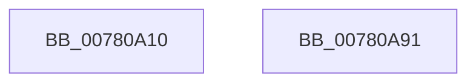

# NtCreateProcess

- RVA: `0x00780A10`–`0x00780A92` (길이 `130` bytes)
- VA: `0x0000000140780A10`
- 실행 섹션: `PAGE`
- PDB 이름 있음: `예`; PDB Function 태그: `아니요`
- unwind 정보 RVA: `0x0008A4C8`
- 디코드: `31`개 명령, `130/130` bytes 표시
- 미해석 바이트: `0` (있으면 어셈블리에 `.byte`로 보존)

> 이 문서는 커널 이미지의 기계어와 PDB 기호를 분석해 생성했습니다. 4번과 5번은 함수 원형과 자료형을 바이너리 사용 방식에서 추정한 C 해석이며 원본 소스 복구 결과는 아닙니다.

## 1. Dependencies

- 직접 호출 지점: **1**; 고유 호출 대상: **1**
- 직접 호출자로 확인된 함수: **0**
- RIP 상대 이미지 참조: **0**

### Outgoing calls
- `0x00780A7C` → [NtCreateProcessEx](NtCreateProcessEx_function_00780AA0.md) (function, `0x00780AA0`)

### Direct callers
- 이 함수 시작 RVA로 연결되는 직접 call은 확인되지 않았습니다. 간접 호출은 완전히 역산할 수 없습니다.

### Static image references
- 디코드된 RIP-relative 메모리 참조가 없습니다.

## 2. Other-region calls and transfers

- 다른 실행 섹션으로 향하는 call: **0**
- 별도 외부 분기/꼬리 이동을 확인하지 못했습니다.

## 3. Assembly (complete function range)

```asm
00780A10  48 89 5C 24 08                  mov qword ptr [rsp + 8], rbx
00780A15  48 89 74 24 10                  mov qword ptr [rsp + 0x10], rsi
00780A1A  57                              push rdi
00780A1B  48 83 EC 50                     sub rsp, 0x50
00780A1F  48 8B BC 24 88 00 00 00         mov rdi, qword ptr [rsp + 0x88]
00780A27  48 8B F1                        mov rsi, rcx
00780A2A  48 8B 9C 24 90 00 00 00         mov rbx, qword ptr [rsp + 0x90]
00780A32  44 8B D7                        mov r10d, edi
00780A35  48 8B 84 24 98 00 00 00         mov rax, qword ptr [rsp + 0x98]
00780A3D  41 83 E2 01                     and r10d, 1
00780A41  45 8B DA                        mov r11d, r10d
00780A44  41 83 CB 02                     or r11d, 2
00780A48  F6 C3 01                        test bl, 1
00780A4B  45 0F 44 DA                     cmove r11d, r10d
00780A4F  41 8B CB                        mov ecx, r11d
00780A52  83 C9 04                        or ecx, 4
00780A55  80 BC 24 80 00 00 00 00         cmp byte ptr [rsp + 0x80], 0
00780A5D  41 0F 44 CB                     cmove ecx, r11d
00780A61  83 64 24 40 00                  and dword ptr [rsp + 0x40], 0
00780A66  48 89 44 24 38                  mov qword ptr [rsp + 0x38], rax
00780A6B  48 89 5C 24 30                  mov qword ptr [rsp + 0x30], rbx
00780A70  48 89 7C 24 28                  mov qword ptr [rsp + 0x28], rdi
00780A75  89 4C 24 20                     mov dword ptr [rsp + 0x20], ecx
00780A79  48 8B CE                        mov rcx, rsi
00780A7C  E8 1F 00 00 00                  call 0x140780aa0
00780A81  48 8B 5C 24 60                  mov rbx, qword ptr [rsp + 0x60]
00780A86  48 8B 74 24 68                  mov rsi, qword ptr [rsp + 0x68]
00780A8B  48 83 C4 50                     add rsp, 0x50
00780A8F  5F                              pop rdi
00780A90  C3                              ret
00780A91  CC                              int3
```

## 4. C-style interpretation (structured pseudocode)

```c
__int64 __fastcall NtCreateProcess(__int64 a1, __int64 a2, __int64 a3, __int64 a4, unsigned __int8 a5, __int64 a6, __int64 a7, __int64 a8)
{
    __int64 result;
    __int64 v_r10;
    __int64 v_r11;
    __int64 v_rsp;
    unsigned int v_stack_m18;
    unsigned __int64 v_stack_m20;
    unsigned __int64 v_stack_m28;
    unsigned __int64 v_stack_m30;
    unsigned int v_stack_m38;
    unsigned __int64 v_stack_p10;
    unsigned __int64 v_stack_p8;

    v_stack_p8 = v_rbx;
    v_stack_p10 = v_rsi;
    v_rsp = (v_rsp) - (80);
    v_r10 = (unsigned int)(((unsigned int)((unsigned int)(a6))) & (1));
    v_r11 = (unsigned int)(((unsigned int)((unsigned int)(v_r10))) | (2));
    if ((((unsigned __int8)(a7)) & (1)) == 0) { v_r11 = (unsigned int)(v_r10); }
    a1 = (unsigned int)(((unsigned int)((unsigned int)(v_r11))) | (4));
    if (a5 == 0) { a1 = (unsigned int)(v_r11); }
    v_stack_m20 = a8;
    v_stack_m28 = a7;
    v_stack_m30 = a6;
    v_stack_m38 = (unsigned int)(a1);
    result = NtCreateProcessEx(a1, a2, a3, a4);
    v_rsp = (v_rsp) + (80);
    return result;
}
```

## 5. (Beta) C Style

```c
int64_t NtCreateProcess(int64_t Arg1, int64_t Arg2, int64_t Arg3, int64_t Arg4, uint8_t Arg5, int64_t Arg6, int64_t Arg7, int64_t Arg8)
{
    int64_t result;
    int64_t local_r10;
    int64_t local_r11;
    int64_t local_rsp;
    uint32_t v_stack_m18;
    uint64_t v_stack_m20;
    uint64_t v_stack_m28;
    uint64_t v_stack_m30;
    uint32_t v_stack_m38;
    uint64_t v_stack_p10;
    uint64_t v_stack_p8;

    v_stack_p8 = local_rbx;
    v_stack_p10 = local_rsi;
    local_rsp = (local_rsp) - (80);
    local_r10 = (uint32_t)(((uint32_t)((uint32_t)(Arg6))) & (1));
    local_r11 = (uint32_t)(((uint32_t)((uint32_t)(local_r10))) | (2));
    if ((((uint8_t)(Arg7)) & (1)) == 0) { local_r11 = (uint32_t)(local_r10); }
    Arg1 = (uint32_t)(((uint32_t)((uint32_t)(local_r11))) | (4));
    if (Arg5 == 0) { Arg1 = (uint32_t)(local_r11); }
    v_stack_m20 = Arg8;
    v_stack_m28 = Arg7;
    v_stack_m30 = Arg6;
    v_stack_m38 = (uint32_t)(Arg1);
    result = NtCreateProcessEx(Arg1, Arg2, Arg3, Arg4);
    local_rsp = (local_rsp) + (80);
    return result;
}
```

## 6. Execution-region graph

[열기: 2D/3D 그래프와 함수 탐색 컨트롤 패널](../../../control-panel.html?section=page&rva=0x00780A10&view=graph)

- 2D 그래프는 위에서 아래로 흐르고, 3D 그래프는 빈 공간을 드래그해 회전합니다. Shift+드래그는 이동, 휠은 확대·축소, 함수 노드 선택은 대상 보고서 이동입니다.

### Static fallback


